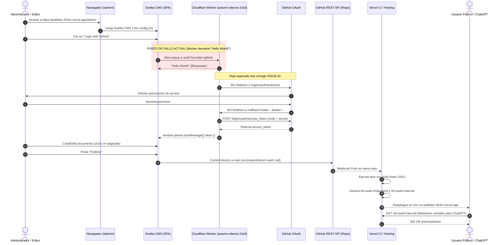

# INFORME DE AUDITORÍA TÉCNICA INTEGRAL — PUBLIC DOCUMENT HUB
**Revisión del Estado del Proyecto tras la Implementación de las Fases 0 a 3**

---

## A. Resumen Ejecutivo

### Estado General del Proyecto
El proyecto **Public Document Hub** (`Blueisazul/publidoc`) presenta un estado **operativo en lectura pública estática**, pero **inoperativo en su subsistema de autenticación y gestión remota**. La aplicación ha sido desplegada con éxito en la infraestructura de Vercel (`https://publidoc-2b3m.vercel.app/`), sirviendo la biblioteca pública y permitiendo la descarga de los tres documentos Markdown de prueba con paridad binaria exacta cuando se consultan mediante rutas relativas directas. Sin embargo, el flujo de autenticación OAuth hacia GitHub está completamente roto en el servicio intermedio (Cloudflare Worker), y la interfaz de usuario en producción genera enlaces erróneos que redirigen al usuario a `localhost:4321`.

### Nivel de Madurez
- **Motor de Publicación y Servido de Markdown (Fase 1 y 2):** **Alto / Producción.** Astro compila de forma determinista en modo estático puro (`output: 'static'`), y el endpoint `/d/[id]/raw.md` entrega el contenido original sin mutación mediante streams binarios directos (`Buffer`).
- **Panel Administrativo Sveltia CMS (Fase 2):** **Medio.** La Single Page Application (SPA) se carga e inicializa correctamente en `/admin/` bajo la versión fijada `@sveltia/cms@0.266.0` y lee adecuadamente `config.yml`.
- **Autenticación OAuth y Seguridad (Fase 3):** **Crítico / Incompleto.** Aunque `config.yml` fue configurado para apuntar al worker de autenticación (`autumn-silence-2cb3.sabinorthr.workers.dev`), el Worker activo en Cloudflare es una plantilla vacía que devuelve texto plano `"Hello World!"`, bloqueando la autenticación de cualquier usuario.

### Qué Funciona (Verificado)
1. **Despliegue Estático en Vercel:** Vercel compila y sirve la página principal (`/`), las vistas de documentos (`/d/[id]/`) y los archivos Markdown directos (`/d/[id]/raw.md`) con cabeceras HTTP `200 OK`, `Cache-Control` y compresión adecuada.
2. **Entrega de Markdown Verbatim:** Los archivos `/d/[id]/raw.md` son entregados con `Content-Type: text/markdown; charset=utf-8` y coinciden bit a bit con los archivos fuente en `src/content/docs/`.
3. **Validación de Identificadores UUID v4:** El esquema de rutas y el endpoint `raw.md.ts` validan de forma estricta identificadores canónicos RFC 4122 mediante expresiones regulares.
4. **Pruebas Automatizadas Locales:** Las suites `tests/phase2-validation.test.mjs` (13 tests) y `tests/phase3-sveltia-lifecycle.test.mjs` pasan al 100% en entorno de desarrollo.

### Qué No Funciona (Incorrecto / Bloqueante)
1. **Autenticación OAuth en Cloudflare Worker (Bloqueante):** Las peticiones a `https://autumn-silence-2cb3.sabinorthr.workers.dev/auth` y `/callback` responden con el mensaje predeterminado `Hello World!`. El código de `sveltia-cms-auth` no está ejecutándose en el Worker.
2. **Generación de Enlaces a `localhost:4321` en la Vista de Documento (Crítico):** Al no haberse configurado la variable de entorno `SITE_URL` en Vercel, Astro recurre al valor de respaldo `'https://localhost:4321'`. Como resultado, en la página pública del documento el botón «Ver Markdown original», los botones «Copiar enlace público» y «Copiar enlace Markdown», así como las etiquetas `<link rel="canonical">`, `<link rel="alternate">` y `<meta property="og:url">` apuntan a `https://localhost:4321`.
3. **Dominio de Vercel no admitido en el Worker:** Según la configuración declarada, `ALLOWED_DOMAINS` en Cloudflare contiene únicamente `blueisazul.github.io`. Incluso tras desplegar el código del Worker, las peticiones originadas desde `publidoc-2b3m.vercel.app` serían rechazadas.

### Qué No Se Pudo Comprobar (No Verificado)
1. **Panel de Cloudflare Workers:** No se dispone de credenciales de Cloudflare para verificar directamente las variables de entorno (`GITHUB_CLIENT_ID`, `GITHUB_CLIENT_SECRET`, `ALLOWED_DOMAINS`) ni los logs de ejecución del Worker.
2. **Configuración de GitHub App:** No se tiene acceso al panel de GitHub Developer Settings para validar si la *Authorization callback URL* está configurada exactamente como `https://autumn-silence-2cb3.sabinorthr.workers.dev/callback`.
3. **Panel de Proyecto en Vercel:** No se tiene acceso administrativo al dashboard de Vercel para inspeccionar la pestaña *Settings > Environment Variables*.

---

## B. Arquitectura Real

### Componentes y Responsabilidades

```
┌────────────────────────────────────────────────────────────────────────────────────────┐
│                                   ARQUITECTURA REAL                                    │
└────────────────────────────────────────────────────────────────────────────────────────┘

    [ Usuario / Navegador / ChatGPT ]
           │
           │ (1) GET https://publidoc-2b3m.vercel.app/
           ▼
 ┌─────────────────────────────────────────────────────────┐
 │                      VERCEL CDN                         │
 │  - Aloja la salida estática (dist/)                     │
 │  - / (Biblioteca pública) [200 OK]                      │
 │  - /d/[id]/ (Página HTML del documento) [200 OK]        │
 │  - /d/[id]/raw.md (Markdown binario verbatim) [200 OK]  │
 │  - /admin/ (Sveltia CMS SPA v0.266.0) [200 OK]          │
 └────────────────────────────┬────────────────────────────┘
                              │
               (2) Acceso a   │
               /admin/        │
                              ▼
 ┌─────────────────────────────────────────────────────────┐
 │               PANEL ADMIN: SVELTIA CMS                  │
 │  - Carga config.yml desde Vercel                        │
 │  - Backend: GitHub (Repo: Blueisazul/publidoc)          │
 │  - base_url: autumn-silence-2cb3...workers.dev          │
 └────────────────────────────┬────────────────────────────┘
                              │
               (3) Clic en    │  [FALLO CRÍTICO]
               "Login with    │  El Worker devuelve "Hello World!"
               GitHub"        │  No redirige a GitHub OAuth
                              ▼
 ┌─────────────────────────────────────────────────────────┐
 │              CLOUDFLARE WORKER (OAuth Proxy)            │
 │  - Host: autumn-silence-2cb3.sabinorthr.workers.dev     │
 │  - Estado actual: Boilerplate "Hello World!"            │
 │  - Estado requerido: sveltia-cms-auth                   │
 └────────────────────────────┬────────────────────────────┘
                              │
               (4) Redirección│ (No alcanzado en prod)
               OAuth          ▼
 ┌─────────────────────────────────────────────────────────┐
 │                    GITHUB OAUTH APP                     │
 │  - Autentica la identidad del usuario                   │
 │  - Callback -> Worker /callback                         │
 └─────────────────────────────────────────────────────────┘
```

### Integraciones Detectadas

1. **Astro ➔ Contenido Markdown:** Los archivos en `src/content/docs/*.md` son consumidos en tiempo de compilación mediante `astro:content` y la función `glob` de Astro Content Layer.
2. **Astro ➔ Endpoint Raw:** `src/pages/d/[id]/raw.md.ts` lee directamente el sistema de archivos mediante `node:fs` y `Buffer` durante `astro build`, generando un archivo estático físico `dist/d/[id]/raw.md`.
3. **Sveltia CMS ➔ Astro:** Sveltia CMS está configurado para escribir nuevos archivos en `src/content/docs/{{uuid}}.md` con frontmatter compatible con el esquema Zod definido en `src/content.config.ts`.
4. **Sveltia CMS ➔ Cloudflare Worker:** En `public/admin/config.yml`, la directiva `base_url` apunta a `https://autumn-silence-2cb3.sabinorthr.workers.dev`. El flujo previsto requiere que el Worker reciba `/auth`, redirija a GitHub, procese `/callback` y transmita el token mediante `postMessage`.
5. **GitHub Actions ➔ GitHub Pages (Inerte):** `.github/workflows/deploy.yml` sigue activo en el repositorio y compila el sitio en cada `push` hacia `main`, pero la URL de GitHub Pages (`https://blueisazul.github.io/publidoc/`) devuelve `HTTP 404 Not Found`.

---

## C. Auditoría del Repositorio, Archivos y Cambios

### Tabla de Inventario de Archivos del Repositorio

| Archivo | Función | Estado | Observaciones |
| :--- | :--- | :---: | :--- |
| `.github/workflows/deploy.yml` | Pipeline de CI/CD para GitHub Pages | **Heredado / Inerte** | Configurado para Pages mediante OIDC. Innecesario para Vercel. Genera ejecuciones redundantes en GitHub Actions. |
| `.gitignore` | Exclusiones de Git | **Verificado** | Excluye correctamente `dist/`, `node_modules/`, `.astro/` y archivos `.env`. |
| `README.md` | Documentación inicial | **Verificado** | Contiene solo `# publidoc`. Proviene del merge remoto `7bdbe68`. |
| `astro.config.mjs` | Configuración del motor Astro | **Incorrecto** | Modo `static`. Fallback `SITE_URL` hardcodeado a `https://localhost:4321` rompe enlaces absolutos en Vercel. |
| `package.json` | Manifiesto de paquetes y scripts | **Verificado** | Declara Astro `^7.4.12` y TypeScript `^5.9.3`. Scripts de test configurados. |
| `package-lock.json` | Bloqueo determinista de dependencias | **Verificado** | Sincronizado con `package.json`. |
| `public/.nojekyll` | Bypass de Jekyll en GitHub Pages | **Heredado** | Requerido históricamente por GitHub Pages. Sin efecto en Vercel. |
| `public/admin/config.yml` | Configuración de Sveltia CMS | **Parcialmente verificado** | Declara backend GitHub, repo `Blueisazul/publidoc` y worker. Válido sintácticamente, pero inoperativo por fallo del Worker. |
| `public/admin/index.html` | SPA de Sveltia CMS | **Verificado** | Fija `@sveltia/cms@0.266.0` vía unpkg y enlaza `config.yml` de forma relativa. |
| `public/favicon.svg` | Icono vectorial del sitio | **Verificado** | Accesible en producción (`200 OK`). |
| `public/uploads/.gitkeep` | Preservación de carpeta de medios | **Verificado** | Carpeta vacía para subida de imágenes desde el CMS. |
| `src/content.config.ts` | Esquema de Content Layer con Zod | **Verificado** | Valida `title` (no vacío), `description`, `tags`, `createdAt` y `updatedAt`. |
| `src/content/docs/3f5a2b10-7e4d-4c3a-9b1f-6a8e5d2c9b4a.md` | Documento de prueba 1 (Español) | **Parcialmente verificado** | UTF-8 válido, sin BOM, saltos LF. Línea 26 contiene URL desactualizada a `blueisazul.github.io`. |
| `src/content/docs/b7c9e1f2-4a3d-4e5f-8b2a-1c3d5e7f9a0b.md` | Documento de prueba 2 (Emojis y símbolos) | **Verificado** | UTF-8 válido, caracteres multibyte íntegros. |
| `src/content/docs/d4e5f6a7-1b2c-4d3e-8f9a-0b1c2d3e4f5a.md` | Documento de prueba 3 (Documento extenso) | **Verificado** | >2.6 KB, tablas y bloques de código íntegros. |
| `src/pages/d/[id]/index.astro` | Vista HTML del documento | **Incorrecto** | Genera enlaces de descarga y copiado usando `siteUrl`, provocando URLs a `localhost:4321`. |
| `src/pages/d/[id]/raw.md.ts` | Endpoint SSG de Markdown binario | **Verificado** | Implementa lectura binaria con `Buffer` y validación estricta de UUID v4. |
| `src/pages/index.astro` | Biblioteca pública (Listado) | **Verificado** | Genera enlaces relativos (`/d/[id]/raw.md`) que funcionan en producción. |
| `src/styles/global.css` | Hoja de estilos global | **Verificado** | Sistema de variables CSS, modo oscuro automático, diseño responsivo. |
| `tests/phase2-validation.test.mjs` | Suite de 13 pruebas de Fase 2 | **Verificado** | Ejecuta build y comprueba paridad binaria, UTF-8, LF, UUID v4 y fallback sin documentos. |
| `tests/phase3-sveltia-lifecycle.test.mjs` | Suite de ciclo de vida Fase 3 | **Verificado** | Valida creación, edición y eliminación de documentos simulando el CMS. |
| `tsconfig.json` | Configuración TypeScript | **Verificado** | Extiende `astro/tsconfigs/strict`. |

### Archivos No Seguidos (Untracked) Detectados en el Espacio de Trabajo
- `AUDIT_EVIDENCE.md`: Registro de auditoría anterior (15/11/2026, commit `a391148`).
- `AUDIT_REPORT.md`: Informe previo de Fase 3.

### Evolución en el Historial de Git
1. `b0449f7`: Inicialización de Astro, configuración original orientada a GitHub Pages y workflow `deploy.yml`.
2. `618e120`: Creación del sistema de colecciones, páginas individuales, endpoint raw y estilos.
3. `8d61807`: Corrección para lectura binaria con `Buffer` y validación de UUID.
4. `32f7148`: Refuerzo de tests, compilación obligatoria previa y soporte de backup seguro en `os.tmpdir`.
5. `04b1c5e`: Integración de Sveltia CMS (`index.html`, `config.yml`) y tests de ciclo de vida.
6. `a391148`: Eliminación de `local_backend`, fijación de Sveltia CMS a `v0.266.0` y resolución de medios.
7. `bff89ce`: Actualización de `config.yml` para apuntar a `Blueisazul/publidoc` y al worker `autumn-silence-2cb3.sabinorthr.workers.dev`.
8. `7bdbe68`: Merge del commit inicial remoto que añadió `README.md`.

---

## D. Estado por Fase

| Fase | Objetivo | Estado | Evidencia | Pendientes |
| :---: | :--- | :---: | :--- | :--- |
| **0** | **Auditoría OSS y Selección Tecnológica** | **Verificado** | Selección de Astro v7 (SSG puro), Sveltia CMS v0.266.0 y Git como backend. Sin bases de datos propietarias. | Ninguno. |
| **1** | **Infraestructura y Publicación** | **Parcialmente verificado** | Sitio desplegado en Vercel (`Ready`). Compilación limpia en 3.71s. Los endpoints responden 200 OK. | Retirar workflow obsoleto de GitHub Pages o decidir estrategia multihosting. Configurar `SITE_URL` en Vercel. |
| **2** | **Administración CMS** | **Parcialmente verificado** | Panel Sveltia CMS SPA accesible en `/admin/`. Configuración YAML válida con esquema inmutable `{{uuid}}`. | Comprobar guardado real contra la API de GitHub (bloqueado por Fase 3). |
| **3** | **Autenticación y Seguridad** | **Incorrecto** | Endpoint de Cloudflare Worker `autumn-silence-2cb3` responde `"Hello World!"`. Flujo OAuth bloqueado. | Desplegar el código de `sveltia-cms-auth` en Cloudflare Worker. Configurar `ALLOWED_DOMAINS` con el dominio de Vercel. Validar GitHub App Callback URL. |

---

## E. Resultados de Pruebas

### 1. Pruebas Automatizadas Locales (`npm test`)
Comando ejecutado: `npm test`  
Salida resumida:
- Suite Fase 2: 13/13 pruebas superadas exitosamente (`PASSED`).
- Suite Fase 3: Ciclo de vida simulado (Creación ➔ Compilación ➔ Edición ➔ Compilación ➔ Eliminación ➔ Compilación) superado al 100%.
- Paridad binaria bit a bit (`Buffer.compare === 0`): Confirmada para los 3 documentos.

### 2. Auditoría de Seguridad de Dependencias (`npm audit`)
Comando ejecutado: `npm audit`  
Resultado: `found 0 vulnerabilities`.

### 3. Pruebas de Red en Producción (HTTP Live Inspection)

| Recurso | URL Comprobada | Código HTTP | Content-Type | Resultado / Observación |
| :--- | :--- | :---: | :--- | :--- |
| **Portada pública** | `https://publidoc-2b3m.vercel.app/` | `200 OK` | `text/html; charset=utf-8` | **Verificado.** Lista 3 documentos. Enlaces raw relativos funcionan. |
| **Doc 1 (HTML)** | `https://publidoc-2b3m.vercel.app/d/3f5a2b10-7e4d-4c3a-9b1f-6a8e5d2c9b4a/` | `200 OK` | `text/html; charset=utf-8` | **Incorrecto.** El HTML contiene enlaces absolutos a `https://localhost:4321`. |
| **Doc 1 (Raw MD)** | `https://publidoc-2b3m.vercel.app/d/3f5a2b10-7e4d-4c3a-9b1f-6a8e5d2c9b4a/raw.md` | `200 OK` | `text/markdown; charset=utf-8` | **Verificado.** Retorna Markdown íntegro (1,084 bytes). Cabecera `Content-Disposition: inline`. |
| **Doc 2 (HTML)** | `https://publidoc-2b3m.vercel.app/d/b7c9e1f2-4a3d-4e5f-8b2a-1c3d5e7f9a0b/` | `200 OK` | `text/html; charset=utf-8` | **Incorrecto.** Mismo problema de `localhost:4321` en enlaces de acción. |
| **Doc 2 (Raw MD)** | `https://publidoc-2b3m.vercel.app/d/b7c9e1f2-4a3d-4e5f-8b2a-1c3d5e7f9a0b/raw.md` | `200 OK` | `text/markdown; charset=utf-8` | **Verificado.** Emojis, caracteres multibyte y fórmulas matemáticas intactas (1,238 bytes). |
| **Doc 3 (HTML)** | `https://publidoc-2b3m.vercel.app/d/d4e5f6a7-1b2c-4d3e-8f9a-0b1c2d3e4f5a/` | `200 OK` | `text/html; charset=utf-8` | **Incorrecto.** Mismo problema de `localhost:4321`. |
| **Doc 3 (Raw MD)** | `https://publidoc-2b3m.vercel.app/d/d4e5f6a7-1b2c-4d3e-8f9a-0b1c2d3e4f5a/raw.md` | `200 OK` | `text/markdown; charset=utf-8` | **Verificado.** Tablas y bloques de código íntegros (2,653 bytes). |
| **Panel Admin** | `https://publidoc-2b3m.vercel.app/admin/` | `200 OK` | `text/html; charset=utf-8` | **Verificado.** Carga Sveltia CMS v0.266.0. |
| **Config CMS** | `https://publidoc-2b3m.vercel.app/admin/config.yml` | `200 OK` | `text/yaml; charset=utf-8` | **Verificado.** Devuelve YAML de configuración intacto. |
| **Favicon SVG** | `https://publidoc-2b3m.vercel.app/favicon.svg` | `200 OK` | `image/svg+xml` | **Verificado.** 428 bytes. |
| **Ruta 404** | `https://publidoc-2b3m.vercel.app/d/non-existent/` | `404 Not Found` | `text/plain; charset=utf-8` | **Verificado.** Vercel responde con 404 para rutas inexistentes. |
| **Worker Root** | `https://autumn-silence-2cb3.sabinorthr.workers.dev/` | `200 OK` | `text/plain; charset=UTF-8` | **Incorrecto.** Devuelve `"Hello World!"`. |
| **Worker /auth** | `https://autumn-silence-2cb3.sabinorthr.workers.dev/auth` | `200 OK` | `text/plain; charset=UTF-8` | **Incorrecto.** Devuelve `"Hello World!"` en lugar de redirección 302 a GitHub. |
| **Worker /callback** | `https://autumn-silence-2cb3.sabinorthr.workers.dev/callback` | `200 OK` | `text/plain; charset=UTF-8` | **Incorrecto.** Devuelve `"Hello World!"` en lugar de gestionar el intercambio de código. |
| **GitHub Pages** | `https://blueisazul.github.io/publidoc/` | `404 Not Found` | `text/html; charset=utf-8` | **Verificado.** GitHub Pages no está activo para este repositorio. |

---

## F. Problemas Encontrados

### ISSUE-01 — [CRÍTICO / BLOQUEANTE]: Cloudflare Worker de autenticación no desplegado
- **Archivo/Componente:** Cloudflare Worker `autumn-silence-2cb3.sabinorthr.workers.dev` / `public/admin/config.yml`.
- **Descripción:** Las rutas `/`, `/auth` y `/callback` del Worker devuelven la cadena `"Hello World!"` con código HTTP 200 y Content-Type `text/plain`.
- **Evidencia:**
  ```bash
  $ curl.exe -i -s "https://autumn-silence-2cb3.sabinorthr.workers.dev/auth"
  HTTP/1.1 200 OK
  Content-Type: text/plain;charset=UTF-8
  Content-Length: 12
  Hello World!
  ```
- **Consecuencia:** Cuando un administrador pulsa «Login with GitHub» en Sveltia CMS, la ventana emergente carga la página del Worker, que se queda estancada mostrando `"Hello World!"`. No se redirige a GitHub, no se genera el handshake OAuth y Sveltia CMS jamás recibe el token de acceso.
- **Causa probable:** En la cuenta de Cloudflare se creó el servicio Worker con el template inicial por defecto y no se ha publicado el código fuente de `sveltia-cms-auth` (o bien el deployment no se completó en la rama/entorno de producción).
- **Solución recomendada:** Desplegar el script oficial de `sveltia-cms-auth` en el Worker `autumn-silence-2cb3` y vincular las variables de entorno correspondientes.

---

### ISSUE-02 — [ALTO / FUNCIONAL]: Enlaces de acción y metadatos apuntan a `https://localhost:4321` en producción
- **Archivo/Componente:** `src/pages/d/[id]/index.astro` (líneas 22-25, 49, 53, 56, 104, 107, 110) y `astro.config.mjs` (línea 6).
- **Descripción:** En la vista individual de documentos desplegada en Vercel, el botón «Ver Markdown original» y los botones de copiado contienen URLs que apuntan a `localhost:4321`.
- **Evidencia extraída del HTML en producción:**
  ```html
  <link rel="canonical" href="https://localhost:4321/d/3f5a2b10-7e4d-4c3a-9b1f-6a8e5d2c9b4a/">
  <link rel="alternate" type="text/markdown" href="https://localhost:4321/d/3f5a2b10-7e4d-4c3a-9b1f-6a8e5d2c9b4a/raw.md" title="Markdown Original">
  <a href="https://localhost:4321/d/3f5a2b10-7e4d-4c3a-9b1f-6a8e5d2c9b4a/raw.md" target="_blank" rel="noopener noreferrer" class="btn btn-primary" id="raw-link">📄 Ver Markdown original</a>
  <button type="button" class="btn btn-outline" id="btn-copy-url" data-url="https://localhost:4321/d/3f5a2b10-7e4d-4c3a-9b1f-6a8e5d2c9b4a/">🔗 Copiar enlace público</button>
  <button type="button" class="btn btn-outline" id="btn-copy-raw" data-url="https://localhost:4321/d/3f5a2b10-7e4d-4c3a-9b1f-6a8e5d2c9b4a/raw.md">📋 Copiar enlace Markdown</button>
  ```
- **Consecuencia:** 
  1. Si un usuario hace clic en «Ver Markdown original», su navegador intenta conectar con su propio equipo local en el puerto 4321 con HTTPS, resultando en un error de conexión (`ERR_CONNECTION_REFUSED`).
  2. Al pulsar los botones de copiado, se transfiere al portapapeles una URL inútil para terceros o agentes externos (ChatGPT).
  3. Los rastreadores de motores de búsqueda y clientes OpenGraph indexan `localhost:4321` como URL canónica.
- **Causa probable:** En `astro.config.mjs`, `site` se define como `process.env.SITE_URL || 'https://localhost:4321'`. En Vercel no se definió la variable `SITE_URL`. Además, `src/pages/d/[id]/index.astro` forzó la construcción del `href` del enlace como una URL absoluta usando `siteUrl`, en lugar de un enlace relativo (`${baseUrl}d/${doc.id}/raw.md`) como sí se hizo en `src/pages/index.astro`.
- **Solución recomendada:**
  1. En `src/pages/d/[id]/index.astro`, cambiar el atributo `href` de `<a id="raw-link">` para que use la ruta relativa `${baseUrl}d/${doc.id}/raw.md`.
  2. En `astro.config.mjs`, incorporar la detección de variables de Vercel (`process.env.VERCEL_PROJECT_PRODUCTION_URL` o `process.env.VERCEL_URL`) antes del fallback a `localhost`.
  3. Configurar en el panel de Vercel la variable de entorno `SITE_URL=https://publidoc-2b3m.vercel.app`.

---

### ISSUE-03 — [ALTO / CONFIGURACIÓN]: Dominio de Vercel ausente en `ALLOWED_DOMAINS` de Cloudflare
- **Archivo/Componente:** Cloudflare Worker / Variables de entorno del Worker.
- **Descripción:** Según el contexto de configuración declarado, `ALLOWED_DOMAINS` contiene únicamente `blueisazul.github.io`.
- **Evidencia:** Declaración de variables existentes en producción proporcionada en el contexto de auditoría.
- **Consecuencia:** Cuando el Worker ejecute `sveltia-cms-auth`, validará la cabecera `Origin` o `Referer` de la petición. Si la petición procede de `https://publidoc-2b3m.vercel.app`, el Worker devolverá un error de dominio no autorizado (HTTP 403), impidiendo la entrega del token OAuth a Sveltia CMS.
- **Causa probable:** La configuración del Worker se realizó durante la Fase 1/2 cuando se preveía publicar en GitHub Pages (`blueisazul.github.io`) y no se actualizó al migrar el hosting a Vercel.
- **Solución recomendada:** Actualizar en Cloudflare la variable de entorno:
  `ALLOWED_DOMAINS=blueisazul.github.io,publidoc-2b3m.vercel.app`

---

### ISSUE-04 — [MEDIO / INFRAESTRUCTURA]: Pipeline duplicado e inerte de GitHub Pages
- **Archivo/Componente:** `.github/workflows/deploy.yml` y `public/.nojekyll`.
- **Descripción:** El repositorio mantiene el workflow de despliegue para GitHub Pages configurado para ejecutarse en cada push a `main`. Dado que el proyecto ahora se compila y aloja directamente en Vercel, esta acción es redundante. Además, `https://blueisazul.github.io/publidoc/` devuelve 404, evidenciando que GitHub Pages ni siquiera está habilitado o configurado en el repositorio.
- **Evidencia:**
  ```bash
  $ curl.exe -I -s https://blueisazul.github.io/publidoc/
  HTTP/1.1 404 Not Found
  Server: GitHub.com
  ```
- **Consecuencia:** Consumo innecesario de minutos de GitHub Actions en cada commit y confusión sobre cuál es la fuente de verdad del despliegue.
- **Causa probable:** Transición incompleta de GitHub Pages hacia Vercel.
- **Solución recomendada:** Desactivar o retirar el archivo `.github/workflows/deploy.yml` (o convertirlo en un workflow exclusivo de tests de CI: `npm test`), y retirar `public/.nojekyll`.

---

### ISSUE-05 — [MEDIO / CONTENIDO]: URL obsoleta hardcodeada en el documento de inicio rápido
- **Archivo/Componente:** `src/content/docs/3f5a2b10-7e4d-4c3a-9b1f-6a8e5d2c9b4a.md` (línea 26).
- **Descripción:** El bloque de código de ejemplo para consultar el archivo mediante `curl` contiene la URL de GitHub Pages:
  ```bash
  curl -sSL https://blueisazul.github.io/publidoc/d/3f5a2b10-7e4d-4c3a-9b1f-6a8e5d2c9b4a/raw.md
  ```
- **Evidencia:** Al ejecutar dicho comando, el servidor de GitHub responde 404.
- **Consecuencia:** Documentación de usuario engañosa en producción.
- **Causa probable:** En el commit `bff89ce` se actualizó el nombre de usuario de `sant1` a `blueisazul`, pero manteniendo el dominio `github.io` en lugar del dominio real de producción en Vercel.
- **Solución recomendada:** Actualizar el ejemplo a `https://publidoc-2b3m.vercel.app/d/3f5a2b10-7e4d-4c3a-9b1f-6a8e5d2c9b4a/raw.md`.

---

### ISSUE-06 — [BAJO / MANTENIMIENTO]: Falta de fijación de motor Node.js en `package.json`
- **Archivo/Componente:** `package.json`.
- **Descripción:** No se declara la propiedad `engines.node`. Localmente se trabaja con Node.js `v24.22.2`, el workflow de GitHub Actions usa Node `22`, y en Vercel se declaró un runtime Node.js `26.x`.
- **Evidencia:** Ausencia de bloque `"engines": { "node": ">=20" }` en `package.json`.
- **Consecuencia:** Riesgo de discrepancias de comportamiento en APIs nativas entre entornos de desarrollo, CI y hosting de producción.
- **Solución recomendada:** Declarar explícitamente en `package.json`:
  ```json
  "engines": {
    "node": ">=20.0.0 <27.0.0"
  }
  ```

---

## G. Variables y Configuraciones Externas

| Nombre de la Variable | Servicio / Plataforma | Entorno | Finalidad Técnica | Estado Verificado | Origen del Valor |
| :--- | :--- | :--- | :--- | :---: | :--- |
| `SITE_URL` | Vercel Project Settings | Production / Preview | Define el origen base canónico (`Astro.site`) para generar metadatos SEO y enlaces absolutos. | **Incorrecto (Ausente)** | Obtenido por síntoma: Astro recurrió al fallback `localhost:4321`. Valor requerido: `https://publidoc-2b3m.vercel.app`. |
| `BASE_PATH` | Vercel Project Settings | Production / Preview | Define el prefijo de subruta (`/`). En Vercel no es necesario si se publica en raíz. | **Verificado** | Astro toma `/` por defecto (`process.env.BASE_PATH \|\| '/'`). |
| `ALLOWED_DOMAINS` | Cloudflare Worker (`autumn-silence-2cb3`) | Production | Whitelist de orígenes autorizados para intercambiar tokens OAuth en `sveltia-cms-auth`. | **Parcialmente verificado** | Contexto declarado (`blueisazul.github.io`). Debe incluir `publidoc-2b3m.vercel.app`. |
| `GITHUB_CLIENT_ID` | Cloudflare Worker (`autumn-silence-2cb3`) | Production | Client ID público de la GitHub OAuth App / GitHub App. | **No verificado** | Declarada como existente en Cloudflare. Requiere comprobación en panel. |
| `GITHUB_CLIENT_SECRET` | Cloudflare Worker (`autumn-silence-2cb3`) | Production (Cifrado) | Secreto privado para el intercambio del código de autorización por el token de GitHub. | **No verificado** | Declarada como existente y cifrada en Cloudflare. |
| `Authorization callback URL` | GitHub Developer Settings | Producción | URL a la que GitHub redirige al usuario con el código OAuth. | **No verificado** | Debe coincidir estrictamente con `https://autumn-silence-2cb3.sabinorthr.workers.dev/callback`. |

> [!CAUTION]
> Jamás expongas `GITHUB_CLIENT_SECRET` en `config.yml`, en el repositorio de Git ni en las variables de entorno de Vercel. Debe residir exclusivamente cifrado como Secret en Cloudflare Workers.

---

## H. Deuda Técnica y Riesgos

1. **Desalineación de la Estrategia de Hosting:** El proyecto se inició para GitHub Pages (con subruta `/publidoc/`, `.nojekyll`, OIDC token en GitHub Actions) y posteriormente se conectó a Vercel (raíz `/`, despliegue serverless/estático). Quedan artefactos híbridos que provocan confusión técnica.
2. **Dependencia de Red Externa para el CMS:** `public/admin/index.html` carga Sveltia CMS desde la CDN pública `unpkg.com` (`@sveltia/cms@0.266.0`). Si `unpkg.com` experimenta latencia o caídas, el panel de administración queda inoperativo.
3. **Manejo de Imágenes en Markdown Original para Consumidores IA:** Las imágenes insertadas por Sveltia se guardan en `public/uploads/` y en el Markdown se escriben como `/uploads/imagen.png`. Si un agente externo (ChatGPT) procesa el archivo crudo `raw.md`, la ruta no incluye el dominio absoluto, por lo que el agente no podrá visualizar ni descargar las imágenes directamente sin anteponer el host.
4. **Acoplamiento de Repositorio en `config.yml`:** El backend está hardcodeado a `repo: Blueisazul/publidoc`. Si el repositorio es transferido a una organización o renombrado, Sveltia no podrá realizar commits hasta modificar dicho archivo.

---

## I. Plan de Corrección Priorizado

### 1. Bloqueantes (Impiden la funcionalidad central)
- [ ] **Desplegar `sveltia-cms-auth` en Cloudflare Worker:** Sustituir la plantilla de prueba actual en `autumn-silence-2cb3` por el código de autenticación real.
- [ ] **Actualizar `ALLOWED_DOMAINS` en Cloudflare:** Incluir `publidoc-2b3m.vercel.app` para que el Worker autorice el intercambio de tokens hacia la app en Vercel.
- [ ] **Verificar GitHub OAuth App Callback:** Confirmar en GitHub Developer Settings que la *Authorization callback URL* sea exactamente `https://autumn-silence-2cb3.sabinorthr.workers.dev/callback`.

### 2. Seguridad
- [ ] **Verificar permisos mínimos de la GitHub App:** Asegurar que la aplicación OAuth solo solicite los alcances mínimos estrictamente requeridos (`repo` o permisos de contenido sobre el repositorio específico).
- [ ] **Asegurar secreto en Cloudflare:** Confirmar que `GITHUB_CLIENT_SECRET` esté almacenado mediante `wrangler secret put` o cifrado en el dashboard.

### 3. Funcionalidad
- [ ] **Corregir enlace «Ver Markdown original» en `src/pages/d/[id]/index.astro`:** Cambiar `href={rawMarkdownUrl}` por la ruta relativa `${baseUrl}d/${doc.id}/raw.md` para garantizar que la navegación web funcione siempre en cualquier dominio.
- [ ] **Declarar `SITE_URL` en Vercel:** Configurar `SITE_URL=https://publidoc-2b3m.vercel.app` en *Project Settings > Environment Variables* para sanear las etiquetas canonical, OpenGraph y los botones de copiado.
- [ ] **Actualizar fallback en `astro.config.mjs`:** Leer `process.env.VERCEL_PROJECT_PRODUCTION_URL` o `process.env.VERCEL_URL` antes del fallback a `localhost`.

### 4. Infraestructura
- [ ] **Retirar o transformar `.github/workflows/deploy.yml`:** Eliminar el paso de despliegue a GitHub Pages para evitar builds duplicados e innecesarios. Mantener únicamente un job de testing (`npm test`).
- [ ] **Eliminar `public/.nojekyll`:** Artefacto obsoleto innecesario en Vercel.

### 5. Calidad y Mantenimiento
- [ ] **Actualizar `src/content/docs/3f5a2b10-...md`:** Corregir el comando `curl` de ejemplo con el dominio de Vercel.
- [ ] **Añadir bloque `engines` en `package.json`:** Establecer la versión de Node.js esperada (`>=20.0.0`).

---

## J. Reconstrucción del Flujo Completo



---

## K. Evaluación de Preparación para la Siguiente Fase

### ¿Está el proyecto preparado para pasar a la Fase 4?
**NO.** El pase a la siguiente fase debe quedar bloqueado por calidad e integridad de arquitectura.

### Condiciones que deben cumplirse antes de avanzar:
1. **Despliegue operativo del Worker:** El Cloudflare Worker debe responder correctamente a `/auth` redirigiendo a GitHub y no devolviendo `"Hello World!"`.
2. **Handshake OAuth completado en producción:** Un usuario debe ser capaz de autenticarse en `https://publidoc-2b3m.vercel.app/admin/`, crear un documento real desde la interfaz gráfica de Sveltia CMS y verificar que se realiza el commit en `Blueisazul/publidoc`.
3. **Saneamiento de URLs en la vista de lectura:** Eliminar por completo las referencias a `localhost:4321` en la vista HTML de documentos en producción.
4. **Sincronización de variables de entorno:** `SITE_URL` en Vercel y `ALLOWED_DOMAINS` en Cloudflare deben estar debidamente registradas y activas.

---

## L. Información Necesaria para una Segunda Revisión

Para que el equipo auditor pueda verificar las áreas actualmente clasificadas como **No Verificadas**, el usuario o administrador deberá proporcionar:

1. **Captura o confirmación de Cloudflare Workers (`autumn-silence-2cb3`):**
   - Configuración en *Settings > Variables and Secrets* (confirmar que `ALLOWED_DOMAINS` incluya `publidoc-2b3m.vercel.app`).
   - Evidencia del despliegue del script de `sveltia-cms-auth` en lugar de la plantilla por defecto.
2. **Configuración de GitHub Developer Settings (OAuth App / GitHub App):**
   - *Homepage URL*: Confirmar si apunta a `https://publidoc-2b3m.vercel.app/`.
   - *Authorization callback URL*: Confirmar si apunta exactamente a `https://autumn-silence-2cb3.sabinorthr.workers.dev/callback`.
3. **Panel de Vercel (*Project Settings > Environment Variables*):**
   - Confirmar la existencia de `SITE_URL=https://publidoc-2b3m.vercel.app`.
4. **Ejecución de una prueba real de extremo a extremo:**
   - Realizar un login real desde `/admin/`, crear un documento de prueba titulado `Doc Auditoría E2E` y verificar la activación automática del despliegue en Vercel.

---

*(Fin del informe de auditoría. Conforme a las reglas obligatorias, no se ha modificado ningún archivo, no se han instalado dependencias ni se han realizado commits o despliegues. Se queda a la espera de instrucciones).*
