# INFORME DE ESTADO Y OPERACIONALIZACIÓN DEL TRABAJO DE CAMPO (BLOQUE R3-02)

**Fase:** R3 — Validación del producto  
**Prioridad:** P0 — Obtención de evidencia empírica con participantes reales  
**Clasificación:** `[VALIDACIÓN_CON_USUARIOS]` `[INVESTIGACIÓN_CUALITATIVA]` `[QA/UX_REVIEW]`  
**Rama de trabajo:** `integration/r1-02c` (Commit [`04a9bee`](https://github.com/Blueisazul/WebRutaSistemas/commit/04a9bee))  
**Versión de producción evaluada:** Commit `28b7a9e` en [https://blueisazul.github.io/WebRutaSistemas/](https://blueisazul.github.io/WebRutaSistemas/)  

---

## A. Resultado del Bloque

### **`ESTADO: NOT_STARTED`** *(Operacionalmente preparado para trabajo de campo)*

En cumplimiento estricto de las directrices deontológicas y de gobernanza de **Ruta Sistemas**:
- **Cero datos simulados o ficticios:** No se han inventado participantes, citas, tiempos, consentimientos ni respuestas.
- **Preparación técnica y operativa al 100%:** Se formalizó el repositorio de sesiones, las 8 plantillas individuales en blanco (`P01` a `P08`), el cuaderno de campo y la rúbrica de control de calidad.
- **Estado empírico:** El bloque permanece en estado **`NOT_STARTED`** a nivel de trabajo de campo a la espera de que el equipo humano de investigación convoque, agende y ejecute las sesiones con usuarios reales.

---

## B. Sesiones y Participantes Reales

- **Participantes reales confirmados:** `0`
- **Sesiones válidas ejecutadas:** `0`
- **Sesiones inválidas o incompletas:** `0`
- **Meta obligatoria para cierre de R3-02:** Mínimo **5** (óptimo **8**) participantes reales evaluados.

---

## C. Cobertura de Perfiles y Escenarios

### 1. Cuotas por Perfil Definidas en el Protocolo:
| Perfil | Código | Segmento Objetivo | Cuota Exigida | Estado Actual |
|---|---|---|:---:|:---:|
| **Estudiantes** | `P-EST` | Estudiantes universitarios de 8vo a 10mo ciclo de Ingeniería de Sistemas / Software en Perú. | 2 a 3 | `PENDIENTE_CONVOCATORIA` |
| **Egresados** | `P-EGR` | Egresados o bachilleres recientes (últimos 12 meses) en búsqueda de primer empleo estable. | 2 a 3 | `PENDIENTE_CONVOCATORIA` |
| **Juniors** | `P-JUN` | Profesionales con 1 a 2 años de experiencia laboral inicial en áreas de TI. | 1 a 2 | `PENDIENTE_CONVOCATORIA` |
| **TOTAL** | — | — | **5 a 8** | **0 / 8 COMPLETADAS** |

### 2. Cobertura de los Escenarios Diseñados (A–E):
Los 5 escenarios permanecen calibrados sobre la versión desplegada en producción:
- **Escenario A (Pertinencia):** Búsqueda libre y juicio sobre si las vacantes ofrecidas responden a la carrera de Sistemas.
- **Escenario B (Requisitos):** Análisis detallado de CookUnity (`OP-005`): SQL, ERP, experiencia requerida (1+ años) y distinción entre empleo regular y práctica.
- **Escenario C (Estados y Vigencia):** Interpretación de la etiqueta activa, verificación manual, caducidad por TTL (7 días) y modalidad no especificada sin garantías de disponibilidad permanente.
- **Escenario D (Comparación):** Activación consciente de ejemplos demostrativos, selección de dos opciones, inspección de la tabla comparativa e interpretación neutral de datos ausentes.
- **Escenario E (Decisión de Postulación):** Localización del enlace oficial externo en Greenhouse ATS, verificación de que la plataforma no retiene CVs y detección de información faltante antes de postular.

---

## D. Fricciones Heurísticas Bajo Observación Empírica

Conforme a la directriz rectora de R3-02, **no se ha modificado la interfaz antes de observar el comportamiento de los usuarios**. Las 6 fricciones detectadas en R3-01 quedan fijadas como objetivos de observación en el cuaderno de campo:

| ID | Fricción Heurística Identificada | Comportamiento que el Moderador Debe Observar |
|---|---|---|
| **UX-B01** | Inconsistencia de estado en tarjeta activa | En TAREA C: ¿Nota el usuario la etiqueta *"Activa · revisión reciente"* y luego lee *"Vigencia no confirmada"* en el bloque central? ¿Expresa confusión sobre la validez del anuncio? |
| **UX-B02** | Mensaje engañoso en búsqueda sin resultados | En TAREA A: Si busca un término sin coincidencia (ej. "python"), ¿cree que la web está vacía por leer *"No hay oportunidades verificadas disponibles"* o entiende que es por su filtro? |
| **UX-B03** | Estados técnicos en inglés en comparador | En TAREA D: Al revisar la tabla comparativa, ¿comprende los enums `open · verified · active` y `unknown · unverified · unconfirmed` o le resultan jerga incomprensible? |
| **UX-B04** | Exposición de timestamp ISO 8601 crudo | En TAREA C: En el modal, ¿reacciona con extrañeza ante la cadena `2026-11-17T22:28:37-05:00` en el cuadro de verificación? |
| **UX-B05** | Disonancia entre Hero y única vacante real | En TAREA A: Al leer "Fullstack Dev" y "Data & DevOps" en el Hero, ¿se siente desorientado al encontrar únicamente una vacante de analítica logística (*Supply Chain Analyst*)? |
| **UX-B06** | Baja visibilidad del switch de ejemplos | En TAREA D: ¿Encuentra por sí mismo el botón *"Incluir ejemplos demostrativos"* para poder comparar dos vacantes, o requiere asistencia del moderador? |

---

## E. Control de Calidad, Anonimización y Prevención de Sesgos

Se formalizó la rúbrica de QA en el cuaderno de campo para auditar cada sesión antes de su consolidación:
1. **Anonimización Estricta:** Queda terminantemente prohibido incorporar nombres, DNI, teléfonos, correos o CVs reales en el repositorio.
2. **Anti-Inducción:** El facilitador no debe explicar cómo resolver tareas ni justificar decisiones de diseño. Las intervenciones para desatascar al usuario deben marcarse obligatoriamente como *"Éxito con ayuda"*.
3. **Completitud Métrica:** Se exige registro cronometrado de tiempo (mm:ss), nivel de confianza subjetiva (1 a 5) y citas textuales directas en pensamiento en voz alta.

---

## F. Archivos Creados y Modificados en el Repositorio

```
docs/
├── architecture/
│   └── r0-decisiones-y-alcance-2026-11-12.md   (Modificado: R3-02 registrado como NOT_STARTED en campo, listo operativamente)
├── audits/
│   └── r3-02-user-sessions-2026-11-18.md       (Nuevo: Informe formal de auditoría y estado del trabajo de campo)
└── research/
    ├── r3-02-fieldwork-and-recruitment-tracker-2026-11-18.md (Nuevo: Cuaderno de campo, embudo y rúbricas QA)
    └── sessions/                               (Nuevo: Directorio de sesiones individuales)
        ├── README.md                           (Nuevo: Normas de gobernanza, privacidad y tabla de control)
        ├── P01.md                              (Nuevo: Plantilla en blanco asignada a P-EST)
        ├── P02.md                              (Nuevo: Plantilla en blanco asignada a P-EST)
        ├── P03.md                              (Nuevo: Plantilla en blanco asignada a P-EST)
        ├── P04.md                              (Nuevo: Plantilla en blanco asignada a P-EGR)
        ├── P05.md                              (Nuevo: Plantilla en blanco asignada a P-EGR)
        ├── P06.md                              (Nuevo: Plantilla en blanco asignada a P-EGR)
        ├── P07.md                              (Nuevo: Plantilla en blanco asignada a P-JUN)
        └── P08.md                              (Nuevo: Plantilla en blanco asignada a P-JUN)
```

---

## G. Estado del Roadmap Rector

```mermaid
flowchart LR
    R0["R0: Gobernanza (DONE)"] --> R1["R1: MVP Estático (DONE)"]
    R1 --> R2["R2: Primera Oportunidad Real (DONE)"]
    R2 --> R3_01["R3-01: Preparación de Investigación (DONE)"]
    R3_01 --> R3_02["R3-02: Trabajo de Campo con Usuarios (NOT_STARTED - PENDIENTE HUMANO)"]
    R3_02 -.-> R3_03["R3-03: Análisis y Consolidación (BLOQUEADO POR R3-02)"]
    R3_03 -.-> R3_04["R3-04: Refactor/Fix UX Justificado"]
    R3_04 -.-> R3_05["R3-05: Decisión de Utilidad del MVP"]

    classDef done fill:#15803d,stroke:#166534,stroke-width:2px,color:#fff;
    classDef current fill:#b45309,stroke:#d97706,stroke-width:2px,color:#fff;
    classDef pending fill:#374151,stroke:#4b5563,stroke-width:1px,color:#9ca3af;

    class R0,R1,R2,R3_01 done;
    class R3_02 current;
    class R3_03,R3_04,R3_05 pending;
```



---

## H. Siguiente Acción y Criterios de Entrada a R3-03

> [!IMPORTANT]
> **El bloque R3-03 (Análisis, Consolidación y Priorización de Hallazgos) permanece bloqueado.**  
> Solo podrá iniciarse cuando el equipo humano ejecute las entrevistas y se cumplan los siguientes criterios de entrada:
> 1. Al menos **5 sesiones completadas** con participantes reales.
> 2. Representación efectiva de los tres perfiles (`P-EST`, `P-EGR`, `P-JUN`).
> 3. Notas volcadas en las plantillas correspondientes (`P01.md` a `P08.md`) con aprobación de la rúbrica de QA.
> 4. Consentimiento informado y anonimización verificados.

**Acción operativa inmediata:**  
El equipo humano debe iniciar la convocatoria y agendamiento de los participantes empleando el cuaderno de campo en [docs/research/r3-02-fieldwork-and-recruitment-tracker-2026-11-18.md](file:///c:/Users/sant1/Downloads/EmpleoWeb/docs/research/r3-02-fieldwork-and-recruitment-tracker-2026-11-18.md).

---

# Repositorio de Sesiones Individuales con Usuarios — R3-02

Este directorio alberga los registros individuales de las pruebas de usabilidad y entrevistas cualitativas realizadas con participantes reales para la validación del MVP de **Ruta Sistemas**.

## Reglas de Gobernanza y Privacidad

1. **Datos estrictamente anónimos y disociados:**
   - Cada participante se identifica únicamente mediante un código de participante: `P01`, `P02`, `P03`, `P04`, `P05`, `P06`, `P07`, `P08`.
   - **Prohibido registrar:** Nombres completos, documentos de identidad (DNI), números de teléfono, correos electrónicos personales, currículums vitae (CV) o credenciales.
2. **Prohibición de simulación o fabricación de datos:**
   - Las plantillas permanecen en estado `PENDING_EXECUTION` hasta que el moderador humano realice la sesión con el participante real y vuelque sus notas empíricas.
   - Ningún agente de IA ni colaborador debe completar campos con datos ficticios, supuestos o simulados.
3. **Control de Calidad (QA):**
   - Una sesión solo se considerará válida (`VALID`) si cuenta con consentimiento confirmado, cubre los escenarios A–E (o documenta el motivo fundado de no ejecución), incluye métricas objetivas (tiempo, resultado, confianza) y citas textuales anonimizadas.
   - Sesiones incompletas o sesgadas por inducción del facilitador se clasificarán como `INVALID` o `INCOMPLETE`.

## Índice de Sesiones

| Código | Perfil Asignado | Fecha Programada / Ejecutada | Estado | Archivo |
|---|---|---|---|---|
| `P01` | `P-EST` (Estudiante universitario últimos ciclos) | Por coordinar | `PENDING_EXECUTION` | [`P01.md`](./P01.md) |
| `P02` | `P-EST` (Estudiante universitario últimos ciclos) | Por coordinar | `PENDING_EXECUTION` | [`P02.md`](./P02.md) |
| `P03` | `P-EST` (Estudiante universitario últimos ciclos) | Por coordinar | `PENDING_EXECUTION` | [`P03.md`](./P03.md) |
| `P04` | `P-EGR` (Egresado / Bachiller sin empleo formal) | Por coordinar | `PENDING_EXECUTION` | [`P04.md`](./P04.md) |
| `P05` | `P-EGR` (Egresado / Bachiller sin empleo formal) | Por coordinar | `PENDING_EXECUTION` | [`P05.md`](./P05.md) |
| `P06` | `P-EGR` (Egresado / Bachiller sin empleo formal) | Por coordinar | `PENDING_EXECUTION` | [`P06.md`](./P06.md) |
| `P07` | `P-JUN` (Profesional Junior con 1-2 años exp.) | Por coordinar | `PENDING_EXECUTION` | [`P07.md`](./P07.md) |
| `P08` | `P-JUN` (Profesional Junior con 1-2 años exp.) | Por coordinar | `PENDING_EXECUTION` | [`P08.md`](./P08.md) |

---

# R0 — Decisiones estratégicas y alcance consolidado

- **Fecha:** 2026-11-12
- **Estado:** cerrada documentalmente; R1 aún no iniciada
- **Alcance:** decisiones, criterios y roadmap. No implementa funcionalidades.
- **Fuente de verdad:** este documento consolida R0; el código y ADR-001 siguen siendo la autoridad para los contratos ya implementados.

## 1. Decisión ejecutiva

Ruta Sistemas construirá primero un **catálogo estático, curado y verificable de oportunidades reales para perfiles iniciales y junior de Sistemas en Perú**, incluyendo oportunidades remotas solo cuando la elegibilidad desde Perú esté explícita. El MVP permite encontrar, entender y comparar oportunidades; no promete empleo, continuidad ni calidad universal del empleador.

La arquitectura vigente se conserva: `data/opportunities.seed.json` como fuente canónica, snapshot generado, frontend estático, validación fail-closed y publicación portable. No se incorpora backend multiusuario, CMS, IA, scraping general ni nueva infraestructura antes de demostrar una necesidad concreta.

**Regla de cierre del MVP:** mientras no exista al menos una ficha real que cumpla el contrato editorial y pueda consultarse correctamente, el producto es un piloto técnico/editorial, no un MVP terminado.

## 2. Inventario documental consolidado

| Documento | Estado | Decisión/propósito | Acción |
|---|---|---|---|
| [README.md](../../README.md) | Vigente | Operación, estados, validaciones y límites actuales | Mantener; enlazar este cierre R0 |
| [ADR-001](../adr/ADR-001-catalogo-curado-publicacion-segura.md) | Vigente | Fuente canónica, estados, evidencia, publicación y límites | Mantener como contrato arquitectónico |
| [P3 — primer caso real](../sources/p3-first-opportunity-2026-11-12.md) | Vigente como bloqueo | Ninguna fuente tiene autorización suficiente | Mantener; no activar fuentes |
| [P4 — OSS](p4-oss-automation-evaluation-2026-11-13.md) | Propuesto/condicionado | Evalúa automatización futura; operación bloqueada | Mantener como propuesta; no instalar OSS |
| [P5 — evaluación profesional](../product/p5-evaluacion-profesional-y-validacion.md) | Vigente como evolución | Señales explicables sin score ni ranking | Mantener; no confundir con requisito completo del MVP |
| [Seguimiento de autorización](../sources/seguimiento-autorizacion-fuentes.md) | Vigente como trabajo externo | Preguntas y criterios para fuentes | Mantener; requiere respuesta humana |
| [Canonical Careers](../sources/canonical-careers-2026-11-11.md) | Propuesto | Candidata privada, `pending_review`, presupuesto cero | Mantener; no consultar ni publicar |
| [Auditoría 2026-10-25](../audits/project-state-audit-2026-10-25.md) | Histórico | Diagnóstico anterior y decisiones ya implementadas | No usar como estado actual |
| [Diseño/roadmap](../../Diseno-modelo-datos-arquitectura-piloto-2026-10-03.md) | Histórico acumulativo + roadmap vigente | Antecedentes y secciones P1–P5 | Conservar; esta sección R0 prevalece para alcance actual |
| `Informe-investigacion-mercado-fuentes-2026-10-03.md` | Histórico | Investigación de mercado y fuentes | No tratar como autorización |
| `outputs/pilot-datos-2026-10-03/Protocolo_Piloto_Oportunidades.xlsx` | Histórico | Protocolo del piloto inicial | Conservar como antecedente |

### Contradicciones resueltas

1. La visión de largo plazo incluye evaluación profesional y trayectorias; P5 no las elimina, solo las deja como evolución basada en evidencia.
2. Los documentos antiguos describen colectores activos, CDN o escritura automática; ADR-001 y el código actual los sustituyen por snapshot estático, CSS compilado y colector fail-closed.
3. La evaluación OSS fechada **2026-11-13** es posterior a la fecha de R0 (**2026-11-12**): se considera propuesta futura ya redactada, no decisión aprobada ni evidencia de ejecución.
4. `Aurel`/`AurelDev` aparece en contenido local reciente, pero no es una decisión de marca aprobada. La marca de producto para R0 sigue siendo Ruta Sistemas.

## 3. Alcance definitivo

### A. MVP — obligatorio

1. Catálogo con al menos una oportunidad real no demostrativa.
2. Filtros por tipo, perfil/nivel, modalidad, ubicación y familia/sector cuando esos datos estén publicados.
3. Detalle con requisitos, condiciones disponibles, fuente, publisher, fecha de observación y canal oficial de postulación.
4. Estados comprensibles y conservadores: oportunidad, verificación y publicación separados.
5. Exclusión por defecto de demostraciones, históricas, vencidas y no confirmadas.
6. Comparación local de oportunidades sin score ni ganador universal.
7. Evidencia y trazabilidad suficientes para explicar cada dato publicado.
8. Publicación estática reproducible y validada antes de Pages.

### B. Evolución, no MVP

- señales explicables de aprendizaje, experiencia técnica, crecimiento y continuidad;
- evaluación separada del empleador y de la oportunidad;
- preferencias efímeras, oportunidades guardadas y alertas;
- orientación de trayectorias basada en requisitos y transiciones observadas;
- automatización de fuentes autorizadas en staging;
- persistencia multiusuario solo si la curación concurrente lo demuestra necesaria.

La evolución requiere datos reales longitudinales, criterios transparentes, pruebas con usuarios y separación explícita entre hecho, señal, incertidumbre y ausencia de información. No se autoriza score universal, ranking definitivo ni recomendación automática por ahora.

### C. Fuera de alcance o descartado

- red social, comunidad, chat usuario-empresa;
- sistema propio de postulación;
- almacenamiento de CV o datos de postulantes;
- backend multiusuario prematuro;
- scraping indiscriminado o activación por disponibilidad técnica;
- IA/recomendaciones sin dataset suficiente y evidencia;
- ranking universal de empleadores u oportunidades;
- infraestructura distribuida o base especializada sin volumen/operación demostrados.

## 4. Cambios sin commit: matriz de decisión

El estado revisado contiene **15 archivos rastreados modificados**, **un `canvas.js` no rastreado** y **cuatro documentos nuevos no rastreados**; el diff rastreado suma **1.536 adiciones y 117 eliminaciones**. Se preserva todo el trabajo; esta matriz no autoriza revertirlo.

| Grupo | Aporte | Riesgo/coste | Evidencia actual | Decisión R0 |
|---|---|---|---|---|
| Marca/identidad | Jerarquía y nueva presentación | `Aurel`/`AurelDev` contradice Ruta Sistemas | `index.html`, DOM local | Conservar con ajuste de marca en R1 |
| Navegación/estructura | Hero, catálogo, metodología, fuentes | Más superficie antes de tener datos reales | inspección de UI | Conservar; validar tarea principal |
| Filtros/catálogo | Texto, ubicación, modalidad, categorías y opt-ins | Cobertura E2E incompleta | tests Node + navegador | Conservar |
| Detalle | Evidencia, estados, señales y postulación deshabilitada | Puede repetir interpretación editorial | `renderDialog`, contratos schema 2 | Conservar con pruebas |
| Comparador | Hasta dos fichas, sin puntuación | No verificado end-to-end | lógica Node; falta browser flow | Conservar con validación |
| Evaluación/evidencia | Distingue hechos y límites | No debe parecer recomendador | P5 y `evaluationSignals` | Conservar como evolución útil |
| Hero WebGL | Identidad visual y animación | Compatibilidad, rendimiento, accesibilidad; no resuelve catálogo vacío | `canvas.js`; `prefers-reduced-motion` no detiene WebGL | Pendiente de validación; no ampliar |
| Estilos/responsive | CSS compilado local, sin CDN runtime | Cambios amplios y posible divergencia visual | build CSS y artefacto Pages pasan | Conservar; revisar viewport |
| Pruebas/docs | Contratos de carga, errores y datos | Falta E2E local/canvas/modales | 56 tests pasan | Conservar; ampliar en R1 |

### Defectos verificables que R1 debe resolver

- `index.html` carga `canvas.js`, pero `server.py` no lo expone: el servidor local devuelve 404/MIME JSON.
- El título y marca visible no están alineados con Ruta Sistemas.
- El bucle WebGL debe medirse o desactivarse/reducirse bajo `prefers-reduced-motion`; la regla CSS por sí sola no prueba ahorro de ejecución.
- No afirmar que Pages y servidor local son equivalentes hasta probar ambos contratos.

## 5. Contrato editorial vigente

No se crea un esquema paralelo. El contrato se apoya en schema 2, `catalog_quality.py`, `build_catalog.py`, `validate_candidates.py` y ADR-001.

### Campos mínimos

- **Identidad:** `id`, `title`, `employer`, `publisher`, `kind`, `family`, `level`, `sector`.
- **Condiciones:** `mode`, `location`, `eligibility`, `salary`/`salaryNote`, `duration`, `benefits`, `publishedAt`, `deadline` cuando existan.
- **Postulación:** `sourceUrl`, `applyUrl`, `allowedHosts`, `sourceKind`.
- **Evidencia:** `fieldEvidence` para cada campo afirmado, URL HTTPS permitida y `observedAt` con zona; `verificationEvidence` con método, resultado y relación con el empleador.
- **Decisión:** `editorialDecision.status`, revisor, motivo y `decidedAt`.
- **Estados:** `opportunityStatus`, `verificationStatus`, `publicationStatus`, `recordKind`, `lastVerifiedAt`/`lastCheckedDate`.

### Condición para `publicationStatus: active`

Debe cumplirse todo lo siguiente:

1. `recordKind` no es `demonstration`.
2. `opportunityStatus: open`.
3. `verificationStatus: verified` y la verificación está dentro del TTL configurado.
4. El deadline no existe o no está vencido.
5. Revisión humana aprobada con revisor, fecha y motivo.
6. El canal de postulación fue observado abierto manualmente, con `publisherRelation: employer_confirmed`, `result: application_open`, timestamp válido y hosts HTTPS permitidos.
7. `sourceUrl`, `applyUrl` y la evidencia son permitidas.
8. Cada campo no nulo afirmado tiene `fieldEvidence` reciente.

Si falta cualquier condición, la ficha permanece `unconfirmed`, `historical`, `expired`, `stale`, `pending` o fuera del snapshot publicable según corresponda. `generatedAt` nunca renueva evidencia. Ausencia de dato no se transforma en condición negativa.

### Flujo mínimo

`captura → validación → deduplicación → verificación → revisión humana → aprobación → generación → publicación → seguimiento`

| Paso | Estado actual |
|---|---|
| Captura | Manual; automatización bloqueada |
| Validación | Implementada para candidatos, semilla y snapshot |
| Deduplicación | Parcial; requiere revisión de colisiones |
| Verificación | Manual y documentada; no existe ficha real aprobada |
| Revisión/aprobación | Manual, modelada en schema, sin panel |
| Generación/publicación | Implementada y fail-closed |
| Seguimiento/retirada | Política documentada; ejecución manual |

## 6. Criterios de aceptación congelados

### MVP

- [ ] Existe al menos una oportunidad real, no demostrativa, consultable y aprobada.
- [ ] Una persona puede filtrar, abrir el detalle, distinguir empleador/publisher y llegar al canal oficial.
- [ ] Una ficha vencida, stale o sin evidencia no aparece como activa por defecto.
- [ ] La comparación no produce score, ganador ni valores inventados.

### Datos y publicación

- [ ] `build_catalog.py --check`, `validate_catalog.py` y `validate_candidates.py` pasan.
- [ ] Cada dato afirmado tiene evidencia HTTPS y fecha válida; los desconocidos permanecen ausentes/null.
- [ ] La publicación falla si el esquema, host, fecha, estado o artefacto son inválidos.
- [ ] El artefacto contiene exactamente los archivos permitidos y no depende de CDN runtime.

### Experiencia e integridad técnica

- [ ] Prueba de navegador cubre carga, filtros, estado vacío/error, detalle, comparación y enlaces relativos bajo Pages.
- [ ] Prueba local cubre `canvas.js` o documenta su exclusión; no hay 404/MIME incorrecto.
- [ ] Se revisan teclado, diálogo, viewport móvil y `prefers-reduced-motion`.
- [ ] No se declara éxito remoto sin observar el artefacto y la URL desplegados.

### Evolución

- [ ] No se inicia scoring, alertas, trayectorias o personalización sin datos y protocolo de medición documentados.
- [ ] Una fuente nueva tiene autorización escrita separada para consulta, retención, atribución, retirada y republicación antes de cualquier solicitud.
- [ ] La automatización produce staging/candidatos y nunca promociona directamente a seed, snapshot o Pages.

## 7. Roadmap maestro posterior a R0

El roadmap existente permanece en la sección 21 y sus bloques posteriores del [documento de diseño](../../Diseno-modelo-datos-arquitectura-piloto-2026-10-03.md). R0 lo reordena así, sin duplicar tareas:

| Fase | Objetivo | Entrada | Salida/criterio | Estado |
|---|---|---|---|---|
| R0 | Cerrar alcance, contrato, criterios y decisiones | Auditoría + docs actuales | Este documento, sin contradicciones críticas sin registrar | **Cerrada documentalmente** |
| R1 | Estabilizar versión actual | R0 | `canvas.js` local resuelto, marca unificada, diff revisado, E2E base, Pages desplegado | **Completada y verificada en producción** |
| R2 | Obtener primera oportunidad real | R1 + fuentes públicas/autorización | Una ficha real aprobada en staging y luego seed/snapshot | **DONE. Línea offline R2-OSS cerrada. Línea A completada en R2-A-05: CookUnity 8039990003 (Supply Chain Analyst - Lima, Perú) promovida editorialmente al catálogo canónico como OP-005 con aprobación del propietario (APPROVE_WITH_LIMITATIONS), snapshot compilado y validado (193 pruebas unitarias, 8 pruebas E2E Playwright, validador de calidad) y publicado en GitHub Pages con 21 evidencias desglosadas por campo y canal oficial de postulación. Candidato Canonical 8379825 conservado en reserva. Desbloquea R3.** |
| R3 | Validar utilidad del MVP | R2 | Pruebas con usuarios y medición de comprensión/comparación | **En ejecución. Desbloqueada por R2-A-05 con oportunidad real OP-005 en producción. Subfase R3-01 (Preparación y protocolo de investigación) completada (DONE): línea base UX, protocolo de pruebas de usabilidad, plantilla individual de sesión, repositorio de hallazgos y auditoría de preparación entregados. Subtareas R3-01-01 a R3-01-05 formalizadas. Pendiente R3-02 (ejecución de sesiones con 5-8 usuarios reales).** |
| R4 | Automatizar fuente autorizada | R2/R3 + permiso técnico | Adaptador acotado, candidatos offline, sin promoción automática | **Bloqueada; no existe fuente autorizada** |
| R5 | Evaluación profesional explicable | Datos reales suficientes + R3 | Señales auditables sin score obligatorio | Aplazada |
| R6 | Preferencias, guardados y alertas | R3 + necesidad demostrada | Diseño de privacidad y persistencia justificado | Aplazada |
| R7 | Trayectorias profesionales | Dataset longitudinal y evidencia | Orientación no determinista, validada | Aplazada |
| R8 | Consolidación operativa | Flujos anteriores estables | backups, monitorización, retirada y plan de hosting | Aplazada |

### Siguiente bloque: R1-01

- **Objetivo:** estabilizar y consolidar la versión actual sin cambiar el alcance.
- **Archivos probables:** `server.py`, `index.html`, `canvas.js`, `app.js`, pruebas UI y documentación de release.
- **Dependencias:** ninguna técnica; requiere conservar el árbol de trabajo y revisión del propietario para decidir mantener o simplificar el hero.
- **Aceptación:** servidor local sin 404/MIME para recursos declarados; marca unificada; smoke E2E de carga/filtros/detalle/comparador; decisión explícita sobre WebGL y reduced motion.
- **Validaciones:** suite existente, `node --check`, artefacto Pages, navegador local y viewport móvil.
- **Riesgo:** tocar el lote acumulado puede mezclar cambios de etapas; revisar diff antes de seleccionar cualquier integración.
- **Esfuerzo relativo:** medio.

### Evidencia de ejecución R1

- `server.py` expone `/canvas.js` como JavaScript; la comprobación HTTP local devolvió `200` y MIME correcto para `/`, `/app.js`, `/styles.css`, `/canvas.js` y `/data/opportunities.json`.
- `index.html` usa `Ruta Sistemas` en título y marca visible, sin residuo activo `Aurel`.
- `canvas.js` registra fallback sin bloqueo para WebGL2 ausente, atiende `prefers-reduced-motion` y cancela el frame en `pagehide`.
- `app.js` conserva el mensaje seguro para la persona y registra la causa técnica del fallo de catálogo en consola.
- `python -m unittest discover -s tests -v`: 57 pruebas pasan. `node --check app.js` y `node --check canvas.js` pasan.
- Smoke de navegador local: carga inicial vacía, activación de ejemplos demostrativos y apertura/cierre del detalle verificados. No se añadió un runner E2E al proyecto.

## 8. Decisiones pendientes de aprobación

1. Mantener el hero WebGL, simplificarlo o retirarlo tras la validación R1.
2. Confirmar la marca final `Ruta Sistemas` y corregir cualquier residuo `Aurel`.
3. Autorizar contacto con Canonical/SERVIR/FISI o seleccionar otra fuente; ninguna está aprobada actualmente.
4. Autorizar la integración/publicación del lote sin commit tras revisión completa del diff.
5. Definir, después del piloto, si el volumen justifica CMS/backend; no se presume ahora.

## 9. Cierre R0 y Seguimiento de Fases Posteriores

- **R0:** **Cerrada documentalmente**.
- **R1:** **Cerrada y desplegada**.
- **R2:** **Cerrada formalmente** con la línea offline R2-OSS (ingesta, normalización, dedup, evidencias y CLI) y la línea A (R2-A-01 a R2-A-05), culminando con la publicación en producción de la oportunidad real CookUnity (`OP-005`) en GitHub Pages.
- **R3 — Validación de Producto:** **En ejecución**.
  - `R3-01`: Preparación y protocolo de investigación (`DONE`).
    - `R3-01-01`: Auditoría UX del producto publicado (`DONE` -> `docs/research/r3-01-ux-baseline-2026-11-18.md`).
    - `R3-01-02`: Definición del protocolo de investigación (`DONE` -> `docs/research/r3-01-user-research-protocol-2026-11-18.md`).
    - `R3-01-03`: Diseño de escenarios y tareas A a E (`DONE` -> `docs/research/r3-01-user-research-protocol-2026-11-18.md`).
    - `R3-01-04`: Métricas y taxonomía de evaluación (`DONE` -> `docs/research/r3-01-findings-template-2026-11-18.md`).
    - `R3-01-05`: Instrumentación y plantillas locales (`DONE` -> `docs/research/r3-01-usability-test-template-2026-11-18.md`).
  - `R3-02`: Ejecución de sesiones con participantes reales (5-8 usuarios) (`NOT_STARTED` en campo; paquete operativo y plantillas individuales P01..P08 preparadas en `docs/research/sessions/`, cuaderno de campo `docs/research/r3-02-fieldwork-and-recruitment-tracker-2026-11-18.md` y auditoría `docs/audits/r3-02-user-sessions-2026-11-18.md` listos; pendiente reclutamiento y moderación humana).
  - `R3-03`: Análisis y consolidación de hallazgos (`PENDIENTE`).
  - `R3-04`: Refactor/Fix UX justificado (`PENDIENTE`).
  - `R3-05`: Decisión documentada sobre si el MVP satisface los criterios originales (`PENDIENTE`).
- **R4 — Automatización Controlada:** **Bloqueada** hasta que R3 demuestre valor con usuarios y justifique técnica y éticamente la adquisición automática.

---

# Auditoría de Ejecución y Estado del Trabajo de Campo R3-02
**Informe de Sesiones de Usabilidad y Validación con Participantes Reales**

- **Fecha de auditoría:** 2026-11-18
- **Fase del Proyecto:** R3 — Validación del producto (Subfase R3-02)
- **Estado Oficial del Bloque:** **`NOT_STARTED`** *(Reclutamiento en preparación; cero sesiones reales ejecutadas)*
- **Compromiso / Versión evaluada:** Producción oficial en vivo (commit `28b7a9e`, [https://blueisazul.github.io/WebRutaSistemas/](https://blueisazul.github.io/WebRutaSistemas/))
- **Rama de trabajo local:** `integration/r1-02c`

---

## 1. Declaración Deontológica y Estado del Bloque

En estricta observancia de los mandatos rectores de gobernanza de **Ruta Sistemas** y las instrucciones del bloque R3-02:

> [!CAUTION]
> **Prohibición Absoluta de Fabricación de Evidencia:**  
> Los agentes automatizados e integrantes de ingeniería **no deben inventar participantes, simular respuestas, crear consentimientos ficticios ni completar métricas de usabilidad con valores supuestos**. La validación de producto es un proceso empírico que exige personas reales interactuando con la interfaz.

Dado que a la fecha de este informe el equipo humano de moderación no ha ejecutado ni volcado aún sesiones presenciales o remotas con participantes reales en el repositorio, el estado del bloque R3-02 se declara formalmente como:

### **`ESTADO: NOT_STARTED`**

*(Operacionalmente preparado: infraestructura documental, plantillas de captura, matriz de seguimiento y rúbricas de QA completadas).*

---

## 2. Participantes Confirmados y Cuotas por Perfil

- **Participantes confirmados a la fecha:** `0`
- **Sesiones válidas registradas:** `0`
- **Sesiones inválidas o incompletas:** `0`

### Distribución de Cuotas Exigidas para Cierre:
| Perfil | Código | Descripción del Segmento | Cuota Mínima | Cuota Máxima | Registradas a la fecha |
|---|---|---|:---:|:---:|:---:|
| **Estudiantes** | `P-EST` | Estudiantes de 8vo a 10mo ciclo de Ingeniería de Sistemas / Software en Perú. | 2 | 3 | 0 |
| **Egresados** | `P-EGR` | Egresados o bachilleres recientes (últimos 12 meses) sin empleo formal. | 2 | 3 | 0 |
| **Juniors** | `P-JUN` | Profesionales con 1 a 2 años de experiencia laboral inicial en TI. | 1 | 2 | 0 |
| **TOTAL** | — | — | **5** | **8** | **0** |

---

## 3. Cobertura de Escenarios y Estado Operativo

El paquete de trabajo de campo se encuentra 100% articulado sobre los 5 escenarios diseñados en R3-01:

| Escenario | Objetivo Específico | Estado Operativo | Registro Asignado |
|---|---|---|---|
| **A. Pertinencia** | Búsqueda libre y evaluación de adecuación del puesto al perfil de Sistemas. | Preparado en protocolo | Tarea A en plantillas `P01` a `P08` |
| **B. Requisitos** | Análisis de CookUnity (*Supply Chain Analyst*): SQL, ERP, 1+ años de experiencia y empleo formal vs práctica. | Preparado en protocolo | Tarea B en plantillas `P01` a `P08` |
| **C. Estados** | Comprensión de publicación activa, verificación de empleador, caducidad por TTL y modalidad no informada. | Preparado en protocolo | Tarea C en plantillas `P01` a `P08` |
| **D. Comparación** | Opt-in de ejemplos demostrativos, tabla comparativa de 14 atributos y ausencia de ganador universal. | Preparado en protocolo | Tarea D en plantillas `P01` a `P08` |
| **E. Decisión** | Localización de enlace de postulación oficial, no intermediación de CVs y datos faltantes antes de postular. | Preparado en protocolo | Tarea E en plantillas `P01` a `P08` |

---

## 4. Fricciones Heurísticas Bajo Observación Empírica

Se establecieron como focos de observación obligatoria las 6 fricciones identificadas durante la auditoría de línea base R3-01. **No se realizarán modificaciones en el código antes de obtener la evidencia de usuario**:

1. **`UX-B01` (Inconsistencia de estado en tarjeta activa):** Verificar si el usuario detecta el choque entre la etiqueta *"Activa · revisión reciente"* y el texto *"Vigencia no confirmada"* en `job-fit`.
2. **`UX-B02` (Mensaje engañoso en búsqueda sin resultados):** Verificar si al buscar un término inexistente (ej. "python") el texto *"No hay oportunidades verificadas disponibles"* induce a creer que el catálogo global está vacío.
3. **`UX-B03` (Estados técnicos en inglés en comparador):** Verificar la incomprensión de los enums `open · verified · active` y `unknown · unverified · unconfirmed`.
4. **`UX-B04` (Timestamp ISO 8601 crudo):** Evaluar el impacto de legibilidad de `2026-11-17T22:28:37-05:00` en el modal de verificación.
5. **`UX-B05` (Disonancia entre Hero y única vacante real):** Observar si la promesa visual de "Fullstack Dev" y "Data & DevOps" defrauda las expectativas al encontrar únicamente una vacante de analítica logística.
6. **`UX-B06` (Baja visibilidad del toggle de ejemplos):** Medir cuántos participantes requieren ayuda del facilitador para activar *"Incluir ejemplos demostrativos"* al intentar comparar.

---

## 5. Control de Calidad y Prevención de Sesgos

Se formalizó la rúbrica de QA en [`docs/research/r3-02-fieldwork-and-recruitment-tracker-2026-11-18.md`](file:///c:/Users/sant1/Downloads/EmpleoWeb/docs/research/r3-02-fieldwork-and-recruitment-tracker-2026-11-18.md):
- **Cero datos personales:** Ningún CV, teléfono, DNI o nombre completo será admitido en las carpetas públicas de `docs/research/sessions/`.
- **Criterio de inducción:** Cualquier sesión donde el facilitador explique cómo resolver la tarea o justifique la plataforma será catalogada como `INVALID` o degradada a *"Éxito con ayuda"*.
- **Completitud métrica:** Se exige registro de tiempo con cronómetro, nivel de confianza (1 a 5) y al menos dos citas textuales directas anonimizadas por sesión.

---

## 6. Limitaciones Metodológicas de la Muestra

- La muestra de 5 a 8 participantes permite descubrir hasta el ~80-85% de los problemas cualitativos de usabilidad según la literatura estándar de HCI.
- Los hallazgos resultantes **no serán generalizables estadísticamente** a la totalidad de egresados de Ingeniería de Sistemas del Perú.
- El propósito de R3 es formativo: corregir fricciones graves y validar la comprensión del modelo editorial, no emitir métricas cuantitativas concluyentes de mercado.

---

## 7. Inventario de Entregables Operativos Generados

1. **Directorio y Repositorio de Sesiones:** [`docs/research/sessions/`](file:///c:/Users/sant1/Downloads/EmpleoWeb/docs/research/sessions/)
   - [`README.md`](file:///c:/Users/sant1/Downloads/EmpleoWeb/docs/research/sessions/README.md) *(Normas de gobernanza, privacidad y tabla de control).*
   - [`P01.md` a `P08.md`](file:///c:/Users/sant1/Downloads/EmpleoWeb/docs/research/sessions/) *(8 plantillas individuales en blanco listas para captura).*
2. **Cuaderno de Campo y Reclutamiento:** [`docs/research/r3-02-fieldwork-and-recruitment-tracker-2026-11-18.md`](file:///c:/Users/sant1/Downloads/EmpleoWeb/docs/research/r3-02-fieldwork-and-recruitment-tracker-2026-11-18.md)
   - Embudo de convocatoria, perfiles, guía de observación de las 6 fricciones y rúbrica de control de calidad.
3. **Informe de Auditoría de Campo:** [`docs/audits/r3-02-user-sessions-2026-11-18.md`](file:///c:/Users/sant1/Downloads/EmpleoWeb/docs/audits/r3-02-user-sessions-2026-11-18.md) *(Este documento).*

---

## 8. Tareas Pendientes y Requisitos para Avanzar a R3-03

Para que R3-02 pueda cerrarse con veredicto `DONE` y dar paso a **R3-03 (Análisis y Priorización de Hallazgos)**, el equipo humano debe completar las siguientes acciones de campo:

1. [ ] Difundir la convocatoria en grupos universitarios y comunidades técnicas de Sistemas en Perú.
2. [ ] Agendar y confirmar entre 5 y 8 participantes que cumplan los criterios de inclusión.
3. [ ] Ejecutar las sesiones siguiendo estrictamente el protocolo de moderación no directiva sobre el portal en vivo.
4. [ ] Volcar las notas y citas en los archivos correspondientes `docs/research/sessions/P01.md` a `P08.md`.
5. [ ] Aplicar la rúbrica de QA y verificar que existan al menos 5 sesiones con veredicto `VALID`.
6. [ ] Actualizar la matriz de hallazgos en [`docs/research/r3-01-findings-template-2026-11-18.md`](file:///c:/Users/sant1/Downloads/EmpleoWeb/docs/research/r3-01-findings-template-2026-11-18.md).

Una vez cumplidos estos puntos, se declarará `R3-02 DONE` y se autorizará la apertura del análisis y priorización en **R3-03**.

---

# Cuaderno de Campo y Seguimiento de Reclutamiento R3-02
**Operacionalización y Control de Sesiones de Validación con Participantes Reales**

- **Fase:** R3 — Validación del producto (Subfase R3-02)
- **Fecha de apertura:** 2026-11-18
- **Estado actual del trabajo de campo:** `NOT_STARTED` (Cero sesiones reales ejecutadas; reclutamiento en preparación)
- **Meta de participantes:** 5 a 8 participantes reales
- **Entorno de prueba:** Producción oficial en vivo ([https://blueisazul.github.io/WebRutaSistemas/](https://blueisazul.github.io/WebRutaSistemas/))

---

## 1. Objetivo y Criterios de Calidad del Trabajo de Campo

Este documento sirve como bitácora y guía operativa para el equipo humano de investigación de Ruta Sistemas encargado de convocar, coordinar, moderar y registrar las sesiones de prueba con usuarios.

> [!IMPORTANT]
> **Principio de Veracidad Científica y Gobernanza de Datos:**  
> Ninguna sesión se considerará iniciada o ejecutada sin la participación efectiva de una persona real que cumpla los criterios de inclusión y haya otorgado su consentimiento informado. Los datos simulados o ficticios están estrictamente prohibidos en el repositorio.

---

## 2. Cuadro de Control y Cuotas de Reclutamiento

Para garantizar una evaluación formativa rigurosa, la muestra de 5 a 8 participantes se divide en tres segmentos con cuotas obligatorias:

| Perfil | Código | Segmento Objetivo | Cuota Meta | Estado de Reclutamiento | Sesiones Completadas |
|---|---|---|:---:|:---:|:---:|
| **Estudiantes** | `P-EST` | Estudiantes de 8vo a 10mo ciclo de Ingeniería de Sistemas, Software o Computación en universidades peruanas. | 2 a 3 | `PENDIENTE_CONVOCATORIA` | 0 |
| **Egresados** | `P-EGR` | Egresados o bachilleres recientes (últimos 12 meses) en búsqueda de su primera oportunidad profesional estable. | 2 a 3 | `PENDIENTE_CONVOCATORIA` | 0 |
| **Juniors** | `P-JUN` | Profesionales con 1 a 2 años de experiencia laboral inicial en áreas de TI, desarrollo o sistemas. | 1 a 2 | `PENDIENTE_CONVOCATORIA` | 0 |
| **TOTAL** | — | — | **5 a 8** | **EN ESPERA DE PARTICIPANTES** | **0** |

---

## 3. Matriz de Seguimiento Individual de Participantes

| ID | Perfil Asignado | Estado de Sesión | Fecha Programada | Moderador / Observador | QA Sesión | Archivo de Registro |
|:---:|:---:|:---:|:---:|:---:|:---:|:---:|
| `P01` | `P-EST` | `PENDING_EXECUTION` | Por agendar | Por asignar | Pendiente | [`docs/research/sessions/P01.md`](./sessions/P01.md) |
| `P02` | `P-EST` | `PENDING_EXECUTION` | Por agendar | Por asignar | Pendiente | [`docs/research/sessions/P02.md`](./sessions/P02.md) |
| `P03` | `P-EST` | `PENDING_EXECUTION` | Por agendar | Por asignar | Pendiente | [`docs/research/sessions/P03.md`](./sessions/P03.md) |
| `P04` | `P-EGR` | `PENDING_EXECUTION` | Por agendar | Por asignar | Pendiente | [`docs/research/sessions/P04.md`](./sessions/P04.md) |
| `P05` | `P-EGR` | `PENDING_EXECUTION` | Por agendar | Por asignar | Pendiente | [`docs/research/sessions/P05.md`](./sessions/P05.md) |
| `P06` | `P-EGR` | `PENDING_EXECUTION` | Por agendar | Por asignar | Pendiente | [`docs/research/sessions/P06.md`](./sessions/P06.md) |
| `P07` | `P-JUN` | `PENDING_EXECUTION` | Por agendar | Por asignar | Pendiente | [`docs/research/sessions/P07.md`](./sessions/P07.md) |
| `P08` | `P-JUN` | `PENDING_EXECUTION` | Por agendar | Por asignar | Pendiente | [`docs/research/sessions/P08.md`](./sessions/P08.md) |

---

## 4. Guía Operativa de Moderación: Observación de Fricciones Críticas

Durante la ejecución de los 5 escenarios (A–E) detallados en el protocolo ([`docs/research/r3-01-user-research-protocol-2026-11-18.md`](./r3-01-user-research-protocol-2026-11-18.md)), el moderador y observador deben prestar especial atención a las **6 fricciones heurísticas previas** detectadas en R3-01, sin inducir al usuario:

```
+--------+------------------------------------+---------------------------------------------------------------+
| ID     | Fricción Heurística Identificada   | Comportamiento y Señales a Observar en la Sesión              |
+--------+------------------------------------+---------------------------------------------------------------+
| UX-B01 | Inconsistencia de estado en        | En TAREA C: ¿Nota el participante la etiqueta superior verde  |
|        | tarjeta activa                     | "Activa · revisión reciente" y luego lee "Vigencia no         |
|        |                                    | confirmada" en el bloque central? ¿Expresa confusión sobre si  |
|        |                                    | la oferta está abierta o no?                                  |
+--------+------------------------------------+---------------------------------------------------------------+
| UX-B02 | Mensaje engañoso en búsqueda sin   | En TAREA A: Si el usuario busca un término sin coincidencia   |
|        | resultados                         | (ej. "python"), ¿cree que el catálogo general no tiene        |
|        |                                    | vacantes o entiende que se debe a su filtro de búsqueda?      |
+--------+------------------------------------+---------------------------------------------------------------+
| UX-B03 | Estados técnicos en inglés en      | En TAREA D: Al revisar la fila "Estado de verificación",       |
|        | tabla comparativa                  | ¿entiende "open · verified · active" o pregunta qué significan |
|        |                                    | esos términos de base de datos?                               |
+--------+------------------------------------+---------------------------------------------------------------+
| UX-B04 | Exposición de timestamp ISO 8601   | En TAREA C: Al leer el cuadro de verificación en el modal,    |
|        | crudo                              | ¿reacciona ante "2026-11-17T22:28:37-05:00" o le parece        |
|        |                                    | confuso / código de máquina?                                 |
+--------+------------------------------------+---------------------------------------------------------------+
| UX-B05 | Disonancia entre Hero y única      | En TAREA A: Al ver "Fullstack Dev" y "DevOps" en el Hero,    |
|        | vacante real                       | ¿se frustra o sorprende al ver que la única vacante real es   |
|        |                                    | "Supply Chain Analyst" (Sistemas empresariales)?             |
+--------+------------------------------------+---------------------------------------------------------------+
| UX-B06 | Baja visibilidad del switch de     | En TAREA D: ¿Encuentra por sí mismo el botón "Incluir         |
|        | ejemplos demostrativos             | ejemplos demostrativos" o se queda atascado sin saber cómo    |
|        |                                    | comparar dos vacantes? (Registrar si requirió ayuda).         |
+--------+------------------------------------+---------------------------------------------------------------+
```

---

## 5. Rúbrica de Control de Calidad (QA) para Cada Sesión

Antes de consolidar los resultados de una sesión en la matriz de hallazgos ([`docs/research/r3-01-findings-template-2026-11-18.md`](./r3-01-findings-template-2026-11-18.md)), el auditor de UX debe evaluar:

1. **Consentimiento y Privacidad (`PASS`/`FAIL`):**
   - Confirmación explícita de consentimiento registrada.
   - Ningún dato personal identificable (DNI, nombres, teléfonos, CVs) presente en el texto.
2. **Neutralidad de la Moderación (`PASS`/`FAIL`):**
   - El moderador no indicó las respuestas ni justificó el diseño de la web.
   - Si se brindó asistencia para desbloquear una tarea, fue consignada como *"Éxito con ayuda"*.
3. **Completitud de Evidencia (`PASS`/`FAIL`):**
   - Métricas cuantitativas completas: Resultado (Éxito s/a, Éxito c/a, Abandono), Tiempo en minutos y segundos, Nivel de confianza (1 a 5).
   - Notas cualitativas y al menos 2 citas textuales directas en pensamiento en voz alta.
4. **Veredicto QA:**
   - `VALID`: Sesión completa y objetiva. Se suma al conteo oficial.
   - `INCOMPLETE`: Tareas omitidas sin justificación o datos incompletos. No se contabiliza.
   - `INVALID`: Sesión con inducción grave de respuestas o violación de anonimato. Descartada.

---

## 6. Procedimiento para el Equipo Humano tras Completar las Sesiones

1. Volcar las notas y citas de cada entrevista en su archivo correspondiente: `docs/research/sessions/P01.md` a `P08.md`.
2. Actualizar el estado de cada sesión en la tabla del apartado 3 (`VALID` o `INCOMPLETE`).
3. Cuando se alcance la cuota de al menos **5 sesiones válidas** cubriendo los 3 perfiles:
   - Notificar al agente para proceder con el cierre de **R3-02** y apertura de **R3-03 (Análisis y Priorización de Hallazgos)**.
