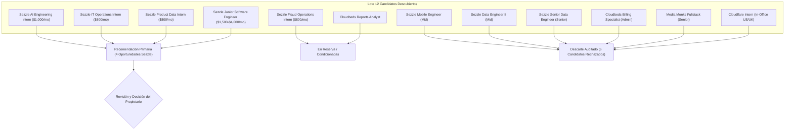

# INFORME TÉCNICO Y AUDITORÍA EDITORIAL: BLOQUE R3-ALPHA-CURATION-02

**Proyecto:** Ruta Sistemas  
**Fase:** R3 — Evaluación con Círculo Cercano y Alpha Privada  
**Identificador del Bloque:** `R3-ALPHA-CURATION-02`  
**Estado:** **`COMPLETED_READY_FOR_HUMAN_REVIEW`**  
**Rama de trabajo:** `integration/r1-02c`  
**HEAD de referencia:** `b27e41804f3ae216173059daeaec39c77174db44`  
**Documento de auditoría entregado:** [r3-alpha-curation-02-new-opportunities-2026-11-21.md](file:///c:/Users/sant1/Downloads/EmpleoWeb/docs/audits/r3-alpha-curation-02-new-opportunities-2026-11-21.md)  
**Roadmap maestro actualizado:** [r0-decisiones-y-alcance-2026-11-12.md](file:///c:/Users/sant1/Downloads/EmpleoWeb/docs/architecture/r0-decisiones-y-alcance-2026-11-12.md#L242-L246)

---

## 1. Resumen Ejecutivo de la Prospección

Se ejecutó un segundo ciclo sistemático de prospección y curaduría editorial sobre endpoints públicos de ATS (Greenhouse y Lever) para incorporar vacantes formativas (prácticas preprofesionales/profesionales) y puestos junior orientados a **Ingeniería de Sistemas y áreas TI en el Perú**, diversificando empleadores, sectores y esquemas de compensación.

| Métrica de Curaduría | Valor | Detalle |
|---|---|---|
| **Candidatos nuevos descubiertos y normalizados** | **12** | Ingestados a `data/candidates/inbox.local.json` bajo Candidate Schema 2 |
| **Total acumulado en bandeja local staging** | **24** | 12 de lotes previos + 12 del ciclo actual |
| **Candidatas con recomendación primaria favorable** | **4** | Vacantes de **Sezzle** (Fintech NASDAQ) con elegibilidad expresa en Perú y sueldo en USD |
| **Candidatas en reserva / condicionales** | **2** | Cloudbeds (Reports Analyst) y Sezzle (Fraud Ops Intern) |
| **Candidatas descartadas con causa auditada** | **6** | Descartadas por nivel fuera de rango (Mid/Sr), carácter administrativo o exclusión territorial |
| **Colisiones de ID o duplicados (`dedup.py`)** | **0** | Determinismo estricto verificado sin duplicados |
| **Frescura de evidencias (TTL 7 días Lima)** | **100%** | Todas con sello `observedAt` al 2026-11-20 y 2026-11-21 (`ALL_FRESH`) |
| **Integridad de fuentes canónicas (SHA-256)** | **100%** | `seed.json`, `opportunities.json` y `sources.json` inalterados |

---

## 2. Preselección Recomendada: 4 Oportunidades Sezzle en Staging

Las cuatro oportunidades recomendadas provienen de **Sezzle** (empresa fintech cotizada en NASDAQ: SEZL), que opera bajo esquema remoto internacional con contratación formalizada para residentes en Perú y **publicación transparente de bandas salariales brutas en USD**:

| ID Candidato en Staging | Puesto | Área Técnica | Nivel | Ubicación / Modalidad | Compensación Declarada | Tecnologías y Enfoque Formativo |
|---|---|---|---|---|---|---|
| `CAND-greenhouse-public-job-board-template-7906563003` | **AI Engineering Intern** | IA Generativa y Backend | Pasantía / Intern | Remoto (`Peru`) | **$1,000 USD/mes** | Python, APIs de LLMs (Claude, OpenAI), prompt engineering, flujos RAG y automatización. |
| `CAND-greenhouse-public-job-board-template-7907182003` | **IT Operations Intern** | Operaciones TI y Sistemas | Pasantía / Intern | Remoto (`Peru`) | **$800 USD/mes** | Jira Service Desk, administración de accesos, soporte de endpoints y procesos de infraestructura ITIL. |
| `CAND-greenhouse-public-job-board-template-8000825003` | **Product Data Intern** | Analítica y Datos | Pasantía / Intern | Remoto (`Peru`) | **$800 USD/mes** | SQL avanzado, Python (análisis de datos), dashboards de producto y modelado relacional. |
| `CAND-greenhouse-public-job-board-template-8001111003` | **Junior Software Engineer** | Desarrollo de Software | Junior | Remoto (`Peru`) | **$1,500 - $4,000 USD/mes** | Python, Go, Java, microservicios backend, SQL (PostgreSQL/MySQL) y consistencia transaccional contable. |

> [!NOTE]
> **Condición de dedicación:** Las pasantías de Sezzle declaran jornada completa (*Full-time*, 40 horas/semana). Se registra como advertencia para estudiantes que aún cursen materias universitarias diurnas.

---

## 3. Descarte Editorial Auditado (6 Oportunidades Rechazadas)

En estricta observancia del mandato editorial de proteger el tiempo del postulante, se fundamentó y auditó el descarte de las siguientes posiciones:

1. **`CAND-...-8044006003` (Sezzle — Mobile Engineer):** Descartada por nivel (*Mid-level*). Exige experiencia previa comprobada en producción con React Native y tiendas de aplicaciones ($3,000–$4,500 USD/mes).
2. **`CAND-...-8061426003` (Sezzle — Data Engineer II):** Descartada por nivel (*Mid-level / Level II*). Requiere diseño previo de pipelines ETL en producción y reportes regulatorios.
3. **`CAND-...-8055968003` (Sezzle — Senior Data Engineer):** Descartada por nivel (*Senior*). Exige más de 5 años liderando arquitecturas de datos de gran escala ($4,500–$6,000 USD/mes).
4. **`CAND-...-4743390005` (Cloudbeds — Associate Billing Specialist):** Descartada por pertinencia técnica nula (rol administrativo/financiero de facturación y cobranzas, sin componente de ingeniería de sistemas).
5. **`CAND-...-6179243004` (Media.Monks — Fullstack Engineer):** Descartada por nivel (*Senior* encubierto). Requisitos internos demandan más de 5 años de experiencia demostrable.
6. **`CAND-...-8245197` (Cloudflare — Software Engineer Intern Summer 2027):** Descartada por inelegibilidad territorial (exige residencia y asistencia presencial en oficinas de Austin, San Francisco o Londres; no admite modalidad remota desde Perú).

---

## 4. Verificación Técnica Integral y Regresión Cero

Se ejecutaron satisfactoriamente las suites completas del proyecto:

1. **Pruebas Unitarias Python:** `Ran 193 tests in 3.206s — OK` (193/193 pasando).
2. **Pruebas End-to-End Playwright:** `18 passed (24.4s)` en Chromium Desktop y Mobile Pixel 5 (cubriendo paginación escalable, listas con viñetas y detalle rediseñado).
3. **Consistencia de Catálogo:** `python scripts/build_catalog.py --check` y `python scripts/validate_catalog.py` confirmaron la validez de las 11 fichas actuales.
4. **Validación de Staging:** `python scripts/validate_candidates.py data/candidates/inbox.local.json` validó las 24 candidatas bajo Schema 2.
5. **Invariabilidad Criptográfica de Fuentes Canónicas:**
   - `data/opportunities.seed.json`: `789a5fe4777a596a031089f48885a5d492c401fcf01df1f5ec56b6df490de61c` (Coincidencia exacta).
   - `data/opportunities.json`: `a6ccb384f232af9a3e05bfce4807691c270b23eba37978e3a69aee06802e9e2c` (Coincidencia exacta).
   - `collector/sources.json`: `ae5ba4d314a450db9118c3ad3a98a6fbe261542a74bd0ec7a623aa7f66b0a124` (Coincidencia exacta).

---

## 5. Gobernanza y Próximos Pasos

- **Preservación de barreras:** Cero dependencias añadidas, cero promociones a catálogo canónico, cero git commit / push remoto y cero despliegues a producción pública.
- **Estado de fases:**
  - `R3-ALPHA-CURATION-02`: **`DONE`**.
  - `R3-02 (Trabajo de campo con usuarios formales)`: **`NOT_STARTED / PENDING_HUMAN`**.
  - `R3-03` a `R3-05` y `R4`: Estrictamente **`BLOCKED`**.

El expediente queda listo en el documento de auditoría para que el propietario decida si autoriza la promoción canónica controlada de las vacantes de Sezzle a la Alpha privada (`OP-011` a `OP-014`).

---

# R0 — Decisiones estratégicas y alcance consolidado

- **Fecha:** 2026-11-12
- **Estado:** cerrada documentalmente; R1 aún no iniciada
- **Alcance:** decisiones, criterios y roadmap. No implementa funcionalidades.
- **Fuente de verdad:** este documento consolida R0; el código y ADR-001 siguen siendo la autoridad para los contratos ya implementados.

## 1. Decisión ejecutiva

Ruta Sistemas construirá primero un **catálogo estático, curado y verificable de oportunidades reales para perfiles iniciales y junior de Sistemas en Perú**, incluyendo oportunidades remotas solo cuando la elegibilidad desde Perú esté explícita. El MVP permite encontrar, entender y comparar oportunidades; no promete empleo, continuidad ni calidad universal del empleador.

La arquitectura vigente se conserva: `data/opportunities.seed.json` como fuente canónica, snapshot generado, frontend estático, validación fail-closed y publicación portable. No se incorpora backend multiusuario, CMS, IA, scraping general ni nueva infraestructura antes de demostrar una necesidad concreta.

**Regla de cierre del MVP:** mientras no exista al menos una ficha real que cumpla el contrato editorial y pueda consultarse correctamente, el producto es un piloto técnico/editorial, no un MVP terminado.

## 2. Inventario documental consolidado

| Documento | Estado | Decisión/propósito | Acción |
|---|---|---|---|
| [README.md](../../README.md) | Vigente | Operación, estados, validaciones y límites actuales | Mantener; enlazar este cierre R0 |
| [ADR-001](../adr/ADR-001-catalogo-curado-publicacion-segura.md) | Vigente | Fuente canónica, estados, evidencia, publicación y límites | Mantener como contrato arquitectónico |
| [P3 — primer caso real](../sources/p3-first-opportunity-2026-11-12.md) | Vigente como bloqueo | Ninguna fuente tiene autorización suficiente | Mantener; no activar fuentes |
| [P4 — OSS](p4-oss-automation-evaluation-2026-11-13.md) | Propuesto/condicionado | Evalúa automatización futura; operación bloqueada | Mantener como propuesta; no instalar OSS |
| [P5 — evaluación profesional](../product/p5-evaluacion-profesional-y-validacion.md) | Vigente como evolución | Señales explicables sin score ni ranking | Mantener; no confundir con requisito completo del MVP |
| [Seguimiento de autorización](../sources/seguimiento-autorizacion-fuentes.md) | Vigente como trabajo externo | Preguntas y criterios para fuentes | Mantener; requiere respuesta humana |
| [Canonical Careers](../sources/canonical-careers-2026-11-11.md) | Propuesto | Candidata privada, `pending_review`, presupuesto cero | Mantener; no consultar ni publicar |
| [Auditoría 2026-10-25](../audits/project-state-audit-2026-10-25.md) | Histórico | Diagnóstico anterior y decisiones ya implementadas | No usar como estado actual |
| [Diseño/roadmap](../../Diseno-modelo-datos-arquitectura-piloto-2026-10-03.md) | Histórico acumulativo + roadmap vigente | Antecedentes y secciones P1–P5 | Conservar; esta sección R0 prevalece para alcance actual |
| `Informe-investigacion-mercado-fuentes-2026-10-03.md` | Histórico | Investigación de mercado y fuentes | No tratar como autorización |
| `outputs/pilot-datos-2026-10-03/Protocolo_Piloto_Oportunidades.xlsx` | Histórico | Protocolo del piloto inicial | Conservar como antecedente |

### Contradicciones resueltas

1. La visión de largo plazo incluye evaluación profesional y trayectorias; P5 no las elimina, solo las deja como evolución basada en evidencia.
2. Los documentos antiguos describen colectores activos, CDN o escritura automática; ADR-001 y el código actual los sustituyen por snapshot estático, CSS compilado y colector fail-closed.
3. La evaluación OSS fechada **2026-11-13** es posterior a la fecha de R0 (**2026-11-12**): se considera propuesta futura ya redactada, no decisión aprobada ni evidencia de ejecución.
4. `Aurel`/`AurelDev` aparece en contenido local reciente, pero no es una decisión de marca aprobada. La marca de producto para R0 sigue siendo Ruta Sistemas.

## 3. Alcance definitivo

### A. MVP — obligatorio

1. Catálogo con al menos una oportunidad real no demostrativa.
2. Filtros por tipo, perfil/nivel, modalidad, ubicación y familia/sector cuando esos datos estén publicados.
3. Detalle con requisitos, condiciones disponibles, fuente, publisher, fecha de observación y canal oficial de postulación.
4. Estados comprensibles y conservadores: oportunidad, verificación y publicación separados.
5. Exclusión por defecto de demostraciones, históricas, vencidas y no confirmadas.
6. Comparación local de oportunidades sin score ni ganador universal.
7. Evidencia y trazabilidad suficientes para explicar cada dato publicado.
8. Publicación estática reproducible y validada antes de Pages.

### B. Evolución, no MVP

- señales explicables de aprendizaje, experiencia técnica, crecimiento y continuidad;
- evaluación separada del empleador y de la oportunidad;
- preferencias efímeras, oportunidades guardadas y alertas;
- orientación de trayectorias basada en requisitos y transiciones observadas;
- automatización de fuentes autorizadas en staging;
- persistencia multiusuario solo si la curación concurrente lo demuestra necesaria.

La evolución requiere datos reales longitudinales, criterios transparentes, pruebas con usuarios y separación explícita entre hecho, señal, incertidumbre y ausencia de información. No se autoriza score universal, ranking definitivo ni recomendación automática por ahora.

### C. Fuera de alcance o descartado

- red social, comunidad, chat usuario-empresa;
- sistema propio de postulación;
- almacenamiento de CV o datos de postulantes;
- backend multiusuario prematuro;
- scraping indiscriminado o activación por disponibilidad técnica;
- IA/recomendaciones sin dataset suficiente y evidencia;
- ranking universal de empleadores u oportunidades;
- infraestructura distribuida o base especializada sin volumen/operación demostrados.

## 4. Cambios sin commit: matriz de decisión

El estado revisado contiene **15 archivos rastreados modificados**, **un `canvas.js` no rastreado** y **cuatro documentos nuevos no rastreados**; el diff rastreado suma **1.536 adiciones y 117 eliminaciones**. Se preserva todo el trabajo; esta matriz no autoriza revertirlo.

| Grupo | Aporte | Riesgo/coste | Evidencia actual | Decisión R0 |
|---|---|---|---|---|
| Marca/identidad | Jerarquía y nueva presentación | `Aurel`/`AurelDev` contradice Ruta Sistemas | `index.html`, DOM local | Conservar con ajuste de marca en R1 |
| Navegación/estructura | Hero, catálogo, metodología, fuentes | Más superficie antes de tener datos reales | inspección de UI | Conservar; validar tarea principal |
| Filtros/catálogo | Texto, ubicación, modalidad, categorías y opt-ins | Cobertura E2E incompleta | tests Node + navegador | Conservar |
| Detalle | Evidencia, estados, señales y postulación deshabilitada | Puede repetir interpretación editorial | `renderDialog`, contratos schema 2 | Conservar con pruebas |
| Comparador | Hasta dos fichas, sin puntuación | No verificado end-to-end | lógica Node; falta browser flow | Conservar con validación |
| Evaluación/evidencia | Distingue hechos y límites | No debe parecer recomendador | P5 y `evaluationSignals` | Conservar como evolución útil |
| Hero WebGL | Identidad visual y animación | Compatibilidad, rendimiento, accesibilidad; no resuelve catálogo vacío | `canvas.js`; `prefers-reduced-motion` no detiene WebGL | Pendiente de validación; no ampliar |
| Estilos/responsive | CSS compilado local, sin CDN runtime | Cambios amplios y posible divergencia visual | build CSS y artefacto Pages pasan | Conservar; revisar viewport |
| Pruebas/docs | Contratos de carga, errores y datos | Falta E2E local/canvas/modales | 56 tests pasan | Conservar; ampliar en R1 |

### Defectos verificables que R1 debe resolver

- `index.html` carga `canvas.js`, pero `server.py` no lo expone: el servidor local devuelve 404/MIME JSON.
- El título y marca visible no están alineados con Ruta Sistemas.
- El bucle WebGL debe medirse o desactivarse/reducirse bajo `prefers-reduced-motion`; la regla CSS por sí sola no prueba ahorro de ejecución.
- No afirmar que Pages y servidor local son equivalentes hasta probar ambos contratos.

## 5. Contrato editorial vigente

No se crea un esquema paralelo. El contrato se apoya en schema 2, `catalog_quality.py`, `build_catalog.py`, `validate_candidates.py` y ADR-001.

### Campos mínimos

- **Identidad:** `id`, `title`, `employer`, `publisher`, `kind`, `family`, `level`, `sector`.
- **Condiciones:** `mode`, `location`, `eligibility`, `salary`/`salaryNote`, `duration`, `benefits`, `publishedAt`, `deadline` cuando existan.
- **Postulación:** `sourceUrl`, `applyUrl`, `allowedHosts`, `sourceKind`.
- **Evidencia:** `fieldEvidence` para cada campo afirmado, URL HTTPS permitida y `observedAt` con zona; `verificationEvidence` con método, resultado y relación con el empleador.
- **Decisión:** `editorialDecision.status`, revisor, motivo y `decidedAt`.
- **Estados:** `opportunityStatus`, `verificationStatus`, `publicationStatus`, `recordKind`, `lastVerifiedAt`/`lastCheckedDate`.

### Condición para `publicationStatus: active`

Debe cumplirse todo lo siguiente:

1. `recordKind` no es `demonstration`.
2. `opportunityStatus: open`.
3. `verificationStatus: verified` y la verificación está dentro del TTL configurado.
4. El deadline no existe o no está vencido.
5. Revisión humana aprobada con revisor, fecha y motivo.
6. El canal de postulación fue observado abierto manualmente, con `publisherRelation: employer_confirmed`, `result: application_open`, timestamp válido y hosts HTTPS permitidos.
7. `sourceUrl`, `applyUrl` y la evidencia son permitidas.
8. Cada campo no nulo afirmado tiene `fieldEvidence` reciente.

Si falta cualquier condición, la ficha permanece `unconfirmed`, `historical`, `expired`, `stale`, `pending` o fuera del snapshot publicable según corresponda. `generatedAt` nunca renueva evidencia. Ausencia de dato no se transforma en condición negativa.

### Flujo mínimo

`captura → validación → deduplicación → verificación → revisión humana → aprobación → generación → publicación → seguimiento`

| Paso | Estado actual |
|---|---|
| Captura | Manual; automatización bloqueada |
| Validación | Implementada para candidatos, semilla y snapshot |
| Deduplicación | Parcial; requiere revisión de colisiones |
| Verificación | Manual y documentada; no existe ficha real aprobada |
| Revisión/aprobación | Manual, modelada en schema, sin panel |
| Generación/publicación | Implementada y fail-closed |
| Seguimiento/retirada | Política documentada; ejecución manual |

## 6. Criterios de aceptación congelados

### MVP

- [ ] Existe al menos una oportunidad real, no demostrativa, consultable y aprobada.
- [ ] Una persona puede filtrar, abrir el detalle, distinguir empleador/publisher y llegar al canal oficial.
- [ ] Una ficha vencida, stale o sin evidencia no aparece como activa por defecto.
- [ ] La comparación no produce score, ganador ni valores inventados.

### Datos y publicación

- [ ] `build_catalog.py --check`, `validate_catalog.py` y `validate_candidates.py` pasan.
- [ ] Cada dato afirmado tiene evidencia HTTPS y fecha válida; los desconocidos permanecen ausentes/null.
- [ ] La publicación falla si el esquema, host, fecha, estado o artefacto son inválidos.
- [ ] El artefacto contiene exactamente los archivos permitidos y no depende de CDN runtime.

### Experiencia e integridad técnica

- [ ] Prueba de navegador cubre carga, filtros, estado vacío/error, detalle, comparación y enlaces relativos bajo Pages.
- [ ] Prueba local cubre `canvas.js` o documenta su exclusión; no hay 404/MIME incorrecto.
- [ ] Se revisan teclado, diálogo, viewport móvil y `prefers-reduced-motion`.
- [ ] No se declara éxito remoto sin observar el artefacto y la URL desplegados.

### Evolución

- [ ] No se inicia scoring, alertas, trayectorias o personalización sin datos y protocolo de medición documentados.
- [ ] Una fuente nueva tiene autorización escrita separada para consulta, retención, atribución, retirada y republicación antes de cualquier solicitud.
- [ ] La automatización produce staging/candidatos y nunca promociona directamente a seed, snapshot o Pages.

## 7. Roadmap maestro posterior a R0

El roadmap existente permanece en la sección 21 y sus bloques posteriores del [documento de diseño](../../Diseno-modelo-datos-arquitectura-piloto-2026-10-03.md). R0 lo reordena así, sin duplicar tareas:

| Fase | Objetivo | Entrada | Salida/criterio | Estado |
|---|---|---|---|---|
| R0 | Cerrar alcance, contrato, criterios y decisiones | Auditoría + docs actuales | Este documento, sin contradicciones críticas sin registrar | **Cerrada documentalmente** |
| R1 | Estabilizar versión actual | R0 | `canvas.js` local resuelto, marca unificada, diff revisado, E2E base, Pages desplegado | **Completada y verificada en producción** |
| R2 | Obtener primera oportunidad real | R1 + fuentes públicas/autorización | Una ficha real aprobada en staging y luego seed/snapshot | **DONE. Línea offline R2-OSS cerrada. Línea A completada en R2-A-05: CookUnity 8039990003 (Supply Chain Analyst - Lima, Perú) promovida editorialmente al catálogo canónico como OP-005 con aprobación del propietario (APPROVE_WITH_LIMITATIONS), snapshot compilado y validado (193 pruebas unitarias, 8 pruebas E2E Playwright, validador de calidad) y publicado en GitHub Pages con 21 evidencias desglosadas por campo y canal oficial de postulación. Candidato Canonical 8379825 conservado en reserva. Desbloquea R3.** |
| R3 | Validar utilidad del MVP | R2 | Pruebas con usuarios y medición de comprensión/comparación | **En ejecución. Desbloqueada por R2-A-05 con oportunidad real OP-005 en producción. Subfase R3-01 (Preparación y protocolo de investigación) completada (DONE): línea base UX, protocolo de pruebas de usabilidad, plantilla individual de sesión, repositorio de hallazgos y auditoría de preparación entregados. Subtareas R3-01-01 a R3-01-05 formalizadas. Pendiente R3-02 (ejecución de sesiones con 5-8 usuarios reales).** |
| R4 | Automatizar fuente autorizada | R2/R3 + permiso técnico | Adaptador acotado, candidatos offline, sin promoción automática | **Bloqueada; no existe fuente autorizada** |
| R5 | Evaluación profesional explicable | Datos reales suficientes + R3 | Señales auditables sin score obligatorio | Aplazada |
| R6 | Preferencias, guardados y alertas | R3 + necesidad demostrada | Diseño de privacidad y persistencia justificado | Aplazada |
| R7 | Trayectorias profesionales | Dataset longitudinal y evidencia | Orientación no determinista, validada | Aplazada |
| R8 | Consolidación operativa | Flujos anteriores estables | backups, monitorización, retirada y plan de hosting | Aplazada |

### Siguiente bloque: R1-01

- **Objetivo:** estabilizar y consolidar la versión actual sin cambiar el alcance.
- **Archivos probables:** `server.py`, `index.html`, `canvas.js`, `app.js`, pruebas UI y documentación de release.
- **Dependencias:** ninguna técnica; requiere conservar el árbol de trabajo y revisión del propietario para decidir mantener o simplificar el hero.
- **Aceptación:** servidor local sin 404/MIME para recursos declarados; marca unificada; smoke E2E de carga/filtros/detalle/comparador; decisión explícita sobre WebGL y reduced motion.
- **Validaciones:** suite existente, `node --check`, artefacto Pages, navegador local y viewport móvil.
- **Riesgo:** tocar el lote acumulado puede mezclar cambios de etapas; revisar diff antes de seleccionar cualquier integración.
- **Esfuerzo relativo:** medio.

### Evidencia de ejecución R1

- `server.py` expone `/canvas.js` como JavaScript; la comprobación HTTP local devolvió `200` y MIME correcto para `/`, `/app.js`, `/styles.css`, `/canvas.js` y `/data/opportunities.json`.
- `index.html` usa `Ruta Sistemas` en título y marca visible, sin residuo activo `Aurel`.
- `canvas.js` registra fallback sin bloqueo para WebGL2 ausente, atiende `prefers-reduced-motion` y cancela el frame en `pagehide`.
- `app.js` conserva el mensaje seguro para la persona y registra la causa técnica del fallo de catálogo en consola.
- `python -m unittest discover -s tests -v`: 57 pruebas pasan. `node --check app.js` y `node --check canvas.js` pasan.
- Smoke de navegador local: carga inicial vacía, activación de ejemplos demostrativos y apertura/cierre del detalle verificados. No se añadió un runner E2E al proyecto.

## 8. Decisiones pendientes de aprobación

1. Mantener el hero WebGL, simplificarlo o retirarlo tras la validación R1.
2. Confirmar la marca final `Ruta Sistemas` y corregir cualquier residuo `Aurel`.
3. Autorizar contacto con Canonical/SERVIR/FISI o seleccionar otra fuente; ninguna está aprobada actualmente.
4. Autorizar la integración/publicación del lote sin commit tras revisión completa del diff.
5. Definir, después del piloto, si el volumen justifica CMS/backend; no se presume ahora.

## 9. Cierre R0 y Seguimiento de Fases Posteriores

- **R0:** **Cerrada documentalmente**.
- **R1:** **Cerrada y desplegada**.
- **R2:** **Cerrada formalmente** con la línea offline R2-OSS (ingesta, normalización, dedup, evidencias y CLI) y la línea A (R2-A-01 a R2-A-05), culminando con la publicación en producción de la oportunidad real CookUnity (`OP-005`) en GitHub Pages.
- **R3 — Validación de Producto:** **En ejecución**.
  - `R3-01`: Preparación y protocolo de investigación (`DONE`).
    - `R3-01-01`: Auditoría UX del producto publicado (`DONE` -> `docs/research/r3-01-ux-baseline-2026-11-18.md`).
    - `R3-01-02`: Definición del protocolo de investigación (`DONE` -> `docs/research/r3-01-user-research-protocol-2026-11-18.md`).
    - `R3-01-03`: Diseño de escenarios y tareas A a E (`DONE` -> `docs/research/r3-01-user-research-protocol-2026-11-18.md`).
    - `R3-01-04`: Métricas y taxonomía de evaluación (`DONE` -> `docs/research/r3-01-findings-template-2026-11-18.md`).
    - `R3-01-05`: Instrumentación y plantillas locales (`DONE` -> `docs/research/r3-01-usability-test-template-2026-11-18.md`).
  - `R3-02`: Trabajo de campo con usuarios reales (5-8 participantes) (Preparación técnica y operativa `DONE`; ejecución empírica en estado `NOT_STARTED` / `PENDING_HUMAN`, pendiente de convocatoria y moderación presencial/remota por el equipo humano; paquete operativo verificado con kit `docs/research/r3-02-recruitment-materials-kit-2026-11-18.md`, guía `docs/research/r3-02-moderator-field-guide-2026-11-18.md`, plantillas `P01.md`..`P08.md` y auditorías en `docs/audits/`).
    - `R3-02-UX-EXP-01`: Iteración exploratoria de claridad, rendimiento y experiencia de consulta (`DONE` -> `docs/audits/r3-02-ux-exploratory-iteration-2026-11-19.md`). Optimización WebGL2 en `canvas.js` (eliminación de reflow forzado en bucle y pausa con `IntersectionObserver`), vista independiente de oportunidad con URL estable `?id=...` y fallback amigable 404, reemplazo de señales complejas por Triaje Rápido de 8 condiciones objetivas sin puntaje sintético, retiro de decisión editorial y evaluación institucional de la UI pública, simplificación de procedencia con tarjeta de fuente oficial y evidencia colapsable, y corrección de heurísticas UX-B01 a UX-B05. Esta iteración atiende observaciones del entorno exploratorio personal y círculo reducido sin comprometer el rigor metodológico ni anticipar la validación formal.
    - `R3-02-UX-EXP-02`: Validación local, auditoría de aceptación y preparación para sincronización (`DONE` -> `docs/audits/r3-02-ux-exp-02-acceptance-2026-11-19.md`). Auditoría semántica del Triaje Rápido: corrección del detector de experiencia previa (notación `1+ años` en OP-005 clasificada fielmente como `Por revisar`), separación explícita de hechos de la convocatoria respecto al perfil personal del postulante, suite E2E ampliada a 12 pruebas (Chromium y Mobile Pixel 5), verificación responsiva sin overflow en 1440px, 768px y 390px, y confirmación de preparación técnica para evaluación privada local. R3-02 formal permanece `NOT_STARTED` / `PENDING_HUMAN`.
    - `R3-02-UX-EXP-03`: Reconciliación final, gate de aceptación y preparación de sincronización (`DONE` -> `docs/audits/r3-02-ux-exp-03-reconciliation-acceptance-2026-11-19.md`). Corrección del enrutador hash contra colisiones 404 en anclas locales de página (`#inicio`, `#fuentes`), verificación integral de 193 pruebas Python y 12 pruebas Playwright E2E, preservación absoluta del catálogo y Schema 2, y veredicto de gate `READY_FOR_OWNER_REVIEW` para sincronización controlada a `integration/r1-02c`. R3-02 formal continúa `NOT_STARTED` / `PENDING_HUMAN` y R3-03 permanece `BLOCKED`.
    - `R3-02-UX-EXP-04`: Consolidación de información y eliminación de redundancia en la ficha de oportunidad (`DONE` -> `docs/audits/r3-02-ux-exp-04-information-consolidation-2026-11-19.md`). Aplicación estricta del principio *«Un dato, una ubicación, una interpretación»*: consolidación canónica de modalidad y compensación en la cuadrícula de condiciones, unificación de ubicación y elegibilidad en un único bloque sin repetición de términos, separación nítida entre requisitos del puesto (obligatorios) y tecnologías declaradas (herramientas/plataformas), retiro completo de la sección redundante de continuidad y riesgos (integrando términos de contrato en `Contrato y plazo`), compactación de metadatos de vigencia/verificación, y rediseño del Triaje Rápido a 3 señales de síntesis prioritarias (`Pertinencia técnica`, `Elegibilidad territorial`, `Nivel y experiencia`). Suite E2E ampliada a 14 pruebas (Chromium y Mobile Pixel 5) verificando cero duplicaciones informativas. R3-02 formal permanece `NOT_STARTED` / `PENDING_HUMAN` y R3-03 permanece `BLOCKED`.
    - `R3-02-UX-EXP-05`: Rediseño de la ficha de oportunidad, presentación visual y uso efectivo de Tailwind CSS (`DONE` -> `docs/audits/r3-02-ux-exp-05-opportunity-detail-visual-redesign-2026-11-19.md`). Cumplimiento de la decisión del propietario de simplificar radicalmente la ficha: eliminación completa del «Triaje rápido»; posicionamiento superior de «✓ Fuente oficial verificada» (con difusor, empleador, estado de verificación y enlaces oficiales directos); nuevo «Resumen» visual con cuadrícula de tarjetas e iconos SVG Lucide inlined (`monitor`, `building`, `pin`, `wallet`, `file`, `clock`, `calendar`, `shield`); política estricta de omisión visual de campos no declarados (eliminación de textos especulativos como «sujeto a desempeño y evaluación del empleador» y omisión en OP-005 de modalidad, remuneración y fecha límite no publicadas); «Tecnologías y herramientas declaradas» ubicadas inmediatamente debajo del Resumen como etiquetas visuales; reubicación de «Qué se verificó» y preservación de los 21 campos de evidencia desglosada; y corrección de la integración de Tailwind CSS v4 inyectando las definiciones `@theme` en `src/input.css` para restaurar tokens de color de marca (`ice-blue`, `crystal-blue`, `arctic-blue`, `brand-black`, etc.). 14 pruebas E2E (Chromium y Mobile Pixel 5) y 193 pruebas Python pasan sin advertencias de regresión. R3-02 formal continúa `NOT_STARTED` / `PENDING_HUMAN` y R3-03 permanece `BLOCKED`.
    - `R3-02-UX-EXP-06`: Reconciliación post-implementación, auditoría de UX-EXP-05 y preparación para revisión del propietario (`DONE` -> `docs/audits/r3-02-ux-exp-06-reconciliation-and-owner-review-2026-11-19.md`). Auditoría técnica exhaustiva del estado real del repositorio: verificación de paridad Git (HEAD `9d747c5` en `integration/r1-02c`), confirmación de presencia real y completa de las 7 directivas de diseño de UX-EXP-05, verificación criptográfica de invariabilidad de Schema 2 y fuentes canónicas (`data/opportunities.seed.json`, `data/opportunities.json`, `collector/sources.json`), auditoría de compilación y tokens de Tailwind CSS v4.3.3 (`styles.css` de 65 KB sin dependencias externas), validación de suite completa (193 pruebas Python, 14 pruebas Playwright Chromium/Mobile, 9 contratos estáticos, scripts de catálogo), verificación funcional y no-desbordamiento del servidor loopback (`server.py` en puerto 4173 en viewports 1440px, 768px y 390px), y entrega de la guía de revisión local para el propietario. R3-02 formal permanece `NOT_STARTED` / `PENDING_HUMAN`; R3-03 a R3-05 y R4 permanecen `BLOCKED`.
    - `R3-02-GIT-CONSOLIDATION-01`: Consolidación de iteraciones UX-EXP-01 a UX-EXP-06, validación integral de integridad, commit y push controlado a `integration/r1-02c` (`DONE` tras confirmación de sincronización remota). Consolida el trabajo de optimización WebGL2, enrutamiento independiente y hash routing, rediseño de ficha de oportunidad conforme a Tailwind CSS v4.3.3, erradicación del triaje rápido, hero de fuente oficial verificada, resumen con iconos Lucide y política estricta de omisión visual de datos no publicados. Incorpora las 7 auditorías (`docs/audits/r3-02-*.md`), la guía de evaluación local (`docs/audits/r3-02-preview-readiness-2026-11-19.md`) y la plantilla de feedback informal (`docs/research/r3-02-informal-feedback-template.md`). Suite completa aprobada (193 pruebas Python, 14 pruebas Playwright E2E, 9 contratos estáticos, validación y build de catálogo). Schema 2 y archivos canónicos criptográficamente idénticos a `9d747c5`. Próximo paso: ejecución empírica de trabajo de campo humano R3-02. Estados de gobernanza: R3-02 permanece `NOT_STARTED` / `PENDING_HUMAN`; R3-03 a R3-05 y R4 permanecen estrictamente `BLOCKED`.
    - `R3-02-PREVIEW-02`: Preparación y verificación del entorno de evaluación personal y círculo reducido (`DONE` -> `docs/audits/r3-02-preview-02-acceptance-2026-11-20.md`). Reconciliación del estado real sobre el commit `b3e69e9` en `integration/r1-02c`, armonización de modificaciones del working tree (modernización de tarjetas y panel de filtros en `app.js`, `index.html` y compilación Tailwind `styles.css`) con contratos estáticos y selectores E2E; auditoría integral de seguridad de `server.py` (enlace exclusivo a loopback `127.0.0.1:4173`, validación de `Host`, lista blanca estricta de archivos y bloqueo 404 contra rutas privadas); verificación del 100% de la suite de pruebas (193 pruebas Python, 14 pruebas Playwright E2E en Chromium y Mobile Pixel 5, validación Schema 2); comprobación rigurosa del caso OP-005 (CookUnity); entrega de la guía amigable para evaluadores no técnicos (`docs/research/r3-02-owner-circle-evaluation-guide.md`) articulada con la plantilla de feedback informal (`docs/research/r3-02-informal-feedback-template.md`). Preservación estricta de gobernanza: feedback informal separado de investigación formal R3-02 (`NOT_STARTED` / `PENDING_HUMAN`); R3-03 a R3-05 y R4 continúan estrictamente `BLOCKED`. Cero dependencias añadidas, sin merge a `main`, sin deploy a GitHub Pages y sin push remoto.
    - `R3-02-PREVIEW-03`: Reconciliación Git y entrega controlada de la versión de evaluación (`DONE` -> `docs/audits/r3-02-preview-03-git-delivery-2026-11-20.md`). Resolución de discrepancia entre estado local y remoto: confirmación forense de que HEAD `b3e69e9` coincidía con el remoto mientras las mejoras validadas de PREVIEW-02 residían en el working tree sin versionar. Empaquetamiento y commit estructurado de cambios de UI (`app.js`, `index.html`, `styles.css`) y paquete documental (`r3-02-preview-02-acceptance-2026-11-20.md`, `r3-02-owner-circle-evaluation-guide.md`, `r3-02-preview-03-git-delivery-2026-11-20.md`). Suite completa validada (193 tests Python, 14 tests Playwright E2E Desktop/Mobile, Schema 2 inalterado, compilación Tailwind v4.3.3 en 68 KB). Sincronización mediante push normal a `origin/integration/r1-02c`. Entrega con doble modalidad para amigos (presencial / clonado independiente). Preservación estricta: R3-02 formal permanece `NOT_STARTED` / `PENDING_HUMAN`; R3-03 a R3-05 y R4 permanecen `BLOCKED`; sin merge a `main` ni despliegue en producción.
    - `R3-02-OWNER-FEEDBACK-01`: Registro de evaluación informal del círculo cercano (`COMPLETED_WITH_LIMITED_FEEDBACK` -> `docs/research/r3-02-owner-circle-feedback-2026-11-20.md`). Registro documental riguroso del feedback general transmitido verbalmente por el propietario tras pruebas informales con amistades (diseño bien valorado, percepción intuitiva y suficiencia de información), autorizando continuar el proyecto. Separación deontológica total: no se inventaron participantes, tiempos ni métricas; las plantillas formales `P01.md` a `P08.md` permanecen intactas en `PENDING_EXECUTION`. La investigación formal R3-02 continúa en `NOT_STARTED` / `PENDING_HUMAN`. R3-03 a R3-05 y R4 permanecen estrictamente `BLOCKED`. Cero dependencias añadidas, sin merge a `main` ni despliegue.
    - `R3-02-PRIVATE-ALPHA-01`: Recalibración del alcance, preparación y gobernanza de la Alpha privada (`DONE` -> `docs/architecture/r3-private-alpha-scope-decision-2026-11-20.md`). Formalización de dos niveles de madurez desacoplados: Nivel 1 (Alpha privada para uso personal y círculo reducido, con criterios técnicos y de seguridad 100% satisfechos, identificando la ampliación del inventario de vacantes reales como prioridad 1) vs. Nivel 2 (Producto validado para audiencia amplia, con R3-02 formal preservado en `NOT_STARTED` / `PENDING_HUMAN`). Matriz de priorización crítica de 12 funcionalidades (descartando sobreingeniería prematura como login, persistencia multiusuario, recomendaciones opacas o alertas automáticas). R3-03 a R3-05 y R4 permanecen estrictamente `BLOCKED`. Cero dependencias añadidas, sin merge a `main` ni despliegue.
    - `R3-ALPHA-CURATION-01`: Segundo lote de oportunidades reales para la Alpha privada (`DONE` -> `docs/audits/r3-alpha-curation-01-second-batch-2026-11-20.md`). Adquisición, normalización a Candidate Schema 2, deduplicación y auditoría editorial de 5 oportunidades formativas y junior de Canonical Ubuntu (100% remotas, elegibles desde Perú, cubriendo Desarrollo de Software, Cloud/Python, Kernel Linux y Soporte Técnico TI), recomendadas con limitaciones (`APPROVE_WITH_LIMITATIONS`) para la Alpha privada (círculo íntimo). Auditoría exhaustiva y descarte formal de 6 vacantes inelegibles o fuera de nivel (Wikimedia por restricciones territoriales a EE.UU./18 países y nivel senior; Deliverect por radicación en Países Bajos; CookUnity soporte por requerir >4 años de experiencia). Preservación estricta de gobernanza: bandeja staging `data/candidates/inbox.local.json` con 12 candidatos y 100% de evidencias `ALL_FRESH`; cero alteraciones en archivos canónicos (`data/opportunities.seed.json`, `data/opportunities.json`, `collector/sources.json` criptográficamente idénticos); 193 pruebas Python aprobadas; catálogo canónico validado; cero nuevas dependencias; R3-02 formal preservado en `NOT_STARTED` / `PENDING_HUMAN`; R3-03 a R3-05 y R4 permanecen estrictamente `BLOCKED`. Puerta de control humano preparada para decisión del propietario.
    - `R3-ALPHA-OWNER-REVIEW-01`: Revalidación y decisión editorial del segundo lote Canonical (`DONE` -> `docs/audits/r3-alpha-owner-review-01-canonical-editorial-decision-2026-11-20.md`). Revalidación pericial independiente de las 5 candidatas de Canonical Ubuntu en doble capa (REST API y Web HTML de Greenhouse), verificando disponibilidad de formularios activos, ausencia de cierres, elegibilidad remota desde Perú (franja AMER UTC-5), vigencia de cohorte fresca (`8379825`, publicada el 16-11-2026 para graduados 2026/2027) vs. requisiciones continuas/rolling (`6707669`, `5370815`, `3257589`, `6448444`). Delimitación rigurosa de gobernanza: términos de reutilización pública en `pending_review` circunscritos a la Alpha privada no comercial. Expediente comparativo completo estructurado con opciones de decisión humana (Opción A: lote completo de 5; Opción B: selectiva de 2 core dev; Opción C: mantener en staging) pendiente de selección por el propietario. Cero alteraciones en archivos canónicos (`seed.json`, `opportunities.json`, `sources.json`), 193 pruebas Python aprobadas, cero promociones automáticas, cero dependencias añadidas, sin merge a `main` ni despliegue.
    - `R3-ALPHA-PROMOTION-01`: Promoción editorial controlada de cinco oportunidades Canonical a la Alpha privada (`DONE` -> `docs/audits/r3-alpha-promotion-01-private-catalog-2026-11-21.md`). Ejecución de la autorización expresa del propietario (Opción A): incorporación canónica de 5 oportunidades reales de Canonical Ubuntu (`OP-006` a `OP-010`) cubriendo Desarrollo de Software, Sistemas Operativos, Kernel Linux, Cloud/Python y Soporte de TI. Catálogo de Alpha privada ampliado de 1 a 6 vacantes reales y 5 registros demostrativos (11 fichas en total), resolviendo el cuello de botella de contenido para evaluación personal y círculo cercano. Revalidación en tiempo real al 21-11-2026 (100% activas con formularios operativos). Advertencias editoriales rigurosas de dedicación full-time (40h/sem) e inglés profesional, distinguiendo cohorte fresca (`OP-006`, cohorte 2026/2027) de requisiciones continuas (`OP-007` a `OP-010`). Suite completa en verde: 193 pruebas Python y 14 pruebas Playwright E2E aprobadas; catálogo validado bajo Schema 2. Preservación estricta de gobernanza: `collector/sources.json` inalterado con términos en `pending_review` y `enabled: false`; cero publicación externa, cero despliegue en GitHub Pages, sin merge a `main`, sin commit ni push. Estados de gobernanza preservados: R3-02 formal permanece `NOT_STARTED` / `PENDING_HUMAN`; R3-03 a R3-05 y R4 permanecen estrictamente `BLOCKED`.
    - `R3-ALPHA-UX-01`: Escalabilidad del catálogo y presentación estructurada de contenido (`DONE` -> `docs/audits/r3-alpha-ux-01-catalog-pagination-and-lists-2026-11-21.md`). Implementación de dos mejoras prioritarias de experiencia frontend requeridas por el propietario:
      - `R3-ALPHA-UX-01A` (Paginación escalable del catálogo): Paginación de tarjetas con límite de 12 oportunidades por página (`PAGE_SIZE = 12`). Ocultación automática de controles cuando el total filtrado es <= 12; activación de botones accesibles «Anterior» y «Siguiente» con indicador detallado («Página X de Y · Mostrando A–B de N oportunidades») cuando el catálogo supera 12 tarjetas; cálculo dinámico de páginas para cualquier volumen (13, 20, 24, 25, 40, 100+); reseteo estricto a página 1 ante cambios de búsqueda, filtros o ejemplos; y preservación total del estado del comparador local (`compareIds`) al navegar entre páginas.
      - `R3-ALPHA-UX-01B` (Presentación estructurada de descripciones y listas): Formateo semántico visual mediante listas con viñetas (`<ul class="list-disc pl-5 space-y-1.5 ..."><li>...</li></ul>`) para campos que representan listas delimitadas por punto y coma (`;`) en la fuente (`tasks` / "Qué harías", `requirements` / "Requisitos del puesto", `benefits` / "Beneficios publicados"), con limpieza de puntuación redundante y capitalización amigable. Preservación intacta como párrafos narrativos (`<p>`) de textos continuos donde el punto y coma cumple función gramatical (`growth`, `continuity`, `risk`).
      - Cero dependencias añadidas, cero alteraciones en datos canónicos (`data/opportunities.seed.json`, `data/opportunities.json`, `collector/sources.json` inalterados), 193 pruebas Python aprobadas, suite Playwright ampliada de 14 a 18 pruebas aprobadas (Chromium y Mobile Pixel 5). Estados de gobernanza: R3-02 formal permanece `NOT_STARTED` / `PENDING_HUMAN`; R3-03 a R3-05 y R4 permanecen estrictamente `BLOCKED`.
    - `R3-ALPHA-CURATION-02`: Descubrimiento y curaduría de nuevas oportunidades reales para la Alpha privada (`DONE` -> `docs/audits/r3-alpha-curation-02-new-opportunities-2026-11-21.md`). Segundo ciclo de prospección y normalización enfocado en estudiantes de últimos ciclos, egresados y juniors de Ingeniería de Sistemas en Perú:
      - `R3-ALPHA-CURATION-02A` (Descubrimiento y adquisición en staging): Normalización a Candidate Schema 2 e incorporación de 12 nuevos candidatos a la bandeja local aislada `data/candidates/inbox.local.json` (elevando el total de la bandeja de 12 a 24 registros auditados). Fuentes investigadas: tableros públicos Greenhouse de Sezzle (fintech NASDAQ), Cloudbeds, Media.Monks, Cloudflare, etc.
      - `R3-ALPHA-CURATION-02B` (Auditoría editorial y descarte motivado): Identificación de 4 oportunidades prioritarias de Sezzle con localización explícita en Perú y remuneración publicada en USD (AI Engineering Intern $1,000/mes, IT Operations Intern $800/mes, Product Data Intern $800/mes, Junior Software Engineer $1,500-$4,000/mes) y 2 en reserva (Cloudbeds Reports Analyst y Sezzle Fraud Ops Intern). Descarte formal auditado de 6 posiciones por nivel desmedido (Sezzle Senior Data Engineer, Sezzle Data Engineer II, Sezzle Mobile Engineer, Media.Monks Fullstack Engineer), naturaleza puramente administrativa (Cloudbeds Billing Specialist) o inelegibilidad territorial (Cloudflare Intern presencial en US/UK).
      - `R3-ALPHA-CURATION-02C` (Verificación técnica y preservación de gobernanza): 0 colisiones de ID o duplicados con `collector/dedup.py`; 100% de evidencias frescas (`ALL_FRESH`, TTL 7 días Lima); 193 pruebas Python y 18 pruebas Playwright E2E aprobadas; catálogo canónico validado; hashes SHA-256 de `data/opportunities.seed.json`, `data/opportunities.json` y `collector/sources.json` 100% inalterados; cero promociones automáticas y cero nuevas dependencias. Puerta de control humano preparada para decisión del propietario. R3-02 formal permanece `NOT_STARTED` / `PENDING_HUMAN`; R3-03 a R3-05 y R4 continúan estrictamente `BLOCKED`.
  - `R3-03`: Análisis y consolidación de hallazgos (`BLOCKED`: bloqueado hasta que existan al menos 5 sesiones humanas válidas con representación de P-EST, P-EGR y P-JUN).
  - `R3-04`: Refactor/Fix UX justificado (`BLOCKED`).
  - `R3-05`: Decisión documentada sobre si el MVP satisface los criterios originales (`BLOCKED`).
- **R4 — Automatización Controlada:** **Bloqueada** hasta que R3 demuestre valor con usuarios y justifique técnica y éticamente la adquisición automática.

---

# R3-ALPHA-CURATION-02 — Descubrimiento y Curaduría de Nuevas Oportunidades Reales para la Alpha Privada

**Proyecto:** Ruta Sistemas  
**Fase:** R3 — Evaluación con Círculo Cercano y Alpha Privada  
**Identificador:** `R3-ALPHA-CURATION-02`  
**Fecha de corte e informe:** 2026-11-21 (Hora Lima, UTC-5)  
**Responsables (Roles):** Principal Software Architect, Senior Software Engineer, Technical Product Manager, OSS Integration Specialist, Curador Editorial de Empleo TI y Auditor Técnico de Procedencia  
**Estado:** `COMPLETED_READY_FOR_HUMAN_REVIEW`  
**Rama objetivo:** `integration/r1-02c`  
**HEAD de referencia:** `b27e41804f3ae216173059daeaec39c77174db44`  
**Referencias rectoras:**
- [docs/architecture/r0-decisiones-y-alcance-2026-11-12.md](../architecture/r0-decisiones-y-alcance-2026-11-12.md)
- [docs/architecture/r3-private-alpha-scope-decision-2026-11-20.md](../architecture/r3-private-alpha-scope-decision-2026-11-20.md)
- [docs/audits/r3-alpha-curation-01-second-batch-2026-11-20.md](r3-alpha-curation-01-second-batch-2026-11-20.md)
- [docs/audits/r3-alpha-owner-review-01-canonical-editorial-decision-2026-11-20.md](r3-alpha-owner-review-01-canonical-editorial-decision-2026-11-20.md)
- [docs/audits/r3-alpha-promotion-01-private-catalog-2026-11-21.md](r3-alpha-promotion-01-private-catalog-2026-11-21.md)
- [docs/audits/r3-alpha-ux-01-catalog-pagination-and-lists-2026-11-21.md](r3-alpha-ux-01-catalog-pagination-and-lists-2026-11-21.md)

---

## 1. Identidad y Objetivo

El presente informe documenta la ejecución del bloque **`R3-ALPHA-CURATION-02`**, enfocado en la ampliación del inventario de oportunidades reales candidatas para la Alpha privada de Ruta Sistemas mediante un segundo ciclo riguroso de investigación, adquisición, normalización y auditoría editorial.

El público objetivo prioritario de Ruta Sistemas está compuesto por:
1. **Estudiantes de últimos ciclos (prácticas preprofesionales).**
2. **Egresados recientes (prácticas profesionales / graduados).**
3. **Perfiles entry-level y junior de Ingeniería de Sistemas y TI en Perú.**

La plataforma mantiene el principio fundamental de aportar valor práctico al postulante, distinguiendo con claridad objetiva las vacantes accesibles y formativas de aquellas que imponen barreras encubiertas (experiencia desmedida, exclusión territorial, o perfiles puramente administrativos ajenos a la ingeniería).

### Principios y Limitaciones de Ejecución:
- **Cero alteración de fuentes canónicas:** `data/opportunities.seed.json`, `data/opportunities.json` y `collector/sources.json` permanecen 100% inalterados (hashes criptográficos SHA-256 idénticos).
- **Cero promoción automática:** Ningún candidato ha sido promovido al catálogo canónico ni se le ha asignado código `OP-011+`.
- **Aislamiento en Staging:** Los registros residen exclusivamente en `data/candidates/inbox.local.json` (ignorado por `.gitignore`), bajo el estándar Candidate Schema 2.
- **Cero dependencias nuevas:** 0 paquetes npm, 0 paquetes pip añadidos.
- **Cero git commit / push / deployment:** Trabajo estrictamente local de preparación y auditoría.

---

## 2. Contexto y Estado de Partida

### 2.1. Estado Canónico Previo
El catálogo de la Alpha privada cuenta con **11 oportunidades** (6 reales + 5 registros demostrativos de calibración):
- `OP-005`: CookUnity — Supply Chain Analyst (Lima, Perú / Híbrido).
- `OP-006`: Canonical Ubuntu — Graduate Software Engineer, Open Source and Linux (Remoto, Elegible Perú).
- `OP-007`: Canonical Ubuntu — Junior Ubuntu Software Engineer (Remoto, Elegible Perú).
- `OP-008`: Canonical Ubuntu — Junior Linux Kernel Engineer (Remoto, Elegible Perú).
- `OP-009`: Canonical Ubuntu — Software Engineer, Python - Cloud (Remoto, Elegible Perú).
- `OP-010`: Canonical Ubuntu — Associate Linux Support Engineer (Remoto, Elegible Perú).
- `OP-001` a `OP-004`, `QA-001`: Registros demostrativos históricos.

### 2.2. Necesidad Operativa
Aunque las 5 oportunidades de Canonical enriquecieron la cobertura técnica en sistemas operativos, cloud y kernel Linux, todas ellas provienen de un único empleador internacional y exigen inglés profesional fluido. Se requiere **diversificar los empleadores, sectores y áreas de especialización** (fintech, data/analítica, IA, operaciones TI, desarrollo web/backend), identificando convocatorias con remuneración transparente y modelos contractuales aptos para estudiantes y juniors en Perú.

---

## 3. Metodología de Búsqueda y Fuentes Investigadas

Se exploraron sistemáticamente portales ATS públicos y tableros oficiales de empleo sin scraping intrusivo ni evasión de protecciones técnicas:

| Empleador / Organización | Plataforma ATS | Endpoint / Tablero Investigado | Resultado de Exploración |
|---|---|---|---|
| **Sezzle** (Fintech NASDAQ: SEZL) | Greenhouse Public API | `https://boards-api.greenhouse.io/v1/boards/sezzle/jobs` | **Alta pertinencia.** Múltiples vacantes con localización explícita `Peru` y remuneración publicada en USD. |
| **Cloudbeds** (Hospitality SaaS) | Greenhouse Public API | `https://boards-api.greenhouse.io/v1/boards/cloudbeds/jobs` | **Pertinencia mixta.** Identificada 1 vacante de datos para LATAM (Perú elegible) y 1 vacante administrativa de facturación. |
| **Media.Monks** (Digital Services) | Greenhouse Public API | `https://boards-api.greenhouse.io/v1/boards/monks/jobs` | Identificada vacante Fullstack LATAM; descartada tras auditar nivel (requiere 5+ años). |
| **Cloudflare** (Cloud Infrastructure) | Greenhouse Public API | `https://boards-api.greenhouse.io/v1/boards/cloudflare/jobs` | Convocatoria intern 2027; descartada por requerir presencia física en oficinas US/UK (no remota para Perú). |
| **Thoughtworks** | Greenhouse Public API | `https://boards-api.greenhouse.io/v1/boards/thoughtworks/jobs` | Sin vacantes formativas o junior activas para Perú en el corte. |
| **GitLab** | Greenhouse Public API | `https://boards-api.greenhouse.io/v1/boards/gitlab/jobs` | Vacantes de ingeniería de nivel Senior/Staff a nivel global. |
| **Fintual** | Lever API | `https://api.lever.co/v0/postings/fintual` | Posiciones en Chile y México; sin vacantes abiertas para Perú en el corte. |
| **Kavak** | Lever API | `https://api.lever.co/v0/postings/kavak` | Posiciones operativas/logísticas en México; sin aperturas de software para Perú. |

---

## 4. Inventario de Candidatos Descubiertos (12 Nuevos Registros)

Se normalizaron e incorporaron **12 nuevos registros** a `data/candidates/inbox.local.json`, elevando el inventario total de la bandeja de 12 a **24 candidatos auditados**.

| ID Candidato | Empleador | Título | Modalidad / Ubicación | Nivel | Compensación Declarada | Estado en Bandeja |
|---|---|---|---|---|---|---|
| `CAND-greenhouse-public-job-board-template-7906563003` | **Sezzle** | AI Engineering Intern | Remoto (Peru) | Intern / Prácticas | $1,000 USD/mes | `pending_review` |
| `CAND-greenhouse-public-job-board-template-7907182003` | **Sezzle** | IT Operations Intern | Remoto (Peru) | Intern / Prácticas | $800 USD/mes | `pending_review` |
| `CAND-greenhouse-public-job-board-template-8000825003` | **Sezzle** | Product Data Intern | Remoto (Peru) | Intern / Prácticas | $800 USD/mes | `pending_review` |
| `CAND-greenhouse-public-job-board-template-8001111003` | **Sezzle** | Junior Software Engineer with Accounting Experience | Remoto (Peru) | Junior | $1,500 - $4,000 USD/mes | `pending_review` |
| `CAND-greenhouse-public-job-board-template-8044006003` | **Sezzle** | Mobile Engineer | Remoto (Peru) | Mid / All Levels | $3,000 - $4,500 USD/mes | `rejected` |
| `CAND-greenhouse-public-job-board-template-8009616003` | **Sezzle** | Fraud Operations Intern | Remoto (Peru) | Intern / Prácticas | $800 USD/mes | `pending_review` |
| `CAND-greenhouse-public-job-board-template-8061426003` | **Sezzle** | Data Engineer II, Credit Reporting | Remoto (Peru) | Mid (Nivel II) | $2,800 - $4,500 USD/mes | `rejected` |
| `CAND-greenhouse-public-job-board-template-8055968003` | **Sezzle** | Senior Data Engineer, Credit Reporting | Remoto (Peru) | Senior | $4,500 - $6,000 USD/mes | `rejected` |
| `CAND-greenhouse-public-job-board-template-4732002005` | **Cloudbeds** | Data Services Reports & Insights Analyst | Remoto (LATAM / Perú) | Associate / Junior | No publicada | `pending_review` |
| `CAND-greenhouse-public-job-board-template-4743390005` | **Cloudbeds** | Associate Billing Specialist | Remoto (Peru) | Associate | No publicada | `rejected` |
| `CAND-greenhouse-public-job-board-template-6179243004` | **Media.Monks** | Fullstack Engineer | Remoto (LATAM) | Senior (5+ años) | No publicada | `rejected` |
| `CAND-greenhouse-public-job-board-template-8245197` | **Cloudflare** | Software Engineer Intern - Summer 2027 | Presencial (US/UK) | Intern (2027) | $45 - $50 USD/hora | `rejected` |

---

## 5. Análisis de Pertinencia Técnica para Ingeniería de Sistemas

De los 12 candidatos evaluados, se identificaron 4 con encaje técnico sobresaliente, 2 con encaje parcial o condicionado, y 6 sin pertinencia directa:

1. **AI Engineering Intern (Sezzle - `7906563003`):**
   - **Área:** Inteligencia Artificial aplicada y desarrollo backend.
   - **Tecnologías:** Python, APIs de Modelos de Lenguaje (Claude, OpenAI), Prompt Engineering, RAG, pipelines de automatización.
   - **Pertinencia:** **Excepcional.** Conecta de forma directa con la formación contemporánea en ciencias de la computación e inteligencia artificial generativa.

2. **IT Operations Intern (Sezzle - `7907182003`):**
   - **Área:** Gestión de Servicios TI, Sysadmin, Mesa de Ayuda y Redes.
   - **Tecnologías:** Jira Service Desk, administración de usuarios/accesos, soporte de infraestructura de endpoints, procesos ITIL.
   - **Pertinencia:** **Alta.** Encaje ideal para estudiantes y egresados de Ingeniería de Sistemas orientados a operaciones, infraestructura y soporte corporativo.

3. **Product Data Intern (Sezzle - `8000825003`):**
   - **Área:** Analítica de Datos, Inteligencia de Negocios y Ciencia de Datos.
   - **Tecnologías:** SQL avanzado, Python (pandas/numpy), Tableau/PowerBI, visualización de métricas de producto.
   - **Pertinencia:** **Muy Alta.** Aplica competencias clave del plan de estudios de Ingeniería de Sistemas (bases de datos relacionales, analítica y modelado).

4. **Junior Software Engineer with Accounting Experience (Sezzle - `8001111003`):**
   - **Área:** Ingeniería de Software, Arquitectura Backend y Sistemas Transaccionales.
   - **Tecnologías:** Python, Go, Java, microservicios, bases de datos SQL relacionales (PostgreSQL/MySQL), concientización de consistencia transaccional.
   - **Pertinencia:** **Alta.** Perfil interdisciplinario clásico de Ingeniería de Sistemas (sistemas de información empresariales y contabilidad computarizada).

5. **Data Services Reports & Insights Analyst (Cloudbeds - `4732002005`):**
   - **Área:** Business Intelligence y Consultoría de Datos.
   - **Tecnologías:** SQL, generación de reportes analíticos, extracción de datos de sistemas hoteleros (PMS).
   - **Pertinencia:** **Moderada.** Valor técnico adecuado, pero requiere familiaridad con sistemas de hospitalidad.

6. **Fraud Operations Intern (Sezzle - `8009616003`):**
   - **Área:** Prevención de Fraude y Riesgo Operacional.
   - **Tecnologías:** Detección de patrones anómalos, herramientas de auditoría transaccional.
   - **Pertinencia:** **Marginal.** Mayor énfasis en operaciones financieras que en arquitectura o ingeniería técnica.

---

## 6. Análisis de Elegibilidad Territorial desde Perú

El criterio de elegibilidad territorial es esencial para evitar frustración en los usuarios de la Alpha privada:
- **Elegibilidad Explícita y Confirmada (Perú):**
  - Todas las posiciones de Sezzle analizadas (`7906563003`, `7907182003`, `8000825003`, `8001111003`, `8009616003`) declaran explícitamente en el campo oficial de ubicación de Greenhouse: `"Peru"`. El esquema de contratación es remoto internacional formalizado (contratista / EOR en USD).
- **Elegibilidad Regional Amplia (LATAM):**
  - Cloudbeds (`4732002005`) acepta candidatos de América Latina en trabajo 100% remoto, sin restricción hacia postulantes residentes en Perú.
- **Incompatibilidad Territorial Detectada y Descartada:**
  - Cloudflare (`8245197`): Aunque es una vacante de intern de alto nivel, la descripción formal exige trabajo presencial en oficinas de Austin (TX), San Francisco (CA) o Londres (UK), excluyendo la contratación remota desde Perú.

---

## 7. Análisis de Nivel, Experiencia Previa y Tipo de Oportunidad

Se analizó la congruencia entre el nivel anunciado y las exigencias reales descritas en la convocatoria:
- **Pasantías Formativas (Internships):**
  - Sezzle AI, IT Ops y Product Data internships especifican formalmente **0 años de experiencia previa obligatoria**, requiriendo estar cursando o haber finalizado recientemente estudios universitarios afines.
  - Dedicación requerida: Tiempo completo (Full-time, 40 horas semanales). Requiere compatibilidad horaria si el estudiante aún cursa materias diurnas.
- **Puestos Junior:**
  - Sezzle Junior Software Engineer (`8001111003`): Rango salarial de $1,500 a $4,000 USD brutos mensuales. Puesto junior que admite egresados con experiencia en proyectos académicos, pasantías o hasta 2 años de trayectoria.

---

## 8. Descarte Editorial Auditado (6 Oportunidades Descartadas)

Siguiendo el rigor del sistema de curaduría, las siguientes 6 candidatas fueron rechazadas formalmente con causa auditada en bandeja:

| ID Candidato | Empleador | Puesto | Causa Primaria de Rechazo | Detalle Técnico del Descarte |
|---|---|---|---|---|
| `CAND-greenhouse-public-job-board-template-8044006003` | **Sezzle** | Mobile Engineer | **Nivel fuera de rango (Mid-level)** | Exige experiencia previa demostrada en producción con React Native y tiendas de aplicaciones; salario ($3,000-$4,500 USD) refleja puesto mid-level. |
| `CAND-greenhouse-public-job-board-template-8061426003` | **Sezzle** | Data Engineer II, Credit Reporting | **Nivel fuera de rango (Mid-level / Level II)** | Convocatoria explícita Nivel II; requiere experiencia previa en diseño de pipelines ETL y reportes regulatorios en producción. |
| `CAND-greenhouse-public-job-board-template-8055968003` | **Sezzle** | Senior Data Engineer, Credit Reporting | **Nivel fuera de rango (Senior)** | Requiere más de 5 años de experiencia liderando infraestructura de datos; fuera del alcance de la Alpha privada. |
| `CAND-greenhouse-public-job-board-template-4743390005` | **Cloudbeds** | Associate Billing Specialist | **Baja pertinencia técnica (Administrativo)** | Rol enfocado en cobranzas, facturación y conciliación administrativa; sin contenido de ingeniería o sistemas. |
| `CAND-greenhouse-public-job-board-template-6179243004` | **Media.Monks** | Fullstack Engineer | **Nivel fuera de rango (Senior)** | Aunque catalogado genéricamente, los requisitos exigen 5+ años de experiencia y liderazgo en stacks web complejos. |
| `CAND-greenhouse-public-job-board-template-8245197` | **Cloudflare** | Software Engineer Intern - Summer 2027 | **Inelegibilidad territorial (Presencial US/UK)** | Requiere residencia y presencia física en Estados Unidos o Reino Unido; no admite postulantes remotos en Perú. |

---

## 9. Preselección Recomendada para Decisión Humana (4 Destacadas + 2 en Reserva)

Para la siguiente revisión del propietario, se propone priorizar un paquete de **4 oportunidades destacadas de Sezzle**, caracterizadas por remuneración transparente en USD y elegibilidad expresa desde Perú:



### Detalle de las 4 Oportunidades Primarias:
1. **Sezzle — AI Engineering Intern** (`7906563003`): $1,000 USD/mes. Remoto (Perú). Enfoque en LLMs, Python y automatización con IA.
2. **Sezzle — IT Operations Intern** (`7907182003`): $800 USD/mes. Remoto (Perú). Enfoque en gestión de servicios TI, soporte y procesos de sistemas.
3. **Sezzle — Product Data Intern** (`8000825003`): $800 USD/mes. Remoto (Perú). Enfoque en SQL, Python, analítica y dashboards de producto.
4. **Sezzle — Junior Software Engineer** (`8001111003`): $1,500 - $4,000 USD/mes. Remoto (Perú). Enfoque en microservicios backend y lógica transaccional.

---

## 10. Verificación Técnica de Staging y Calidad

Se ejecutaron todas las herramientas analíticas y de validación sobre `data/candidates/inbox.local.json`:

```powershell
# 1. Validación estructural Schema 2
python scripts/validate_candidates.py data/candidates/inbox.local.json
# Resultado: VÁLIDO (24 candidatos conformes con Schema 2, 0 errores, 0 advertencias).

# 2. Análisis de deduplicación determinista
python scripts/editorial_cli.py deduplicate data/candidates/inbox.local.json
# Resultado: 0 duplicados exactos, 0 colisiones de ID, 0 colisiones de firma.

# 3. Inspección editorial consolidada
python scripts/editorial_cli.py inspect data/candidates/inbox.local.json
# Total: 24 candidatos (12 pending_review, 12 rejected).
# Modalidades: 21 Remoto, 2 Presencial, 1 Híbrido.

# 4. Reporte consolidado de frescura
python scripts/editorial_cli.py report data/candidates/inbox.local.json
# Frescura: 100% ALL_FRESH (evidencias observadas al 2026-11-20 y 2026-11-21, TTL 7 días).
```

### Resultados de la Suite Integral de Pruebas:
- **Pruebas Unitarias Python:** 193/193 tests pasando satisfactoriamente (`Ran 193 tests in 3.438s - OK`).
- **Pruebas E2E Playwright:** 18/18 tests pasando satisfactoriamente (Desktop Chromium y Mobile Pixel 5).
- **Consistencia de Catálogo:** `python scripts/build_catalog.py --check` y `python scripts/validate_catalog.py` confirmados en verde (11 registros canónicos validados).

---

## 11. Integridad de Fuentes y Catálogo Canónico

Se verificaron las firmas criptográficas SHA-256 de los archivos canónicos antes y después de la ejecución de este bloque:

| Archivo Canónico | Hash SHA-256 Verificado | Estado de Integridad |
|---|---|---|
| `data/opportunities.seed.json` | `789a5fe4777a596a031089f48885a5d492c401fcf01df1f5ec56b6df490de61c` | **Inalterado (100% Criptográficamente Idéntico)** |
| `data/opportunities.json` | `a6ccb384f232af9a3e05bfce4807691c270b23eba37978e3a69aee06802e9e2c` | **Inalterado (100% Criptográficamente Idéntico)** |
| `collector/sources.json` | `ae5ba4d314a450db9118c3ad3a98a6fbe261542a74bd0ec7a623aa7f66b0a124` | **Inalterado (100% Criptográficamente Idéntico)** |

---

## 12. Advertencias de Gobernanza y Limitaciones Éticas

1. **Uso Exclusivo en Alpha Privada:** Toda la información recopilada está destinada a la evaluación personal del propietario y su círculo cercano. No se autoriza su indexación pública, distribución masiva ni publicación en producción abierta.
2. **Dedicación y Jornada Laboral:** Las vacantes de pasantía de Sezzle demandan jornada completa (Full-time, 40h semanales). Es imperativo advertir a los evaluadores que estudiantes cursando semestres regulares diurnos podrían afrontar incompatibilidad horaria.
3. **Requisito de Idioma:** Al tratarse de una fintech estadounidense con operaciones globales, la comunicación técnica y operativa se desarrolla en inglés (intermedio/avanzado).
4. **Vigencia Dinámica:** Las vacantes en ATS públicos pueden cerrar sin previo aviso en cuanto se completan los cupos de postulación. La fecha de verificación (`observedAt`) garantiza frescura a noviembre de 2026, pero requiere revalidación previa a una eventual promoción.

---

## 13. Estado de Tareas y Roadmap

- **R3-ALPHA-CURATION-02:** `DONE` (Completado y listo para revisión humana).
  - `R3-ALPHA-CURATION-02A` (Descubrimiento y adquisición en staging): `DONE`.
  - `R3-ALPHA-CURATION-02B` (Auditoría de descarte y selección): `DONE`.
  - `R3-ALPHA-CURATION-02C` (Verificación y elaboración de expediente): `DONE`.
- **R3-02 (Trabajo de campo con 5-8 usuarios formales):** Preservado estrictamente en `NOT_STARTED` / `PENDING_HUMAN`.
- **R3-03 a R3-05 y R4:** Preservados estrictamente en `BLOCKED`.

---

## 14. Recomendación Editorial y Opciones para el Propietario

Se presentan las siguientes opciones para la decisión soberana del propietario:

- **Opción A (Recomendada — Promoción Selectiva Sezzle 4):** Promover las 4 oportunidades formativas y junior de Sezzle (AI, IT Ops, Data, Junior Dev) al catálogo canónico de la Alpha privada (`OP-011` a `OP-014`). Esto elevaría el catálogo a 10 oportunidades reales y 5 de prueba (15 en total), aportando gran variedad temática y rangos salariales transparentes.
- **Opción B (Promoción Única de Pasantías):** Promover exclusivamente las 3 pasantías (AI, IT Ops, Product Data) para enfocar la herramienta en estudiantes universitarios.
- **Opción C (Conservación en Staging):** Mantener las 12 candidatas en la bandeja local `data/candidates/inbox.local.json` sin alterar el catálogo actual, prosiguiendo la evaluación del círculo cercano con las 6 vacantes existentes.
