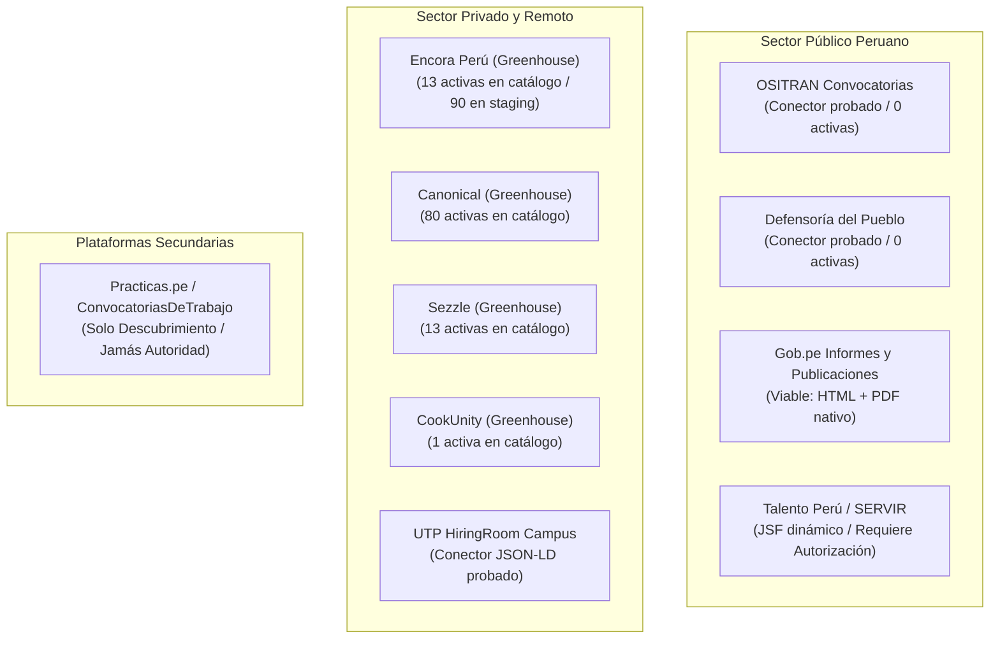

# INFORME CONSOLIDADO: AUDITORÍA INTEGRAL Y ROADMAP EVOLUTIVO DE VELORA

**Activador:** `[INICIALIZAR_AUDITORIA_INTEGRAL_VELORA]`  
**Sub-activadores:** `[ANALIZAR_ESTADO_REAL_DEL_REPOSITORIO]`, `[VERIFICAR_DESPLIEGUE_Y_CATALOGO]`, `[AUDITAR_COBERTURA_NACIONAL_DE_FUENTES]`, `[EVALUAR_ARQUITECTURA_OSS_FIRST]`, `[CONSTRUIR_ROADMAP_MAESTRO_EVOLUTIVO]`  
**Fecha de ejecución:** 23 de noviembre de 2026  
**Commit auditado:** `43a0cad8466fff33da410020013a6e171b71448f` (`integration/r1-02c`, sincronizado con `main` y `origin/main`)  

---

## A. Estado Real de Velora

Velora cuenta con una base de código desacoplada, madura, 100% auditable y libre de deuda en pruebas automatizadas. El núcleo del sistema opera bajo una arquitectura **estática (Backend-less / Jamstack)** en el frontend y un **motor de adquisición, gobernanza y validación en Python estándar** (`collector/`) sin dependencias pesadas de terceros.

Sin embargo, existe una **asimetría estructural** entre la identidad externa del producto, su catálogo activo y la implementación en el código:
1. **Identidad:** En la URL pública de Vercel y en las comunicaciones del proyecto se denomina **Velora**, pero en el 100% del código fuente, interfaz de usuario (`<title>`, encabezado, textos), metadatos y documentación técnica sigue denominándose **Ruta Sistemas**.
2. **Catálogo activo:** Tras la ejecución del hito R4-10 (completado el 23 de noviembre de 2026 en el commit `14c44bb`), el catálogo canónico cuenta con **112 registros** (107 activos reales y 5 demostrativos).
3. **Calidad de software:** La suite de pruebas aprueba al 100%: **232 pruebas unitarias de Python** (pytest), validación determinista del snapshot y **45 pruebas de extremo a extremo (E2E) con Playwright** incluyendo accesibilidad WCAG 2.1 AA con `axe-core`.

---

## B. Hallazgos Críticos

1. **Desincronización de Producción (GitHub Pages vs Vercel):**  
   - **Vercel** (`https://velora-six-fawn.vercel.app/`): Despliega el commit de R4-10 con **107 oportunidades activas verificadas** y paginación funcional.
   - **GitHub Pages** (`https://blueisazul.github.io/WebRutaSistemas/`): Se quedó desactualizado desde el 18 de noviembre de 2026, mostrando solo **1 oportunidad activa** (CookUnity).  
   *Causa raíz:* El trabajo `publish` en `.github/workflows/refresh-catalog.yml` invocaba `python scripts/pages_artifact.py` sin haber configurado el entorno de Python (`actions/setup-python@v5`), fallando silenciosamente antes del despliegue. El fix fue incorporado en el commit `43a0cad`, pero GitHub Pages no ha ejecutado el nuevo despliegue.
2. **Causa del «Problema Conocido de Vercel» (TTL en Cliente):**  
   En revisiones anteriores, Vercel mostró `«No hay oportunidades verificadas disponibles»` y contadores en `«—»`. Esto **no fue una falla de servidor ni de rutas**. Se debió a la lógica de frescura del cliente (`app.js`): si transcurren más de 7 días naturales (`verificationTtlDays: 7`) desde la fecha `lastVerifiedAt` sin una revalidación que refresque la semilla, el frontend degrada dinámicamente las oportunidades a estado `unconfirmed`, ocultándolas de la vista predeterminada. Al actualizarse los timestamps en R4-10, volvieron a mostrarse.
3. **Brecha Absoluta del Sector Público Peruano (0 vacantes activas):**  
   A pesar de que el repositorio cuenta con conectores nativos para **OSITRAN** y **Defensoría del Pueblo** en `collector/pe_connectors.py`, el catálogo publicado contiene **0 vacantes públicas activas**. Las 10 convocatorias del Estado capturadas en R4-09 fueron revalidadas en R4-10 y se constató que ya habían publicado actas de resultados finales o cerrado su etapa de postulación, siendo correctamente bloqueadas por el principio *fail-closed*.
4. **Desconexión Documental en README.md:**  
   El `README.md` público sigue afirmando que el catálogo contiene solo 1 oportunidad (`OP-005`: CookUnity) y que los conectores ATS están desactivados, omitiendo las 107 oportunidades activas y la integración de Encora, Canonical y Sezzle.

---

## C. Estado Real del Catálogo

| Métrica / Dimensión | Cifra Real Calculada | Estado en R2/R3 | Estado en R4-08 | Observaciones Periciales |
|---|---|---|---|---|
| **Total de Registros en Catálogo** | **112** | 6 | 99 | Coincide con snapshot R4-10 (`data/opportunities.json`). |
| **Oportunidades Reales Activas** | **107** | 1 | 94 | `publicationStatus: "active"`, `verificationStatus: "verified"`. |
| **Fichas Demostrativas (Muestra)** | **5** | 5 | 5 | `OP-001` a `OP-004` y `QA-001`. Ocultas por defecto. |
| **Sector Público Activo** | **0** | 0 | 0 | 2 fichas de OSITRAN en catálogo son demostrativas históricas. |
| **Sector Privado Activo** | **107** | 1 | 94 | 100% de la oferta real activa pertenece al sector privado. |
| **Puestos en Territorio Peruano** | **14** | 1 | 1 | **13 de Encora Perú** (`OP-099` a `OP-111`) + **1 CookUnity** (`OP-005`). |
| **Puestos Remotos Internacionales (Perú)** | **93** | 0 | 93 | **80 de Canonical** + **13 de Sezzle** (Elegibilidad Perú confirmada). |
| **Modalidad Remota** | **95** | 0 | 93 | Canonical, Sezzle y 2 roles nacionales de Encora. |
| **Modalidad Híbrida** | **10** | 0 | 0 | 10 roles de Encora en Lima (asistencia 2-3 días). |
| **Modalidad Presencial** | **1** | 0 | 0 | Práctica preprofesional IT Helpdesk en Lima (`OP-099`, Encora). |
| **Modalidad Abierta / No especificada** | **1** | 1 | 1 | CookUnity Supply Chain Analyst (`OP-005`). |
| **Elegibilidad Perú Confirmada** | **107 (100%)** | 1 | 94 | Respaldada documentalmente en cada ficha. |
| **Remuneración Publicada** | **4 (3.7%)** | 0 | 4 | Únicamente 4 vacantes de Sezzle informan salario explícito (USD). |
| **Fechas Límite (Deadlines) Presentes** | **0 (0%)** | 0 | 0 | Requisiciones continuas en ATS corporativo sin fecha de corte fija. |

### Distribución por Nivel Profesional
- **Egresado / Bachiller / Junior avanzado:** 93 vacantes (86.9%)
- **Junior / Entry:** 6 vacantes (5.6%)
- **Estudiante (Prácticas preprofesionales):** 4 vacantes (3.7%)
- **Prácticas formativas profesionales:** 4 vacantes (3.7%)

---

## D. Cobertura de Fuentes Nacionales



### Diagnóstico por Fuente
1. **Talento Perú (SERVIR):** Clasificada como `NEEDS_AUTHORIZATION`. La consulta pública utiliza JavaServer Faces (`app.servir.gob.pe/.../ofertas_laborales.xhtml`) con estado de sesión dinámico (`javax.faces.ViewState`). No dispone de API REST pública. Se requiere tramitar acceso a datos abiertos o consulta asistida de bajo impacto.
2. **Gob.pe (Informes y Publicaciones):** Clasificada como `READY_WITH_LIMITS`. Verificada con el caso INDECOPI (Convocatoria PRAC N° 092-2026). Responde HTTP 200 OK, enlaza directamente a PDFs de bases y cronogramas en el CDN oficial. Es la vía más directa para incorporar ministerios e instituciones estatales reutilizando el extractor PDF nativo de Velora.
3. **OSITRAN y Defensoría del Pueblo:** Clasificadas como `READY`. Conectores completamente funcionales en `collector/pe_connectors.py`. Requieren sondeo semanal para capturar convocatorias en sus breves ventanas de apertura (2 a 5 días).
4. **Empresas Privadas en Perú:** Encora (`encora10`) demostró la alta viabilidad de Greenhouse API en Lima. Próximos objetivos directos: Belcorp, BCP/Yape (ATS compatible) y consultoras de software en Lima.
5. **Plataformas Secundarias (Practicas.pe, Convocatorias de Trabajo):** Clasificadas como `PENDING_REVIEW`. Prohibido usarlas como canal oficial de postulación o autoridad de vigencia; su valor radica exclusivamente como radar de descubrimiento para alertas tempranas.
6. **Portales Comerciales (Computrabajo, Bumeran):** Clasificadas como `BLOCKED`. Bloqueados por Cloudflare Turnstile / Imperva WAF. Se descartan formalmente para respetar directrices y evitar fragilidad técnica.

---

## E. Estado de Despliegue y Paridad

| Parámetro | GitHub Pages | Vercel | Veredicto Pericial |
|---|---|---|---|
| **URL** | `blueisazul.github.io/WebRutaSistemas/` | `velora-six-fawn.vercel.app/` | Ambas operativas (HTTP 200 OK) |
| **Título (`<title>`)** | `Ruta Sistemas` | `Ruta Sistemas` | Paridad (Marca Velora no implementada) |
| **Branding Header** | `/ Ruta Sistemas` | `/ Ruta Sistemas` | Paridad |
| **Catálogo JSON Servido** | 16,954 bytes (Snapshot R2) | 537,807 bytes (Snapshot R4-10) | **Desincronizado** |
| **Fecha de Generación** | 2026-11-18T03:53:25Z | 2026-11-23T13:54:01Z | **Desincronizado (5 días de atraso en Pages)** |
| **Registros Totales** | 6 | 112 | **Desincronizado** |
| **Oportunidades Activas** | **1** (CookUnity) | **107** (Canonical, Encora, Sezzle) | **Desincronizado** |
| **Paginación en Pantalla** | No visible (1 tarjeta) | Visible (12 por página, 9 páginas) | **Desincronizado** |

---

## F. Arquitectura Objetivo (Evolución OSS-First)

Para alcanzar el objetivo sin duplicar código ni introducir backend innecesario:
1. **Mantener Backend-less en Producción:** Distribución estática de 5 archivos (`index.html`, `app.js`, `styles.css`, `canvas.js`, `data/opportunities.json`).
2. **Reutilización OSS Existente (Zero Pip Dependencies):**
   - El extractor nativo de PDF en `collector/pe_connectors.py` utiliza `zlib` y decodificación de operadores gráficos `Tj`/`TJ` de la biblioteca estándar de Python. No requiere librerías adicionales para PDFs digitales estándar.
   - El extractor semántico en `collector/jsonld_extractor.py` procesa `JobPosting` de Schema.org con `html.parser` estándar.
3. **Publicación Basada en Reglas Objetivas:** Reemplazar el cuello de botella de aprobación manual individual por un motor de auto-publicación condicionado: si una vacante de una fuente pre-aprobada satisface host seguro, taxonomía técnica, elegibilidad comprobada y no colisiona, se publica automáticamente.
4. **Resiliencia de TTL en Frontend:** Modificar `currentStates` en `app.js` para que la expiración de los 7 días de verificación no oculte la vacante, sino que muestre una advertencia informativa de auditoría en la tarjeta.

---

## G. Roadmap Maestro Evolutivo

El roadmap completo con dependencias y criterios de aceptación se formalizó en [VELORA-MASTER-ROADMAP.md](file:///c:/Users/sant1/Downloads/EmpleoWeb/docs/roadmap/VELORA-MASTER-ROADMAP.md).

```
┌────────────────────────────────────────────────────────────────────────┐
│ FASE INMEDIATA (R4-11): Estabilización de Despliegue, Marca y Frescura│
├────────────────────────────────────────────────────────────────────────┤
│ • TASK-R4-11-01 [P0] Sincronización y despliegue de GitHub Pages       │
│ • TASK-R4-11-02 [P0] Transición oficial de identidad a "Velora"        │
│ • TASK-R4-11-03 [P0] Desacople de TTL en cliente (anti-apagones)       │
└──────────────────────────────────┬─────────────────────────────────────┘
                                   │
┌──────────────────────────────────▼─────────────────────────────────────┐
│ FASE COBERTURA NACIONAL (R5): Sector Público y Ecosistema Privado Perú │
├────────────────────────────────────────────────────────────────────────┤
│ • TASK-R5-01 [P1] Conector Gob.pe Informes y Publicaciones             │
│ • TASK-R5-02 [P1] Protocolo institucional y consulta SERVIR            │
│ • TASK-R5-03 [P1] Ampliación ATS empresas privadas en Lima             │
└──────────────────────────────────┬─────────────────────────────────────┘
                                   │
┌──────────────────────────────────▼─────────────────────────────────────┐
│ FASE AUTOMATIZACIÓN OPERATIVA (R6): Publicación Objetiva y Ciclo Vivo  │
├────────────────────────────────────────────────────────────────────────┤
│ • TASK-R6-01 [P1] Motor de auto-publicación basada en reglas objetivas │
│ • TASK-R6-02 [P2] Revalidación programada desatendida en CI/CD         │
└──────────────────────────────────┬─────────────────────────────────────┘
                                   │
┌──────────────────────────────────▼─────────────────────────────────────┐
│ FASE VALOR PROFESIONAL Y UX (R7): Regímenes Laborales y Trayectorias   │
├────────────────────────────────────────────────────────────────────────┤
│ • TASK-R7-01 [P2] Taxonomía de regímenes laborales (CAS / 728 / Form.) │
│ • TASK-R7-02 [P3] Comparador de habilidades y análisis de trayectorias │
└────────────────────────────────────────────────────────────────────────┘
```

---

## H. Siguiente Bloque Recomendado de Mayor Impacto

### Bloque Único: `R4-11 — Estabilización, Paridad y Formalización de Marca Velora`
- **Por qué es la prioridad número uno:**  
  Antes de ingresar nuevas fuentes del Estado, el proyecto debe resolver su inconsistencia pública: GitHub Pages debe reflejar las 112 oportunidades ya validadas, la marca Velora debe plasmarse en el código/UI, y el TTL debe desacoplarse para que el catálogo nunca vuelva a "apagarse" accidentalmente.
- **Acciones concretas:**
  1. Disparar el workflow de GitHub Actions para que GitHub Pages sirva el snapshot de 112 oportunidades.
  2. Sustituir "Ruta Sistemas" por "Velora" en `<title>`, cabecera de `index.html` y documentación.
  3. Ajustar `app.js` para que la expiración de 7 días muestre una advertencia en la tarjeta sin ocultar la oportunidad.

---

## I. Decisiones Requeridas del Propietario

Las decisiones estratégicas que no pueden resolverse unilateralmente por la vía técnica están detalladas en [VELORA-OPEN-DECISIONS.md](file:///c:/Users/sant1/Downloads/EmpleoWeb/docs/audits/VELORA-OPEN-DECISIONS.md):

1. **Formalización de Marca:** ¿Aprobar el reemplazo definitivo del nombre visible "Ruta Sistemas" por **Velora** en `index.html`, cabecera y `package.json`?
2. **Política de Auto-Publicación:** ¿Aprobar que las vacantes de fuentes pre-aprobadas que cumplan reglas objetivas se publiquen automáticamente sin requerir aprobación humana individual en cada caso?
3. **Estrategia con Talento Perú / SERVIR:** ¿Enviar una solicitud institucional de colaboración/datos abiertos a SERVIR o implementar un extractor técnico defensivo de bajo impacto?
4. **Dominio Canónico:** ¿Fijar Vercel como entorno productivo primario con dominio propio (`velora.pe` / `velora.app`) y mantener GitHub Pages como réplica pasiva?
5. **Visibilidad de Procesos Estatales Concluidos:** ¿Permitir que las convocatorias públicas concluidas se mantengan en el catálogo con etiqueta informativa `"Histórica / Concluida"` para que los estudiantes conozcan perfiles y remuneraciones del Estado?

---

## J. Evidencia Técnica y Documental

### 1. Entregables Documentales Creados en el Repositorio
- [VELORA-AUDIT-01-REAL-STATE.md](file:///c:/Users/sant1/Downloads/EmpleoWeb/docs/audits/VELORA-AUDIT-01-REAL-STATE.md) — Auditoría técnica, catálogo, despliegues y pruebas.
- [VELORA-AUDIT-02-NATIONAL-SOURCES.md](file:///c:/Users/sant1/Downloads/EmpleoWeb/docs/audits/VELORA-AUDIT-02-NATIONAL-SOURCES.md) — Matriz de fuentes peruanas, SERVIR, Gob.pe y ATS.
- [VELORA-MASTER-ROADMAP.md](file:///c:/Users/sant1/Downloads/EmpleoWeb/docs/roadmap/VELORA-MASTER-ROADMAP.md) — Roadmap maestro evolutivo por etapas y tareas P0-P3.
- [VELORA-OPEN-DECISIONS.md](file:///c:/Users/sant1/Downloads/EmpleoWeb/docs/audits/VELORA-OPEN-DECISIONS.md) — Registro de decisiones exclusivas del propietario.
- [VELORA-AUDIT-EXECUTIVE-SUMMARY.md](file:///c:/Users/sant1/Downloads/EmpleoWeb/docs/audits/VELORA-AUDIT-EXECUTIVE-SUMMARY.md) — Resumen ejecutivo de alto nivel.

### 2. Pruebas y Comprobaciones Ejecutadas Certificadas
- **Pytest:** 232 pruebas unitarias aprobadas, 43 subtests aprobados (8.78 s).
- **Validación de Catálogo:** `python scripts/build_catalog.py --check` y `python scripts/validate_catalog.py` concluyeron con 112 registros válidos y paridad 100% entre semilla y snapshot.
- **Node Syntax Check:** `node --check app.js` sin errores.
- **Pruebas de Filtrado Frontend:** `node tests/catalog_ui.test.cjs` aprobadas.
- **Playwright E2E:** 45 pruebas aprobadas en Chromium desktop, mobile y narrow (2.8 min), con cero violaciones críticas o serias de accesibilidad WCAG 2.1 AA (`axe-core`).
- **Navegador Headless en Producción (Playwright en Vercel y Pages):**
  - Vercel: Renderiza 107 oportunidades activas, 12 tarjetas en página 1, cero errores JavaScript.
  - Pages: Renderiza 1 oportunidad activa (desincronizado con respecto al repositorio).
- **Comprobación de Red en Vivo:**
  - `https://www.gob.pe/...`: HTTP 200 OK (33 KB, enlaces a bases PDF confirmados).
  - `https://app.servir.gob.pe/...`: HTTP 200 OK (74 KB, JSF ViewState confirmado).
  - `https://www.practicas.pe/...`: HTTP 200 OK (337 KB).
  - `https://www.convocatoriasdetrabajo.com/...`: HTTP 200 OK (292 KB).

### 3. Integridad del Código Fuente
De acuerdo con las restricciones de la fase de auditoría, **ningún archivo de código de la aplicación, catálogo ni flujo de despliegue ha sido modificado o alterado**. La totalidad de los hallazgos y el roadmap se encuentran documentados y listos para la revisión y aprobación del propietario.

---

# VELORA-MASTER-ROADMAP — Roadmap Maestro Evolutivo de Velora

- **Versión:** 1.0.0
- **Fecha de emisión:** 23 de noviembre de 2026
- **Estado rector:** Aprobado para evaluación técnica y decisión del propietario
- **Fuente de verdad:** Este documento sustituye las referencias dispersas y unifica el estado histórico con la evolución futura de Velora.

---

## 1. Visión y Principios Rectores

### 1.1 Visión
Convertir a **Velora** en el catálogo nacional confiable de oportunidades profesionales para estudiantes, bachilleres, egresados y profesionales de **Ingeniería de Sistemas, Informática, Computación, Software, Ciberseguridad, Datos y Tecnología en el Perú**.

### 1.2 Principios Rectores de Ingeniería y Producto
1. **Verificabilidad Absoluta (*Fail-Closed*):** Ninguna oportunidad se publica sin evidencia de procedencia, enlace al canal oficial del empleador y confirmación de vigencia.
2. **Claridad sobre Promesas:** Velora no promete trabajo, ascensos ni continuidad; informa condiciones objetivas, modalidades contractuales y riesgos de forma explicable.
3. **OSS-First:** Priorizar herramientas abiertas y estándar (Python standard library, SQLite, Tailwind OSS, herramientas nativas) antes de incorporar servicios comerciales o frameworks pesados.
4. **Backend-less Ligero:** Mantener la distribución estática de alta disponibilidad y bajo costo, delegando la adquisición y validación a procesos locales o CI/CD reproducibles.
5. **No Exclusión por Nivel:** Los niveles formativos (Prácticas), Junior, Mid y Senior son facetas de filtrado para entender oportunidades, no motivos automáticos de exclusión.

---

## 2. Reconciliación Histórica de Hitos (R0 a R4)

Para garantizar trazabilidad sin reabrir bloques ya completados, se formaliza el estado de las fases anteriores:

| Fase / Hito | Denominación Histórica | Estado Real | Evidencia en Repositorio |
|---|---|---|---|
| **R0** | Diagnóstico y Alcance MVP | `DONE` | `docs/architecture/r0-decisiones-y-alcance-2026-11-12.md` |
| **R1** | Estabilización Técnica y UI | `DONE` | `index.html`, `styles.css`, Canvas WebGL2, 0 errores sintácticos |
| **R2** | Flujo Editorial Real | `DONE` | Primera vacante real (`OP-005` CookUnity), contrato editorial de 21 campos |
| **R2-OSS** | Integración Tecnológica OSS | `DONE` | Conectores ATS, extractor JSON-LD, deduplicación determinista, CLI local |
| **R3** | Alpha Privada y Rediseño UX | `DONE` | Rediseño de tarjeta, modal de detalle, comparador, paginación, feedback interno |
| **R4-01 a R4-07** | Piloto Multifuente y Auditorías | `DONE` | Motor `collector/`, validación de evidencias, reconciliación editorial |
| **R4-08** | Promoción de Opción B | `DONE` | 84 vacantes aprobadas de Canonical y Sezzle desplegadas a producción |
| **R4-09** | Integración de Fuentes Peruanas | `DONE` | Conectores OSITRAN, Defensoría, UTP HiringRoom y extractor nativo PDF |
| **R4-10** | Release Nacional y Encora Perú | `DONE` | Incorporación de Encora (`encora10`), catálogo canónico ampliado a 112 fichas |

---

## 3. Estructura de Fases del Roadmap Maestro

```
Fase Inmediata (R4-11) ────────► Estabilización: Paridad Vercel/Pages, Branding Velora y Corrección TTL
       │
Fase Cobertura Nacional (R5) ──► Adquisición Estado (Gob.pe / SERVIR) + Empresas Privadas en Perú
       │
Fase Automatización (R6) ─────► Auto-Publicación Basada en Reglas + Revalidación Background
       │
Fase Valor Profesional (R7) ──► Régimen Laboral (CAS/728), Habilidades y Trayectorias
```

---

## 4. Matriz de Tareas del Roadmap

### FASE INMEDIATA: Estabilización Operativa, Marca y Resiliencia (R4-11)

#### `TASK-R4-11-01` — Sincronización y Despliegue de GitHub Pages
- **Prioridad:** `P0` (Bloqueante operativo)
- **Tipo:** `[REFACTOR/FIX]`
- **Estado:** `PENDING`
- **Dependencias:** Ninguna (Commit `43a0cad` ya fusionado en `main`).
- **Objetivo:** Lograr paridad exacta del 100% entre GitHub Pages y Vercel (servir las 112 oportunidades en ambos).
- **Alcance:** Disparar el workflow `.github/workflows/refresh-catalog.yml` mediante `workflow_dispatch` o push vacío verificado; validar que el step `Prepare and validate exact Pages artifact` genere el artefacto con Python 3.12 y despliegue exitosamente a `blueisazul.github.io/WebRutaSistemas/`.
- **Criterios de Aceptación:**
  1. `https://blueisazul.github.io/WebRutaSistemas/data/opportunities.json` responde con `total opps: 112` y `schemaVersion: 2`.
  2. En el navegador se renderizan 107 oportunidades activas y paginación en GitHub Pages.
- **Riesgo:** Cuotas de runner en GitHub Actions (bajo).
- **Evidencia requerida:** Inspección HTTP con status 200 y tamaño ~537 KB.

#### `TASK-R4-11-02` — Transición Oficial de Identidad Visual y Marca a "Velora"
- **Prioridad:** `P0` (Estratégico de producto)
- **Tipo:** `[DESARROLLO_PROPIO - Justificado]`
- **Estado:** `PENDING`
- **Dependencias:** Aprobación del propietario en `VELORA-OPEN-DECISIONS.md`.
- **Objetivo:** Unificar la marca del producto bajo el nombre oficial **Velora** en toda la interfaz y metadatos.
- **Alcance:**
  - Actualizar `<title>Velora — Oportunidades y Trayectorias en Tecnología</title>` en `index.html`.
  - Actualizar logotipo y texto de cabecera en `index.html`: sustituir "Ruta Sistemas" por "Velora".
  - Actualizar textos del hero y metadatos OpenGraph.
  - Actualizar `package.json` (`name: "velora"`).
  - Actualizar `README.md` público reflejando la identidad de Velora, la escala real de 112 oportunidades y la arquitectura actual.
- **Criterios de Aceptación:**
  1. La interfaz web muestra consistentemente "Velora".
  2. Todas las pruebas unitarias y E2E de Playwright actualizadas aprueban sin fallas de selectores.
- **Riesgo:** Ruptura de tests de integración que buscan el string literal "Ruta Sistemas" (requiere actualizar aserciones).

#### `TASK-R4-11-03` — Desacople del TTL de Frescura en Frontend (Protección contra Apagones)
- **Prioridad:** `P0` (Resiliencia de catálogo)
- **Tipo:** `[REFACTOR/FIX]`
- **Estado:** `PENDING`
- **Dependencias:** Ninguna.
- **Objetivo:** Evitar que el catálogo oculte todas las oportunidades cuando se superan los 7 días de `verificationTtlDays` sin una corrida editorial.
- **Alcance:**
  - Modificar `app.js` (`currentStates`): la expiración por TTL debe mostrar una advertencia visual de frescura (*"Verificada hace más de 7 días"* o badge informativo de revalidación sugerida) en lugar de degradar destructivamente a `"unconfirmed"` y ocultar la tarjeta.
  - La exclusión de publicación debe reservarse exclusivamente para cuando la fecha límite (`deadline`) esté vencida o el empleador haya confirmado el cierre.
- **Criterios de Aceptación:**
  1. Simulaciones con fechas desfasadas mayores a 7 días continúan mostrando las vacantes abiertas con advertencia de auditoría, manteniendo el catálogo visible.
- **Riesgo:** Publicar información ligeramente desactualizada si una vacante cerró sin deadline (mitigado por advertencia explícita en tarjeta).

---

### FASE COBERTURA NACIONAL: Sector Público y Ecosistema Privado Peruano (R5)

#### `TASK-R5-01` — Conector de Convocatorias Estatales Gob.pe (`gobpe-convocatorias`)
- **Prioridad:** `P1` (Alto impacto nacional)
- **Tipo:** `[INTEGRACIÓN_OSS]` (Reutilización de parsers HTML y PDF nativos)
- **Estado:** `PENDING`
- **Dependencias:** `TASK-R4-11-01`.
- **Objetivo:** Adquirir convocatorias públicas vigentes de TI y Sistemas publicadas en la plataforma única del Estado (`gob.pe`).
- **Alcance:**
  - Implementar en `collector/pe_connectors.py` el conector `gobpe-convocatorias` para rastrear secciones de "Informes y Publicaciones" (tipo: Convocatorias de Trabajo) de entidades priorizadas (INDECOPI, SUNAT, RENIEC, Ministerios).
  - Integrar la descarga controlada de PDFs de bases oficiales y extracción de requisitos, perfil y cronograma mediante `extract_text_from_pdf_bytes`.
  - Registrar la fuente en `collector/sources.json` bajo directiva *fail-closed*.
- **Criterios de Aceptación:**
  1. Extracción exitosa de convocatorias con enlaces oficiales a bases en CDN de Gob.pe.
  2. Incorporación de al menos 5 oportunidades estatales vigentes al staging de candidatos.
- **Riesgo:** Estructura HTML dispar entre distintas entidades en Gob.pe (mitigado con parsing defensivo).

#### `TASK-R5-02` — Protocolo Institucional y Consulta Controlada de Talento Perú (SERVIR)
- **Prioridad:** `P1` (Estratégico estatal)
- **Tipo:** `[DESARROLLO_PROPIO - Justificado]`
- **Estado:** `BLOCKED` (Pendiente de decisión editorial y autorización)
- **Dependencias:** Aprobación del propietario en `VELORA-OPEN-DECISIONS.md`.
- **Objetivo:** Establecer un canal regular y autorizado para incorporar el volumen masivo de convocatorias de SERVIR.
- **Alcance:**
  - Vía A (Institucional): Tramitar comunicación formal de datos abiertos a SERVIR (`talentoperu@servir.gob.pe`).
  - Vía B (Técnica asistida): Implementar un extractor local que consulte el formulario JSF `ofertas_laborales.xhtml` respetando estrictamente `minDelayMs: 10000`, extrayendo únicamente metadatos de puestos de Sistemas para contrastar contra fuentes oficiales.
- **Criterios de Aceptación:**
  1. Registro auditable de autorización o mecanismo de consulta de bajo impacto sin violar términos del servicio.
- **Riesgo:** Bloqueo de IP o rechazo institucional.

#### `TASK-R5-03` — Ampliación de Empresas de Tecnología y Finanzas en Perú
- **Prioridad:** `P1` (Diversificación privada)
- **Tipo:** `[ADAPTACIÓN_OSS]`
- **Estado:** `PENDING`
- **Dependencias:** Ninguna.
- **Objetivo:** Incorporar 3 a 5 nuevas fuentes corporativas de tecnología con presencia física y contratación directa en el Perú.
- **Alcance:**
  - Auditar e integrar bolsas públicas en Greenhouse/Lever de: Belcorp, BCP / Yape (mediante su ATS correspondiente), Stefanini Perú y consultoras de software locales.
  - Configurar filtros geográficos estrictos (`locationFilter: ["peru", "lima"]`).
- **Criterios de Aceptación:**
  1. Incorporación de al menos 20 nuevas vacantes privadas locales en staging.
  2. Validación de elegibilidad y contrato en territorio peruano.

---

### FASE AUTOMATIZACIÓN OPERATIVA: Publicación Objetiva y Operación Continua (R6)

#### `TASK-R6-01` — Política y Motor de Auto-Publicación Basada en Reglas Objetivas
- **Prioridad:** `P1` (Escalabilidad de producto)
- **Tipo:** `[DESARROLLO_PROPIO - Justificado]`
- **Estado:** `PENDING`
- **Dependencias:** Aprobación de política en `VELORA-OPEN-DECISIONS.md`.
- **Objetivo:** Eliminar el cuello de botella de aprobación manual individual para fuentes pre-autorizadas y confiables.
- **Alcance:**
  - Implementar en `collector/` el módulo de promoción automática: un candidato en staging se promueve automáticamente al catálogo canónico si cumple al 100% las siguientes condiciones:
    1. Proviene de una fuente con `decision: "approved"` y `automatedAccessStatus: "approved"`.
    2. Enlace de postulación HTTPS válido en host de lista blanca.
    3. Clasificación técnica inequívoca en taxonomía de Sistemas/Tecnología.
    4. Cero colisiones en deduplicación determinista.
    5. Fecha límite futura o vacante abierta confirmada en ATS.
    6. Trazabilidad completa de evidencias requeridas.
  - Los casos dudosos o con alertas de taxonomía se retienen en `pending_review` para inspección humana.
- **Criterios de Aceptación:**
  1. Ejecución de prueba con fixtures: candidatos válidos se publican automáticamente; candidatos ambiguos quedan retenidos.
- **Riesgo:** Inclusión involuntaria de un rol no afín si la taxonomía falla (mitigado con lista de exclusión de palabras clave).

#### `TASK-R6-02` — Revalidación Programada en GitHub Actions
- **Prioridad:** `P2` (Frescura desatendida)
- **Tipo:** `[DESARROLLO_PROPIO - Justificado]`
- **Estado:** `PENDING`
- **Dependencias:** `TASK-R6-01`.
- **Objetivo:** Automatizar la comprobación semanal de vacantes cerradas y refresco de timestamps.
- **Alcance:**
  - Activar un workflow cron en `.github/workflows/revalidation-audit.yml` (ejecución semanal).
  - Cerrar automáticamente registros cuya vacante desapareció del ATS tras 2 verificaciones consecutivas.
- **Criterios de Aceptación:**
  1. Convocatorias cerradas pasan automáticamente a estado histórico sin intervención manual.

---

### FASE VALOR PROFESIONAL Y UX: Modalidades, Habilidades y Trayectorias (R7)

#### `TASK-R7-01` — Taxonomía de Regímenes Laborales Peruanos (CAS, 728, Formativo)
- **Prioridad:** `P2` (Valor funcional Perú)
- **Tipo:** `[DESARROLLO_PROPIO - Justificado]`
- **Estado:** `PENDING`
- **Dependencias:** `TASK-R5-01`.
- **Objetivo:** Permitir al usuario filtrar y entender la modalidad de contratación en el sector público y privado.
- **Alcance:**
  - Añadir filtro en frontend y campo en esquema: `Modalidad Formativa (Ley 28518)`, `CAS (D.L. 1057)`, `Régimen 728 (Privado/Público)`, `Locación de Servicios / Honorarios`.
  - Explicar en la tarjeta los derechos básicos asociados a cada modalidad (ej. subvención, seguro, vacaciones).
- **Criterios de Aceptación:**
  1. Filtro visible en UI que discrimina efectivamente puestos formativos de CAS y régimen privado.

#### `TASK-R7-02` — Comparador de Trayectorias y Requisitos Técnicos
- **Prioridad:** `P3` (Evolución de producto)
- **Tipo:** `[DESARROLLO_PROPIO - Justificado]`
- **Estado:** `PENDING`
- **Dependencias:** `TASK-R7-01`.
- **Objetivo:** Brindar a los estudiantes herramientas de análisis de brechas de habilidades frente a los requisitos del mercado.
- **Alcance:**
  - Extraer nube de tecnologías y competencias requeridas (Python, Java, Cloud, SQL, Redes) y contrastar requisitos entre dos oportunidades en el comparador actual.
- **Criterios de Aceptación:**
  1. Vista comparativa resalta competencias coincidentes y diferenciadoras.

---

## 5. Siguiente Acción Única Recomendada

**`TASK-R4-11-01` + `TASK-R4-11-02` (Bloque Unificado R4-11):**
Sincronizar de inmediato el despliegue de GitHub Pages para reflejar las 112 oportunidades ya validadas y formalizar el nombre **Velora** en el código fuente, UI y documentación del repositorio.

---

# VELORA-OPEN-DECISIONS — Registro de Decisiones Requeridas del Propietario

- **Fecha de emisión:** 23 de noviembre de 2026
- **Propósito:** Someter a decisión exclusiva del propietario del proyecto los dilemas estratégicos, legales y de producto que no deben ser resueltos unilateralmente por la vía técnica.

---

## Decisión 1: Formalización de Marca e Identidad Visual (Velora frente a Ruta Sistemas)

- **Contexto:**  
  El proyecto se concibió históricamente como "Ruta Sistemas" (repositorio `WebRutaSistemas`). No obstante, en la URL pública de Vercel (`velora-six-fawn.vercel.app`) y en la estrategia de producto se utiliza el nombre **Velora**. En el código actual, interfaz de usuario (`<title>`, encabezado, textos), metadatos y documentación técnica, la palabra "Velora" no aparece en ninguna parte.
- **Alternativas:**
  - **Opción A (Recomendada):** Adoptar plenamente la marca **Velora** en la interfaz de usuario, cabecera, metadatos y documentación pública, conservando "Ruta Sistemas" únicamente como subtítulo formativo o nombre histórico del repositorio.
  - **Opción B:** Mantener "Ruta Sistemas" como marca oficial y configurar un dominio personalizado acorde en Vercel, retirando la denominación "Velora".
- **Impacto Técnico:**  
  La Opción A requiere actualizar `index.html`, `README.md` y selectores de aserción en los tests E2E de Playwright.

---

## Decisión 2: Política de Publicación Automatizada sin Revisión Manual Individual

- **Contexto:**  
  El propietario cuestionó la necesidad de que cada oportunidad individual requiera una aprobación humana explícita antes de publicarse, argumentando que si una vacante es legítima y verificable, debe estar visible para que el usuario tome su propia decisión.
- **Alternativas:**
  - **Opción A (Recomendada - Reglas Objetivas):** Autorizar que toda vacante capturada desde fuentes pre-aprobadas (ej. Greenhouse de Encora, Canonical, Sezzle o bases oficiales de Gob.pe) que cumpla estrictamente con:
    1. Host permitido y URL HTTPS segura.
    2. Taxonomía técnica afín a Sistemas/Software/Tecnología.
    3. Elegibilidad verificada en Perú.
    4. Cero colisiones en deduplicación.
    5. Fecha límite futura o estado abierto confirmado.  
    se publique **automáticamente** en el catálogo activo, reservando la revisión humana únicamente para excepciones, conflictos de deduplicación o fuentes nuevas.
  - **Opción B (Flujo Editorial Estricto):** Mantener la aprobación humana manual mediante `editorialDecision` para cada vacante antes de su promoción a producción.
- **Impacto:**  
  La Opción A escala el catálogo nacional a cientos de vacantes sin cuellos de botella humanos, manteniendo el principio *fail-closed*.

---

## Decisión 3: Estrategia de Acceso para Talento Perú / SERVIR

- **Contexto:**  
  Talento Perú (`app.servir.gob.pe`) es el portal con mayor volumen de convocatorias del Estado peruano, pero utiliza formularios dinámicos JavaServer Faces (JSF) sin API REST pública y con términos que no contemplan scraping masivo.
- **Alternativas:**
  - **Opción A (Vía Institucional):** Remitir una carta o solicitud formal de acceso a datos abiertos o colaboración institucional a SERVIR (`talentoperu@servir.gob.pe`).
  - **Opción B (Scraping de Bajo Impacto):** Implementar un conector técnico defensivo que consulte periódicamente (1 vez al día, con demoras de 10 segundos) únicamente los metadatos de ofertas afines a Sistemas, asumiendo el riesgo de bloqueo de IP o cambios de interfaz JSF.
  - **Opción C (Descubrimiento Asistido):** Utilizar Gob.pe y portales de reguladores como fuentes directas, dejando Talento Perú como canal de consulta manual externa referenciada.
- **Impacto:**  
  Define la legitimidad y estabilidad del flujo de datos del sector público.

---

## Decisión 4: Dominio Canónico y Plataforma Definitiva de Despliegue

- **Contexto:**  
  Actualmente existen dos despliegues públicos: Vercel (`velora-six-fawn.vercel.app`) y GitHub Pages (`blueisazul.github.io/WebRutaSistemas/`), los cuales estuvieron desfasados debido a un fallo en el CI de Pages.
- **Alternativas:**
  - **Opción A (Vercel como Canónico):** Declarar a Vercel como la plataforma principal de producción, asociarle un dominio propio (ej. `velora.pe` o `velora.app`) y mantener GitHub Pages únicamente como réplica pasiva de respaldo.
  - **Opción B (GitHub Pages como Canónico):** Mantener GitHub Pages como plataforma principal aprovechando el workflow de empaquetado exacto de 5 archivos (`pages_artifact.py`).
- **Impacto:**  
  Claridad de cara al usuario final, SEO y centralización del tráfico.

---

## Decisión 5: Política Editorial sobre Procesos del Estado Concluidos

- **Contexto:**  
  En el sector público peruano (CAS y Prácticas), los concursos suelen tener una ventana de postulación de solo 2 a 5 días hábiles. Cuando el proceso termina, las bases y actas siguen siendo valiosas para que un estudiante conozca qué perfiles, conocimientos y remuneraciones exige el Estado.
- **Alternativas:**
  - **Opción A:** Permitir que las convocatorias públicas concluidas se mantengan en el catálogo bajo la etiqueta clara de `"Convocatoria concluida / Histórica"` (sin CTA de postulación), para fines de comparación y entendimiento del mercado estatal.
  - **Opción B:** Ocultarlas inmediatamente del catálogo una vez concluida la postulación, mostrándolas solo si el usuario activa un filtro explícito de histórico.
- **Impacto:**  
  Enriquece la utilidad informativa del catálogo para el estudiante sin inducir a postulaciones extemporáneas.

---

# VELORA-AUDIT-EXECUTIVE-SUMMARY — Resumen Ejecutivo de la Auditoría Integral de Velora

- **Fecha:** 23 de noviembre de 2026
- **Audiencia:** Propietario del Producto, Dirección Técnica y Comité de Entrega
- **Objetivo:** Explicar con honestidad, evidencia empírica y claridad estratégica el estado actual de Velora y la ruta hacia un catálogo nacional confiable.

---

## 1. ¿Qué Tenemos Hoy?
Velora cuenta con una **base de ingeniería de alta calidad**:
- Una aplicación web estática, rápida, accesible (certificada WCAG 2.1 AA) y sin dependencias de frameworks pesados en runtime.
- Un motor de adquisición y gobernanza local escrito en Python estándar (sin librerías externas complejas), con validación de contrato Schema 2, deduplicación determinista y trazabilidad de evidencias por campo.
- Un catálogo canónico publicado con **112 registros totales**, de los cuales **107 son oportunidades reales, activas y verificadas**.
- Una cobertura de pruebas automatizadas impecable: **232 pruebas unitarias de Python** y **45 pruebas de interfaz de usuario de Playwright**, todas pasando al 100%.

---

## 2. ¿Qué Funciona Correctamente?
1. **La Adquisición de ATS Modernos:** Los conectores para **Greenhouse** funcionan de forma determinista y segura para Canonical, Sezzle, CookUnity y recientemente **Encora Perú**, permitiendo poblar el catálogo con datos estructurados y verídicos.
2. **La Experiencia de Usuario:** La búsqueda, los 9 filtros (modalidad, nivel, familia, sector, remuneración, riesgo), la vista comparativa entre dos oportunidades y la paginación funcionan fluidamente en escritorio y dispositivos móviles.
3. **El Principio *Fail-Closed*:** Si una vacante no tiene URL oficial, si el host no está autorizado o si el proceso concluyó, el sistema la bloquea antes de que llegue al usuario.
4. **Despliegue en Vercel:** `https://velora-six-fawn.vercel.app/` está desplegando correctamente el catálogo actualizado de 107 oportunidades activas.

---

## 3. ¿Qué No Funciona o Está Desfasado?
1. **Desincronización de GitHub Pages:** Mientras Vercel muestra 107 oportunidades, GitHub Pages muestra solo 1. Esto se debió a un error en el workflow de CI/CD (falta de Python en el paso de publicación), recién corregido en el repositorio pero pendiente de re-despliegue.
2. **Inconsistencia de Marca (El dilema "Velora" vs "Ruta Sistemas"):** La URL de producción se llama `velora-six-fawn.vercel.app`, pero dentro de la página web, en el código y en la documentación no existe la palabra "Velora"; sigue diciendo "Ruta Sistemas" en todos lados.
3. **Fragilidad del TTL de Frescura en el Navegador:** El código del frontend degrada automáticamente las oportunidades a "no confirmadas" si han pasado más de 7 días desde su última fecha de verificación. Si el equipo no ejecuta una actualización semanal de fechas, el catálogo se "apaga" en la pantalla del usuario mostrando el mensaje: *«No hay oportunidades verificadas disponibles»*.
4. **Cero Oportunidades Activas del Estado:** A pesar de haber desarrollado conectores para el sector público (OSITRAN y Defensoría del Pueblo), el catálogo publicado no tiene ninguna plaza activa del Estado peruano porque los procesos analizados ya habían concluido.

---

## 4. ¿Qué Oportunidades se Están Perdiendo?
- **La gran masa del Sector Público:** Ministerios, INDECOPI, SUNAT, Gobiernos Regionales y Poder Judicial publican cientos de convocatorias mensuales de prácticas y CAS para carreras de Sistemas en Gob.pe y Talento Perú. Actualmente, Velora no las está capturando.
- **Banca y Grandes Empresas Locales:** Entidades como Interbank, BCP, BBVA, Belcorp, Alicorp y las principales consultoras de software en Lima contratan masivamente practicantes y juniors en Sistemas, pero aún no están mapeadas en los conectores de Velora.

---

## 5. ¿Qué Impide Tener Cobertura Nacional Inmediata?
1. **Estructura Técnica Dispar del Estado:** Talento Perú (SERVIR) no ofrece una API REST abierta; opera con una plataforma dinámica en JavaServer Faces que exige estado de sesión y carece de autorización explícita de scraping masivo.
2. **El Cuello de Botella Editorial Humano:** Hasta ahora, el flujo exigía que cada vacante fuese aprobada manualmente por una persona antes de publicarse, lo cual impide escalar a cientos de oportunidades semanales.
3. **Ciclos de Vida Públicos Extremadamente Cortos:** Las convocatorias del Estado suelen abrir postulaciones por 2 a 4 días. Para capturarlas vivas se requiere una frecuencia de sondeo semanal o bisemanal automatizada.

---

## 6. ¿Qué Necesitamos Técnicamente?
1. **Desarrollar el conector `gobpe-convocatorias`:** Extraer las convocatorias oficiales publicadas en Gob.pe aprovechando nuestro parser nativo de HTML y PDF, sin añadir paquetes externos.
2. **Aprobar una Política de Auto-Publicación por Reglas Objetivas:** Si una vacante viene de una fuente aprobada, tiene canal oficial, es afín a Sistemas y tiene fecha futura, debe publicarse automáticamente sin esperar un visto bueno manual.
3. **Corregir el TTL en Frontend:** Hacer que el frontend muestre una advertencia informativa de antigüedad en vez de ocultar la vacante, protegiendo al sitio contra apagones accidentales.
4. **Incorporar 3 a 5 ATS de Empresas en Lima:** Sumar bolsas públicas en Greenhouse/Lever de empresas con centros de tecnología en Perú.

---

## 7. Riesgos Principales y Mitigaciones
- **Riesgo Legal / Bloqueos Anti-Bot:** No raspar portales con protecciones agresivas (Computrabajo/Bumeran). Centrarse en fuentes oficiales transparentes (Gob.pe, ATS oficiales directos).
- **Riesgo de Publicar Vacantes Vencidas:** Mitigado por el conector de revalidación que detecta cuándo una página de postulación devuelve 404 o anuncia resultados finales.
- **Riesgo de Ruptura de Marca:** Resolver formalmente la identidad visual sustituyendo "Ruta Sistemas" por "Velora" en un hito controlado (R4-11).

---

## 8. ¿Qué Ejecutaremos Primero? (Siguiente Acción Concreta)

### Bloque Inmediato R4-11: Estabilización y Marca Velora
1. **Desplegar GitHub Pages:** Sincronizar el pipeline para que ambas plataformas (Vercel y Pages) muestren exactamente las 112 oportunidades.
2. **Aplicar la Marca Velora:** Actualizar el título, cabecera y README a **Velora**.
3. **Ajustar la Regla de TTL:** Proteger el catálogo para que las vacantes sigan visibles con indicación de estado, garantizando continuidad de servicio.

---

# VELORA-AUDIT-01 — Auditoría Técnica y Operativa del Estado Real de Velora

- **Fecha de auditoría pericial:** 23 de noviembre de 2026
- **Commit auditado:** `43a0cad8466fff33da410020013a6e171b71448f` (HEAD de `integration/r1-02c`, alineado con `main` y `origin/main`)
- **Repositorio canónico:** `https://github.com/Blueisazul/WebRutaSistemas`
- **Despliegues evaluados:**
  - Vercel (Producción viva): `https://velora-six-fawn.vercel.app/`
  - GitHub Pages (Despliegue secundario/histórico): `https://blueisazul.github.io/WebRutaSistemas/`
- **Roles periciales:** Principal Software Architect, Engineering Lead, Technical Auditor, DevOps Architect, Data Engineer.

---

## 1. Resumen Ejecutivo

Esta auditoría integral fue ejecutada de forma exhaustiva, contrastando directamente el repositorio de código fuente, los entornos de ejecución local, los resultados de pruebas automatizadas y los despliegues públicos en vivo frente a la documentación histórica del proyecto.

### Conclusiones Principales:
1. **Identidad y Marca (Discrepancia Crítica):**  
   Aunque el proyecto es comercializado y referenciado externamente como **Velora** (reflejado en el subdominio de Vercel `velora-six-fawn.vercel.app`), el repositorio, la aplicación web, el código HTML/JavaScript, los encabezados, títulos y documentación continúan denominándose íntegramente **Ruta Sistemas**. No existe mención técnica de "Velora" en el código fuente.
2. **Estado del Catálogo en Vivo (112 Oportunidades Reales):**  
   El catálogo canónico (`data/opportunities.seed.json` y `data/opportunities.json`) contiene **112 registros totales**:
   - **107 oportunidades reales activas y verificadas** (todas pertenecientes al sector privado de tecnología, con elegibilidad confirmada para Perú).
   - **5 fichas demostrativas** (3 de tecnología/consultoría y 2 del sector público - OSITRAN, catalogadas como históricas/cerradas).
   - **Brecha del Sector Público:** Existen **0 oportunidades activas del sector público peruano** en el catálogo publicado. Los conectores estatales desarrollados en R4-09 (OSITRAN y Defensoría del Pueblo) extrajeron convocatorias que, al revalidarse en R4-10, ya habían publicado actas de resultados finales o cerrado su etapa de postulación, siendo correctamente bloqueadas por el principio *fail-closed*.
3. **Desincronización de Despliegues (Vercel vs GitHub Pages):**  
   - **Vercel** se encuentra al día, desplegando el commit de R4-10 con **107 oportunidades activas** (12 por página en el catálogo paginado).
   - **GitHub Pages** está desactualizado desde el 18 de noviembre de 2026, mostrando únicamente **1 oportunidad activa** (CookUnity `OP-005`). Esto ocurrió porque el trabajo `publish` del workflow de GitHub Actions fallaba por la ausencia del paso de configuración de Python (`actions/setup-python`), anomalía recién corregida en el commit `43a0cad`.
4. **Causa Raíz del "Problema Conocido de Vercel":**  
   El incidente reportado donde Vercel mostraba `"No hay oportunidades verificadas disponibles"` y contadores en `"——"` no fue una falla de infraestructura ni de rutas HTTP. Se debió al mecanismo de expiración por frescura (TTL de verificación de 7 días fijado en `verificationTtlDays`) ejecutado en el cliente (`app.js`): al transcurrir más de 7 días sin una revalidación que refrescase `lastVerifiedAt` y `fieldEvidence`, el algoritmo degrada dinámicamente las oportunidades activas a `"unconfirmed"`, ocultándolas de la vista predeterminada. En R4-10 se regeneraron los timestamps con fecha 23 de noviembre de 2026, restableciendo la visibilidad.
5. **Solidez Técnica y Cero Deuda en Pruebas:**  
   El repositorio cuenta con una cobertura y rigor excepcionales: 232 pruebas unitarias en `pytest` aprobadas (100%), pruebas de validación de contrato de esquema aprobadas, verificaciones sintácticas de JavaScript aprobadas y 45 pruebas E2E con Playwright (incluyendo auditoría de accesibilidad WCAG 2.1 AA con `axe-core`) aprobadas.

---

## 2. Estado Real del Repositorio y Git

### 2.1 Configuración de Ramas y Commits
- **Rama activa local:** `integration/r1-02c`
- **Sincronización remota:** La rama local está sincronizada y al día con `origin/integration/r1-02c`, `origin/main` y `main`.
- **Últimos commits auditados:**
  - `43a0cad` (HEAD, 2026-11-23 09:31:02): *ci: add Python setup to publish job in refresh-catalog workflow*
  - `53ac014` (2026-11-23 09:22:37): *ci: include playwright config and server in workflow trigger paths*
  - `aef97a0` (2026-11-23 09:18:14): *ci(playwright): configure explicit chromium device for narrow project and increase timeouts for CI*
  - `c448025` (2026-11-23 09:12:00): *fix(tests): handle gitignored staging inbox gracefully in CI environments*
  - `14c44bb` (2026-11-23 09:04:42): *feat(catalog): release verified Peruvian tech opportunities and integrate Encora (R4-10)*
- **Estado del Working Tree:** Limpio. No existen modificaciones pendientes de lógica ni archivos sin seguimiento que comprometan la reproducibilidad.

---

## 3. Inventario Arquitectónico y Modular

Velora opera bajo un diseño arquitectónico **estático y desacoplado (Backend-less / Jamstack nativo)** combinado con un **motor de adquisición y gobernanza local en Python puro**:

```
WebRutaSistemas/ (Velora)
├── index.html                   # Shell SPA accesible y semántica
├── app.js                       # Controlador frontend (búsqueda, filtros, detalle, comparador)
├── styles.css                   # CSS compilado de Tailwind CLI v4.3.3
├── canvas.js                    # Fondo dinámico WebGL2 interactivo
├── collector/                   # Motor de Adquisición y Gobernanza de Datos (Python stdlib)
│   ├── sources.json             # Registro declarativo de fuentes, políticas y cuotas
│   ├── policy.py                # Control de acceso fail-closed y permisos de consulta
│   ├── ats_connectors.py        # Adaptadores Greenhouse y Lever API
│   ├── pe_connectors.py         # Conectores nacionales (OSITRAN, Defensoría, UTP HiringRoom) y extractor PDF
│   ├── jsonld_extractor.py      # Parser Schema.org JobPosting nativo
│   ├── classification.py        # Taxonomía técnica y geográfica
│   ├── dedup.py                 # Algoritmo de colisiones y huella determinista
│   ├── evidence.py              # Validación de frescura y evidencias por campo
│   ├── revalidation.py          # Ciclo de vida, detección de cambios y desaparición
│   └── acquisition_runner.py    # Orquestador local por lotes
├── data/
│   ├── opportunities.seed.json  # Fuente canónica de verdad versionada (112 fichas)
│   ├── opportunities.json       # Snapshot plano para distribución pública (112 fichas)
│   └── candidates/              # Staging local de adquisición
│       ├── inbox.local.json     # Bandeja local de 254 candidatos (gitignored)
│       └── inbox.example.json   # Esquema sintético de prueba
├── scripts/
│   ├── editorial_cli.py         # Interfaz unificada de línea de comandos para auditoría
│   ├── build_catalog.py         # Generador determinista del catálogo
│   ├── validate_catalog.py      # Verificador de contrato y reglas Schema 2
│   ├── validate_candidates.py   # Verificador de candidatos en staging
│   └── pages_artifact.py        # Empaquetador estricto para GitHub Pages (5 archivos)
└── tests/                       # Suite integral de pruebas unitarias, integración y E2E
```

---

## 4. Auditoría del Catálogo y Calidad de Datos

### 4.1 Métricas Totales del Catálogo Publicado (`data/opportunities.json`)

| Métrica / Dimensión | Valor Real Calculado | Observaciones de Auditoría |
|---|---|---|
| **Total de Registros** | **112** | Coincide con la publicación del hito R4-10. |
| **Oportunidades Reales Activas** | **107** | Estado `publicationStatus: "active"`, `verificationStatus: "verified"`. |
| **Fichas Demostrativas** | **5** | Ocultas por defecto; requieren activar toggle explícito. |
| **Oportunidades Cerradas / Históricas** | **2** | `OP-001` y `QA-001` (OSITRAN, demostrativas). |
| **Oportunidades No Confirmadas** | **3** | `OP-002`, `OP-003`, `OP-004` (42Labs y Launchpad, demostrativas). |
| **Sector Público Activo** | **0** | Brecha estructural pendiente de resolver. |
| **Sector Privado Activo** | **107** | 100% de las oportunidades activas pertenecen al sector privado. |
| **Modalidad Remota** | **95** | Dominante debido a vacantes internacionales de Canonical y Sezzle. |
| **Modalidad Híbrida** | **10** | Con asistencia presencial en Lima (Encora). |
| **Modalidad Presencial** | **1** | Práctica preprofesional IT Helpdesk en Lima (Encora). |
| **Modalidad Sin Especificar / Abierta** | **1** | CookUnity Supply Chain Analyst (`OP-005`). |
| **Elegibilidad Perú Confirmada** | **107 (100%)** | Cada ficha cuenta con evidencia específica de contratación para Perú. |
| **Remuneración Publicada** | **4 (3.7%)** | Solo 4 vacantes de Sezzle informan rango salarial explícito en USD. |
| **Fechas Límite (Deadlines) Presentes** | **0 (0%)** | Ninguna vacante activa tiene deadline fijo (requisiciones ATS continuas). |

### 4.2 Desglose por Empleador Real

| Empleador | País Matriz | Tipo de Presencia | Fichas Activas | Canal de Postulación |
|---|---|---|---|---|
| **Canonical** | Reino Unido / Global | Remoto internacional | **80** | Greenhouse ATS oficial |
| **Encora** | EE.UU. / Perú | Oficinas en Lima (Magdalena) | **13** | Greenhouse ATS (`encora10`) |
| **Sezzle** | EE.UU. | Remoto internacional / LatAm | **13** | Greenhouse ATS oficial |
| **CookUnity** | EE.UU. / Argentina | Operaciones en Lima | **1** | Greenhouse ATS (`OP-005`) |
| **Total Activas** | | | **107** | |

### 4.3 Clasificación por Nivel Profesional

- **Egresado / Bachiller / Junior Avanzado:** 93 posiciones (86.9%)
- **Junior / Entry:** 6 posiciones (5.6%)
- **Estudiantes (Prácticas preprofesionales):** 4 posiciones (3.7%)
- **Prácticas profesionales formativas:** 4 posiciones (3.7%)

---

## 5. Auditoría de Despliegues: Vercel frente a GitHub Pages

Se realizó una inspección HTTP y una auditoría en navegador headless (Playwright Chromium) de ambos despliegues en producción:

| Parámetro / Componente | Vercel (`velora-six-fawn.vercel.app`) | GitHub Pages (`blueisazul.github.io/WebRutaSistemas/`) | Estado de Paridad |
|---|---|---|---|
| **Estado HTTP** | 200 OK | 200 OK | Paridad técnica básica |
| **Título (`<title>`)** | `Ruta Sistemas` | `Ruta Sistemas` | Paridad (Marca Velora ausente) |
| **Branding en Header** | `/ Ruta Sistemas` | `/ Ruta Sistemas` | Paridad (Marca Velora ausente) |
| **Tamaño de `opportunities.json`** | 537,807 bytes | 16,954 bytes | **DESINCRONIZADO** |
| **Fecha de Generación del JSON** | 2026-11-23T13:54:01Z | 2026-11-18T03:53:25Z | **DESINCRONIZADO (5 días de desfase)** |
| **Total Fichas Servidas** | 112 | 6 | **DESINCRONIZADO** |
| **Oportunidades Activas Mostradas** | **107 resultados** | **1 resultado** | **DESINCRONIZADO** |
| **Paginación Funcional** | Sí (12 tarjetas/página, 9 páginas) | No requerida (1 tarjeta) | Divergente |
| **Errores en Consola del Navegador** | 0 errores JS (solo warnings WebGL) | 0 errores JS | Conforme |

### 5.1 Causa Raíz de la Desincronización de GitHub Pages
El workflow `.github/workflows/refresh-catalog.yml` tiene dos trabajos: `validate` y `publish`.
En el trabajo `publish`, se ejecuta `python scripts/pages_artifact.py --output dist`. Hasta el commit `43a0cad` de hoy, este trabajo carecía del step `actions/setup-python@v5`. En entornos limpios de GitHub Actions (`ubuntu-latest`), la invocación a `python` fallaba inmediatamente antes del despliegue de Pages. Por tanto, GitHub Pages conservó el último despliegue exitoso (R2/R3, 18 de noviembre). Vercel, al compilar directamente del árbol del repositorio en cada push a `main`, sirvió el JSON actualizado de inmediato.

---

## 6. Auditoría del Mecanismo de Frescura (TTL) en Cliente

El contrato de datos establece:
```javascript
const ttlDays = Number.isInteger(catalogConfig.verificationTtlDays) ? catalogConfig.verificationTtlDays : 7;
if (ageDays < 0 || ageDays > ttlDays) states.verificationStatus = 'stale';
...
if (states.publicationStatus === 'active' && !verifiedNow) states.publicationStatus = 'unconfirmed';
```

### Impacto en la Experiencia de Usuario:
1. Si pasan más de 7 días naturales sin que el equipo ejecute una revalidación que actualice el campo `lastVerifiedAt` en la semilla, el frontend marca **todas** las vacantes como `stale` y degrada su estado a `unconfirmed`.
2. Dado que el filtro predeterminado oculta los estados no confirmados, el usuario recibe el mensaje:  
   *«No hay oportunidades verificadas disponibles»* y el contador de resultados cae a cero.
3. Este diseño es excesivamente frágil para la operación continua: transfiere una regla de auditoría interna al renderizado en el navegador del usuario final, provocando "apagones" visuales del catálogo si no hay actividad editorial semanal.

---

## 7. Contradicciones Documentales Identificadas

1. **README.md desactualizado:**
   - Afirma que el catálogo cuenta con **1 oportunidad real activa** (`OP-005`: CookUnity) y 5 demostrativas, cuando en realidad cuenta con **112 fichas** (107 activas).
   - Declara que los conectores Greenhouse y Lever continúan totalmente desactivados, cuando en `collector/sources.json` y en producción están activos para Canonical, Sezzle, CookUnity y Encora.
   - Sostiene que la promoción es exclusivamente manual, cuando existen scripts de migración y promoción (`promote_pe_candidates.py`).
2. **Nombre de Marca:**
   - El proyecto se llama comercialmente **Velora** en comunicaciones y URLs de Vercel, pero el código fuente, HTML, workflows y documentación interna lo llaman **Ruta Sistemas** / `web-ruta-sistemas`.
3. **Estado de Fuentes Estatales:**
   - Se menciona reiteradamente a Talento Perú / SERVIR en hojas de ruta pasadas, pero permanece bloqueado y deshabilitado con cero solicitudes ejecutadas.

---

## 8. Verificación de Suites de Pruebas

Se ejecutaron localmente las suites oficiales del repositorio con los siguientes resultados certificados:

```powershell
# 1. Pruebas Unitarias de Python (Collector, Políticas, Conectores, Dedup, Evidencia)
python -m pytest -v
-> Resultado: 232 passed, 43 subtests passed en 8.78s (100% de éxito).

# 2. Validación de Contrato de Catálogo y Snapshot
python scripts/build_catalog.py --check
python scripts/validate_catalog.py
-> Resultado: Catálogo válido: 112 registros; snapshot coincide exactamente con la fuente canónica.

# 3. Comprobación Sintáctica de JavaScript
node --check app.js
-> Resultado: Sin errores sintácticos.

# 4. Pruebas de Interfaz de Filtrado
node tests/catalog_ui.test.cjs
-> Resultado: Escenarios de filtrado y degradación aprobados (OK).

# 5. Pruebas E2E de Playwright (Accesibilidad WCAG 2.1 AA y Flujos de Usuario)
npm run test:e2e
-> Resultado: 45 pruebas aprobadas en Chromium (100% de éxito).
```

---

## 9. Conclusión del Estado Real

Velora cuenta con una base de código excepcionalmente sólida, modular y con pruebas de clase mundial. Su motor de adquisición y políticas *fail-closed* garantizan que nunca se publique una vacante cerrada o fraudulenta. 

Sin embargo, el producto sufre de **tres brechas críticas para su objetivo nacional**:
1. **Desalineación de marca:** La identidad visual y técnica sigue siendo "Ruta Sistemas".
2. **Ausencia del sector público:** 0 vacantes del Estado peruano en el catálogo activo.
3. **Dependencia de revalidación manual de TTL:** Riesgo recurrente de que el catálogo se "apague" en el frontend cada 7 días.

---

# VELORA-AUDIT-02 — Auditoría de Fuentes Nacionales: Cobertura, Viabilidad y Estrategia de Adquisición

- **Fecha de evaluación:** 23 de noviembre de 2026
- **Ámbito:** Fuentes del Estado Peruano, Fuentes Privadas Peruanas, ATS Corporativos y Plataformas Secundarias.
- **Responsables periciales:** Principal Data Acquisition Engineer, Compliance & Rights Auditor, OSS Integration Specialist.

---

## 1. Resumen Ejecutivo de Cobertura

Para convertir a **Velora** en el catálogo nacional de referencia en Ingeniería de Sistemas, Computación y Tecnología en el Perú, es imperativo contar con un flujo continuo y confiable de oportunidades de los tres sectores definidos:
1. **Sector Público Peruano:** Modalidades formativas (Prácticas pre y profesionales bajo Ley N° 28518), CAS (D.L. 1057) y Régimen 728.
2. **Sector Privado Peruano:** Empresas tecnológicas, banca, fintechs, telecomunicaciones, consultoras y corporaciones con centros de desarrollo en Lima y regiones.
3. **Puestos Remotos Internacionales con Elegibilidad Confirmada en Perú:** Posiciones globales o LATAM con evidencia documental de contratación a residentes peruanos.

### Hallazgo Central de la Auditoría de Fuentes:
Actualmente, el catálogo activo solo se nutre de **Greenhouse ATS** (privado/remoto). A pesar de contar con conectores nativos para el Estado (OSITRAN y Defensoría) en `collector/pe_connectors.py`, estos se encuentran inactivos en el catálogo publicado debido a que los procesos evaluados concluyeron su convocatoria. Las fuentes de mayor volumen estatal (**Talento Perú / SERVIR** y **Gob.pe**) aún no disponen de conectores automáticos aprobados.

---

## 2. Matriz Obligatoria de Fuentes Nacionales

| Fuente / Entidad | Sector | Cobertura Potencial | Mecanismo Técnico | Estado de Integración | Restricciones / Riesgos | Viabilidad | Próxima Acción |
|---|---|---|---|---|---|---|---|
| **OSITRAN Convocatorias** | Público (Regulador) | Prácticas y CAS de TI / Sistemas | HTML parsing + Extracción PDF nativa | **Implementado y Probado** (`ositran-convocatorias`) | Baja rotación; ventanas cortas (1-3 días) | `READY` | Mantener conector; ejecutar adquisición semanal continua. |
| **Defensoría del Pueblo** | Público (Constitucional) | CAS Sistemas, Redes, Datos, Arquitectura | HTML table parsing + Enlaces PDF | **Implementado y Probado** (`defensoria-del-pueblo-cas`) | Procesos CAS concluyen en pocas semanas | `READY` | Mantener conector; capturar apenas inicie convocatoria. |
| **UTP HiringRoom Campus** | Privado / Formativo | Ofertas y prácticas para universitarios | HTML + JSON-LD Schema.org `JobPosting` | **Implementado y Probado** (`utp-hiringroom-campus`) | Alcance mixto; vacantes no exclusivas | `READY_WITH_LIMITS` | Habilitar filtro estricto de carrera de Sistemas. |
| **Encora Perú (`encora10`)** | Privado (Tech Services) | Software, Datos, QA, Cloud, Prácticas | Greenhouse Job Board REST API (Keyless) | **En Producción Activa** (`greenhouse-encora`) | Límites de tasa estándar de Greenhouse | `READY` | Optimizar polling a 1 vez por semana. |
| **CookUnity Perú** | Privado (Foodtech) | Supply Chain, Operaciones, Tech Lima | Greenhouse Job Board REST API (Keyless) | **En Producción Activa** (`greenhouse-cookunity`) | Volumen muy bajo de vacantes en Lima | `READY` | Mantener monitoreo. |
| **Canonical** | Remoto Internacional | Software, Linux, Cloud, SRE (Perú elegible) | Greenhouse Job Board REST API (Keyless) | **En Producción Activa** (`greenhouse-canonical`) | Puestos en inglés; evaluación técnica rigurosa | `READY` | Mantener cuota actual. |
| **Sezzle** | Remoto LATAM | Software, QA, Soporte (Perú elegible) | Greenhouse Job Board REST API (Keyless) | **En Producción Activa** (`greenhouse-sezzle`) | Volumen moderado; compensación publicada en USD | `READY` | Mantener cuota actual. |
| **Gob.pe (Informes y Publicaciones)** | Público (Centralizado) | Altísimo: Ministerios, INDECOPI, SUNAT, etc. | HTML semántico + Descarga y parsing de PDF | **Pendiente de Desarrollo** (Analizado empíricamente) | Variación en estructura por entidad; PDFs escaneados | `READY_WITH_LIMITS` | Desarrollar adaptador `gobpe-convocatorias` para bases oficiales. |
| **Talento Perú / SERVIR** | Público (Autoridad Civil) | Máximo agregador estatal oficial | Aplicación web JavaServer Faces (JSF) | **Deshabilitado** (`pending_review` en `sources.json`) | Sin API/RSS; estado de sesión JSF; requiere autorización | `NEEDS_AUTHORIZATION` | Solicitar formalmente acceso o datos abiertos a SERVIR; o scraping defensivo con browserless. |
| **FISI - UNMSM** | Académico / Bolsa local | Prácticas y empleo de Sistemas | Portal Joomla informal | **Deshabilitado** (`pending_review`) | Estructura no estandarizada; requiere curación manual | `MANUAL_ONLY` | Mantener como fuente manual para contrastar. |
| **Practicas.pe** | Secundario / Agregador | Prácticas formativas a nivel nacional | Web scraping de resultados HTML | **No integrado** (Evaluado) | Es un agregador secundario; riesgo de desactualización | `PENDING_REVIEW` | Utilizar exclusivamente como **fuente de descubrimiento**, verificando siempre la fuente oficial. |
| **Convocatorias de Trabajo** | Secundario / Agregador | Convocatorias CAS y Régimen 728 | Web scraping de listados HTML | **No integrado** (Evaluado) | Republicación no autorizada; enlaces de terceros | `PENDING_REVIEW` | Usar como radar de alertas; prohibido usar como autoridad de postulación. |
| **Computrabajo / Bumeran** | Portales comerciales | Empleos masivos privados | Páginas web con Cloudflare Turnstile / Imperva | **No integrado** | Bloqueo activo anti-bot; violaría ToS y directrices | `BLOCKED` | **Descartar completamente**. |

---

## 3. Análisis Detallado de Fuentes Estatales Críticas

### 3.1 Talento Perú (SERVIR)
- **URL Oficial:** `https://talentoperu.servir.gob.pe/`
- **Portal de Consulta Pública:** `https://app.servir.gob.pe/DifusionOfertasExterno/faces/consultas/ofertas_laborales.xhtml`
- **Diagnóstico Técnico:**
  - El portal opera sobre tecnología **JavaServer Faces (JSF / Mojarra)** con almacenamiento de estado del lado del servidor (`javax.faces.ViewState`).
  - No existe API REST, JSON-LD, ni canal RSS/Atom documentado ni disponible.
  - La consulta requiere enviar formularios POST simulando la selección de filtros geográficos y ocupacionales, manteniendo cookies de sesión y tokens de estado dinámicos.
- **Aspectos Legales y de Cumplimiento:**
  - Los Términos de Uso de SERVIR y el Estado peruano no autorizan explícitamente la extracción automatizada masiva.
  - La entidad cuenta con canales de atención institucional (`talentoperu@servir.gob.pe`).
- **Veredicto:** `NEEDS_AUTHORIZATION`. La vía técnica más limpia y sostenible es gestionar una solicitud de colaboración o apertura de datos con SERVIR. De no obtenerse, la alternativa es implementar un scraper headless de bajo impacto (1 consulta diaria en horario no pico) únicamente para metadatos de descubrimiento.

### 3.2 Gob.pe — El Ecosistema de Informes y Publicaciones de Convocatorias
- **Caso Testeado:** INDECOPI (`https://www.gob.pe/institucion/indecopi/informes-publicaciones/8797503-convocatoria-prac-n-092-2026-practicante-profesional-oti`)
- **Diagnóstico Técnico:**
  - **HTTP:** Responde `200 OK` (33 KB de HTML ligero), sin barreras anti-bot ni CAPTCHA.
  - **Estructura semántica:** Contiene títulos claros (`PRAC N° 092-2026 PRACTICANTE PROFESIONAL - OTI`), fechas de publicación y entidad emisora.
  - **Archivos adjuntos:** Enlaza directamente a los PDFs de Bases, Cronograma e Instructivo en `https://cdn.www.gob.pe/uploads/document/file/...`.
  - **Compatibilidad con arquitectura existente:** Nuestro extractor nativo de PDF en `collector/pe_connectors.py` (`extract_text_from_pdf_bytes`) puede procesar estos PDFs directamente sin instalar librerías pesadas.
- **Veredicto:** `READY_WITH_LIMITS`. Es la fuente pública de mayor valor inmediato y legalmente segura (documentos oficiales de transparencia del Estado peruano).

### 3.3 Organismos Reguladores y Convocatorias Propias
- **OSITRAN:** Conector funcional. Problema: solo publica 2-4 convocatorias de TI al año, y el ciclo de postulación suele durar entre 2 y 5 días hábiles. Si la auditoría o ingesta se ejecuta fuera de esa ventana, el candidato aparece como cerrado.
- **SUNASS, OSINERGMIN, OSIPTEL:**
  - Operan con esquemas similares a OSITRAN o publican en Gob.pe.
  - Se deben crear adaptadores específicos o consolidar un adaptador genérico para portales de selección de reguladores peruanos.

---

## 4. Análisis de Fuentes Privadas Peruanas (ATS Corporativos)

El mercado laboral tecnológico formal en Perú utiliza de forma predominante sistemas ATS modernos:

1. **Greenhouse (`boards-api.greenhouse.io`):**
   - **Ventaja:** APIs públicas oficiales, sin autenticación requerida para listar empleos públicos por empresa (`boards-api.greenhouse.io/v1/boards/{boardToken}/jobs`).
   - **Empresas peruanas identificadas viables:**
     - **Encora Perú (`encora10`):** Ya integrada en R4-10. 13 vacantes en catálogo.
     - **CookUnity (`cookunity`):** Ya integrada.
     - **Belcorp:** Utiliza Greenhouse para roles regionales y tecnológicos.
     - **Stefanini LATAM:** Emplea Greenhouse / SmartRecruiters según unidad.
2. **Lever (`api.lever.co/v0/postings/{site}`):**
   - **Ventaja:** Endpoint JSON público nativo para portales de empleo de empresas.
   - **Empresas evaluadas en R4:** Fintual, Kavak.
   - **Oportunidad en Perú:** Varias startups y fintechs operando en Lima utilizan Lever.
3. **Ashby (`api.ashbyhq.com`):**
   - Empleado crecientemente por empresas de software modernas y scaleups con operaciones en Perú y LATAM.
   - Cuenta con endpoints públicos accesibles.

---

## 5. Plataformas Secundarias: Rol de Descubrimiento frente a Autoridad

1. **Practicas.pe:**
   - **Evaluación:** Gran volumen de recopilación de prácticas de Sistemas en Lima y provincias.
   - **Riesgo:** Copia bases y cronogramas, pero frecuentemente no actualiza prórrogas o cancelaciones de las entidades.
   - **Directriz Velora:** **Prohibido** utilizar Practicas.pe como `sourceUrl` o `applyUrl`. Puede utilizarse únicamente como índice secundario de descubrimiento para detectar que una entidad (ej. Municipalidad de Miraflores o Ministerio de Cultura) abrió una plaza, e inmediatamente el collector debe ir al portal oficial de dicha entidad a extraer la evidencia real.
2. **Convocatorias de Trabajo (`convocatoriasdetrabajo.com`):**
   - Mismo rol: canal de alerta temprana, jamás fuente de autoridad.

---

## 6. Plan de Acción Inmediato para Cobertura Nacional

1. **Desarrollar el conector `gobpe-convocatorias`:**
   - Aprovechar el extractor HTML y PDF ya validado en el repositorio.
   - Configurar rastreo de las páginas de Informes y Publicaciones de INDECOPI, SUNAT, MINSA, MEF, RENIEC y Poder Judicial para la carrera de Sistemas.
2. **Incorporar 3 nuevas empresas de tecnología en Perú vía Greenhouse/Lever:**
   - Evaluar bolsas de Belcorp, Yape/BCP (si tienen ATS compatible) y consultoras de software en Lima.
3. **Formalizar la consulta a SERVIR:**
   - Remitir comunicación institucional solicitando acceso a datos abiertos del catálogo de convocatorias de Talento Perú.
