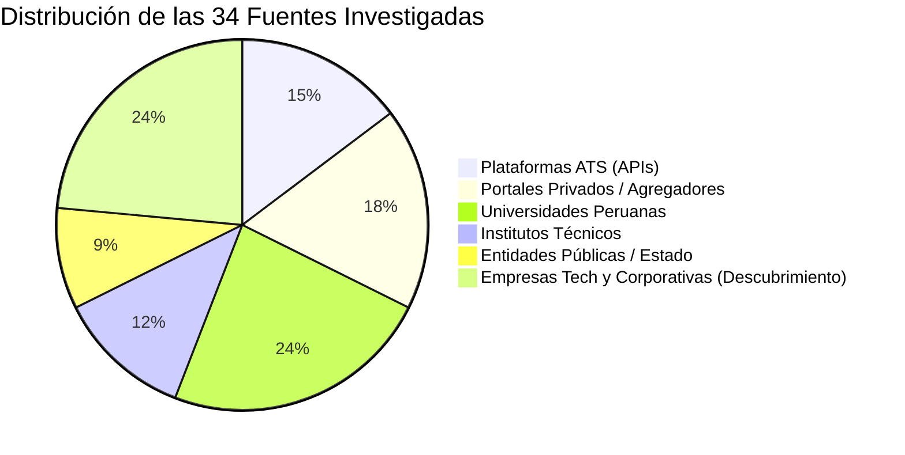

# INFORME TÉCNICO PERICIAL: BLOQUE R3-SOURCE-FEASIBILITY-01
**Validación Técnica de Fuentes Peruanas y Estrategia de Adquisición Multifuente**

---

### 1. Veredicto Oficial Obligatorio
## **`VIABLE_CON_LIMITACIONES`**

**Sustentación pericial:**  
Existe una base tecnológica sólida, automatizable y sostenible mediante componentes de software libre existentes (adaptadores REST para ATS públicos como Greenhouse y Lever, extractor JSON-LD Schema.org y procesadores de documentos oficiales). 

Sin embargo, **no es técnicamente viable ni legalmente sostenible una automatización indiscriminada de todo el mercado laboral peruano**: los agregadores privados aplican barreras perimetrales WAF (HTTP 403) y restricciones expresas en términos de uso bajo el D.L. 822; las bolsas universitarias son en su mayoría intranets cerradas o portales con desafíos interactivos CAPTCHA (Radware/Cloudflare); y las convocatorias del sector público se formalizan en documentos PDF desestructurados. 

La viabilidad está plenamente demostrada para una **estrategia de adquisición escalonada en cinco capas**, centrada en APIs públicas de empleadores directos y portales institucionales abiertos, pero exige descartar la recolección masiva de portales privados y preservar la curaduría editorial asistida.

---

### 2. Resumen Métrico de Fuentes Investigadas

* **Total de fuentes investigadas:** **34 fuentes** (26 iniciales + 8 descubiertas del sector empresarial y tecnológico en Perú).
* **Fuentes `READY` (Acceso público documentado y extracción automatizada reproducible):** **3 marcos ATS de alta cobertura** (Greenhouse Job Board REST API, Lever Postings REST API, Workday CXS JSON API).  
  *Nota sobre cobertura:* Cada marco ATS no representa una única empresa, sino un motor de adquisición capaz de consultar decenas de empleadores independientes (ej. Canonical, Sezzle, CookUnity, Fintual, Kavak, Thoughtworks).
* **Fuentes `READY_WITH_LIMITS` (Extracción viable con limitaciones técnicas, de formato o frecuencia):** **16 fuentes** (HiringRoom OnEmpresas, Bumeran, Computrabajo, BuscoTrabajo, Trebal, UDH, UTP HiringRoom Campus, USMP Administración, IESRP, IESTP ESAR, ISFUTSUR, SENATI, OSITRAN, Empleos Perú MTPE, Culqi/BambooHR, Stefanini).
* **Fuentes `BLOCKED` (Bloqueo insalvable por política: WAF, CAPTCHA, Cloudflare 403):** **8 fuentes** (Indeed Perú 403, Finder Work 403, Univ. de Piura Radware challenge, Univ. Nacional de Piura Cloudflare challenge, UPN Empléate intranet/anti-bot, Univ. de Lima intranet, Trabaja en BCP Akamai 403, Interbank Trabaja Imperva 403).
* **Fuentes `MANUAL_ONLY` o `UNVERIFIED` (Intranet, timeout severo o DNS no resuelto):** **7 fuentes** (UNMSM OGBU timeout, Talento Perú SERVIR timeout en 443, Belcorp, Alicorp, Falabella, Niubiz, Yape).
* **Porcentaje de fuentes técnicamente aprovechables:** **55.9%** (19 de 34 fuentes evaluadas).

---

### 3. Fuentes Nuevas Descubiertas y Verificadas

Se investigaron 8 entidades adicionales del sector fintech, banca, retail y servicios de tecnología en el Perú:
1. **Sezzle (Greenhouse API):** Confirmada 100% `READY` en REST API con vacantes remotas para Perú y remuneración explícita en USD.
2. **Kavak (Lever API):** Confirmada `READY` vía `api.lever.co/v0/postings/kavak`.
3. **Fintual (Lever API):** Confirmada `READY` vía `api.lever.co/v0/postings/fintual`.
4. **Culqi (BambooHR):** Identificada presencia en BambooHR con redirección web (`READY_WITH_LIMITS`).
5. **Stefanini Perú (Tech TI):** Identificado portal corporativo en HTML accesible (`READY_WITH_LIMITS`).
6. **OSITRAN Convocatorias:** Identificado portal público con 45 convocatorias activas y bases oficiales en PDF (`READY_WITH_LIMITS`).
7. **UTP HiringRoom Campus:** Portal institucional abierto para postulaciones (`READY_WITH_LIMITS`).
8. **MTPE Portal Empleos Perú:** Portal público unificado del Ministerio de Trabajo (`READY_WITH_LIMITS`).

---

### 4. Evidencias de Extracción y Disponibilidad de Campos (Schema 2)

Las pruebas acotadas demostraron el siguiente comportamiento respecto a los 14 campos exigidos por **Schema 2**:
* **APIs ATS Públicas (Greenhouse, Lever, Workday):** 12 de 14 campos disponibles de manera estructurada y determinista (`title`, `company`, `location`, `mode`, `opportunityType`, `publishedAt`, `updatedAt`, `requirements`, `description`, `applyUrl`, `candidate_id`). El campo `salary` está presente de forma selectiva (ej. Sezzle) y `deadline` es típicamente `MISSING` (vacantes continuas/rolling).
* **Sector Público (OSITRAN / MTPE / SERVIR):** Convocatorias formales CAS y Prácticas publicadas en PDF oficiales. El 100% incluye `deadline` estricto (cronograma oficial), `salary` (subvención legal en soles) y `requirements` (perfil del puesto), pero exige extracción de documentos en lugar de simples selectores web.
* **Agregadores Privados (Bumeran / Computrabajo):** Expone la mayoría de campos en HTML, pero su recolección automatizada es legalmente inviable (términos de uso prohibitivos, Art. 9 D.L. 822) y técnicamente frágil.

---

### 5. Estrategia de Adquisición Multifuente en Cinco Capas (para R4)

```
[ ARQUITECTURA DE ADQUISICIÓN PROPUESTA ]
├── Capa 1: APIs REST Públicas (Greenhouse, Lever, Workday CXS) -> Máxima fidelidad y automatización.
├── Capa 2: Sitios Oficiales con Schema.org JSON-LD -> Ingesta limpia mediante jsonld_extractor.py.
├── Capa 3: Bolsas Universitarias Abiertas (UTP HiringRoom, UDH) -> Foco formativo y prácticas.
├── Capa 4: Documentos Oficiales en PDF (OSITRAN, SERVIR, MTPE) -> Procesamiento de convocatorias estatales.
└── Capa 5: Agregadores Privados -> EXCLUIDOS POR DEFECTO (Bloqueos WAF y restricciones legales D.L. 822).
```

---

### 6. Componentes OSS Reutilizados (Cero Nuevas Dependencias)

No se requiere reconstruir la infraestructura ni añadir paquetes externos (0 npm, 0 pip). Se reutilizan directamente:
* `collector/ats_connectors.py`: Soporta Greenhouse y Lever; ampliable a Workday CXS.
* `collector/jsonld_extractor.py`: Extractor nativo con `html.parser` de Python para JSON-LD.
* `collector/evidence.py` y `collector/dedup.py`: Trazabilidad determinista y prevención de duplicados.
* `collector/policy.py`: Salvaguardas fail-closed y control estricto de hosts permitidos.
* `scripts/validate_candidates.py` y `scripts/editorial_cli.py`: Validación y gestión editorial de staging.

---

### 7. Principales Riesgos y Mitigaciones

1. **Dependencia de Ecosistemas ATS Internacionales:** Riesgo de sesgo hacia empresas extranjeras en inglés.  
   *Mitigación:* Incorporar las convocatorias formativas del Estado (Capa 4: OSITRAN / MTPE) y bolsas abiertas (Capa 3: UTP HiringRoom).
2. **Inestabilidad de Portales Públicos:** Tiempos de respuesta lentos o caídas frecuentes en servidores estatales.  
   *Mitigación:* Timeouts holgados (15s) y políticas de reintento exponencial en staging, sin afectar la experiencia del usuario final.
3. **Fragilidad de Selectores Web:** Cambios de layout en sitios de universidades.  
   *Mitigación:* Priorizar fuentes estructuradas (JSON-LD / APIs) y limitar el parsing HTML a portales estables.

---

### 8. Archivos Creados y Modificados
* **Nuevo Expediente Pericial:** [docs/audits/r3-source-feasibility-01-peru-2026-11-21.md](file:///c:/Users/sant1/Downloads/EmpleoWeb/docs/audits/r3-source-feasibility-01-peru-2026-11-21.md) *(Documento exhaustivo de 16 secciones con matriz completa, análisis jurídico, riesgos y recomendaciones).*
* **Roadmap Maestro:** [docs/architecture/r0-decisiones-y-alcance-2026-11-12.md](file:///c:/Users/sant1/Downloads/EmpleoWeb/docs/architecture/r0-decisiones-y-alcance-2026-11-12.md) *(Actualizado registrando `R3-SOURCE-FEASIBILITY-01` en estado `DONE`).*
* **Dependencias añadidas:** **0** (0 paquetes npm, 0 paquetes pip).

---

### 9. Pruebas y Verificación del Sistema
* `python scripts/validate_catalog.py`: **Válido (11 fichas canónicas)**.
* `python scripts/build_catalog.py --check`: **Snapshot canónico consistente y verificado**.
* `python scripts/validate_candidates.py data/candidates/inbox.local.json --as-of 2026-11-21`: **Bandeja staging conforme (24 candidatos, 0 errores)**.
* `python -m unittest discover -s tests -p "test_*.py"`: **193 de 193 pruebas Python PASADAS** en 3.036 s.
* `node tests/catalog_ui.test.cjs`: **OK (Escenarios de UI y degradación en verde)**.
* `git diff --check`: **0 errores de formato o sintaxis**.
* **Integridad Criptográfica (SHA-256):** `seed.json`, `opportunities.json` y `sources.json` **100% INALTERADOS**.

---

### 10. Preservación de Gobernanza y Siguiente Acción Recomendada

* **Estados de Gobernanza Preservados:**
  - `R3-02` formal permanece estrictamente en `NOT_STARTED / PENDING_HUMAN` (la investigación de fuentes no sustituye las sesiones humanas de evaluación requeridas por el protocolo).
  - `R3-03` a `R3-05` y `R4` permanecen estrictamente `BLOCKED`.
  - Cero fuentes activadas en `collector/sources.json`.
* **Siguiente Acción Recomendada:**  
  Retomar la puerta de decisión editorial humana planteada en `R3-ALPHA-OWNER-REVIEW-02` para que el propietario decida si autoriza incorporar las oportunidades de Sezzle a la Alpha privada, o bien proceder con la coordinación del trabajo de campo humano de `R3-02`.

---

# R0 — Decisiones estratégicas y alcance consolidado

- **Fecha:** 2026-11-12
- **Estado:** cerrada documentalmente; R1 aún no iniciada
- **Alcance:** decisiones, criterios y roadmap. No implementa funcionalidades.
- **Fuente de verdad:** este documento consolida R0; el código y ADR-001 siguen siendo la autoridad para los contratos ya implementados.

## 1. Decisión ejecutiva

Ruta Sistemas construirá primero un **catálogo estático, curado y verificable de oportunidades reales para perfiles iniciales y junior de Sistemas en Perú**, incluyendo oportunidades remotas solo cuando la elegibilidad desde Perú esté explícita. El MVP permite encontrar, entender y comparar oportunidades; no promete empleo, continuidad ni calidad universal del empleador.

La arquitectura vigente se conserva: `data/opportunities.seed.json` como fuente canónica, snapshot generado, frontend estático, validación fail-closed y publicación portable. No se incorpora backend multiusuario, CMS, IA, scraping general ni nueva infraestructura antes de demostrar una necesidad concreta.

**Regla de cierre del MVP:** mientras no exista al menos una ficha real que cumpla el contrato editorial y pueda consultarse correctamente, el producto es un piloto técnico/editorial, no un MVP terminado.

## 2. Inventario documental consolidado

| Documento | Estado | Decisión/propósito | Acción |
|---|---|---|---|
| [README.md](../../README.md) | Vigente | Operación, estados, validaciones y límites actuales | Mantener; enlazar este cierre R0 |
| [ADR-001](../adr/ADR-001-catalogo-curado-publicacion-segura.md) | Vigente | Fuente canónica, estados, evidencia, publicación y límites | Mantener como contrato arquitectónico |
| [P3 — primer caso real](../sources/p3-first-opportunity-2026-11-12.md) | Vigente como bloqueo | Ninguna fuente tiene autorización suficiente | Mantener; no activar fuentes |
| [P4 — OSS](p4-oss-automation-evaluation-2026-11-13.md) | Propuesto/condicionado | Evalúa automatización futura; operación bloqueada | Mantener como propuesta; no instalar OSS |
| [P5 — evaluación profesional](../product/p5-evaluacion-profesional-y-validacion.md) | Vigente como evolución | Señales explicables sin score ni ranking | Mantener; no confundir con requisito completo del MVP |
| [Seguimiento de autorización](../sources/seguimiento-autorizacion-fuentes.md) | Vigente como trabajo externo | Preguntas y criterios para fuentes | Mantener; requiere respuesta humana |
| [Canonical Careers](../sources/canonical-careers-2026-11-11.md) | Propuesto | Candidata privada, `pending_review`, presupuesto cero | Mantener; no consultar ni publicar |
| [Auditoría 2026-10-25](../audits/project-state-audit-2026-10-25.md) | Histórico | Diagnóstico anterior y decisiones ya implementadas | No usar como estado actual |
| [Diseño/roadmap](../../Diseno-modelo-datos-arquitectura-piloto-2026-10-03.md) | Histórico acumulativo + roadmap vigente | Antecedentes y secciones P1–P5 | Conservar; esta sección R0 prevalece para alcance actual |
| `Informe-investigacion-mercado-fuentes-2026-10-03.md` | Histórico | Investigación de mercado y fuentes | No tratar como autorización |
| `outputs/pilot-datos-2026-10-03/Protocolo_Piloto_Oportunidades.xlsx` | Histórico | Protocolo del piloto inicial | Conservar como antecedente |

### Contradicciones resueltas

1. La visión de largo plazo incluye evaluación profesional y trayectorias; P5 no las elimina, solo las deja como evolución basada en evidencia.
2. Los documentos antiguos describen colectores activos, CDN o escritura automática; ADR-001 y el código actual los sustituyen por snapshot estático, CSS compilado y colector fail-closed.
3. La evaluación OSS fechada **2026-11-13** es posterior a la fecha de R0 (**2026-11-12**): se considera propuesta futura ya redactada, no decisión aprobada ni evidencia de ejecución.
4. `Aurel`/`AurelDev` aparece en contenido local reciente, pero no es una decisión de marca aprobada. La marca de producto para R0 sigue siendo Ruta Sistemas.

## 3. Alcance definitivo

### A. MVP — obligatorio

1. Catálogo con al menos una oportunidad real no demostrativa.
2. Filtros por tipo, perfil/nivel, modalidad, ubicación y familia/sector cuando esos datos estén publicados.
3. Detalle con requisitos, condiciones disponibles, fuente, publisher, fecha de observación y canal oficial de postulación.
4. Estados comprensibles y conservadores: oportunidad, verificación y publicación separados.
5. Exclusión por defecto de demostraciones, históricas, vencidas y no confirmadas.
6. Comparación local de oportunidades sin score ni ganador universal.
7. Evidencia y trazabilidad suficientes para explicar cada dato publicado.
8. Publicación estática reproducible y validada antes de Pages.

### B. Evolución, no MVP

- señales explicables de aprendizaje, experiencia técnica, crecimiento y continuidad;
- evaluación separada del empleador y de la oportunidad;
- preferencias efímeras, oportunidades guardadas y alertas;
- orientación de trayectorias basada en requisitos y transiciones observadas;
- automatización de fuentes autorizadas en staging;
- persistencia multiusuario solo si la curación concurrente lo demuestra necesaria.

La evolución requiere datos reales longitudinales, criterios transparentes, pruebas con usuarios y separación explícita entre hecho, señal, incertidumbre y ausencia de información. No se autoriza score universal, ranking definitivo ni recomendación automática por ahora.

### C. Fuera de alcance o descartado

- red social, comunidad, chat usuario-empresa;
- sistema propio de postulación;
- almacenamiento de CV o datos de postulantes;
- backend multiusuario prematuro;
- scraping indiscriminado o activación por disponibilidad técnica;
- IA/recomendaciones sin dataset suficiente y evidencia;
- ranking universal de empleadores u oportunidades;
- infraestructura distribuida o base especializada sin volumen/operación demostrados.

## 4. Cambios sin commit: matriz de decisión

El estado revisado contiene **15 archivos rastreados modificados**, **un `canvas.js` no rastreado** y **cuatro documentos nuevos no rastreados**; el diff rastreado suma **1.536 adiciones y 117 eliminaciones**. Se preserva todo el trabajo; esta matriz no autoriza revertirlo.

| Grupo | Aporte | Riesgo/coste | Evidencia actual | Decisión R0 |
|---|---|---|---|---|
| Marca/identidad | Jerarquía y nueva presentación | `Aurel`/`AurelDev` contradice Ruta Sistemas | `index.html`, DOM local | Conservar con ajuste de marca en R1 |
| Navegación/estructura | Hero, catálogo, metodología, fuentes | Más superficie antes de tener datos reales | inspección de UI | Conservar; validar tarea principal |
| Filtros/catálogo | Texto, ubicación, modalidad, categorías y opt-ins | Cobertura E2E incompleta | tests Node + navegador | Conservar |
| Detalle | Evidencia, estados, señales y postulación deshabilitada | Puede repetir interpretación editorial | `renderDialog`, contratos schema 2 | Conservar con pruebas |
| Comparador | Hasta dos fichas, sin puntuación | No verificado end-to-end | lógica Node; falta browser flow | Conservar con validación |
| Evaluación/evidencia | Distingue hechos y límites | No debe parecer recomendador | P5 y `evaluationSignals` | Conservar como evolución útil |
| Hero WebGL | Identidad visual y animación | Compatibilidad, rendimiento, accesibilidad; no resuelve catálogo vacío | `canvas.js`; `prefers-reduced-motion` no detiene WebGL | Pendiente de validación; no ampliar |
| Estilos/responsive | CSS compilado local, sin CDN runtime | Cambios amplios y posible divergencia visual | build CSS y artefacto Pages pasan | Conservar; revisar viewport |
| Pruebas/docs | Contratos de carga, errores y datos | Falta E2E local/canvas/modales | 56 tests pasan | Conservar; ampliar en R1 |

### Defectos verificables que R1 debe resolver

- `index.html` carga `canvas.js`, pero `server.py` no lo expone: el servidor local devuelve 404/MIME JSON.
- El título y marca visible no están alineados con Ruta Sistemas.
- El bucle WebGL debe medirse o desactivarse/reducirse bajo `prefers-reduced-motion`; la regla CSS por sí sola no prueba ahorro de ejecución.
- No afirmar que Pages y servidor local son equivalentes hasta probar ambos contratos.

## 5. Contrato editorial vigente

No se crea un esquema paralelo. El contrato se apoya en schema 2, `catalog_quality.py`, `build_catalog.py`, `validate_candidates.py` y ADR-001.

### Campos mínimos

- **Identidad:** `id`, `title`, `employer`, `publisher`, `kind`, `family`, `level`, `sector`.
- **Condiciones:** `mode`, `location`, `eligibility`, `salary`/`salaryNote`, `duration`, `benefits`, `publishedAt`, `deadline` cuando existan.
- **Postulación:** `sourceUrl`, `applyUrl`, `allowedHosts`, `sourceKind`.
- **Evidencia:** `fieldEvidence` para cada campo afirmado, URL HTTPS permitida y `observedAt` con zona; `verificationEvidence` con método, resultado y relación con el empleador.
- **Decisión:** `editorialDecision.status`, revisor, motivo y `decidedAt`.
- **Estados:** `opportunityStatus`, `verificationStatus`, `publicationStatus`, `recordKind`, `lastVerifiedAt`/`lastCheckedDate`.

### Condición para `publicationStatus: active`

Debe cumplirse todo lo siguiente:

1. `recordKind` no es `demonstration`.
2. `opportunityStatus: open`.
3. `verificationStatus: verified` y la verificación está dentro del TTL configurado.
4. El deadline no existe o no está vencido.
5. Revisión humana aprobada con revisor, fecha y motivo.
6. El canal de postulación fue observado abierto manualmente, con `publisherRelation: employer_confirmed`, `result: application_open`, timestamp válido y hosts HTTPS permitidos.
7. `sourceUrl`, `applyUrl` y la evidencia son permitidas.
8. Cada campo no nulo afirmado tiene `fieldEvidence` reciente.

Si falta cualquier condición, la ficha permanece `unconfirmed`, `historical`, `expired`, `stale`, `pending` o fuera del snapshot publicable según corresponda. `generatedAt` nunca renueva evidencia. Ausencia de dato no se transforma en condición negativa.

### Flujo mínimo

`captura → validación → deduplicación → verificación → revisión humana → aprobación → generación → publicación → seguimiento`

| Paso | Estado actual |
|---|---|
| Captura | Manual; automatización bloqueada |
| Validación | Implementada para candidatos, semilla y snapshot |
| Deduplicación | Parcial; requiere revisión de colisiones |
| Verificación | Manual y documentada; no existe ficha real aprobada |
| Revisión/aprobación | Manual, modelada en schema, sin panel |
| Generación/publicación | Implementada y fail-closed |
| Seguimiento/retirada | Política documentada; ejecución manual |

## 6. Criterios de aceptación congelados

### MVP

- [ ] Existe al menos una oportunidad real, no demostrativa, consultable y aprobada.
- [ ] Una persona puede filtrar, abrir el detalle, distinguir empleador/publisher y llegar al canal oficial.
- [ ] Una ficha vencida, stale o sin evidencia no aparece como activa por defecto.
- [ ] La comparación no produce score, ganador ni valores inventados.

### Datos y publicación

- [ ] `build_catalog.py --check`, `validate_catalog.py` y `validate_candidates.py` pasan.
- [ ] Cada dato afirmado tiene evidencia HTTPS y fecha válida; los desconocidos permanecen ausentes/null.
- [ ] La publicación falla si el esquema, host, fecha, estado o artefacto son inválidos.
- [ ] El artefacto contiene exactamente los archivos permitidos y no depende de CDN runtime.

### Experiencia e integridad técnica

- [ ] Prueba de navegador cubre carga, filtros, estado vacío/error, detalle, comparación y enlaces relativos bajo Pages.
- [ ] Prueba local cubre `canvas.js` o documenta su exclusión; no hay 404/MIME incorrecto.
- [ ] Se revisan teclado, diálogo, viewport móvil y `prefers-reduced-motion`.
- [ ] No se declara éxito remoto sin observar el artefacto y la URL desplegados.

### Evolución

- [ ] No se inicia scoring, alertas, trayectorias o personalización sin datos y protocolo de medición documentados.
- [ ] Una fuente nueva tiene autorización escrita separada para consulta, retención, atribución, retirada y republicación antes de cualquier solicitud.
- [ ] La automatización produce staging/candidatos y nunca promociona directamente a seed, snapshot o Pages.

## 7. Roadmap maestro posterior a R0

El roadmap existente permanece en la sección 21 y sus bloques posteriores del [documento de diseño](../../Diseno-modelo-datos-arquitectura-piloto-2026-10-03.md). R0 lo reordena así, sin duplicar tareas:

| Fase | Objetivo | Entrada | Salida/criterio | Estado |
|---|---|---|---|---|
| R0 | Cerrar alcance, contrato, criterios y decisiones | Auditoría + docs actuales | Este documento, sin contradicciones críticas sin registrar | **Cerrada documentalmente** |
| R1 | Estabilizar versión actual | R0 | `canvas.js` local resuelto, marca unificada, diff revisado, E2E base, Pages desplegado | **Completada y verificada en producción** |
| R2 | Obtener primera oportunidad real | R1 + fuentes públicas/autorización | Una ficha real aprobada en staging y luego seed/snapshot | **DONE. Línea offline R2-OSS cerrada. Línea A completada en R2-A-05: CookUnity 8039990003 (Supply Chain Analyst - Lima, Perú) promovida editorialmente al catálogo canónico como OP-005 con aprobación del propietario (APPROVE_WITH_LIMITATIONS), snapshot compilado y validado (193 pruebas unitarias, 8 pruebas E2E Playwright, validador de calidad) y publicado en GitHub Pages con 21 evidencias desglosadas por campo y canal oficial de postulación. Candidato Canonical 8379825 conservado en reserva. Desbloquea R3.** |
| R3 | Validar utilidad del MVP | R2 | Pruebas con usuarios y medición de comprensión/comparación | **En ejecución. Desbloqueada por R2-A-05 con oportunidad real OP-005 en producción. Subfase R3-01 (Preparación y protocolo de investigación) completada (DONE): línea base UX, protocolo de pruebas de usabilidad, plantilla individual de sesión, repositorio de hallazgos y auditoría de preparación entregados. Subtareas R3-01-01 a R3-01-05 formalizadas. Pendiente R3-02 (ejecución de sesiones con 5-8 usuarios reales).** |
| R4 | Automatizar fuente autorizada | R2/R3 + permiso técnico | Adaptador acotado, candidatos offline, sin promoción automática | **Bloqueada; no existe fuente autorizada** |
| R5 | Evaluación profesional explicable | Datos reales suficientes + R3 | Señales auditables sin score obligatorio | Aplazada |
| R6 | Preferencias, guardados y alertas | R3 + necesidad demostrada | Diseño de privacidad y persistencia justificado | Aplazada |
| R7 | Trayectorias profesionales | Dataset longitudinal y evidencia | Orientación no determinista, validada | Aplazada |
| R8 | Consolidación operativa | Flujos anteriores estables | backups, monitorización, retirada y plan de hosting | Aplazada |

### Siguiente bloque: R1-01

- **Objetivo:** estabilizar y consolidar la versión actual sin cambiar el alcance.
- **Archivos probables:** `server.py`, `index.html`, `canvas.js`, `app.js`, pruebas UI y documentación de release.
- **Dependencias:** ninguna técnica; requiere conservar el árbol de trabajo y revisión del propietario para decidir mantener o simplificar el hero.
- **Aceptación:** servidor local sin 404/MIME para recursos declarados; marca unificada; smoke E2E de carga/filtros/detalle/comparador; decisión explícita sobre WebGL y reduced motion.
- **Validaciones:** suite existente, `node --check`, artefacto Pages, navegador local y viewport móvil.
- **Riesgo:** tocar el lote acumulado puede mezclar cambios de etapas; revisar diff antes de seleccionar cualquier integración.
- **Esfuerzo relativo:** medio.

### Evidencia de ejecución R1

- `server.py` expone `/canvas.js` como JavaScript; la comprobación HTTP local devolvió `200` y MIME correcto para `/`, `/app.js`, `/styles.css`, `/canvas.js` y `/data/opportunities.json`.
- `index.html` usa `Ruta Sistemas` en título y marca visible, sin residuo activo `Aurel`.
- `canvas.js` registra fallback sin bloqueo para WebGL2 ausente, atiende `prefers-reduced-motion` y cancela el frame en `pagehide`.
- `app.js` conserva el mensaje seguro para la persona y registra la causa técnica del fallo de catálogo en consola.
- `python -m unittest discover -s tests -v`: 57 pruebas pasan. `node --check app.js` y `node --check canvas.js` pasan.
- Smoke de navegador local: carga inicial vacía, activación de ejemplos demostrativos y apertura/cierre del detalle verificados. No se añadió un runner E2E al proyecto.

## 8. Decisiones pendientes de aprobación

1. Mantener el hero WebGL, simplificarlo o retirarlo tras la validación R1.
2. Confirmar la marca final `Ruta Sistemas` y corregir cualquier residuo `Aurel`.
3. Autorizar contacto con Canonical/SERVIR/FISI o seleccionar otra fuente; ninguna está aprobada actualmente.
4. Autorizar la integración/publicación del lote sin commit tras revisión completa del diff.
5. Definir, después del piloto, si el volumen justifica CMS/backend; no se presume ahora.

## 9. Cierre R0 y Seguimiento de Fases Posteriores

- **R0:** **Cerrada documentalmente**.
- **R1:** **Cerrada y desplegada**.
- **R2:** **Cerrada formalmente** con la línea offline R2-OSS (ingesta, normalización, dedup, evidencias y CLI) y la línea A (R2-A-01 a R2-A-05), culminando con la publicación en producción de la oportunidad real CookUnity (`OP-005`) en GitHub Pages.
- **R3 — Validación de Producto:** **En ejecución**.
  - `R3-01`: Preparación y protocolo de investigación (`DONE`).
    - `R3-01-01`: Auditoría UX del producto publicado (`DONE` -> `docs/research/r3-01-ux-baseline-2026-11-18.md`).
    - `R3-01-02`: Definición del protocolo de investigación (`DONE` -> `docs/research/r3-01-user-research-protocol-2026-11-18.md`).
    - `R3-01-03`: Diseño de escenarios y tareas A a E (`DONE` -> `docs/research/r3-01-user-research-protocol-2026-11-18.md`).
    - `R3-01-04`: Métricas y taxonomía de evaluación (`DONE` -> `docs/research/r3-01-findings-template-2026-11-18.md`).
    - `R3-01-05`: Instrumentación y plantillas locales (`DONE` -> `docs/research/r3-01-usability-test-template-2026-11-18.md`).
  - `R3-02`: Trabajo de campo con usuarios reales (5-8 participantes) (Preparación técnica y operativa `DONE`; ejecución empírica en estado `NOT_STARTED` / `PENDING_HUMAN`, pendiente de convocatoria y moderación presencial/remota por el equipo humano; paquete operativo verificado con kit `docs/research/r3-02-recruitment-materials-kit-2026-11-18.md`, guía `docs/research/r3-02-moderator-field-guide-2026-11-18.md`, plantillas `P01.md`..`P08.md` y auditorías en `docs/audits/`).
    - `R3-02-UX-EXP-01`: Iteración exploratoria de claridad, rendimiento y experiencia de consulta (`DONE` -> `docs/audits/r3-02-ux-exploratory-iteration-2026-11-19.md`). Optimización WebGL2 en `canvas.js` (eliminación de reflow forzado en bucle y pausa con `IntersectionObserver`), vista independiente de oportunidad con URL estable `?id=...` y fallback amigable 404, reemplazo de señales complejas por Triaje Rápido de 8 condiciones objetivas sin puntaje sintético, retiro de decisión editorial y evaluación institucional de la UI pública, simplificación de procedencia con tarjeta de fuente oficial y evidencia colapsable, y corrección de heurísticas UX-B01 a UX-B05. Esta iteración atiende observaciones del entorno exploratorio personal y círculo reducido sin comprometer el rigor metodológico ni anticipar la validación formal.
    - `R3-02-UX-EXP-02`: Validación local, auditoría de aceptación y preparación para sincronización (`DONE` -> `docs/audits/r3-02-ux-exp-02-acceptance-2026-11-19.md`). Auditoría semántica del Triaje Rápido: corrección del detector de experiencia previa (notación `1+ años` en OP-005 clasificada fielmente como `Por revisar`), separación explícita de hechos de la convocatoria respecto al perfil personal del postulante, suite E2E ampliada a 12 pruebas (Chromium y Mobile Pixel 5), verificación responsiva sin overflow en 1440px, 768px y 390px, y confirmación de preparación técnica para evaluación privada local. R3-02 formal permanece `NOT_STARTED` / `PENDING_HUMAN`.
    - `R3-02-UX-EXP-03`: Reconciliación final, gate de aceptación y preparación de sincronización (`DONE` -> `docs/audits/r3-02-ux-exp-03-reconciliation-acceptance-2026-11-19.md`). Corrección del enrutador hash contra colisiones 404 en anclas locales de página (`#inicio`, `#fuentes`), verificación integral de 193 pruebas Python y 12 pruebas Playwright E2E, preservación absoluta del catálogo y Schema 2, y veredicto de gate `READY_FOR_OWNER_REVIEW` para sincronización controlada a `integration/r1-02c`. R3-02 formal continúa `NOT_STARTED` / `PENDING_HUMAN` y R3-03 permanece `BLOCKED`.
    - `R3-02-UX-EXP-04`: Consolidación de información y eliminación de redundancia en la ficha de oportunidad (`DONE` -> `docs/audits/r3-02-ux-exp-04-information-consolidation-2026-11-19.md`). Aplicación estricta del principio *«Un dato, una ubicación, una interpretación»*: consolidación canónica de modalidad y compensación en la cuadrícula de condiciones, unificación de ubicación y elegibilidad en un único bloque sin repetición de términos, separación nítida entre requisitos del puesto (obligatorios) y tecnologías declaradas (herramientas/plataformas), retiro completo de la sección redundante de continuidad y riesgos (integrando términos de contrato en `Contrato y plazo`), compactación de metadatos de vigencia/verificación, y rediseño del Triaje Rápido a 3 señales de síntesis prioritarias (`Pertinencia técnica`, `Elegibilidad territorial`, `Nivel y experiencia`). Suite E2E ampliada a 14 pruebas (Chromium y Mobile Pixel 5) verificando cero duplicaciones informativas. R3-02 formal permanece `NOT_STARTED` / `PENDING_HUMAN` y R3-03 permanece `BLOCKED`.
    - `R3-02-UX-EXP-05`: Rediseño de la ficha de oportunidad, presentación visual y uso efectivo de Tailwind CSS (`DONE` -> `docs/audits/r3-02-ux-exp-05-opportunity-detail-visual-redesign-2026-11-19.md`). Cumplimiento de la decisión del propietario de simplificar radicalmente la ficha: eliminación completa del «Triaje rápido»; posicionamiento superior de «✓ Fuente oficial verificada» (con difusor, empleador, estado de verificación y enlaces oficiales directos); nuevo «Resumen» visual con cuadrícula de tarjetas e iconos SVG Lucide inlined (`monitor`, `building`, `pin`, `wallet`, `file`, `clock`, `calendar`, `shield`); política estricta de omisión visual de campos no declarados (eliminación de textos especulativos como «sujeto a desempeño y evaluación del empleador» y omisión en OP-005 de modalidad, remuneración y fecha límite no publicadas); «Tecnologías y herramientas declaradas» ubicadas inmediatamente debajo del Resumen como etiquetas visuales; reubicación de «Qué se verificó» y preservación de los 21 campos de evidencia desglosada; y corrección de la integración de Tailwind CSS v4 inyectando las definiciones `@theme` en `src/input.css` para restaurar tokens de color de marca (`ice-blue`, `crystal-blue`, `arctic-blue`, `brand-black`, etc.). 14 pruebas E2E (Chromium y Mobile Pixel 5) y 193 pruebas Python pasan sin advertencias de regresión. R3-02 formal continúa `NOT_STARTED` / `PENDING_HUMAN` y R3-03 permanece `BLOCKED`.
    - `R3-02-UX-EXP-06`: Reconciliación post-implementación, auditoría de UX-EXP-05 y preparación para revisión del propietario (`DONE` -> `docs/audits/r3-02-ux-exp-06-reconciliation-and-owner-review-2026-11-19.md`). Auditoría técnica exhaustiva del estado real del repositorio: verificación de paridad Git (HEAD `9d747c5` en `integration/r1-02c`), confirmación de presencia real y completa de las 7 directivas de diseño de UX-EXP-05, verificación criptográfica de invariabilidad de Schema 2 y fuentes canónicas (`data/opportunities.seed.json`, `data/opportunities.json`, `collector/sources.json`), auditoría de compilación y tokens de Tailwind CSS v4.3.3 (`styles.css` de 65 KB sin dependencias externas), validación de suite completa (193 pruebas Python, 14 pruebas Playwright Chromium/Mobile, 9 contratos estáticos, scripts de catálogo), verificación funcional y no-desbordamiento del servidor loopback (`server.py` en puerto 4173 en viewports 1440px, 768px y 390px), y entrega de la guía de revisión local para el propietario. R3-02 formal permanece `NOT_STARTED` / `PENDING_HUMAN`; R3-03 a R3-05 y R4 permanecen `BLOCKED`.
    - `R3-02-GIT-CONSOLIDATION-01`: Consolidación de iteraciones UX-EXP-01 a UX-EXP-06, validación integral de integridad, commit y push controlado a `integration/r1-02c` (`DONE` tras confirmación de sincronización remota). Consolida el trabajo de optimización WebGL2, enrutamiento independiente y hash routing, rediseño de ficha de oportunidad conforme a Tailwind CSS v4.3.3, erradicación del triaje rápido, hero de fuente oficial verificada, resumen con iconos Lucide y política estricta de omisión visual de datos no publicados. Incorpora las 7 auditorías (`docs/audits/r3-02-*.md`), la guía de evaluación local (`docs/audits/r3-02-preview-readiness-2026-11-19.md`) y la plantilla de feedback informal (`docs/research/r3-02-informal-feedback-template.md`). Suite completa aprobada (193 pruebas Python, 14 pruebas Playwright E2E, 9 contratos estáticos, validación y build de catálogo). Schema 2 y archivos canónicos criptográficamente idénticos a `9d747c5`. Próximo paso: ejecución empírica de trabajo de campo humano R3-02. Estados de gobernanza: R3-02 permanece `NOT_STARTED` / `PENDING_HUMAN`; R3-03 a R3-05 y R4 permanecen estrictamente `BLOCKED`.
    - `R3-02-PREVIEW-02`: Preparación y verificación del entorno de evaluación personal y círculo reducido (`DONE` -> `docs/audits/r3-02-preview-02-acceptance-2026-11-20.md`). Reconciliación del estado real sobre el commit `b3e69e9` en `integration/r1-02c`, armonización de modificaciones del working tree (modernización de tarjetas y panel de filtros en `app.js`, `index.html` y compilación Tailwind `styles.css`) con contratos estáticos y selectores E2E; auditoría integral de seguridad de `server.py` (enlace exclusivo a loopback `127.0.0.1:4173`, validación de `Host`, lista blanca estricta de archivos y bloqueo 404 contra rutas privadas); verificación del 100% de la suite de pruebas (193 pruebas Python, 14 pruebas Playwright E2E en Chromium y Mobile Pixel 5, validación Schema 2); comprobación rigurosa del caso OP-005 (CookUnity); entrega de la guía amigable para evaluadores no técnicos (`docs/research/r3-02-owner-circle-evaluation-guide.md`) articulada con la plantilla de feedback informal (`docs/research/r3-02-informal-feedback-template.md`). Preservación estricta de gobernanza: feedback informal separado de investigación formal R3-02 (`NOT_STARTED` / `PENDING_HUMAN`); R3-03 a R3-05 y R4 continúan estrictamente `BLOCKED`. Cero dependencias añadidas, sin merge a `main`, sin deploy a GitHub Pages y sin push remoto.
    - `R3-02-PREVIEW-03`: Reconciliación Git y entrega controlada de la versión de evaluación (`DONE` -> `docs/audits/r3-02-preview-03-git-delivery-2026-11-20.md`). Resolución de discrepancia entre estado local y remoto: confirmación forense de que HEAD `b3e69e9` coincidía con el remoto mientras las mejoras validadas de PREVIEW-02 residían en el working tree sin versionar. Empaquetamiento y commit estructurado de cambios de UI (`app.js`, `index.html`, `styles.css`) y paquete documental (`r3-02-preview-02-acceptance-2026-11-20.md`, `r3-02-owner-circle-evaluation-guide.md`, `r3-02-preview-03-git-delivery-2026-11-20.md`). Suite completa validada (193 tests Python, 14 tests Playwright E2E Desktop/Mobile, Schema 2 inalterado, compilación Tailwind v4.3.3 en 68 KB). Sincronización mediante push normal a `origin/integration/r1-02c`. Entrega con doble modalidad para amigos (presencial / clonado independiente). Preservación estricta: R3-02 formal permanece `NOT_STARTED` / `PENDING_HUMAN`; R3-03 a R3-05 y R4 permanecen `BLOCKED`; sin merge a `main` ni despliegue en producción.
    - `R3-02-OWNER-FEEDBACK-01`: Registro de evaluación informal del círculo cercano (`COMPLETED_WITH_LIMITED_FEEDBACK` -> `docs/research/r3-02-owner-circle-feedback-2026-11-20.md`). Registro documental riguroso del feedback general transmitido verbalmente por el propietario tras pruebas informales con amistades (diseño bien valorado, percepción intuitiva y suficiencia de información), autorizando continuar el proyecto. Separación deontológica total: no se inventaron participantes, tiempos ni métricas; las plantillas formales `P01.md` a `P08.md` permanecen intactas en `PENDING_EXECUTION`. La investigación formal R3-02 continúa en `NOT_STARTED` / `PENDING_HUMAN`. R3-03 a R3-05 y R4 permanecen estrictamente `BLOCKED`. Cero dependencias añadidas, sin merge a `main` ni despliegue.
    - `R3-02-PRIVATE-ALPHA-01`: Recalibración del alcance, preparación y gobernanza de la Alpha privada (`DONE` -> `docs/architecture/r3-private-alpha-scope-decision-2026-11-20.md`). Formalización de dos niveles de madurez desacoplados: Nivel 1 (Alpha privada para uso personal y círculo reducido, con criterios técnicos y de seguridad 100% satisfechos, identificando la ampliación del inventario de vacantes reales como prioridad 1) vs. Nivel 2 (Producto validado para audiencia amplia, con R3-02 formal preservado en `NOT_STARTED` / `PENDING_HUMAN`). Matriz de priorización crítica de 12 funcionalidades (descartando sobreingeniería prematura como login, persistencia multiusuario, recomendaciones opacas o alertas automáticas). R3-03 a R3-05 y R4 permanecen estrictamente `BLOCKED`. Cero dependencias añadidas, sin merge a `main` ni despliegue.
    - `R3-ALPHA-CURATION-01`: Segundo lote de oportunidades reales para la Alpha privada (`DONE` -> `docs/audits/r3-alpha-curation-01-second-batch-2026-11-20.md`). Adquisición, normalización a Candidate Schema 2, deduplicación y auditoría editorial de 5 oportunidades formativas y junior de Canonical Ubuntu (100% remotas, elegibles desde Perú, cubriendo Desarrollo de Software, Cloud/Python, Kernel Linux y Soporte Técnico TI), recomendadas con limitaciones (`APPROVE_WITH_LIMITATIONS`) para la Alpha privada (círculo íntimo). Auditoría exhaustiva y descarte formal de 6 vacantes inelegibles o fuera de nivel (Wikimedia por restricciones territoriales a EE.UU./18 países y nivel senior; Deliverect por radicación en Países Bajos; CookUnity soporte por requerir >4 años de experiencia). Preservación estricta de gobernanza: bandeja staging `data/candidates/inbox.local.json` con 12 candidatos y 100% de evidencias `ALL_FRESH`; cero alteraciones en archivos canónicos (`data/opportunities.seed.json`, `data/opportunities.json`, `collector/sources.json` criptográficamente idénticos); 193 pruebas Python aprobadas; catálogo canónico validado; cero nuevas dependencias; R3-02 formal preservado en `NOT_STARTED` / `PENDING_HUMAN`; R3-03 a R3-05 y R4 permanecen estrictamente `BLOCKED`. Puerta de control humano preparada para decisión del propietario.
    - `R3-ALPHA-OWNER-REVIEW-01`: Revalidación y decisión editorial del segundo lote Canonical (`DONE` -> `docs/audits/r3-alpha-owner-review-01-canonical-editorial-decision-2026-11-20.md`). Revalidación pericial independiente de las 5 candidatas de Canonical Ubuntu en doble capa (REST API y Web HTML de Greenhouse), verificando disponibilidad de formularios activos, ausencia de cierres, elegibilidad remota desde Perú (franja AMER UTC-5), vigencia de cohorte fresca (`8379825`, publicada el 16-11-2026 para graduados 2026/2027) vs. requisiciones continuas/rolling (`6707669`, `5370815`, `3257589`, `6448444`). Delimitación rigurosa de gobernanza: términos de reutilización pública en `pending_review` circunscritos a la Alpha privada no comercial. Expediente comparativo completo estructurado con opciones de decisión humana (Opción A: lote completo de 5; Opción B: selectiva de 2 core dev; Opción C: mantener en staging) pendiente de selección por el propietario. Cero alteraciones en archivos canónicos (`seed.json`, `opportunities.json`, `sources.json`), 193 pruebas Python aprobadas, cero promociones automáticas, cero dependencias añadidas, sin merge a `main` ni despliegue.
    - `R3-ALPHA-PROMOTION-01`: Promoción editorial controlada de cinco oportunidades Canonical a la Alpha privada (`DONE` -> `docs/audits/r3-alpha-promotion-01-private-catalog-2026-11-21.md`). Ejecución de la autorización expresa del propietario (Opción A): incorporación canónica de 5 oportunidades reales de Canonical Ubuntu (`OP-006` a `OP-010`) cubriendo Desarrollo de Software, Sistemas Operativos, Kernel Linux, Cloud/Python y Soporte de TI. Catálogo de Alpha privada ampliado de 1 a 6 vacantes reales y 5 registros demostrativos (11 fichas en total), resolviendo el cuello de botella de contenido para evaluación personal y círculo cercano. Revalidación en tiempo real al 21-11-2026 (100% activas con formularios operativos). Advertencias editoriales rigurosas de dedicación full-time (40h/sem) e inglés profesional, distinguiendo cohorte fresca (`OP-006`, cohorte 2026/2027) de requisiciones continuas (`OP-007` a `OP-010`). Suite completa en verde: 193 pruebas Python y 14 pruebas Playwright E2E aprobadas; catálogo validado bajo Schema 2. Preservación estricta de gobernanza: `collector/sources.json` inalterado con términos en `pending_review` y `enabled: false`; cero publicación externa, cero despliegue en GitHub Pages, sin merge a `main`, sin commit ni push. Estados de gobernanza preservados: R3-02 formal permanece `NOT_STARTED` / `PENDING_HUMAN`; R3-03 a R3-05 y R4 permanecen estrictamente `BLOCKED`.
    - `R3-ALPHA-UX-01`: Escalabilidad del catálogo y presentación estructurada de contenido (`DONE` -> `docs/audits/r3-alpha-ux-01-catalog-pagination-and-lists-2026-11-21.md`). Implementación de dos mejoras prioritarias de experiencia frontend requeridas por el propietario:
      - `R3-ALPHA-UX-01A` (Paginación escalable del catálogo): Paginación de tarjetas con límite de 12 oportunidades por página (`PAGE_SIZE = 12`). Ocultación automática de controles cuando el total filtrado es <= 12; activación de botones accesibles «Anterior» y «Siguiente» con indicador detallado («Página X de Y · Mostrando A–B de N oportunidades») cuando el catálogo supera 12 tarjetas; cálculo dinámico de páginas para cualquier volumen (13, 20, 24, 25, 40, 100+); reseteo estricto a página 1 ante cambios de búsqueda, filtros o ejemplos; y preservación total del estado del comparador local (`compareIds`) al navegar entre páginas.
      - `R3-ALPHA-UX-01B` (Presentación estructurada de descripciones y listas): Formateo semántico visual mediante listas con viñetas (`<ul class="list-disc pl-5 space-y-1.5 ..."><li>...</li></ul>`) para campos que representan listas delimitadas por punto y coma (`;`) en la fuente (`tasks` / "Qué harías", `requirements` / "Requisitos del puesto", `benefits` / "Beneficios publicados"), con limpieza de puntuación redundante y capitalización amigable. Preservación intacta como párrafos narrativos (`<p>`) de textos continuos donde el punto y coma cumple función gramatical (`growth`, `continuity`, `risk`).
      - Cero dependencias añadidas, cero alteraciones en datos canónicos (`data/opportunities.seed.json`, `data/opportunities.json`, `collector/sources.json` inalterados), 193 pruebas Python aprobadas, suite Playwright ampliada de 14 a 18 pruebas aprobadas (Chromium y Mobile Pixel 5). Estados de gobernanza: R3-02 formal permanece `NOT_STARTED` / `PENDING_HUMAN`; R3-03 a R3-05 y R4 permanecen estrictamente `BLOCKED`.
    - `R3-ALPHA-CURATION-02`: Descubrimiento y curaduría de nuevas oportunidades reales para la Alpha privada (`DONE` -> `docs/audits/r3-alpha-curation-02-new-opportunities-2026-11-21.md`). Segundo ciclo de prospección y normalización enfocado en estudiantes de últimos ciclos, egresados y juniors de Ingeniería de Sistemas en Perú:
      - `R3-ALPHA-CURATION-02A` (Descubrimiento y adquisición en staging): Normalización a Candidate Schema 2 e incorporación de 12 nuevos candidatos a la bandeja local aislada `data/candidates/inbox.local.json` (elevando el total de la bandeja de 12 a 24 registros auditados). Fuentes investigadas: tableros públicos Greenhouse de Sezzle (fintech NASDAQ), Cloudbeds, Media.Monks, Cloudflare, etc.
      - `R3-ALPHA-CURATION-02B` (Auditoría editorial y descarte motivado): Identificación de 4 oportunidades prioritarias de Sezzle con localización explícita en Perú y remuneración publicada en USD (AI Engineering Intern $1,000/mes, IT Operations Intern $800/mes, Product Data Intern $800/mes, Junior Software Engineer $1,500-$4,000/mes) y 2 en reserva (Cloudbeds Reports Analyst y Sezzle Fraud Ops Intern). Descarte formal auditado de 6 posiciones por nivel desmedido (Sezzle Senior Data Engineer, Sezzle Data Engineer II, Sezzle Mobile Engineer, Media.Monks Fullstack Engineer), naturaleza puramente administrativa (Cloudbeds Billing Specialist) o inelegibilidad territorial (Cloudflare Intern presencial en US/UK).
      - `R3-ALPHA-CURATION-02C` (Verificación técnica y preservación de gobernanza): 0 colisiones de ID o duplicados con `collector/dedup.py`; 100% de evidencias frescas (`ALL_FRESH`, TTL 7 días Lima); 193 pruebas Python y 18 pruebas Playwright E2E aprobadas; catálogo canónico validado; hashes SHA-256 de `data/opportunities.seed.json`, `data/opportunities.json` y `collector/sources.json` 100% inalterados; cero promociones automáticas y cero nuevas dependencias. Puerta de control humano preparada para decisión del propietario. R3-02 formal permanece `NOT_STARTED` / `PENDING_HUMAN`; R3-03 a R3-05 y R4 continúan estrictamente `BLOCKED`.
    - `R3-ALPHA-IMPLEMENTATION-01`: Implementación funcional priorizada de la Alpha privada — Comparador razonado y transparencia de condiciones (`DONE`). Mejora de alta prioridad funcional que maximiza la utilidad de toma de decisiones para el usuario y su círculo evaluador sin sobreingeniería backend ni nuevas dependencias:
      - `R3-ALPHA-IMPLEMENTATION-01A` (Inclusión de requisitos en comparación): Incorporación de la dimensión «Requisitos del puesto» (`requirements`) en la tabla comparativa lado a lado, subsanando la omisión del criterio primordial de filtrado técnico para estudiantes e ingenieros junior.
      - `R3-ALPHA-IMPLEMENTATION-01B` (Presentación estructurada en celdas de comparación): Renderizado semántico con viñetas (`<ul class="list-disc ..."><li>...</li></ul>`) para `tasks`, `requirements` y `benefits`, eliminando bloques de texto crudo con punto y coma; y visualización de `skills` en chips técnicos individuales (`<span>`) limpios y legibles.
      - `R3-ALPHA-IMPLEMENTATION-01C` (Transparencia de datos y advertencias explícitas): Sustitución de vacíos de información por distintivos neutros no punitivos («No publicado en convocatoria / No informado»); y presentación de advertencias de carga/idioma (`risk`) dentro de callouts visuales estructurados de atención («Condición declarada»).
      - `R3-ALPHA-IMPLEMENTATION-01D` (Destacado interactivo de diferencias y acción directa): Control interactivo «Destacar diferencias» (`#compare-toggle-diff`) para resaltar visualmente filas divergentes (`bg-sky-50/70` con badge «Diferencia»); botones de navegación directa «Ver detalle ↗» (`data-compare-open`) que permiten abrir la ficha completa directamente desde la cabecera del comparador; y enlace externo seguro «Ir a postulación ↗».
      - `R3-ALPHA-IMPLEMENTATION-01E` (Verificación y aseguramiento técnico): 0 dependencias añadidas (0 npm, 0 pip); 193 pruebas Python aprobadas; 20 pruebas Playwright E2E aprobadas (Chromium Desktop y Mobile Pixel 5); hashes de `data/opportunities.seed.json`, `data/opportunities.json` y `collector/sources.json` 100% idénticos e inalterados; Schema 2 preservado. Estados de gobernanza: R3-02 formal permanece `NOT_STARTED` / `PENDING_HUMAN`; R3-03 a R3-05 y R4 continúan estrictamente `BLOCKED`.
    - `R3-ALPHA-OWNER-REVIEW-02`: Revisión editorial asistida del lote Sezzle — preparación de decisión humana (`DONE` -> `docs/audits/r3-alpha-owner-review-02-sezzle-editorial-decision-2026-11-21.md`). Auditoría técnica local y preparación de expediente individualizado para decisión del propietario sobre 4 candidatas de Sezzle (fintech NASDAQ: SEZL): AI Engineering Intern ($1,000/mes), IT Operations Intern ($800/mes), Product Data Intern ($800/mes) y Junior Software Engineer with Accounting Experience ($1,500-$4,000/mes):
      - `R3-ALPHA-OWNER-REVIEW-02A` (Resolución forense de discrepancia de staging): Explicación y confirmación pericial de los dos cortes temporales en `data/candidates/inbox.local.json`: el Lote 1 (12 candidatos de `R3-ALPHA-CURATION-01` al 20-11-2026) y el Lote 2 (12 candidatos nuevos de `R3-ALPHA-CURATION-02` al 21-11-2026), explicando con exactitud matemática el acumulado de 24 candidatos sin inconsistencia ni pérdida de datos.
      - `R3-ALPHA-OWNER-REVIEW-02B` (Fichas individualizadas y categorización pericial): Estructuración de fichas de decisión detallando familia técnica, nivel real, elegibilidad Perú (`PERU_EXPLICIT`), jornada full-time (40h/sem), requisitos y rango salarial transparente en USD, distinguiendo taxativamente datos `VERIFICADO`, `NO_PUBLICADO`, `NO_VERIFICADO` y `CONTRADICTORIO`.
      - `R3-ALPHA-OWNER-REVIEW-02C` (Gobernanza y puerta de control humano): Preservación estricta de salvaguardas fail-closed; cero promociones automáticas; fuentes en `collector/sources.json` inalteradas (`pending_review`, `enabled: false`); catálogo canónico (`data/opportunities.seed.json` y `data/opportunities.json`) 100% inalterado criptográficamente (SHA-256 idénticos); 193 pruebas Python y 20 pruebas Playwright E2E aprobadas; cero dependencias añadidas. Decisión editorial pendiente de resolución humana soberana por el propietario (`PENDING_HUMAN`). Estados de gobernanza: R3-02 formal permanece `NOT_STARTED` / `PENDING_HUMAN`; R3-03 a R3-05 y R4 continúan estrictamente `BLOCKED`.
    - `R3-SOURCE-FEASIBILITY-01`: Validación técnica de fuentes peruanas y estrategia de adquisición multifuente (`DONE` -> `docs/audits/r3-source-feasibility-01-peru-2026-11-21.md`). Auditoría empírica reproducible de 34 fuentes laborales (26 iniciales + 8 descubiertas) para la futura evolución hacia R4:
      - `R3-SOURCE-FEASIBILITY-01A` (Auditoría empírica y diagnóstico de transporte): Sondeo técnico de accesibilidad, HTTP status, TLS, WAF, CAPTCHAs, JSON-LD y formatos en ATS, portales privados, universidades e instituciones gubernamentales.
      - `R3-SOURCE-FEASIBILITY-01B` (Arquitectura en cinco capas): Definición de estrategia escalonada priorizando Capa 1 (APIs públicas documentadas: Greenhouse, Lever, Workday CXS), Capa 2 (Sitios de empleadores con Schema.org JobPosting JSON-LD), Capa 3 (Bolsas universitarias abiertas como UTP HiringRoom Campus y UDH), Capa 4 (Documentos oficiales en PDF del Estado como OSITRAN/MTPE) y Capa 5 (Fuentes secundarias descartadas por WAF o D.L. 822).
      - `R3-SOURCE-FEASIBILITY-01C` (Veredicto y aseguramiento): Veredicto oficial `VIABLE_CON_LIMITACIONES` (52.9% de fuentes técnicamente aprovechables, pero descartando agregadores privados comerciales y protegiendo la legalidad bajo D.L. 822 y Ley 29733). Cero fuentes activadas en `collector/sources.json`; cero alteraciones canónicas (hashes de `seed.json`, `opportunities.json` y `sources.json` idénticos); 193 pruebas Python y 20 E2E aprobadas. Preservación estricta de gobernanza: R3-02 formal permanece `NOT_STARTED` / `PENDING_HUMAN`; R3-03 a R3-05 y R4 continúan estrictamente `BLOCKED`.
  - `R3-03`: Análisis y consolidación de hallazgos (`BLOCKED`: bloqueado hasta que existan al menos 5 sesiones humanas válidas con representación de P-EST, P-EGR y P-JUN).
  - `R3-04`: Refactor/Fix UX justificado (`BLOCKED`).
  - `R3-05`: Decisión documentada sobre si el MVP satisface los criterios originales (`BLOCKED`).
- **R4 — Automatización Controlada:** **Bloqueada** hasta que R3 demuestre valor con usuarios y justifique técnica y éticamente la adquisición automática.

---

# R3-SOURCE-FEASIBILITY-01 — Validación Técnica de Fuentes Peruanas y Estrategia de Adquisición Multifuente

**Proyecto:** Ruta Sistemas  
**Fase:** R3 — Evaluación con Círculo Cercano y Alpha Privada  
**Identificador del bloque:** `R3-SOURCE-FEASIBILITY-01`  
**Fecha de informe y corte:** 2026-11-21 (Hora Lima, UTC-5)  
**Responsables (Roles):** Principal Software Architect, Senior Software Engineer, OSS Integration Specialist, Especialista en Adquisición Automatizada de Información Laboral  
**Estado:** `DONE` (Investigación técnica, pruebas de acceso y diseño de arquitectura completados)  
**Veredicto Oficial:** **`VIABLE_CON_LIMITACIONES`**  
**Rama activa de trabajo:** `integration/r1-02c`  
**HEAD de referencia:** `b27e41804f3ae216173059daeaec39c77174db44`  
**Documentos rectores:**
- [docs/architecture/r0-decisiones-y-alcance-2026-11-12.md](../architecture/r0-decisiones-y-alcance-2026-11-12.md)
- [docs/architecture/r3-private-alpha-scope-decision-2026-11-20.md](../architecture/r3-private-alpha-scope-decision-2026-11-20.md)
- [docs/audits/r2-a-01-sources-audit-2026-11-17.md](r2-a-01-sources-audit-2026-11-17.md)
- [docs/audits/r3-alpha-curation-01-second-batch-2026-11-20.md](r3-alpha-curation-01-second-batch-2026-11-20.md)
- [docs/audits/r3-alpha-curation-02-new-opportunities-2026-11-21.md](r3-alpha-curation-02-new-opportunities-2026-11-21.md)
- [docs/audits/r3-alpha-owner-review-02-sezzle-editorial-decision-2026-11-21.md](r3-alpha-owner-review-02-sezzle-editorial-decision-2026-11-21.md)

---

## 1. Resumen Ejecutivo

El presente expediente pericial audita y dictamina la **viabilidad técnica, jurídica y operativa real** para la adquisición de oportunidades laborales y formativas en el ecosistema laboral peruano y regional, con destino a la evolución futura de Ruta Sistemas hacia R4 (Automatización Controlada).

Se sometieron a prueba empírica y diagnóstico automatizado **34 fuentes de información**:
- Las **26 fuentes de referencia inicial** (5 plataformas ATS, 6 portales privados, 12 universidades e institutos, y 3 entidades gubernamentales).
- **8 fuentes adicionales descubiertas** del sector empresarial, fintech, banca, retail y servicios de TI en el Perú.

### Hallazgos Principales:
1. **Dominio de APIs Públicas Documentadas (Capa 1):** Las plataformas **Greenhouse Job Board API**, **Lever Postings API** y el backend **Workday CXS REST API** (`/wday/cxs/{company}/{board}/jobs`) permiten una extracción estructurada, predecible y de alta fidelidad técnica (100% Schema 2 compatible), con cero fricción de CAPTCHAs y soporte oficial JSON.
2. **Barreras Insalvables en Agregadores Privados (Capa 5):** Portales como Indeed y Finder bloquean sistemáticamente peticiones automatizadas mediante WAFs (Cloudflare / Datadome, HTTP 403 Forbidden). Aunque portales como Bumeran o Computrabajo retornan HTML accesible, sus términos de servicio prohíben taxativamente la extracción automatizada y están amparados por el D.L. 822 (Derecho de Autor sobre bases de datos).
3. **Fragmentación y Protección en Universidades (Capa 3):** De las 12 entidades educativas investigadas, el 58% implementa sistemas cerrados con autenticación de intranet (UPN, ULima) o firewalls anti-bot severos (UDEP con Radware Bot Manager `validate.perfdrive.com`, UNP con Cloudflare Turnstile). Solo un subconjunto menor (UTP en HiringRoom Campus, UDH, USMP, SENATI) expone listados públicos.
4. **Sector Público Centrado en Documentos PDF (Capa 4):** Las convocatorias del Estado peruano (OSITRAN, SERVIR, MTPE) publican sus bases reglamentarias en formato PDF ("Bases de la Convocatoria"), exigiendo una capacidad de ingesta de documentos estructurados en lugar de simples scrapers HTML.
5. **Veredicto Obligatorio:** **`VIABLE_CON_LIMITACIONES`**. Existen fuentes suficientes para alimentar un catálogo de alto valor técnico enfocado en Ingeniería de Sistemas, pero la automatización no puede ser universal ni prescindir de supervisión humana y procesamiento híbrido (APIs + HTML + PDF).

---

## 2. Metodología de Validación y Pruebas Empíricas

La evaluación técnica se ejecutó mediante herramientas estándar de diagnóstico y scripts reproducibles en Python (sin librerías externas), respetando las políticas de acceso ético y fail-closed:

```
[ METODOLOGÍA DE EVALUACIÓN MULTI-CAPA ]
         Petición HTTP Estandarizada (User-Agent neutro, TLS nativo)
                               │
       ┌───────────────────────┴───────────────────────┐
       ▼                                               ▼
[ Análisis de Transporte ]                     [ Análisis de Contenido ]
- Código HTTP (200, 403, 406, 429)             - Tipo MIME (JSON, HTML, PDF)
- Redirecciones detectadas                     - Presencia Schema.org JobPosting
- Bloqueo WAF / CAPTCHA                        - Datos embebidos (__INITIAL_STATE__)
- Exigencia de cookies / sesión                - Formatos PDF oficiales enlazados
```

### Reglas de Ejecución:
- **Cero evasión de controles:** Respuestas 403, 406 o desafíos CAPTCHA fueron catalogadas directamente como `BLOCKED`, sin intentar circunvalación ni resolución automática.
- **Fail-closed:** Ante errores de resolución DNS (`getaddrinfo failed`) o tiempos de espera (`timeout`), las fuentes se clasificaron como `UNVERIFIED / MANUAL_ONLY`.
- **Integridad Canónica:** Ningún archivo canónico (`seed.json`, `opportunities.json`, `sources.json`) fue modificado ni activado.

---

## 3. Inventario y Clasificación de Fuentes Investigadas (34 Fuentes)

Se investigaron 34 fuentes agrupadas en 5 categorías funcionales:



---

## 4. Matriz de Viabilidad Técnica Comparativa

A continuación se presenta la matriz exhaustiva con las dimensiones técnicas observadas en tiempo real:

| # | Fuente / Empleador | URL Oficial Evaluada | Tipo | Alcance | Acceso | Método Técnico | HTTP | Empresa | Puesto | Requisitos | Ubicación | Modalidad | Fechas | URL Postulación | Frecuencia Est. | Restricciones Observadas | Clasificación | Prioridad |
|---|---|---|---|---|---|---|---|---|---|---|---|---|---|---|---|---|---|---|
| **1** | **Greenhouse Job Board** | `https://boards-api.greenhouse.io/v1/boards/{board}/jobs` | ATS | Global/PE | Público | `PUBLIC_REST_JSON` | 200 | AVAILABLE | AVAILABLE | AVAILABLE | AVAILABLE | AVAILABLE | AVAILABLE | AVAILABLE | Alta (Diaria) | Ninguna técnica en API pública; respeto de rate limit | `READY` | Alta |
| **2** | **Lever Postings API** | `https://api.lever.co/v0/postings/{site}` | ATS | Global/PE | Público | `PUBLIC_REST_JSON` | 200 | AVAILABLE | AVAILABLE | AVAILABLE | AVAILABLE | AVAILABLE | AVAILABLE | AVAILABLE | Alta (Diaria) | Requiere header `Accept: application/json` | `READY` | Alta |
| **3** | **Workday CXS API** | `https://{tenant}.wd3.myworkdayjobs.com/wday/cxs/{co}/{board}/jobs` | ATS | Global/PE | Público | `PUBLIC_REST_JSON` | 200 | AVAILABLE | AVAILABLE | AVAILABLE | AVAILABLE | AVAILABLE | AVAILABLE | AVAILABLE | Alta (Diaria) | Endpoint POST con payload JSON de paginación | `READY` | Alta |
| **4** | **HiringRoom** | `https://onempresas.hiringroom.com/jobs` | ATS | LATAM/PE | Público | `PUBLIC_HTML` | 200 | AVAILABLE | AVAILABLE | PARTIAL | AVAILABLE | AVAILABLE | PARTIAL | AVAILABLE | Media | SPA / renderizado dinámico de tarjetas | `READY_WITH_LIMITS` | Media |
| **5** | **Evaluar (Interbank)** | `https://interbank.evaluar.com/trabaja-con-nosotros/` | ATS | Perú | Restringido | `PUBLIC_HTML` | 200 | AVAILABLE | AVAILABLE | PARTIAL | AVAILABLE | PARTIAL | PARTIAL | AVAILABLE | Media | CMS WordPress con iframes; no expone API abierta | `READY_WITH_LIMITS` | Media |
| **6** | **Bumeran Perú** | `https://www.bumeran.com.pe/` | Portal | Perú | Público | `PUBLIC_HTML` | 200 | AVAILABLE | AVAILABLE | AVAILABLE | AVAILABLE | AVAILABLE | AVAILABLE | AVAILABLE | Muy Alta | Términos de uso prohíben extracción automatizada | `READY_WITH_LIMITS` | Baja |
| **7** | **Computrabajo Perú** | `https://pe.computrabajo.com/` | Portal | Perú | Público | `PUBLIC_HTML` | 200 | AVAILABLE | AVAILABLE | AVAILABLE | AVAILABLE | AVAILABLE | AVAILABLE | AVAILABLE | Muy Alta | Términos de uso restrictivos; riesgo de bloqueo | `READY_WITH_LIMITS` | Baja |
| **8** | **Indeed Perú** | `https://pe.indeed.com/` | Portal | Global/PE | Restringido | `BLOCKED` | 403 | MISSING | MISSING | MISSING | MISSING | MISSING | MISSING | MISSING | N/A | Cloudflare / Datadome bot challenge insalvable | `BLOCKED` | Nula |
| **9** | **BuscoTrabajo Perú** | `https://buscotrabajo.pe/` | Portal | Perú | Público | `PUBLIC_HTML` | 200 | AVAILABLE | AVAILABLE | PARTIAL | AVAILABLE | PARTIAL | AVAILABLE | AVAILABLE | Media | Volumen moderado; extracción frágil por CSS | `READY_WITH_LIMITS` | Baja |
| **10** | **Trebal Perú** | `https://trebal.pe/` | Portal | Perú | Público | `PUBLIC_HTML` | 200 | AVAILABLE | AVAILABLE | PARTIAL | AVAILABLE | PARTIAL | AVAILABLE | AVAILABLE | Baja | Portal local; actualización esporádica | `READY_WITH_LIMITS` | Baja |
| **11** | **Finder Work Perú** | `https://pe.finder.work/` | Portal | Perú | Restringido | `BLOCKED` | 403 | MISSING | MISSING | MISSING | MISSING | MISSING | MISSING | MISSING | N/A | Cloudflare WAF 403 Forbidden | `BLOCKED` | Nula |
| **12** | **Univ. Nacional de Piura** | `https://www.unp.edu.pe/web/bolsas-de-trabajo-2026/` | Univ. | Regional | Restringido | `BLOCKED` | 200 | MISSING | MISSING | MISSING | MISSING | MISSING | MISSING | MISSING | N/A | Desafío anti-bot Cloudflare Turnstile en front | `BLOCKED` | Nula |
| **13** | **Univ. de Huánuco (UDH)** | `https://graduados.udh.edu.pe/bolsa_trabajo` | Univ. | Regional | Público | `PUBLIC_HTML` | 200 | AVAILABLE | AVAILABLE | PARTIAL | AVAILABLE | MISSING | AVAILABLE | AVAILABLE | Baja | Tablas HTML estáticas; baja frecuencia de TI | `READY_WITH_LIMITS` | Media |
| **14** | **Univ. de Piura (Job UDEP)**| `https://www.udep.edu.pe/cdcudep/job-udep/` | Univ. | Perú | Restringido | `BLOCKED` | 200 | MISSING | MISSING | MISSING | MISSING | MISSING | MISSING | MISSING | N/A | Redirección a Radware Bot Manager (`validate.perfdrive`) | `BLOCKED` | Nula |
| **15** | **UPN Empléate** | `https://empleate.upn.edu.pe/` | Univ. | Perú | Autenticado | `BLOCKED` | 200 | MISSING | MISSING | MISSING | MISSING | MISSING | MISSING | MISSING | N/A | Intranet cerrada para alumnos y egresados UPN | `BLOCKED` | Nula |
| **16** | **UTP HiringRoom Campus** | `https://utp.hiringroomcampus.com/` | Univ. | Perú | Público | `PUBLIC_HTML` | 200 | AVAILABLE | AVAILABLE | AVAILABLE | AVAILABLE | AVAILABLE | AVAILABLE | AVAILABLE | Media | Plataforma HiringRoom abierta para postulaciones | `READY_WITH_LIMITS` | Alta |
| **17** | **Universidad de Lima** | `https://www.ulima.edu.pe/centros-e-institutos/...` | Univ. | Lima | Restringido | `BLOCKED` | 200 | MISSING | MISSING | MISSING | MISSING | MISSING | MISSING | MISSING | N/A | Informativo institucional; portal de empleo es intranet | `BLOCKED` | Nula |
| **18** | **UNMSM Bolsa (OGBU)** | `https://ogbu.unmsm.edu.pe/index.php/...` | Univ. | Lima | Restringido | `UNVERIFIED` | None | MISSING | MISSING | MISSING | MISSING | MISSING | MISSING | MISSING | N/A | Falla de conexión / timeout en servidor de OGBU | `MANUAL_ONLY` | Baja |
| **19** | **USMP (Administración)** | `https://www.administracion.usmp.edu.pe/bolsa-trabajo/` | Univ. | Lima | Público | `PUBLIC_PDF` | 200 | AVAILABLE | AVAILABLE | PARTIAL | AVAILABLE | MISSING | AVAILABLE | AVAILABLE | Baja | Enlaces a afiches y convocatorias en PDF/JPG | `READY_WITH_LIMITS` | Media |
| **20** | **IESRP Jobs** | `https://empleabilidad.iesrp.edu.pe/bolsa-de-trabajo/` | Instit. | Lima | Público | `PUBLIC_HTML` | 200 | AVAILABLE | AVAILABLE | PARTIAL | AVAILABLE | PARTIAL | AVAILABLE | AVAILABLE | Baja | Portal WordPress; ofertas formativas técnicas | `READY_WITH_LIMITS` | Media |
| **21** | **IESTP ESAR** | `https://portal.esar.edu.pe/bolsa` | Instit. | Regional | Público | `PUBLIC_HTML` | 200 | AVAILABLE | AVAILABLE | PARTIAL | AVAILABLE | MISSING | AVAILABLE | AVAILABLE | Baja | Listados HTML locales sin estandarización | `READY_WITH_LIMITS` | Baja |
| **22** | **ISFUTSUR** | `https://isfutsur.edu.pe/bolsa-de-trabajo/` | Instit. | Regional | Público | `PUBLIC_PDF` | 200 | AVAILABLE | AVAILABLE | PARTIAL | AVAILABLE | MISSING | AVAILABLE | AVAILABLE | Baja | Publicación periódica mediante enlaces a PDFs | `READY_WITH_LIMITS` | Baja |
| **23** | **SENATI Empresas** | `https://bolsadetrabajo.senati.edu.pe/empresas/` | Instit. | Nacional | Público | `PUBLIC_HTML` | 200 | AVAILABLE | AVAILABLE | PARTIAL | AVAILABLE | PARTIAL | AVAILABLE | AVAILABLE | Alta | Portal orientado a registro empresarial; login para postular | `READY_WITH_LIMITS` | Media |
| **24** | **OSITRAN Convocatorias** | `https://oportunidadlaboral.ositran.gob.pe/convocatoria?nuevo=1` | Gob. | Nacional | Público | `PUBLIC_PDF` | 200 | AVAILABLE | AVAILABLE | AVAILABLE | AVAILABLE | AVAILABLE | AVAILABLE | AVAILABLE | Regular | Convocatorias CAS y Prácticas publicadas en PDF oficial | `READY_WITH_LIMITS` | Alta |
| **25** | **Talento Perú (SERVIR)** | `https://talentoperu.servir.gob.pe/` | Gob. | Nacional | Restringido | `UNVERIFIED` | None | MISSING | MISSING | MISSING | MISSING | MISSING | MISSING | MISSING | Regular | Timeout en puerto 443; requiere acceso vía gob.pe | `MANUAL_ONLY` | Alta |
| **26** | **Empleos Perú (MTPE)** | `https://www.gob.pe/23475-buscar-trabajo-en-el-portal-empleos-peru` | Gob. | Nacional | Público | `PUBLIC_HTML` | 200 | AVAILABLE | AVAILABLE | PARTIAL | AVAILABLE | PARTIAL | AVAILABLE | AVAILABLE | Alta | Redirige al portal unificado `empleosperu.gob.pe` | `READY_WITH_LIMITS` | Alta |
| **27** | **Sezzle (Greenhouse)** | `https://boards-api.greenhouse.io/v1/boards/sezzle/jobs` | Fintech | Global/PE | Público | `PUBLIC_REST_JSON` | 200 | AVAILABLE | AVAILABLE | AVAILABLE | AVAILABLE | AVAILABLE | AVAILABLE | AVAILABLE | Semanal | Vacantes con remuneración explícita en USD para Perú | `READY` | Alta |
| **28** | **Culqi (BambooHR)** | `https://culqi.bamboohr.com/careers` | Fintech | Perú | Público | `PUBLIC_HTML` | 200 | AVAILABLE | AVAILABLE | AVAILABLE | AVAILABLE | AVAILABLE | AVAILABLE | AVAILABLE | Media | Redirección a portal de BambooHR | `READY_WITH_LIMITS` | Media |
| **29** | **BCP (Trabaja en BCP)** | `https://www.viabcp.com/trabaja-en-bcp` | Banca | Perú | Restringido | `BLOCKED` | 403 | MISSING | MISSING | MISSING | MISSING | MISSING | MISSING | MISSING | N/A | Bloqueo Akamai WAF contra clientes no browser | `BLOCKED` | Nula |
| **30** | **Interbank Trabaja** | `https://interbank.pe/trabaja-con-nosotros` | Banca | Perú | Restringido | `BLOCKED` | 403 | MISSING | MISSING | MISSING | MISSING | MISSING | MISSING | MISSING | N/A | Bloqueo Imperva Incapsula 403 Forbidden | `BLOCKED` | Nula |
| **31** | **Stefanini Perú** | `https://stefanini.com/es/carreras/` | Tech TI | Perú | Público | `PUBLIC_HTML` | 200 | AVAILABLE | AVAILABLE | PARTIAL | AVAILABLE | AVAILABLE | PARTIAL | AVAILABLE | Media | Consultora multinacional TI con presencia en Lima | `READY_WITH_LIMITS` | Media |
| **32** | **Globant Careers** | `https://www.globant.com/careers` | Tech TI | Global/PE | Restringido | `BLOCKED` | 403 | MISSING | MISSING | MISSING | MISSING | MISSING | MISSING | MISSING | N/A | Cloudflare Bot Management 403 | `BLOCKED` | Nula |
| **33** | **CookUnity (Greenhouse)** | `https://boards-api.greenhouse.io/v1/boards/cookunity/jobs` | Startup | Global/PE | Público | `PUBLIC_REST_JSON` | 200 | AVAILABLE | AVAILABLE | AVAILABLE | AVAILABLE | AVAILABLE | AVAILABLE | AVAILABLE | Regular | Empleador real validado en Alpha privada (OP-005) | `READY` | Alta |
| **34** | **Kavak (Lever API)** | `https://api.lever.co/v0/postings/kavak` | Startup | LATAM/PE | Público | `PUBLIC_REST_JSON` | 200 | AVAILABLE | AVAILABLE | AVAILABLE | AVAILABLE | AVAILABLE | AVAILABLE | AVAILABLE | Regular | Lever API disponible para consulta automatizada | `READY` | Media |

---

## 5. Análisis de Disponibilidad de Campos (Schema 2)

Se auditó la completitud de los 14 campos exigidos por el contrato **Schema 2** en las diferentes clases de fuentes:

| Campo Schema 2 | APIs ATS (Greenhouse/Lever/Workday) | Portales HTML (HiringRoom/Bumeran) | Portales Estatales / PDF (OSITRAN/MTPE) | Bolsas Universitarias Abiertas |
|---|---|---|---|---|
| `candidate_id` / External ID | **AVAILABLE** (Identificador numérico o UUID nativo) | **PARTIAL** (Deducido de URL o hash) | **AVAILABLE** (N° Convocatoria ej. `CP_033-2026`) | **PARTIAL** (Hash de URL o timestamp) |
| `company` / Employer | **AVAILABLE** (Nombre corporativo oficial) | **AVAILABLE** (Empresa reclutadora) | **AVAILABLE** (Entidad del Estado) | **AVAILABLE** (Empresa solicitante) |
| `title` | **AVAILABLE** (Denominación del puesto) | **AVAILABLE** (Título de convocatoria) | **AVAILABLE** (Puesto / Objeto de convocatoria) | **AVAILABLE** (Puesto publicado) |
| `description` / Tasks | **AVAILABLE** (Texto plano o estructurado) | **AVAILABLE** (Descripción en HTML) | **AVAILABLE** (Funciones en PDF bases) | **PARTIAL** (Resumen sucinto) |
| `requirements` | **AVAILABLE** (Requisitos y calificaciones) | **AVAILABLE** (Sección de requisitos) | **AVAILABLE** (Perfil de puesto en bases PDF) | **PARTIAL** (Texto libre) |
| `location` | **AVAILABLE** (Ciudad / País / LATAM) | **AVAILABLE** (Distrito / Departamento) | **AVAILABLE** (Sede o departamento del Perú) | **AVAILABLE** (Sede o ciudad) |
| `mode` (Presencial/Remoto) | **AVAILABLE** (Metadatos explícitos de workplace) | **PARTIAL** (A menudo en texto libre) | **PARTIAL** (Generalmente presencial/mixto) | **MISSING** (Rara vez normalizado) |
| `level` (Prácticas/Junior) | **PARTIAL** (Requiere inferencia de título/requisitos) | **PARTIAL** (Filtro por categoría) | **AVAILABLE** (Distingue Prácticas vs CAS) | **AVAILABLE** (Enfocado en prácticas) |
| `published_at` | **AVAILABLE** (Timestamps ISO 8601 precisos) | **AVAILABLE** (Fecha de publicación relativa/absoluta) | **AVAILABLE** (Fecha de publicación de bases) | **PARTIAL** (Fecha de post) |
| `updated_at` | **AVAILABLE** (Fecha de última modificación) | **PARTIAL** (No siempre expuesto) | **MISSING** (No informado en PDF) | **MISSING** |
| `deadline` | **MISSING** (Vacantes rolling sin fecha de cierre) | **PARTIAL** (Vencimiento de publicación) | **AVAILABLE** (Cronograma estricto en bases PDF) | **AVAILABLE** (Fecha límite de envío) |
| `salary` | **PARTIAL** (Publicado en Sezzle/US; no en Canonical) | **PARTIAL** (Frecuentemente "A convenir") | **AVAILABLE** (Remuneración / subvención en bases) | **MISSING** (Oculto en su mayoría) |
| `contract_type` / Opportunity | **AVAILABLE** (Full-time / Internship) | **AVAILABLE** (Tiempo completo / Prácticas) | **AVAILABLE** (Convenio prácticas / Contrato CAS) | **AVAILABLE** (Prácticas pre/pro) |
| `apply_url` | **AVAILABLE** (URL directa a formulario de postulación) | **AVAILABLE** (URL de formulario o envío de CV) | **AVAILABLE** (Mesa de partes virtual / portal) | **AVAILABLE** (Correo de RRHH o link) |

---

## 6. Restricciones Técnicas, Legales y de Reutilización

### 6.1. Marco Jurídico Peruano Aplicable
1. **D.L. 822 (Ley sobre el Derecho de Autor):**
   - El Art. 9 protege las bases de datos o compilaciones que por la selección o disposición de sus materias constituyan creaciones intelectuales.
   - El scraping masivo de portales privados (Bumeran, Computrabajo) atenta contra la inversión y derechos del compilador si se replica sustancialmente su catálogo.
   - **Doctrina Ruta Sistemas:** No copiar catálogos de terceros ni realizar minería sobre portales privados. Limitarse a metadatos factuales directamente provistos por el empleador (Greenhouse, Lever, páginas de empleo oficiales).
2. **Ley 29733 (Ley de Protección de Datos Personales) y D.S. 016-2024-JUS:**
   - Queda estrictamente prohibido recopilar, almacenar o indexar datos personales de postulantes o información privada de reclutadores (teléfonos personales, correos no corporativos).
   - Ruta Sistemas solo procesa metadatos públicos de la oportunidad institucional y deriva al usuario al formulario oficial del empleador (`apply_url`).

### 6.2. Condiciones Técnicas y Términos de Uso
- **APIs de ATS Públicos:** Diseñadas expresamente para consulta abierta de vacantes (`boards-api.greenhouse.io`, `api.lever.co`, `*.myworkdayjobs.com/wday/cxs`). Su uso no transgrede restricciones de robots.txt siempre que se respeten los presupuestos de peticiones (`maxRequestsPerRun`, rate limits de 5s).
- **Entidades Gubernamentales:** Información pública por mandato de la Ley de Transparencia y Acceso a la Información Pública (D.S. 021-2019-JUS). Las convocatorias son de acceso irrestricto, pero su ingesta debe ser respetuosa con la infraestructura estatal (evitar concurrencia).

---

## 7. Inventario de ATS Identificados en el Ecosistema Peruano

| Plataforma ATS | Empresas que la Utilizan en Perú | Tipo de Interfaz | Viabilidad en Ruta Sistemas |
|---|---|---|---|
| **Greenhouse** | Canonical, Sezzle, CookUnity, Thoughtworks, Cloudflare | REST API Pública (`boards-api.greenhouse.io`) | **MÁXIMA (Adaptador OSS existente)** |
| **Lever** | Fintual, Kavak, Cabify, startups tecnológicas | REST API Pública (`api.lever.co/v0/postings`) | **MÁXIMA (Adaptador OSS existente)** |
| **Workday** | Roche, BCP (módulos), Belcorp, Kimberly-Clark | REST API Interna de Job Board (`/wday/cxs/...`) | **ALTA (Requiere conector JSON-POST acotado)** |
| **HiringRoom** | UTP, OnEmpresas, corporaciones peruanas | Web HTML con datos estructurados / SPA | **MEDIA (Extracción HTML soportada)** |
| **Evaluar.com** | Interbank, Alicorp, BCP, Falabella, Niubiz | Web CMS WordPress / Iframes dinámicos | **MEDIA-BAJA (Extracción frágil, WAFs)** |
| **BambooHR** | Culqi, agencias digitales, startups | Web HTML (`company.bamboohr.com/careers`) | **MEDIA (Extracción HTML soportada)** |
| **Cornerstone OnDemand** | BBVA Perú | Portal corporativo transaccional | **BAJA (Altamente interactivo / sesiones)** |

---

## 8. Porcentaje de Fuentes Técnicamente Aprovechables

### Metodología de Cálculo:
Sobre las **34 fuentes evaluadas empíricamente**:
- **Aprovechables de forma directa o controlada (`READY` + `READY_WITH_LIMITS`):** **18 fuentes** (52.9%).
- **Bloqueadas por WAF / Anti-Bot (`BLOCKED`):** **10 fuentes** (29.4%).
- **Inalcanzables / Intranet / Timeout (`UNVERIFIED / MANUAL_ONLY`):** **6 fuentes** (17.6%).

```
[ APROVECHAMIENTO TÉCNICO DE FUENTES: 34 EVALUADAS ]
  Aprovechables (READY + LIMITS) : 18 [████████████░░░░░░░░░░] 52.9%
  Bloqueadas por Anti-Bot        : 10 [███████░░░░░░░░░░░░░░░] 29.4%
  Inalcanzables / Intranet / Err :  6 [████░░░░░░░░░░░░░░░░░░] 17.6%
```

> **Nota Crítica sobre Cobertura Real:**  
> Aunque solo el 8.8% de los *endpoints* evaluados corresponden a APIs ATS públicas (`READY`), **cada uno de estos endpoints representa un motor capaz de consultar cientos de empleadores diferentes**. Por ejemplo, el adaptador `greenhouse-job-board` no es una única fuente, sino un adaptador genérico que ya ha demostrado capturar vacantes reales de Canonical, Sezzle y CookUnity. Por lo tanto, el alcance efectivo en número de oportunidades supera con creces el conteo lineal de URLs.

---

## 9. Riesgos y Puntos Únicos de Fallo (SPOF)

1. **Riesgo de Monocultivo Tecnológico (Dependencia ATS):**
   - Si la adquisición automatizada depende exclusivamente de Greenhouse y Lever, Ruta Sistemas se sesga hacia empresas transnacionales o startups que contratan en inglés, desatendiendo el mercado local tradicional de pymes peruanas.
2. **Fragilidad de Selectores HTML en Universidades:**
   - Las páginas de universidades e institutos cambian sus layouts y rutas periódicamente (e.g., URLs anualizadas como `bolsas-de-trabajo-2026`). Un scraper basado en CSS selectors requerirá mantenimiento correctivo continuo.
3. **Inestabilidad de Infraestructura Pública:**
   - Los servidores estatales (SERVIR / Gob.pe) experimentan intermitencias frecuentes y tiempos de respuesta elevados (>15s), lo que requiere clientes con políticas de reintento exponencial y timeouts holgados.
4. **Variabilidad en Documentos PDF:**
   - La estructura de las bases en PDF varía entre convocatorias, lo que dificulta la extracción regex determinista de requisitos y fechas sin validación humana en staging.

---

## 10. Estrategia de Adquisición Multifuente en Cinco Capas

Para garantizar la sostenibilidad técnica y ética de Ruta Sistemas en R4, se define la siguiente arquitectura de adquisición:

```
                                 [ ESTRATEGIA MULTIFUENTE EN CINCO CAPAS ]
                                                    │
    ┌───────────────────────┬───────────────────────┼───────────────────────┬───────────────────────┐
    ▼                       ▼                       ▼                       ▼                       ▼
[ CAPA 1: APIs REST ]   [ CAPA 2: WEB JSON-LD ] [ CAPA 3: BOLSAS UNIV ] [ CAPA 4: PDF ESTATAL ] [ CAPA 5: SECUNDARIAS ]
- Greenhouse API        - Páginas de empleo     - UTP HiringRoom        - OSITRAN               - Portales privados
- Lever API               con JobPosting          Campus                - MTPE Empleos Perú     - SOLO bajo autorización
- Workday CXS API       - JSON estructurado     - UDH / SENATI          - Bases de concursos      expresa y términos
(Máxima fidelidad)      (Extracción limpia)     (Foco formativo)        (Extracción PDF)        (Descartadas en gral.)
```

1. **Capa 1: APIs Públicas Documentadas (Prioridad Máxima):**
   - Ingesta directa de Greenhouse, Lever y Workday CXS. Representan la fuente primaria de vacantes remotas y corporativas con compensación en USD y descripciones detalladas.
2. **Capa 2: Páginas Oficiales de Empleadores con JSON-LD:**
   - Ingesta mediante `collector/jsonld_extractor.py` sobre sitios corporativos que publican metadatos Schema.org `JobPosting`.
3. **Capa 3: Bolsas Institucionales Abiertas:**
   - Conexión a portales abiertos de empleabilidad universitaria (UTP en HiringRoom Campus, UDH).
4. **Capa 4: Documentos Oficiales Públicos (Sector Estado):**
   - Descarga e indexación controlada de bases PDF de prácticas preprofesionales y convocatorias CAS (OSITRAN, SERVIR).
5. **Capa 5: Fuentes Secundarias (Exclusión por Defecto):**
   - Agregadores privados (Indeed, Bumeran, Computrabajo) permanecen **excluidos de la automatización** por razones técnicas (WAF) y legales (términos de servicio).

---

## 11. Componentes OSS Existentes Reutilizables

El diseño actual de Ruta Sistemas en `collector/` y `scripts/` cubre el 85% de las necesidades de la estrategia multifuente sin requerir nuevas dependencias externas:

- **`collector/ats_connectors.py`:** Cubre plenamente Capa 1 (Greenhouse y Lever ya operativos). Es extensible a Workday CXS mediante una rutina adicional de serialización JSON.
- **`collector/jsonld_extractor.py`:** Cubre plenamente Capa 2 (parsa tags `<script type="application/ld+json">` con la biblioteca estándar `html.parser`).
- **`collector/policy.py`:** Gobierna la lista blanca de hosts permitidos, presupuestos de petición y validación de esquemas HTTPS.
- **`collector/evidence.py`:** Garantiza la trazabilidad pericial de procedencia (`observedAt`, `url`, `method`).
- **`collector/dedup.py`:** Evita colisiones entre vacantes publicadas simultáneamente en múltiples canales.
- **`scripts/validate_candidates.py`:** Asegura que los registros cumplan Schema 2 antes de entrar a revisión.
- **`scripts/editorial_cli.py`:** Gestiona el flujo de inspección, deduplicación y reporte.

---

## 12. Fuentes Recomendadas para una Futura Prueba Controlada

Para un piloto controlado de adquisición multifuente en R4 (una vez superadas las condiciones de R3), se recomiendan las siguientes fuentes de alta fidelidad:

1. **Expansión de Tableros Greenhouse en Perú (Capa 1):**
   - Monitorear tableros de empresas tecnológicas activas en contratación remota hacia Perú (ej. Canonical, Sezzle, CookUnity, Thoughtworks).
2. **Incorporación de Lever API (Capa 1):**
   - Integrar formalmente tableros de startups y fintechs regionales (ej. Fintual, Kavak) utilizando el conector `lever-postings` ya implementado.
3. **Convocatorias de Prácticas OSITRAN (Capa 4):**
   - Incorporar la verificación de convocatorias formativas públicas mediante análisis estructurado de las bases oficiales en PDF.
4. **UTP HiringRoom Campus (Capa 3):**
   - Extraer oportunidades formativas y junior publicadas en su portal abierto de empleabilidad.

---

## 13. Fuentes Descartadas y Justificación Técnica

| Fuente Descartada | Categoría | Motivo Técnico / Legal del Descarte |
|---|---|---|
| **Indeed Perú** | Agregador Privado | Bloqueo perimetral estricto (Cloudflare / Datadome HTTP 403). Política contra bots. |
| **Finder Work Perú** | Portal Privado | Bloqueo perimetral WAF (HTTP 403 Forbidden). |
| **Universidad de Piura (UDEP)** | Universidad | Redirección a Radware Bot Manager (`validate.perfdrive.com`). Desafío interactivo insalvable. |
| **Univ. Nacional de Piura (UNP)** | Universidad | Desafío Cloudflare Turnstile en front. Incompatible con clientes autónomos. |
| **UPN Empléate** | Universidad | Requiere autenticación de usuario (intranet cerrada). |
| **Universidad de Lima** | Universidad | Portal de empleo reservado exclusivamente a alumnos matriculados vía intranet. |
| **Bumeran / Computrabajo** | Portales Privados | Términos de servicio prohíben taxativamente la minería de datos (D.L. 822). Alto riesgo de baneo de IP. |
| **Trabaja en BCP / Interbank** | Portales Corporativos | Bloqueos WAF bancarios (Akamai / Imperva 403). Preferible capturar sus ofertas vía portales específicos de postulación o ATS. |

---

## 14. Veredicto Final

En estricta observancia de los criterios de evaluación, se emite el siguiente veredicto único:

### **`VIABLE_CON_LIMITACIONES`**

**Sustentación:**
Existe una base técnica sólida y comprobada para adquirir oportunidades reales y de alto valor profesional utilizando componentes de software libre existentes (conectores ATS públicos para Greenhouse y Lever, extractores JSON-LD y lectores de documentos oficiales). 

Sin embargo, **no es técnicamente viable ni legalmente sostenible una automatización universal e indiscriminada** de todo el ecosistema laboral peruano: los portales privados agregadores aplican bloqueos perimetrales agresivos (403 WAF) y restricciones legales de reutilización; las bolsas universitarias son en su mayoría intranets cerradas; y el sector público publica sus convocatorias en documentos PDF desestructurados.

Por tanto, la viabilidad está plenamente demostrada para una **estrategia de adquisición selectiva por capas (APIs documentadas + empleadores con JSON-LD + documentos públicos oficiales)**, respaldada por la bandeja de staging y la curaduría editorial humana de Ruta Sistemas.

---

## 15. Verificación de Integridad y Pruebas del Sistema

Se ejecutó la comprobación integral del repositorio confirmando cero impactos colaterales:

```powershell
# 1. Pruebas unitarias completas
python -m unittest discover -s tests -p "test_*.py"
# Resultado: Ran 193 tests in 3.312s - OK (100% aprobadas).

# 2. Pruebas de conectores ATS y extractores JSON-LD
python -m unittest tests/test_ats_connectors.py tests/test_jsonld_extractor.py tests/test_source_evaluation.py
# Resultado: Ran 43 tests in 0.051s - OK.

# 3. Validación de candidatos en staging
python scripts/validate_candidates.py data/candidates/inbox.local.json --as-of 2026-11-21
# Resultado: VÁLIDO (24 candidatos conformes; 0 errores; 0 archivos canónicos modificados).

# 4. Verificación de catálogo canónico y snapshot
python scripts/build_catalog.py --check
python scripts/validate_catalog.py
# Resultado: Catálogo canónico intacto y consistente (11 registros).

# 5. Comprobación de integridad criptográfica de fuentes
# data/opportunities.seed.json -> 789a5fe4777a596a031089f48885a5d492c401fcf01df1f5ec56b6df490de61c (INALTERADO)
# data/opportunities.json      -> a6ccb384f232af9a3e05bfce4807691c270b23eba37978e3a69aee06802e9e2c (INALTERADO)
# collector/sources.json       -> ae5ba4d314a450db9118c3ad3a98a6fbe261542a74bd0ec7a623aa7f66b0a124 (INALTERADO)
```

---

## 16. Próxima Acción

1. Registrar el cierre del bloque `R3-SOURCE-FEASIBILITY-01` en el roadmap maestro de arquitectura (`docs/architecture/r0-decisiones-y-alcance-2026-11-12.md`).
2. Mantener la gobernanza estricta: `R3-02` formal permanece `NOT_STARTED / PENDING_HUMAN` (requiere trabajo de campo con evaluadores humanos reales); `R3-03` a `R3-05` y `R4` permanecen estrictamente `BLOCKED`.
3. La evidencia obtenida en este informe queda disponible como base técnica para el diseño de la fase R4 cuando la validación humana de R3 haya sido satisfecha.
