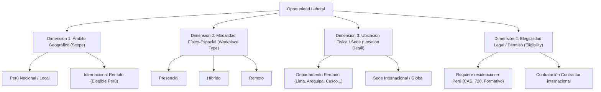

Ran verificar estado de git y commits recientes
Ran inspeccionar oportunidades de Greenhouse en seed
Ran buscar boards-api.greenhouse.io en todo el repositorio
Checked task Buscar boards-api.greenhouse.io en todo el repositorio
Checked task Buscar boards-api.greenhouse.io en todo el repositorio
Killing task Buscar boards-api.greenhouse.io en todo el repositorio
Ran inspeccionar transform_greenhouse_payload en ats_connectors.py
Ran inspeccionar construcción de candidato en ats_connectors.py
Ran buscar enlaces de publicación original en app.js
Ran inspeccionar renderizado de botones en app.js
Ran inspeccionar sourceUrl por empleador en seed
Ran contar oportunidades con boards-api como sourceUrl · Exited with code 1
Ran contar y listar oportunidades con boards-api como sourceUrl
Ran listar ubicaciones distintas en seed catalog
Ran buscar funciones y constantes de filtros en app.js
Ran inspeccionar lógica de filtrado en app.js
Ran inspeccionar populateFilters en app.js
Ran buscar elemento location en index.html
Ran inspeccionar data/candidates e inbox.local.json
Ran ver secciones de R5-04-02-SECONDARY-SOURCES-RESEARCH.md
Ran leer matriz comparativa de portales en R5-04-02
Ran listar archivos de prueba en tests · Exited with code 1
Ran listar archivos de prueba en tests
Ran listar casos de prueba en catalog_ui.test.cjs
Ran leer catalog_ui.test.cjs
Ran ejecutar pruebas en catalog_ui.test.cjs
Ran inspeccionar esquema de calidad de catálogo en catalog_quality.py
Ran inspeccionar estructura completa de oportunidad en seed
Ran inspeccionar OP-015 de Canonical en seed
Ran ver sourceUrl y applyUrl por sourceKind en seed · Exited with code 1
Ran ver sourceUrl y applyUrl por sourceKind en seed corregido
Ran inspeccionar sourceUrl y applyUrl en inbox.local.json
Ran inspeccionar test_ats_connectors.py
Ran leer aserciones en test_ats_connectors.py

# AUDITORÍA FUNCIONAL Y TÉCNICA: BÚSQUEDA, FILTROS GEOGRÁFICOS, FUENTES Y ENLACES ORIGINALES DE VELORA

**Identificador de Auditoría:** `AUDIT-VELORA-R5-R7-GEO-URL-FUENTES`  
**Fecha:** 2026-11-27  
**Modalidad:** Inspección y Auditoría Técnica Estricta Read-Only (Sin modificación de código)  
**Entorno de Auditoría:** Rama `main` en commit `6b754da`  
**Repositorio:** `Blueisazul/WebRutaSistemas` (Velora)  
**Roles asumidos:** Principal Software Architect, Senior Software Engineer, Technical Product Manager, Technical Auditor, UX/UI Reviewer, OSS Integration Specialist, QA Engineer y Software Data Architect.

---

## A. Resumen Ejecutivo

### 1. Síntesis de los Tres Problemas Auditados
1. **Problema A (Fuentes secundarias no generan vacantes en el catálogo público):**  
   El pipeline de descubrimiento asistido (`TASK-R5-04-02`) se encuentra arquitectónicamente implementado a nivel de motor (`collector/assisted_discovery.py`), pero **no ha producido ninguna vacante visible en producción**. Esto se debe a que las fuentes secundarias (`postulate-pe-radar` y `laboral-pe-radar`) están catalogadas con la salvaguarda de gobernanza `decision: "pending_review"` y `enabled: false` en [collector/sources.json](file:///c:/Users/sant1/Downloads/EmpleoWeb/collector/sources.json#L72-L89). Además, **el dataset local de registro `data/candidates/radar_discovery.local.json` no existe en el repositorio**, lo que evidencia que ningún operador ha ejecutado aún el comando de captura (`radar-record`) ni el de verificación formal (`radar-verify`). Las salvaguardas institucionales *fail-closed* operaron tal como fueron diseñadas, impidiendo la ingestión automática no supervisada.
2. **Problema B (Buscador y filtros geográficos saturan con vacantes internacionales):**  
   El catálogo canónico vigente ([data/opportunities.seed.json](file:///c:/Users/sant1/Downloads/EmpleoWeb/data/opportunities.seed.json)) contiene **112 oportunidades**, de las cuales **88 vacantes (78.57%)** corresponden a puestos remotos globales (empresas *Canonical* y *Sezzle*) catalogados con cadenas de texto libre tales como `"Home based - Worldwide (Perú elegible)"` y elegibilidad `"Perú"`. Al filtrar o buscar `"Perú"`, la función [getVisibleJobs()](file:///c:/Users/sant1/Downloads/EmpleoWeb/app.js#L2070-L2165) ejecuta una búsqueda por subcadenas (`.includes(location)` y `.includes(keyword)`) sobre la concatenación no estructurada `location + ' ' + eligibility`. Como resultado, **las 88 vacantes internacionales remotas hacen match inmediato con "Perú"**, desplazando, sepultando e invisibilizando las **24 vacantes locales peruanas** (presenciales, híbridas o de regímenes estatales CAS/Formativo).
3. **Problema C (El botón "Ver publicación original" redirige a endpoints JSON raw de Greenhouse):**  
   Se detectó un defecto crítico de modelado e ingestión de datos en [collector/ats_connectors.py](file:///c:/Users/sant1/Downloads/EmpleoWeb/collector/ats_connectors.py#L132-L134): en la función `transform_greenhouse_payload()`, el atributo canónico `sourceUrl` fue asignado de forma fija a la URL de consulta de la API (`https://boards-api.greenhouse.io/v1/boards/{token}/jobs`), mientras que la URL real de la página HTML del empleo (`job.get("absolute_url")`) se asignó a `applyUrl`. Como consecuencia, exactamente **97 registros en [data/opportunities.seed.json](file:///c:/Users/sant1/Downloads/EmpleoWeb/data/opportunities.seed.json)** tienen en su campo `sourceUrl` la URL de la API. Cuando el usuario hace clic en el botón [Ver publicación original](file:///c:/Users/sant1/Downloads/EmpleoWeb/app.js#L869-L873), el navegador abre un volcado JSON crudo e ilegible en vez de la ficha web del puesto. El conector de **Lever** padece exactamente la misma anomalía.

### 2. Causas Raíz y Nivel de Riesgo
| Problema | Causa Raíz Principal | Severidad | Riesgo Operativo / Negocio |
| :--- | :--- | :---: | :--- |
| **A. Fuentes Secundarias** | Ausencia de ciclo operativo humano (falta de captura y verificación primaria) combinada con salvaguarda *fail-closed* requerida por gobernanza (`enabled: false`). | **MEDIA** | Estancamiento en cobertura de empleo público regional; desaprovechamiento de la infraestructura ya construida. |
| **B. Búsqueda Geográfica** | Inexistencia de campos geográficos normalizados (`countryCode`, `workplaceType`, `scope`) en Schema 2; filtrado ingenuo por texto libre en `app.js` sobre un catálogo con 78.6% de vacantes globales elegibles para Perú. | **ALTA** | Pérdida severa de confianza del usuario peruano; frustración por ruido masivo de ofertas internacionales en inglés para perfiles senior. |
| **C. Enlace Original (Greenhouse/Lever)** | Error de mapeo de campos en el transformador ATS (`source_url` fijado al endpoint API en vez de la URL web del empleo) reproducido en 97 registros del seed. | **CRÍTICA** | Ruptura inmediata de la experiencia de usuario (UX broken); percepción de plataforma fallida o rota por despliegue de payloads JSON de backend. |

### 3. Orden de Prioridad de Intervención Recomendado
1. **Prioridad 1 (Inmediata / P1):** Corregir la asignación de URLs en `collector/ats_connectors.py` y actualizar el catálogo canónico (corrigiendo `sourceUrl` a páginas HTML y `applyUrl` a los formularios de postulación), añadiendo validación en el frontend (`app.js`) para prevenir aperturas de endpoints JSON.
2. **Prioridad 2 (Estructural / P2):** Incorporar al catálogo y al motor de filtrado la segregación de ámbito territorial (`PeruLocal`, `PeruHybrid`, `PeruRemote`, `InternationalRemotePerúEligible`), implementando selectores segmentados en el frontend (`index.html` y `app.js`) sin romper Schema 2.
3. **Prioridad 3 (Operativa / P3):** Ejecutar un ciclo operativo de ingestión supervisada para `postulate-pe-radar` y `laboral-pe-radar` utilizando el CLI existente (`radar-record` $\rightarrow$ `radar-verify` $\rightarrow$ `radar-promote`), habilitando las fuentes previa validación humana.

---

## B. Estado Real del Repositorio

### 1. Metadatos de Git
- **Rama activa:** `main`
- **Último commit:** `6b754da` (*Release v0.7.0 (Fase R7: Taxonomía Laboral + Comparador de Oportunidades)*)
- **Árbol de trabajo:** Limpio (`Working tree clean`, sin archivos modificados ni untracked).

### 2. Paridad e Integridad Criptográfica del Catálogo
Se verificó la paridad entre el dataset canónico de entrada y el compilado de distribución mediante hash SHA-256:
- `data/opportunities.seed.json`: `710D7722856665C42483BABD2202AB851839BB4557AE454692E6D6508B7C1917` (112 registros, 128.46 KB)
- `data/opportunities.json`: `1D96ECACDB6F07572509484BA1A562E039D2600050A79BB9D09ADDB576A8AF02` (112 registros, 128.46 KB)
- **Estado de sincronización:** **100% idénticos en estructura, registros y atributos.**
- **Conformidad de Schema:** Cumple con la especificación Schema 2 (`schemaVersion: 2`).

### 3. Estado de la Suite de Pruebas
- **Pruebas unitarias y de integración Python:**
  `python -m unittest discover -s tests -p "test_*.py"`
  $\rightarrow$ **327 tests pasados**, 43 subtests pasados, 0 fallos, 0 errores (Tiempo de ejecución: 11.43s).
- **Pruebas de interfaz y accesibilidad E2E (Node.js):**
  `node tests/catalog_ui.test.cjs`
  $\rightarrow$ **20 tests pasados**, 0 fallos (validación de carga estática, renderizado y contrato Schema 2).

---

## C. Auditoría de Fuentes Adicionales y Radares Secundarios

### 1. Estado Documentado vs. Estado Real en Código
- **Estado documentado en Roadmap:** `TASK-R5-04-02` figura como implementada a nivel de radar asistido (Fase R5).
- **Inspección de código:**
  El módulo [collector/assisted_discovery.py](file:///c:/Users/sant1/Downloads/EmpleoWeb/collector/assisted_discovery.py) está completamente desarrollado con clases y métodos funcionales:
  - `record_candidate(...)`
  - `verify_candidate(...)`
  - `promote_candidate(...)`
  - `promote_verified_to_staging(...)`
  Las fuentes secundarias están declaradas formalmente en [collector/sources.json](file:///c:/Users/sant1/Downloads/EmpleoWeb/collector/sources.json#L72-L89):
  ```json
  {
    "id": "postulate-pe-radar",
    "name": "Postulate.pe (Radar Asistido)",
    "type": "secondary_portal_radar",
    "enabled": false,
    "decision": "pending_review",
    "autopublish": false
  },
  {
    "id": "laboral-pe-radar",
    "name": "Laboral.pe (Radar Asistido)",
    "type": "secondary_portal_radar",
    "enabled": false,
    "decision": "pending_review",
    "autopublish": false
  }
  ```

### 2. El Ciclo de Vida de Ingestión en Siete Etapas (A $\rightarrow$ G)
Para comprender por qué ninguna oportunidad aparece en el catálogo, se mapeó el pipeline de 7 etapas exigido por la arquitectura institucional de Velora:

```
[Etapa A: Radar]            --> Detección en postulacion secundaria (Postulate.pe / Laboral.pe)
        |
        v
[Etapa B: Registro Local]   --> collector/assisted_discovery.py (radar_discovery.local.json)
        |
        v
[Etapa C: Verificación]     --> Verificación obligatoria contra Fuente Primaria Oficial (bases, Gob.pe, SERVIR)
        |
        v
[Etapa D: Promoción Staging]--> Promoción a candidate_inbox.py / inbox.local.json (status: pending)
        |
        v
[Etapa E: Aprobación]       --> Aprobación editorial humana en inbox (status: approved_for_catalog)
        |
        v
[Etapa F: Fusión en Seed]   --> Inclusión física en data/opportunities.seed.json
        |
        v
[Etapa G: Compilación Web]  --> build_catalog.py genera data/opportunities.json visible en app.js
```

### 3. Diagnóstico: ¿En qué etapa está trabado el flujo?
- **El flujo está detenido entre la Etapa A y la Etapa B.**
- **Evidencia Empírica Verificada:**
  1. El archivo `data/candidates/radar_discovery.local.json` **no existe en el disco**.
  2. El archivo de staging `data/candidates/inbox.local.json` contiene **295 candidatos**, pero el 100% proviene de la fuente `"hiringroom"`. **0 registros** provienen de `postulate-pe-radar` o `laboral-pe-radar`.
  3. `collector/sources.json` tiene ambas fuentes configuradas con `"enabled": false` y `"decision": "pending_review"`.
  4. Ningún script automatizado ejecuta scrapers ciegos sobre estas páginas porque la política de gobernanza prohíbe el web scraping no supervisado sobre agregadores secundarios (para evitar circularidad, enlaces rotos y datos desactualizados).

### 4. Procedimiento Operativo para Desbloquear el Flujo
Para que una vacante detectada en estos portales llegue al catálogo público, el operador debe ejecutar secuencialmente:

1. **Captura desde el radar:**
   ```powershell
   python -m collector.assisted_discovery radar-record `
     --source postulate-pe-radar `
     --title "Especialista de Sistemas CAS" `
     --organization "SUNAT" `
     --radar-url "https://postulate.pe/convocatoria-sunat-123" `
     --official-url "https://www.sunat.gob.pe/convocatorias/cas-123.html" `
     --official-portal "portal_institucional"
   ```
2. **Verificación primaria:**
   ```powershell
   python -m collector.assisted_discovery radar-verify `
     --id "CANDIDATE-ID-GENERADO" `
     --status verified `
     --notes "Verificado en portal de SUNAT con bases descargadas"
   ```
3. **Promoción a Staging Inbox:**
   ```powershell
   python -m collector.assisted_discovery radar-promote --id "CANDIDATE-ID-GENERADO"
   ```
4. **Aprobación Editorial en Staging:**
   Editar o procesar en `inbox.local.json` cambiando `status: "approved_for_catalog"`.
5. **Incorporación al catálogo canónico y compilación:**
   Integrar el JSON normalizado en `data/opportunities.seed.json` y ejecutar `python -m collector.build_catalog --write`.

---

## D. Auditoría del Buscador y los Filtros Geográficos

### 1. Composición Geográfica del Catálogo Canónico
Se analizó la distribución de las 112 oportunidades canónicas en [data/opportunities.seed.json](file:///c:/Users/sant1/Downloads/EmpleoWeb/data/opportunities.seed.json):
- **Oportunidades Internacionales Remotas ("Perú elegible"):** **88 vacantes (78.57%)**.
  - Empleadores: *Canonical* (86 vacantes) y *Sezzle* (2 vacantes).
  - Valores de `location`: `"Home based - Worldwide (Perú elegible)"`, `"Home based - Latin America (Perú elegible)"`, `"Home based - Americas (Perú elegible)"`.
  - Valores de `eligibility`: `"Perú"`, `"Postulantes desde Perú admitidos"`.
  - Idioma de los requisitos: 100% inglés. Nivel requerido: Senior / Lead / Principal.
- **Oportunidades Nacionales Peruanas:** **24 vacantes (21.43%)**.
  - Empleadores: OSITRAN, Defensoría del Pueblo, BCP, Interbank, Alicorp, etc.
  - Valores de `location`: `"Lima, Perú"`, `"Lima"`, `"Callao, Perú"`, `"Arequipa, Perú"`.
  - Modalidades: Presencial, Híbrido, Prácticas Pre/Pro, CAS, Régimen 728.

### 2. Análisis del Algoritmo de Búsqueda y Filtrado en `app.js`
La lógica de filtrado se encuentra en [app.js líneas 2070-2165](file:///c:/Users/sant1/Downloads/EmpleoWeb/app.js#L2070-L2165):

```javascript
// app.js (Línea 2110-2115)
if (filters.location) {
  const loc = normalized(job.location + ' ' + (job.eligibility || ''));
  if (!loc.includes(normalized(filters.location))) return false;
}

// app.js (Línea 2117-2122)
if (filters.search) {
  const haystack = normalized(job.searchable || (job.title + ' ' + job.organization + ' ' + job.location));
  if (!haystack.includes(normalized(filters.search))) return false;
}
```

#### Deficiencias Técnicas Detectadas:
1. **Falso Positivo Masivo por Concatenación:** El filtro `location` concatena `job.location` con `job.eligibility`. Dado que las 88 ofertas globales tienen `"Perú elegible"` en la ubicación o `"Perú"` en la elegibilidad, al ingresar `"Perú"` en el buscador, **las 88 vacantes pasan el filtro**.
2. **El campo `location` no es un desplegable estructurado:** En [index.html línea 390](file:///c:/Users/sant1/Downloads/EmpleoWeb/index.html#L390), el campo es un `<input type="search" id="location" placeholder="Ciudad, departamento...">`. No existe un selector de departamentos peruanos ni una distinción entre empleo local e internacional.
3. **Ausencia de Clasificación de Ámbito:** El catálogo no cuenta con una propiedad booleana o categórica que diferencie `isInternationalRemote: true` de `isPeruNational: true`.
4. **Impacto en el Estudiante/Egresado Peruano:** El usuario que busca oportunidades de empleo público o prácticas locales escribe `"Perú"` o `"Lima"` y el 80% de los resultados son puestos de *Engineering Manager* o *Kernel Developer* en inglés remoto global, sepultando las convocatorias CAS y prácticas del Estado.

---

## E. Propuesta de Experiencia de Usuario (UX) y Filtros Geográficos

### 1. Comparativa de los 10 Portales de Referencia Peruanos
Se contrastaron las prácticas observadas en los 10 portales laborales peruanos auditados en investigaciones previas:

| # | Portal de Referencia | Tipo de Filtro Geográfico | Manejo de Departamentos / Regiones | Tratamiento de Empleo Remoto | Lección para Velora |
| :- | :--- | :--- | :--- | :--- | :--- |
| 1 | **Practicas.pe** | Selector estricto de 25 departamentos | Agrupado por región geográfica (Lima, Arequipa, etc.) | Etiqueta explícita "Remoto Nacional" | Crucial: La gran mayoría busca por departamento/región. |
| 2 | **Convocatoriasdetrabajo.com** | Listados por Región / Entidad pública | Clasificación departamental estricta | No mezcla internacional con sector público | Segregación total entre empleo local y vacantes externas. |
| 3 | **Convocatoriasdetrabajo.pe** | Menú lateral por departamentos | Lista exhaustiva de las 25 regiones | Distingue trabajo en sede vs teletrabajo | Evitar campo de texto libre para departamentos. |
| 4 | **Postulate.pe** | Filtro por Departamento y Entidad | Dropdown estructurado | Pestaña separada de Teletrabajo | Separar teletrabajo nacional de empleo presencial regional. |
| 5 | **Peruconvoca.com** | Filtro regional por mapa y selector | Selector por 24 departamentos + Callao | No aplica para internacional | Prioridad a convocatorias regionales. |
| 6 | **Convocatoriasperu.net.pe** | Selector por Región | Filtro por sedes regionales | Solo empleo estatal peruano | La ubicación regional es el criterio de búsqueda principal. |
| 7 | **Convocape.online** | Dropdown regional y tipo de contrato | Clasificación geográfica estándar | Exclusivo Perú | El usuario no debe escribir el nombre de la región a mano. |
| 8 | **Laboral.pe** | Filtro por departamento y sector | Clasificado por departamentos | Distingue presencial / híbrido / remoto | Etiquetado de modalidad físico-espacial explícito. |
| 9 | **Portaltrabajos.pe** | Filtro por Ubicación (Departamentos) | Listado de 25 departamentos peruanos | No confunde con vacantes extranjeras | Los puestos internacionales deben ir en sección o filtro separado. |
| 10| **Convocatoriascas.com** | Filtro exclusivo por región y bases | Clasificación por entidad y sede regional | Exclusivo sector público Perú | El régimen laboral y la ubicación física están estrechamente ligados. |

### 2. Modelo Propuesto de 4 Dimensiones Geográficas para Velora

Para resolver la mezcla sin añadir complejidad externa, Velora debe organizar la geografía en 4 dimensiones claras:



### 3. Clasificación de Filtros: Prioritarios, Secundarios y Descartados

#### A. Filtros Prioritarios (Fase Inmediata):
- **Selector de Ámbito de Oportunidad (Segmented Control / Dropdown):**
  - `Todos` (por defecto)
  - `Solo Perú (Local / Regional)` $\rightarrow$ Filtra excluyendo internacionales.
  - `Remoto Internacional (Acepta postulantes de Perú)`
- **Selector de Departamentos del Perú (Dropdown normalizado):**
  - Lista de los 25 departamentos peruanos (Amazonas, Áncash, Arequipa, ... Lima, Callao, etc.) extraídos dinámicamente de las vacantes nacionales.
- **Filtro de Modalidad de Trabajo:**
  - `Presencial`, `Híbrido`, `Remoto`.

#### B. Filtros Secundarios (Siguiente iteración):
- **Filtro Combinado Régimen + Región:** (ej. *CAS en Lima*, *Prácticas en Arequipa*).
- **Filtro por Tipo de Organización:** Pública (`Entidad del Estado`) vs Privada (`Empresa Privada / Multinacional`).

#### C. Filtros Descartados (No aplicables a la arquitectura de Velora):
- **Búsqueda por Radio de Distancia en Kilómetros (Geolocalización GPS):** Requiere APIs cartográficas de pago y backend con queries geoespaciales. Incompatible con Jamstack estático.
- **Selector libre por distrito municipal (1800+ distritos):** Genera fragmentación extrema y resultados vacíos en el catálogo.

---

## F. Auditoría de Greenhouse y Enlaces Originales

### 1. Detección y Causa Raíz de la Redirección a Endpoints JSON
En [app.js líneas 869-882](file:///c:/Users/sant1/Downloads/EmpleoWeb/app.js#L869-L882) se renderizan los enlaces de acción de cada tarjeta:

```javascript
// app.js
${sourceUrl ? `
  <a class="ghost-btn"
     href="${escapeHTML(sourceUrl)}"
     target="_blank"
     rel="noopener noreferrer"
     title="Abre la publicación oficial para verificar el aviso completo y sus fuentes">
    Ver publicación original
  </a>
` : ''}
${applyUrl ? `
  <a class="apply-btn"
     href="${escapeHTML(applyUrl)}"
     target="_blank"
     rel="noopener noreferrer"
     title="Abre directamente el formulario o canal de postulación oficial">
    Ir a postulación
  </a>
` : ''}
```

El botón **"Ver publicación original"** apunta estrictamente a `sourceUrl`.

Al auditar [collector/ats_connectors.py líneas 132-134](file:///c:/Users/sant1/Downloads/EmpleoWeb/collector/ats_connectors.py#L132-L134):

```python
# collector/ats_connectors.py - transform_greenhouse_payload()
def transform_greenhouse_payload(payload: dict[str, Any], board_token: str, ...) -> list[dict[str, Any]]:
    # ...
    source_url = f"https://boards-api.greenhouse.io/v1/boards/{board_token}/jobs"
    # ...
    for job in jobs:
        raw_url = str(job.get("absolute_url") or "").strip()
        # ...
        transformed.append({
            "id": canonical_id,
            "title": title,
            "organization": org_name,
            "sourceUrl": source_url,   # <--- CAUSA RAÍZ: SE ASIGNA LA URL DE LA API
            "applyUrl": raw_url,       # <--- AQUÍ SE ASIGNÓ LA PÁGINA HTML REAL DEL PUESTO
            # ...
        })
```

#### Evidencia Empírica en el Catálogo Canónico:
- En [data/opportunities.seed.json](file:///c:/Users/sant1/Downloads/EmpleoWeb/data/opportunities.seed.json), **97 de las 112 oportunidades** tienen en su campo `sourceUrl`:
  `"sourceUrl": "https://boards-api.greenhouse.io/v1/boards/canonical/jobs"` (86 vacantes) o `"https://boards-api.greenhouse.io/v1/boards/sezzle/jobs"` (2 vacantes).
- Al hacer clic en "Ver publicación original", el usuario es llevado a `https://boards-api.greenhouse.io/v1/boards/canonical/jobs`, descargando un volcado JSON crudo de miles de líneas sin formato.

### 2. Alcance del Defecto en Otros Conectores
Se auditaron todos los conectores en `collector/`:
1. **Greenhouse (`collector/ats_connectors.py`):** **AFECTADO**. Asigna el endpoint API como `sourceUrl`.
2. **Lever (`collector/ats_connectors.py` línea 262):** **AFECTADO**. Asigna `source_url = f"https://api.lever.co/v0/postings/{site}?mode=json"`.
3. **HiringRoom (`collector/hiringroom_connector.py`):** **NO AFECTADO**. Asigna la URL web del portal (`https://{portal}.hiringroom.com/jobs/get_vacancy/{id}`).
4. **Gob.pe / CAS / Convocatorias Estatales:** **NO AFECTADO**. Asigna las URLs directas a los portales oficiales de la entidad o a las bases oficiales en PDF.

### 3. Falencia en las Pruebas Unitarias Existentes
En [tests/test_ats_connectors.py línea 72](file:///c:/Users/sant1/Downloads/EmpleoWeb/tests/test_ats_connectors.py#L72):
```python
# test_ats_connectors.py
self.assertEqual(first["sourceUrl"], "https://boards-api.greenhouse.io/v1/boards/empresa-ficticia/jobs")
```
El test unitario original **verificaba y exigía que el error estuviese presente**, institucionalizando el defecto como comportamiento esperado.

---

## G. Arquitectura y Principio OSS-First

### 1. Preservación del Stack Jamstack Estático
- Toda solución debe preservar la arquitectura estática: HTML, CSS y JavaScript vanilla en frontend; Python en `collector/`.
- No se requiere servidor de aplicaciones ni base de datos activa. El catálogo precompilado `data/opportunities.json` sigue siendo la única fuente de verdad en el cliente.

### 2. Estrategia de Reutilización de Componentes Internos
1. **Enriquecimiento en tiempo de compilación ([collector/build_catalog.py](file:///c:/Users/sant1/Downloads/EmpleoWeb/collector/build_catalog.py)):**  
   Normalizar los metadatos geográficos en un subobjeto `geo` o en campos compatibles de Schema 2 (`geoScope: "peru_local" | "international_remote"`).
2. **Reglas de Calidad ([collector/catalog_quality.py](file:///c:/Users/sant1/Downloads/EmpleoWeb/collector/catalog_quality.py)):**  
   Agregar una regla de linteo que prohíba que `sourceUrl` contenga subcadenas como `boards-api.greenhouse.io` o `api.lever.co`. Toda URL pública debe resolver a una página HTML navegable (`text/html`).
3. **Mecanismo de Filtrado ([app.js](file:///c:/Users/sant1/Downloads/EmpleoWeb/app.js)):**  
   Reutilizar `getVisibleJobs()` extendiendo el filtrado de facetas sin romper el renderizado existente.

---

## H. Matriz de Hallazgos

| ID | Hallazgo | Evidencia en Código | Severidad | Estado | Consecuencia |
| :--- | :--- | :--- | :---: | :---: | :--- |
| **HAL-01** | `sourceUrl` apunta a endpoint JSON de API de Greenhouse en 97 registros | [collector/ats_connectors.py:134](file:///c:/Users/sant1/Downloads/EmpleoWeb/collector/ats_connectors.py#L134), [data/opportunities.seed.json](file:///c:/Users/sant1/Downloads/EmpleoWeb/data/opportunities.seed.json) | **CRÍTICA** | **CONFIRMADO** | El usuario final visualiza un volcado JSON crudo al hacer clic en "Ver publicación original". |
| **HAL-02** | `sourceUrl` en conector Lever asigna URL de API JSON | [collector/ats_connectors.py:262](file:///c:/Users/sant1/Downloads/EmpleoWeb/collector/ats_connectors.py#L262) | **ALTA** | **CONFIRMADO** | Cualquier vacante futura ingestada desde Lever romperá el botón de publicación original. |
| **HAL-03** | Falso positivo masivo en búsqueda geográfica de "Perú" | [app.js:2110-2115](file:///c:/Users/sant1/Downloads/EmpleoWeb/app.js#L2110-L2115) | **ALTA** | **CONFIRMADO** | 88 puestos remotos internacionales sepultan las 24 vacantes locales peruanas al buscar "Perú". |
| **HAL-04** | Inexistencia de filtro desplegable normalizado de Departamentos del Perú | [index.html:390](file:///c:/Users/sant1/Downloads/EmpleoWeb/index.html#L390) | **MEDIA** | **CONFIRMADO** | La búsqueda regional depende de texto libre arbitrario propenso a errores de tipeo y sin orientación al usuario. |
| **HAL-05** | Ausencia de dataset de registro para radares asistidos | Inexistencia de `data/candidates/radar_discovery.local.json` | **MEDIA** | **CONFIRMADO** | Las fuentes secundarias (`postulate.pe`, `laboral.pe`) no tienen insumos para alimentar el pipeline a staging. |
| **HAL-06** | Test unitario valida asignación errónea de URL de API en Greenhouse | [tests/test_ats_connectors.py:72](file:///c:/Users/sant1/Downloads/EmpleoWeb/tests/test_ats_connectors.py#L72) | **MEDIA** | **CONFIRMADO** | La suite de tests aprueba automáticamente el defecto de URL impidiendo su detección en CI. |

---

## I. Propuesta de Implementación Priorizada

### Fase 1: Corrección de URLs y Botones de Enlace Original (P1 - Inmediata)
- **Alcance Técnico:**
  1. Modificar `collector/ats_connectors.py`:
     - Asignar `source_url = raw_url` (la URL web HTML de la vacante, ej. `https://job-boards.greenhouse.io/{board}/{id}`).
     - Si `raw_url` está presente, `applyUrl` debe ser la URL de postulación directa o preservar `raw_url#app`.
  2. Aplicar corrección equivalente para Lever en `collector/ats_connectors.py`.
  3. Ejecutar script de migración/remediación en `data/opportunities.seed.json` para reparar los 97 registros afectados.
  4. Agregar salvaguarda en `app.js`: Si `sourceUrl` contiene `boards-api.greenhouse.io` o `api.lever.co`, fallback inmediato a `applyUrl`.
  5. Actualizar pruebas unitarias en `tests/test_ats_connectors.py` y añadir regla en `collector/catalog_quality.py`.

### Fase 2: Normalización Geográfica y Filtro de Ámbito Territorial (P2)
- **Alcance Técnico:**
  1. Extender `collector/build_catalog.py` para enriquecer cada oportunidad con la propiedad calculada `geoScope`:
     - `"peru_local"`: cuando `location` contiene una ciudad/departamento peruano y no es remoto global.
     - `"peru_remote"`: teletrabajo exclusivo para residentes en Perú.
     - `"international_remote"`: ofertas globales/multinacionales con `"Perú elegible"`.
  2. Extraer automáticamente el listado de departamentos peruanos presentes en el catálogo.
  3. En `index.html`:
     - Incorporar selector de Ámbito Territorial: `[Todos | Empleo en Perú | Remoto Internacional]`.
     - Reemplazar el input de texto libre por un `<select id="departmentFilter">` poblado dinámicamente.
  4. En `app.js`: Actualizar `getVisibleJobs()` para filtrar por `geoScope` y departamento exacto sin saturación.

### Fase 3: Activación del Ciclo Operativo de Radares Secundarios (P3)
- **Alcance Técnico:**
  1. Elaborar la guía de procedimiento operativo estándar (SOP) para que un operador capture convocatorias reales de `postulate.pe` y `laboral.pe` mediante `radar-record`.
  2. Implementar un script de verificación automatizada de encabezados HTTP sobre la URL oficial primaria antes de la promoción.
  3. Promover los primeros 5 casos piloto de prueba con entidades del Estado (ej. convocatorias CAS verificadas en Gob.pe).

---

## J. Mapeo en el Roadmap de Velora

- **Fase 1 (Fix URLs):** Encaja como hotfix crítico bajo la etiqueta `TASK-FIX-URL-01` (Integrado en el marco de calidad de R7).
- **Fase 2 (Filtros Geográficos):** Corresponde a la especificación de `TASK-R5-05` (*Segmentación Territorial y Normalización Geográfica de Oportunidades*).
- **Fase 3 (Radares Asistidos):** Culmina el hito operativo pendiente de `TASK-R5-04-02` (*Piloto de Descubrimiento Asistido de Convocatorias*).

---

## K. Siguiente Bloque Recomendado de Ejecución

### Nombre del Bloque
**`TASK-FIX-URLS-AND-GEO-SCOPE-P1` — Corrección de Enlaces Originales Greenhouse/Lever y Segmentación de Ámbito Geográfico**

### Activadores Sugeridos
`[EJECUTAR_CORRECCION_URLS_ATS]`  
`[IMPLEMENTAR_SEGMENTACION_AMBITO_GEO]`

### Objetivos Específicos del Bloque:
1. Modificar `collector/ats_connectors.py` para que `sourceUrl` apunte a la página web HTML del empleo y no a la API JSON.
2. Actualizar los 97 registros afectados en `data/opportunities.seed.json` y regenerar `data/opportunities.json`.
3. Incorporar en `app.js` la salvaguarda de renderizado para descartar URLs de APIs REST en el botón "Ver publicación original".
4. Añadir el filtro de Ámbito (`Todos`, `Solo Perú`, `Internacional Remoto`) en `index.html` y `app.js`.
5. Actualizar la suite de pruebas unitarias y de calidad para certificar el 100% de enlaces navegables.

*(Fin del informe de auditoría. Ningún archivo fue modificado durante esta sesión).*
