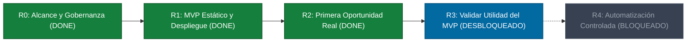

# Resumen Ejecutivo de Promoción y Primera Publicación Real (R2-A-05)

**Resultado:** `DONE`  
**Fase:** R2 — Flujo editorial real (Cierre definitivo de R2)  
**Rama de origen:** `integration/r1-02c`  
**Rama remota desplegada:** `main` (Fast-forward, commit [`28b7a9e`](https://github.com/Blueisazul/WebRutaSistemas/commit/28b7a9e))  
**Workflow CI/CD:** GitHub Actions Run ID [`44234640124`](https://github.com/Blueisazul/WebRutaSistemas/actions/runs/44234640124) (`validate`: **success**, `publish`: **success**)  
**URL de Producción:** https://blueisazul.github.io/WebRutaSistemas/  
**Snapshot Público:** https://blueisazul.github.io/WebRutaSistemas/data/opportunities.json  

---

## 1. Oportunidad Promovida y Publicada

En cumplimiento de la autorización y recomendación editorial de [R2-A-04](file:///c:/Users/sant1/Downloads/EmpleoWeb/docs/audits/r2-a-04-editorial-decision-2026-11-18.md) (`APPROVE_WITH_LIMITATIONS`), se incorporó formalmente la primera oportunidad real al catálogo canónico:

- **Identificador de Catálogo:** `OP-005`
- **Identificador de Candidato Staging:** `CAND-greenhouse-public-job-board-template-8039990003`
- **ID Externo (ATS):** `8039990003` (Greenhouse Public ATS)
- **Empleador:** CookUnity
- **Entidad Difusora (`publisher`):** CookUnity (`publisherRelation: "employer_confirmed"`)
- **Puesto:** *Supply Chain Analyst*
- **Familia Profesional:** `Sistemas empresariales` (consultas SQL, calidad de datos, sistemas ERP y modelado de datos)
- **Nivel:** `Profesional / junior` (requiere al menos 1 año de experiencia previa en análisis de datos o cadena de suministro; no es práctica preprofesional)
- **Modalidad (`mode`):** `null` (no inferida; visualizada estrictamente como «No especificada» para evitar afirmaciones no comprobadas)
- **Ubicación y Elegibilidad:** `Lima, Perú` / `Elegible desde Perú (puesto radicado en Lima, Perú)`
- **Fecha de Verificación (`lastVerifiedAt`):** `2026-11-18` (vigencia confirmada dentro del TTL de 7 días)
- **Estado de Publicación:** `publicationStatus: "active"`, `opportunityStatus: "open"`, `verificationStatus: "verified"`, `recordKind: "curated"`
- **Canal de Postulación Directo (`applyUrl`):** https://job-boards.greenhouse.io/cookunity/jobs/8039990003 (botón *«Ir a postulación ↗»* habilitado en producción)
- **Ficha Informativa del Empleador (`sourceUrl`):** https://careers.cookunity.com/jobs/8039990003

---

## 2. Desglose de Evidencia por Campo (`fieldEvidence`)

Para satisfacer el contrato editorial de Candidate Schema 2 y Catalog Schema 2 en modo activo, la ficha cuenta con **21 evidencias HTTPS directas** verificadas el `2026-11-18` sobre los hosts permitidos (`boards-api.greenhouse.io`, `careers.cookunity.com`, `job-boards.greenhouse.io`, `www.cookunity.com`):

1. `employer` · evidencia ↗ (`careers.cookunity.com`)
2. `publisher` · evidencia ↗ (`careers.cookunity.com`)
3. `title` · evidencia ↗ (`boards-api.greenhouse.io`)
4. `applyUrl` · evidencia ↗ (`job-boards.greenhouse.io`)
5. `location` · evidencia ↗ (`boards-api.greenhouse.io`)
6. `eligibility` · evidencia ↗ (`boards-api.greenhouse.io`)
7. `requirements` · evidencia ↗ (`boards-api.greenhouse.io`)
8. `skills` · evidencia ↗ (`boards-api.greenhouse.io`)
9. `tasks` · evidencia ↗ (`boards-api.greenhouse.io`)
10. `training` · evidencia ↗ (`boards-api.greenhouse.io`)
11. `growth` · evidencia ↗ (`careers.cookunity.com`)
12. `sector` · evidencia ↗ (`www.cookunity.com`)
13. `family` · evidencia ↗ (`boards-api.greenhouse.io`)
14. `level` · evidencia ↗ (`boards-api.greenhouse.io`)
15. `kind` · evidencia ↗ (`careers.cookunity.com`)
16. `duration` · evidencia ↗ (`careers.cookunity.com`)
17. `publishedAt` · evidencia ↗ (`boards-api.greenhouse.io`)
18. `benefits` · evidencia ↗ (`boards-api.greenhouse.io`)
19. `continuity` · evidencia ↗ (`careers.cookunity.com`)
20. `risk` · evidencia ↗ (`careers.cookunity.com`)
21. `salary` · evidencia ↗ (`careers.cookunity.com`)

---

## 3. Estado de la Bandeja de Staging y Candidatos en Reserva

- El candidato alternativo de Canonical (**`CAND-greenhouse-public-job-board-template-8379825`**, *Junior Operations Analyst*, Remote Worldwide/AMER) se conservó **intacto en la bandeja local de staging** ([data/candidates/inbox.local.json](file:///c:/Users/sant1/Downloads/EmpleoWeb/data/candidates/inbox.local.json)) en estado `pending_review` como reserva técnica.
- Ningún archivo temporal, secreto o bandeja local privada fue versionado en Git (`data/candidates/inbox.local.json` verificado como ignorado en `.gitignore`).

---

## 4. Validación Técnica y Suite de Pruebas

Toda la cadena de validación estricta y offline fue ejecutada localmente y en CI con resultado 100% aprobatorio:

| Componente de Prueba | Herramienta / Comando | Resultado |
|---|---|---|
| **Consistencia Semilla / Snapshot** | `python scripts/build_catalog.py --check` | **Pasa** (6 registros sincronizados byte por byte) |
| **Calidad de Catálogo Schema 2** | `python scripts/validate_catalog.py` | **Pasa** (0 errores; advertencias informativas esperadas de registros demostrativos y modalidad) |
| **Bandeja de Candidatos Staging** | `python scripts/validate_candidates.py` | **Pasa** (8 candidatos conformes a Schema 2) |
| **Pruebas Unitarias** | `python -m unittest discover -s tests -p "test_*.py"` | **193 de 193 pruebas aprobadas** (0 errores, 0 fallos) |
| **Sintaxis y Contrato JavaScript** | `node --check app.js` / `node tests/catalog_ui.test.cjs` | **Pasa** (escenarios de filtrado público y degradación conformes) |
| **Pruebas E2E de Navegador** | `npx playwright test` | **8 de 8 pruebas aprobadas** (Chromium y mobile Pixel 5) |
| **Integridad de Formato Git** | `git diff --check` | **Pasa** (sin conflictos de espacios ni saltos de línea) |

---

## 5. Verificación en Producción en Vivo (GitHub Pages)

Tras el push de `integration/r1-02c` a `main`, el workflow `.github/workflows/refresh-catalog.yml` completó las fases de compilación de Tailwind CSS, validación completa, empaquetado y despliegue a GitHub Pages:

- **Página Principal (HTML):** HTTP 200 OK (`44,638 bytes`).
- **Endpoint JSON (`/data/opportunities.json`):** HTTP 200 OK.
  - Conteo total: 6 fichas (`OP-001`, `OP-002`, `OP-003`, `OP-004`, `QA-001`, `OP-005`).
  - Oportunidades activas en vista inicial: **1 resultado** (`OP-005`).
  - Fichas demostrativas: **5 registros** accesibles mediante el opt-in explícito *«Incluir ejemplos demostrativos»*.
  - Vacante `OP-005`: Renderiza con etiqueta de estado activa, modalidad «No especificada», procedencia desglosada y enlace directo a postulación oficial.

---

## 6. Documentación y Trazabilidad de Auditorías

Se generaron y actualizaron los siguientes documentos rectores y expedientes de auditoría:
- [docs/audits/r2-a-05-first-real-publication-2026-11-18.md](file:///c:/Users/sant1/Downloads/EmpleoWeb/docs/audits/r2-a-05-first-real-publication-2026-11-18.md) *(Informe de auditoría y publicación de este bloque)*
- [docs/audits/r2-a-04-editorial-decision-2026-11-18.md](file:///c:/Users/sant1/Downloads/EmpleoWeb/docs/audits/r2-a-04-editorial-decision-2026-11-18.md) *(Auditoría de evidencia y decisión editorial humana)*
- [docs/audits/r2-a-03-controlled-capture-2026-11-18.md](file:///c:/Users/sant1/Downloads/EmpleoWeb/docs/audits/r2-a-03-controlled-capture-2026-11-18.md) *(Captura controlada y consolidación de expediente)*
- [docs/audits/r2-a-02-editorial-review-2026-11-17.md](file:///c:/Users/sant1/Downloads/EmpleoWeb/docs/audits/r2-a-02-editorial-review-2026-11-17.md) *(Curaduría editorial y verificación de elegibilidad)*
- [docs/audits/r2-a-01-rev-public-sources-discovery-2026-11-17.md](file:///c:/Users/sant1/Downloads/EmpleoWeb/docs/audits/r2-a-01-rev-public-sources-discovery-2026-11-17.md) *(Descubrimiento y evaluación de fuentes públicas)*
- [docs/architecture/r0-decisiones-y-alcance-2026-11-12.md](file:///c:/Users/sant1/Downloads/EmpleoWeb/docs/architecture/r0-decisiones-y-alcance-2026-11-12.md) *(R2 actualizado a **DONE**, desbloqueando **R3**)*
- [docs/sources/seguimiento-autorizacion-fuentes.md](file:///c:/Users/sant1/Downloads/EmpleoWeb/docs/sources/seguimiento-autorizacion-fuentes.md) *(CookUnity marcado como `published`; Canonical en reserva)*
- [README.md](file:///c:/Users/sant1/Downloads/EmpleoWeb/README.md) *(Actualizado el estado real del catálogo con 1 oportunidad activa y 5 demostrativas)*

---

## 7. Estado del Roadmap



La fase **R2 queda formalmente concluida y cerrada**. El proyecto se encuentra ahora en condiciones de iniciar la fase **R3 (Validar utilidad del MVP)** mediante pruebas de usuario sobre la experiencia de toma de decisiones profesionales con oportunidades y evidencias reales.

---

# Ruta Sistemas

Catálogo piloto de oportunidades laborales para estudiantes y profesionales de Sistemas, con foco en Perú y puestos remotos elegibles desde Perú. El objetivo es hacer comparables las condiciones y la evidencia que ayudan a decidir una trayectoria; la plataforma no garantiza empleo, continuidad ni ascensos.

## Estado real

La interfaz estática permite buscar y filtrar un catálogo JSON. Tras la culminación del primer flujo editorial real (R2-A-05), el catálogo contiene **1 oportunidad real activa verificada** (`OP-005`: *Supply Chain Analyst* en CookUnity, Lima, Perú) con canal de postulación oficial habilitado y 21 evidencias trazables por campo. Asimismo, se conservan cinco fichas **demostrativas** (ninguna habilitada para postular) para pruebas de interfaz y comparación.

Las fichas demostrativas no aparecen en la búsqueda normal: se muestran solo al activar **“Incluir ejemplos demostrativos”** y están identificadas como ejemplos. Los contadores de oportunidades reales reflejan exclusivamente las oportunidades reales verificadas y activas. Cuando no hay oportunidades reales verificadas para un filtro determinado, la página lo indica y explica que cada publicación se incorpora tras revisar su origen y canal de postulación.

## Fuente de datos y estados

- `data/opportunities.seed.json` es la única fuente editable y versionada. Contiene las fichas, su procedencia, fechas y estados.
- `data/opportunities.json` es un artefacto generado para el frontend. No editarlo directamente: el validador detecta cualquier diferencia con la fuente; para reemplazarlo deliberadamente se usa `--write`.
- Todas las fechas civiles usan `YYYY-MM-DD`; timestamps de evidencia usan ISO 8601 con zona. Fechas civiles se evalúan en `America/Lima` (UTC-05:00). Una fecha incompleta o ausente permanece desconocida.
- `opportunityStatus` describe abierta/cerrada/vencida/desconocida; `verificationStatus` describe verificada/pendiente/atrasada/no verificada; `publicationStatus` determina activa/no confirmada/histórica. No son equivalentes.
- La configuración del TTL piloto está en `verificationTtlDays` de la semilla. El valor inicial es **7 días calendario** por la rotación rápida de vacantes; debe revisarse con evidencia del piloto. Deadline vencido siempre anula publicación activa. Sin deadline, la verificación reciente y la evidencia siguen siendo obligatorias.
- Para publicar una ficha activa se exige revisión manual reciente del canal de postulación confirmado por el empleador y observado abierto, timestamp con zona, evidencia enlazada, enlaces HTTPS en hosts explícitamente permitidos, estatus abierto, fecha límite no vencida si existe y registro no demostrativo. Un ATS que devuelve un anuncio o una ejecución de generación no satisface por sí sola estos requisitos.
- El contrato editorial para nuevas fichas activas separa `employer` (quien contrata) de `publisher` (quien difunde); `sourceUrl` identifica la ficha informativa y `applyUrl` el canal de postulación. `fieldEvidence` registra URL HTTPS y `observedAt` por cada dato publicado, y `editorialDecision` conserva aprobación humana, revisor, fecha y motivo. Cada dato no publicado permanece `null`/ausente; el validador exige evidencia para toda condición que sí se afirme.
- La interfaz identifica empleador, difusor, ficha y canal de postulación por separado; detalla los enlaces de evidencia por campo. Muestras demostrativas se etiquetan como tales, y el enlace de postulación no se habilita por defecto ni se infiere desde la fuente informativa.
- Talento Perú/SERVIR y una alternativa institucional (portal FISI-UNMSM) fueron evaluados el 2026-10-26 y quedaron `pending_review`. El directorio oficial de SERVIR lista una aplicación web pública de consulta, pero no API/feed documentado ni autorización de automatización/reutilización. Ambas fuentes están deshabilitadas con presupuesto de solicitudes cero; no hubo extracción. Los borradores de seguimiento están preparados, no enviados. Los conectores Greenhouse/Lever también continúan desactivados.

## Ejecutar y validar

Requisitos locales: Python 3.12+ y Node.js 22 para compilar CSS y comprobar JavaScript. El build usa Tailwind CSS CLI 4.3.3 fijado en `package-lock.json`; el sitio publicado sirve CSS estático compilado y no carga Tailwind ni dependencias de terceros en runtime. La dirección visual prioriza jerarquía editorial, contraste, densidad útil del catálogo y estados verificables; la referencia de Sequence se utilizó solo para principios generales, no para copiar marca o composición.

```powershell
npm ci
npm run build:css
# Durante desarrollo, recompila al cambiar index.html, app.js o src/site.css
npm run watch:css
```

`src/input.css` y `src/site.css` son las fuentes del estilo; `styles.css` es la salida compilada versionada que consume Pages. GitHub Actions compila CSS antes de validar el candidato y antes de preparar el artefacto público.

```powershell
# Comprobar pruebas y fuente/snapshot sin escribir
python -m unittest discover -s tests -v
python scripts/build_catalog.py --check
python scripts/validate_catalog.py
python scripts/validate_candidates.py data/candidates/inbox.example.json
node --check app.js
node tests/catalog_ui.test.cjs
npm run test:e2e

# Después de editar deliberadamente la semilla, regenerar el JSON
python scripts/build_catalog.py --write
python scripts/build_catalog.py --check

# Servidor local de demostración
python server.py
```

`npm run test:e2e` inicia el servidor local de forma temporal y ejecuta los flujos principales con Playwright en Chromium de escritorio y viewport móvil. En un entorno nuevo, el navegador se instala con `npx playwright install chromium`; GitHub Actions instala el navegador durante la validación. Los tests activan explícitamente las fichas demostrativas y no cambian el catálogo.

La captura editorial manual permanece separada del catálogo: revisa [data/candidates/README.md](data/candidates/README.md). La bandeja real `inbox.local.json` es local e ignorada por Git; no hay importación automática a la semilla.

### CLI Unificado de Gestión Editorial y Observabilidad Local (`scripts/editorial_cli.py`)

Para orquestar el flujo local de candidatos (Schema 2) de forma 100% offline y determinista con la biblioteca estándar de Python:

```powershell
# Ayuda general y subcomandos
python scripts/editorial_cli.py --help

# Validar bandeja con verificación de evidencias y vigencia
python scripts/editorial_cli.py validate-inbox data/candidates/inbox.example.json --verify-evidence --as-of 2026-11-17

# Inspeccionar métricas, distribución de estados y frescura
python scripts/editorial_cli.py inspect data/candidates/inbox.example.json --verify-evidence

# Deduplicar lote contra sí mismo y contra el catálogo canónico (sin modificar archivos)
python scripts/editorial_cli.py deduplicate data/candidates/inbox.example.json

# Generar informe integral consolidado (validación + dedup + evidencias)
python scripts/editorial_cli.py report data/candidates/inbox.example.json --json-report

# Importar y normalizar fixtures locales (Greenhouse, Lever o HTML/JSON-LD) a Schema 2
python scripts/editorial_cli.py import --format greenhouse --source-id greenhouse-public-job-board-template --board-token empresa-ficticia --employer "Empresa Ficticia" --input tests/fixtures/ats/greenhouse_complete.json --output data/candidates/imported.json

# Preparar y exportar candidatos para revisión humana (sin modificar semilla ni snapshot)
python scripts/editorial_cli.py prepare-review --inbox data/candidates/inbox.example.json --output data/candidates/review_export.json --status pending_review
```

La CLI no realiza llamadas de red ni modifica automáticamente la semilla canónica ni el snapshot publicado. La promoción editorial continúa siendo humana y explícita.

La generación automática usa hora actual para `generatedAt`, pero ese campo no se usa como evidencia de vigencia. Para una reconstrucción reproducible se puede fijar el timestamp:

```powershell
python scripts/build_catalog.py --write --generated-at 2026-10-26T12:00:00Z
```

El TTL y el `--as-of YYYY-MM-DD` del validador permiten ejecutar la misma regla para una fecha de referencia. El modo de catálogo vacío solo se admite si se pide explícitamente en el validador para una prueba; la publicación no acepta catálogo vacío por defecto.

## Publicación, seguridad y autonomía

El workflow `.github/workflows/refresh-catalog.yml` primero ejecuta pruebas, validación y `node --check`, y solo entonces prepara el artefacto con cinco archivos: `index.html`, `app.js`, `canvas.js`, `styles.css` y `data/opportunities.json`. Todos los recursos runtime son locales; no se usan fuentes web ni CDN. No programa scraping, no escribe commits ni tiene permiso `contents: write`. Un error bloquea la publicación. Cada cambio queda reversible con Git.

**GitHub Pages y GitHub Actions son servicios alojados, no software OSS ni operación autoalojada.** Se conservan en este piloto por simplicidad y costo monetario directo cero bajo las condiciones aplicables a la cuenta/repositorio, no como garantía de disponibilidad ni autonomía plena. El pipeline y catálogo son reproducibles desde el repositorio, sin datos ocultos ni APIs pagadas. Camino de salida: servir el artefacto estático en infraestructura propia con Caddy o Nginx OSS y ejecutar validaciones localmente o con un runner propio. Antes de migrar se debe disponer de máquina/conectividad, dominio/TLS, monitorización, respaldos y procedimiento de restauración; eso implica costos eléctricos y de operación aunque el software sea gratuito.

`server.py` conserva un prototipo local Python/SQLite de lectura, ligado a loopback y no utilizado por Pages. No es backend público ni fuente canónica. No se sincroniza con JSON/semilla. Se reconsiderará solo si aparece una necesidad validada de curación concurrente o historial transaccional.

El servidor local expone los recursos declarados por la interfaz, incluido `canvas.js`, con MIME JavaScript. El hero WebGL se oculta sin bloquear la página cuando WebGL2 no está disponible, y reduce su trabajo a un único render cuando el navegador solicita movimiento reducido; el catálogo y sus controles siguen funcionando.

## Documentos vigentes e históricos

- [ADR-001 — catálogo curado y publicación segura](docs/adr/ADR-001-catalogo-curado-publicacion-segura.md): decisiones vigentes de este bloque.
- [R0 — decisiones estratégicas y alcance consolidado](docs/architecture/r0-decisiones-y-alcance-2026-11-12.md): fuente rectora para MVP, evolución, contrato editorial, criterios de aceptación y roadmap posterior.
- [Seguimiento de autorización](docs/sources/seguimiento-autorizacion-fuentes.md): borradores oficiales no enviados y criterios de decisión.
- [Diseño y roadmap](Diseno-modelo-datos-arquitectura-piloto-2026-10-03.md): sección 21 para decisiones base y secciones 37–40 para continuidad y rediseño; las secciones anteriores se conservan como historia.
- [Auditoría fechada 2026-10-25](docs/audits/project-state-audit-2026-10-25.md): snapshot previo a este bloque, no descripción del código actual.
- [Investigación de mercado/fuentes](Informe-investigacion-mercado-fuentes-2026-10-03.md): investigación histórica; ninguna fuente queda autorizada por aparecer allí.

Estado de continuidad: R0 está cerrada; R1 está 100% completada y cerrada
tras el despliegue exitoso en GitHub Pages (run 43603777615, deployment 7855911966)
y la verificación en vivo de los cinco recursos públicos (R1-04 y R1-05).
El detalle está en [runtime-validation-report.md](runtime-validation-report.md).
R2 de producto permanece abierta y bloqueada por falta de autorización documental
externa y ausencia de una primera oportunidad real aprobada; la línea técnica
offline R2-OSS (R2-OSS-01 a R2-OSS-08) queda 100% completada y cerrada formalmente
(193 pruebas automatizadas, pipeline E2E y CLI unificada). R3 está validada
técnicamente con fixtures demostrativos, pero no con usuarios ni oportunidades reales;
R4 mantiene las fuentes deshabilitadas y la automatización condicionada a autorización;
R5 permanece aplazada. La siguiente acción única es obtener una respuesta escrita
de una fuente concreta sobre consulta, automatización, conservación de metadatos,
atribución, retirada, republicación, límites de uso y elegibilidad desde Perú.
Los borradores están en [seguimiento de autorización](docs/sources/seguimiento-autorizacion-fuentes.md)
y la candidata prioritaria está en [Canonical Careers](docs/sources/canonical-careers-2026-11-11.md).
No añadir scoring, IA, rutas profesionales, Firecrawl ni crawling general hasta que la
calidad de datos lo justifique.

---

# Seguimiento de Fuentes y Autorización

**Actualización de Revisión Editorial y Preparación de Aprobación (Hito R2-A-04 — 2026-11-18):**
Se completó la auditoría de evidencia y revisión editorial humana de la oportunidad seleccionada:
- **CookUnity Greenhouse ATS (`8039990003`):** *Supply Chain Analyst* en `Lima, Lima Province, Peru` (`PERU_LOCAL`).
  * Auditoría temporal: Verificación en tiempo real a las `2026-11-17T22:28:37-05:00` (HTTP 200 OK en Greenhouse API y portal oficial de carreras).
  * Dictamen editorial: `APPROVE_WITH_LIMITATIONS`. Se constató que es un puesto de tiempo completo enfocado en analítica de datos SQL y sistemas ERP/MRP que requiere 1+ años de experiencia (adecuado para bachilleres/egresados de Sistemas, no para estudiantes activos en ciclo regular ni prácticas de desarrollo de software puro).
  * Candidato en reserva: Canonical `8379825` (*Graduate Software Engineer*) preservado en staging en estado `pending_review` sin modificaciones.
  * Informe completo: [docs/audits/r2-a-04-editorial-decision-2026-11-18.md](../audits/r2-a-04-editorial-decision-2026-11-18.md).

**Actualización de Recaptura Controlada y Consolidación de Evidencia (Hito R2-A-03 — 2026-11-18):**
Se ejecutó la recaptura controlada y consolidación del expediente de la primera oportunidad real seleccionada:
- **CookUnity Greenhouse ATS (`8039990003`):** *Supply Chain Analyst* en `Lima, Lima Province, Peru` (`PERU_LOCAL`).
  * Verificación en tiempo real: HTTP 200 OK en Greenhouse API (`boards-api.greenhouse.io/v1/boards/cookunity/jobs/8039990003`), portal oficial de carreras (`careers.cookunity.com/jobs/8039990003`) y ATS Greenhouse (`job-boards.greenhouse.io/cookunity/jobs/8039990003`).
  * Datos enriquecidos con evidencia: `publishedAt` confirmado como `2026-10-21` (según `first_published` en API y `datePosted` en Schema.org JobPosting JSON-LD).
  * Evidencias: 7 evidencias verificadas con frescura inmediata (`ALL_FRESH`, TTL 7 días Lima).
  * Candidato en reserva: Canonical `8379825` (*Graduate Software Engineer*) preservado en staging en estado `pending_review` sin modificaciones.
  * Expediente completo documentado en [docs/audits/r2-a-03-controlled-capture-2026-11-18.md](../audits/r2-a-03-controlled-capture-2026-11-18.md).

**Actualización de Curaduría Editorial y Verificación de Elegibilidad (Hito R2-A-02 — 2026-11-17):**
La auditoría editorial sobre 7 oportunidades en staging (`data/candidates/inbox.local.json`) identificó dos oportunidades aptas para consideración del propietario del proyecto (`ESTADO A`):
1. **Canonical Greenhouse ATS (`8379825`):** *Graduate Software Engineer, Open Source and Linux, Canonical Ubuntu* (Remoto global / huso horario AMER que incluye Perú, dirigida a recién graduados 2026/2027 en Ciencias de la Computación o Ingeniería de Sistemas).
2. **CookUnity Greenhouse ATS (`8039990003`):** *Supply Chain Analyst* (Presencial/Híbrida en Lima, Perú, con enfoque en consultas SQL, aseguramiento de calidad de datos, sistemas ERP y modelado de datos).

Los cuatro candidatos previos de Wikimedia Foundation fueron descartados formalmente: la vacante de prácticas (`8268853`) excluye postulantes fuera de ciertos estados de EE.UU. (`NOT_ELIGIBLE`) y las tres restantes exigen perfiles Senior (`NOT_RELEVANT`). El informe exhaustivo de curaduría se encuentra en [docs/audits/r2-a-02-editorial-review-2026-11-17.md](../audits/r2-a-02-editorial-review-2026-11-17.md).

**Actualización estratégica (Hito R2-A-01-REV — 2026-11-17):**
Ruta Sistemas ha ampliado su marco de adquisición hacia el **descubrimiento e integración de fuentes públicas, feeds abiertos y mecanismos documentados de sindicación de vacantes (APIs públicas keyless de ATS)**. La operación del proyecto no está supeditada de manera universal a la respuesta bilateral de una única entidad (como SERVIR o Canonical). Para fuentes públicas con APIs documentadas (como Greenhouse Job Board API y Lever Postings API), la ingestión a staging se rige por especificación técnica y directrices de uso público, manteniendo la verificación estricta de procedencia, TTL de 7 días y elegibilidad territorial para Perú. El informe exhaustivo de fuentes públicas y la muestra en staging se encuentran en [docs/audits/r2-a-01-rev-public-sources-discovery-2026-11-17.md](../audits/r2-a-01-rev-public-sources-discovery-2026-11-17.md).

**Historial de expedientes de autorización (Hito R2-A-01):**
Los borradores preparados para consulta bilateral formal se conservan intactos a continuación como parte del archivo histórico de gobernanza para entidades con términos restrictivos o portales sin APIs públicas. Ninguna solicitud ha sido enviada por el asistente ni se usan datos personales sin instrucción expresa del propietario.

## Evidencia y contactos oficiales

### SERVIR — Talento Perú

- Fuente: [página oficial Talento Perú](https://www.gob.pe/institucion/servir/campa%C3%B1as/4782-talento-peru).
- La [página oficial de canales de consulta](https://www.gob.pe/institucion/servir/informes-publicaciones/6182394-directorio-de-plataformas-para-canales-de-atencion-de-consultas) lista “Búsqueda de empleos y prácticas en el Estado — Talento Perú” y enlaza a la [aplicación de consulta pública](https://app.servir.gob.pe/DifusionOfertasExterno/faces/consultas/ofertas_laborales.xhtml). La herramienta de navegación recibió HTTP 403 al abrir esa URL; no permite concluir si el sitio requiere interacción, bloquea automatización o está inaccesible desde este entorno.
- La página institucional de Talento Perú publica `talentoperu@servir.gob.pe` y los anexos telefónicos para consultas; la nota oficial de lanzamiento también identifica ese correo y los anexos de ofertas laborales/prácticas: [contacto para Talento Perú](https://www.servir.gob.pe/servir-lanza-unico-portal-de-ofertas-de-empleos-y-practicas-en-el-estado-talento-peru/).
- Contacto de primer envío sugerido: `talentoperu@servir.gob.pe` (canal específico publicado por SERVIR). El teléfono publicado es (01) 206-3370, anexos 2519 para ofertas laborales y 2616 para prácticas, según la página de campaña.

### FISI — UNMSM

- Fuente: [portal oficial FISI](https://sistemas.unmsm.edu.pe/) y [sección Oportunidad Laboral](https://sistemas.unmsm.edu.pe/site/noticias/38-oportunidad-laboral).
- El [directorio institucional de FISI](https://sistemas.unmsm.edu.pe/posgrado/directorio/) identifica `decanato.fisi@unmsm.edu.pe` como correo del Decanato y `mesadepartes.fisi@unmsm.edu.pe` como Mesa de Partes. Contacto sugerido para la consulta: Decanato; Mesa de Partes queda como canal institucional alterno si no existe otro canal aplicable.
- El sitio muestra anuncios de empleadores externos y oportunidades institucionales. La autoridad del contenido y del canal de postulación debe evaluarse por cada ficha; no asumir que FISI es el empleador.

### Canonical Careers

- Fuente: [portal oficial de carreras](https://canonical.com/careers), [roles abiertos](https://canonical.com/careers/all) y [política de trabajo remoto](https://canonical.com/careers/company-culture/remote-work).
- Los [términos del sitio](https://canonical.com/legal/terms) limitan el uso visible del contenido a fines personales, educativos y no comerciales, conservando avisos. No acreditan extracción automatizada ni republicación pública en Ruta Sistemas.
- Contacto jurídico publicado: `legal@canonical.com`. El expediente detallado está en [canonical-careers-2026-11-11.md](canonical-careers-2026-11-11.md).
- Estado: `pending_review`, deshabilitada, presupuesto cero. La candidata es relevante por roles de ingeniería y trabajo remoto, pero la elegibilidad para Perú y los derechos de uso deben confirmarse por escrito.

## Borrador para SERVIR

**Para:** talentoperu@servir.gob.pe<br>
**Asunto:** Consulta sobre acceso y reutilización de metadatos públicos de Talento Perú

> Señores de SERVIR / equipo de Talento Perú:
>
> Estoy preparando Ruta Sistemas, un catálogo independiente para ayudar a estudiantes y profesionales de Ingeniería de Sistemas a encontrar convocatorias públicas y verificar siempre la fuente y el canal oficial de postulación. Antes de incorporar información de Talento Perú, quisiera confirmar las condiciones aplicables.
>
> 1. ¿Existe una API, feed, exportación o mecanismo oficial autorizado para consultas automatizadas por un proyecto externo? ¿La aplicación pública de consulta puede consultarse automáticamente o solo mediante navegación humana?
> 2. ¿Se permite almacenar y reutilizar en un catálogo público metadatos mínimos de una convocatoria (entidad, título, identificador, fechas, ubicación y enlace), sin copiar las bases ni la descripción completa?
> 3. ¿Qué atribución y enlaces de origen deben mostrarse? ¿Debe enlazarse siempre también al portal de la entidad convocante?
> 4. ¿Qué frecuencia, límites, identificación del cliente o condiciones técnicas deben respetarse?
> 5. ¿Qué política de retención, corrección y retirada recomienda o exige SERVIR para registros y metadatos derivados?
> 6. ¿Qué campo o enlace permite identificar el canal vigente de postulación? ¿La presencia de una ficha en Talento Perú significa que la postulación sigue abierta, o debe confirmarse en el portal de cada entidad?
> 7. ¿Hay términos, licencias o restricciones que impidan publicar esos metadatos en un catálogo de terceros, incluso citando y enlazando la fuente?
>
> Mantendremos la fuente deshabilitada hasta recibir orientación suficiente. Agradeceré que indiquen los términos/documentos oficiales aplicables o el área competente para responder.
>
> Atentamente,<br>
> Equipo Ruta Sistemas

## Borrador para FISI-UNMSM

**Para:** decanato.fisi@unmsm.edu.pe<br>
**Asunto:** Consulta sobre difusión y reutilización de avisos laborales publicados por FISI

> Señores del Decanato de la Facultad de Ingeniería de Sistemas e Informática:
>
> Estoy preparando Ruta Sistemas, un catálogo independiente para orientar a estudiantes y profesionales de Sistemas hacia oportunidades verificables. En el portal FISI observamos avisos laborales y de prácticas, algunos remitidos por empleadores externos. Antes de registrar esos avisos, quisiera confirmar el uso permitido.
>
> 1. ¿Existe una API, feed, exportación o mecanismo oficial para consultar avisos; se permite automatizar consultas a las páginas públicas de Oportunidad Laboral?
> 2. ¿FISI autoriza conservar y publicar metadatos mínimos (título, entidad anunciante, fecha y enlace), sin reproducir el texto íntegro ni anexos? ¿Debe solicitarse autorización a cada empleador anunciante?
> 3. ¿Qué atribución y enlaces de origen deben mantenerse?
> 4. ¿Qué frecuencia y límites técnicos deben respetarse?
> 5. ¿Cuál es el procedimiento para corregir o retirar un aviso, y cuánto tiempo puede conservarse la referencia?
> 6. ¿Cómo distinguir anuncios vigentes, cerrados o históricos y verificar el canal oficial de postulación?
> 7. ¿Qué condiciones del portal o de los avisos limitan republicar esos metadatos en un catálogo público?
>
> No automatizaremos consultas ni publicaremos avisos hasta aclarar estas condiciones. Si esta consulta corresponde a otra oficina, agradeceré nos indiquen el canal oficial adecuado.
>
> Atentamente,<br>
> Equipo Ruta Sistemas

## Borrador para Canonical Careers

**Para:** legal@canonical.com<br>
**Asunto:** Inquiry regarding non-commercial indexing of job metadata for Ruta Sistemas

> Dear Canonical Legal Team:
>
> I am writing on behalf of Ruta Sistemas, an independent, open, and non-commercial educational project based in Peru designed to help computer science and systems engineering students identify legitimate career and internship opportunities, with a special focus on remote roles eligible from Peru (https://github.com/Blueisazul/WebRutaSistemas).
>
> In reviewing your Website Terms and Conditions (https://canonical.com/legal/terms), we noted that content is authorized for personal, non-commercial, and educational use. To ensure absolute compliance with your guidelines, we are requesting explicit clarification regarding the indexing of select engineering opportunities in our curated directory.
>
> 1. Manual Query: Is our editorial team permitted to periodically review public postings at canonical.com/careers?
> 2. Minimal Metadata Retention & Display: Are we authorized to store and display minimal factual metadata (job title, department, location/country eligibility, publication date, and official canonical URLs)? We do NOT store full job descriptions, application forms, recruiter names, applicant CVs, or personal data.
> 3. Official Application Redirection: May we direct candidates exclusively to Canonical's official application URLs (never replacing or proxying Canonical's recruitment process)?
> 4. Automated Access / ATS Feeds (Optional): Does Canonical offer or permit a documented public feed, API endpoint, or low-frequency automated mechanism (e.g., 1 request per run, complying with User-Agent identification and rate limits)?
> 5. Attribution: What specific attribution notice and hyperlink format does Canonical require when displaying your opportunities?
> 6. Takedown & Deletion Policy: We enforce a strict editorial policy to remove or mark as closed any expired role within 7 days, and we commit to immediately removing any listing upon request from Canonical. Please confirm if you have a preferred contact channel for updates or takedown notices.
> 7. Remote Eligibility for Peru: Could you confirm whether remote engineering positions that indicate global or regional distribution accept applicants residing in Peru, or whether eligibility must be confirmed on an individual job basis?
>
> Our project keeps the source entirely disabled and stores zero candidate records pending your written guidance. We do not claim any endorsement or existing authorization from Canonical.
>
> Sincerely,<br>
> [Nombre del Responsable / Project Lead]<br>
> Ruta Sistemas

## Registro de seguimiento y decisión

| Fuente | Contacto verificado | Estado del borrador | Solicitud enviada | Respuesta | Decisión actual |
|---|---|---|---|---|---|
| Canonical Careers (Bilateral) | `legal@canonical.com`; términos oficiales | Preparado y revisado; listo para envío | No enviada | Pendiente | `pending_review` |
| Talento Perú / SERVIR | `talentoperu@servir.gob.pe`; página de campaña oficial | Preparado y revisado; listo para envío | No enviada | Pendiente | `pending_review` |
| FISI / UNMSM | `decanato.fisi@unmsm.edu.pe`; directorio oficial | Preparado; no enviado | No enviada | Pendiente | `pending_review` |
| Canonical (Greenhouse Public ATS) | API pública `boards-api.greenhouse.io` | Candidato `8379825` validado en staging (AMER/Worldwide) | No aplica (Pública) | Factual keyless | `pending_review` (En reserva; apta para futura promoción) |
| CookUnity (Greenhouse Public ATS) | API pública `boards-api.greenhouse.io` | Candidato `8039990003` auditado, revisado y promovido al catálogo (`OP-005`, R2-A-05) | No aplica (Pública) | Factual keyless | `published` (Promovida con limitaciones: rol profesional no inicial; 21 evidencias activas) |
| Wikimedia (Greenhouse Public ATS) | API pública `boards-api.greenhouse.io` | 4 candidatos evaluados en staging; descartados por territorio/seniority | No aplica (Pública) | Factual keyless | `pending_review` (Sin candidatos aptos) |

### Criterios para reabrir la decisión

- **Aprobar consulta automatizada:** obtener una fuente oficial que permita explícitamente el mecanismo y propósito; conocer hosts, límites, frecuencia y manejo de errores; confirmar que no se requieren credenciales o evasión de controles.
- **Aprobar almacenamiento/reutilización pública:** confirmar el conjunto mínimo de metadatos que puede conservarse/publicarse, atribución, enlaces, retención, corrección y retirada. Si el permiso cubre solo navegación manual, registrar la autorización manual por separado y mantener el adaptador deshabilitado.
- **Validar publicación de una ficha:** verificar individualmente que el anunciante/entidad de origen está identificado, que la fuente autoriza el uso del dato, y que el canal de postulación vigente y la evidencia reciente pertenecen al empleador o entidad responsable. El TTL y una respuesta HTTP no son prueba de vigencia.
- **Rechazar:** registrar una prohibición expresa, incompatibilidad de licencia/condiciones, necesidad de eludir controles o falta de canal/evidencia confiable que no pueda corregirse.
- **Mantener pendiente:** cualquier silencio, respuesta ambigua o evidencia incompleta. No habilitar solicitudes por defecto.

Una autorización manual nunca habilita automáticamente el conector. La configuración debe mantener separadas las decisiones de acceso manual, automatización y reutilización/publicación.

---

# R0 — Decisiones estratégicas y alcance consolidado

- **Fecha:** 2026-11-12
- **Estado:** cerrada documentalmente; R1 aún no iniciada
- **Alcance:** decisiones, criterios y roadmap. No implementa funcionalidades.
- **Fuente de verdad:** este documento consolida R0; el código y ADR-001 siguen siendo la autoridad para los contratos ya implementados.

## 1. Decisión ejecutiva

Ruta Sistemas construirá primero un **catálogo estático, curado y verificable de oportunidades reales para perfiles iniciales y junior de Sistemas en Perú**, incluyendo oportunidades remotas solo cuando la elegibilidad desde Perú esté explícita. El MVP permite encontrar, entender y comparar oportunidades; no promete empleo, continuidad ni calidad universal del empleador.

La arquitectura vigente se conserva: `data/opportunities.seed.json` como fuente canónica, snapshot generado, frontend estático, validación fail-closed y publicación portable. No se incorpora backend multiusuario, CMS, IA, scraping general ni nueva infraestructura antes de demostrar una necesidad concreta.

**Regla de cierre del MVP:** mientras no exista al menos una ficha real que cumpla el contrato editorial y pueda consultarse correctamente, el producto es un piloto técnico/editorial, no un MVP terminado.

## 2. Inventario documental consolidado

| Documento | Estado | Decisión/propósito | Acción |
|---|---|---|---|
| [README.md](../../README.md) | Vigente | Operación, estados, validaciones y límites actuales | Mantener; enlazar este cierre R0 |
| [ADR-001](../adr/ADR-001-catalogo-curado-publicacion-segura.md) | Vigente | Fuente canónica, estados, evidencia, publicación y límites | Mantener como contrato arquitectónico |
| [P3 — primer caso real](../sources/p3-first-opportunity-2026-11-12.md) | Vigente como bloqueo | Ninguna fuente tiene autorización suficiente | Mantener; no activar fuentes |
| [P4 — OSS](p4-oss-automation-evaluation-2026-11-13.md) | Propuesto/condicionado | Evalúa automatización futura; operación bloqueada | Mantener como propuesta; no instalar OSS |
| [P5 — evaluación profesional](../product/p5-evaluacion-profesional-y-validacion.md) | Vigente como evolución | Señales explicables sin score ni ranking | Mantener; no confundir con requisito completo del MVP |
| [Seguimiento de autorización](../sources/seguimiento-autorizacion-fuentes.md) | Vigente como trabajo externo | Preguntas y criterios para fuentes | Mantener; requiere respuesta humana |
| [Canonical Careers](../sources/canonical-careers-2026-11-11.md) | Propuesto | Candidata privada, `pending_review`, presupuesto cero | Mantener; no consultar ni publicar |
| [Auditoría 2026-10-25](../audits/project-state-audit-2026-10-25.md) | Histórico | Diagnóstico anterior y decisiones ya implementadas | No usar como estado actual |
| [Diseño/roadmap](../../Diseno-modelo-datos-arquitectura-piloto-2026-10-03.md) | Histórico acumulativo + roadmap vigente | Antecedentes y secciones P1–P5 | Conservar; esta sección R0 prevalece para alcance actual |
| `Informe-investigacion-mercado-fuentes-2026-10-03.md` | Histórico | Investigación de mercado y fuentes | No tratar como autorización |
| `outputs/pilot-datos-2026-10-03/Protocolo_Piloto_Oportunidades.xlsx` | Histórico | Protocolo del piloto inicial | Conservar como antecedente |

### Contradicciones resueltas

1. La visión de largo plazo incluye evaluación profesional y trayectorias; P5 no las elimina, solo las deja como evolución basada en evidencia.
2. Los documentos antiguos describen colectores activos, CDN o escritura automática; ADR-001 y el código actual los sustituyen por snapshot estático, CSS compilado y colector fail-closed.
3. La evaluación OSS fechada **2026-11-13** es posterior a la fecha de R0 (**2026-11-12**): se considera propuesta futura ya redactada, no decisión aprobada ni evidencia de ejecución.
4. `Aurel`/`AurelDev` aparece en contenido local reciente, pero no es una decisión de marca aprobada. La marca de producto para R0 sigue siendo Ruta Sistemas.

## 3. Alcance definitivo

### A. MVP — obligatorio

1. Catálogo con al menos una oportunidad real no demostrativa.
2. Filtros por tipo, perfil/nivel, modalidad, ubicación y familia/sector cuando esos datos estén publicados.
3. Detalle con requisitos, condiciones disponibles, fuente, publisher, fecha de observación y canal oficial de postulación.
4. Estados comprensibles y conservadores: oportunidad, verificación y publicación separados.
5. Exclusión por defecto de demostraciones, históricas, vencidas y no confirmadas.
6. Comparación local de oportunidades sin score ni ganador universal.
7. Evidencia y trazabilidad suficientes para explicar cada dato publicado.
8. Publicación estática reproducible y validada antes de Pages.

### B. Evolución, no MVP

- señales explicables de aprendizaje, experiencia técnica, crecimiento y continuidad;
- evaluación separada del empleador y de la oportunidad;
- preferencias efímeras, oportunidades guardadas y alertas;
- orientación de trayectorias basada en requisitos y transiciones observadas;
- automatización de fuentes autorizadas en staging;
- persistencia multiusuario solo si la curación concurrente lo demuestra necesaria.

La evolución requiere datos reales longitudinales, criterios transparentes, pruebas con usuarios y separación explícita entre hecho, señal, incertidumbre y ausencia de información. No se autoriza score universal, ranking definitivo ni recomendación automática por ahora.

### C. Fuera de alcance o descartado

- red social, comunidad, chat usuario-empresa;
- sistema propio de postulación;
- almacenamiento de CV o datos de postulantes;
- backend multiusuario prematuro;
- scraping indiscriminado o activación por disponibilidad técnica;
- IA/recomendaciones sin dataset suficiente y evidencia;
- ranking universal de empleadores u oportunidades;
- infraestructura distribuida o base especializada sin volumen/operación demostrados.

## 4. Cambios sin commit: matriz de decisión

El estado revisado contiene **15 archivos rastreados modificados**, **un `canvas.js` no rastreado** y **cuatro documentos nuevos no rastreados**; el diff rastreado suma **1.536 adiciones y 117 eliminaciones**. Se preserva todo el trabajo; esta matriz no autoriza revertirlo.

| Grupo | Aporte | Riesgo/coste | Evidencia actual | Decisión R0 |
|---|---|---|---|---|
| Marca/identidad | Jerarquía y nueva presentación | `Aurel`/`AurelDev` contradice Ruta Sistemas | `index.html`, DOM local | Conservar con ajuste de marca en R1 |
| Navegación/estructura | Hero, catálogo, metodología, fuentes | Más superficie antes de tener datos reales | inspección de UI | Conservar; validar tarea principal |
| Filtros/catálogo | Texto, ubicación, modalidad, categorías y opt-ins | Cobertura E2E incompleta | tests Node + navegador | Conservar |
| Detalle | Evidencia, estados, señales y postulación deshabilitada | Puede repetir interpretación editorial | `renderDialog`, contratos schema 2 | Conservar con pruebas |
| Comparador | Hasta dos fichas, sin puntuación | No verificado end-to-end | lógica Node; falta browser flow | Conservar con validación |
| Evaluación/evidencia | Distingue hechos y límites | No debe parecer recomendador | P5 y `evaluationSignals` | Conservar como evolución útil |
| Hero WebGL | Identidad visual y animación | Compatibilidad, rendimiento, accesibilidad; no resuelve catálogo vacío | `canvas.js`; `prefers-reduced-motion` no detiene WebGL | Pendiente de validación; no ampliar |
| Estilos/responsive | CSS compilado local, sin CDN runtime | Cambios amplios y posible divergencia visual | build CSS y artefacto Pages pasan | Conservar; revisar viewport |
| Pruebas/docs | Contratos de carga, errores y datos | Falta E2E local/canvas/modales | 56 tests pasan | Conservar; ampliar en R1 |

### Defectos verificables que R1 debe resolver

- `index.html` carga `canvas.js`, pero `server.py` no lo expone: el servidor local devuelve 404/MIME JSON.
- El título y marca visible no están alineados con Ruta Sistemas.
- El bucle WebGL debe medirse o desactivarse/reducirse bajo `prefers-reduced-motion`; la regla CSS por sí sola no prueba ahorro de ejecución.
- No afirmar que Pages y servidor local son equivalentes hasta probar ambos contratos.

## 5. Contrato editorial vigente

No se crea un esquema paralelo. El contrato se apoya en schema 2, `catalog_quality.py`, `build_catalog.py`, `validate_candidates.py` y ADR-001.

### Campos mínimos

- **Identidad:** `id`, `title`, `employer`, `publisher`, `kind`, `family`, `level`, `sector`.
- **Condiciones:** `mode`, `location`, `eligibility`, `salary`/`salaryNote`, `duration`, `benefits`, `publishedAt`, `deadline` cuando existan.
- **Postulación:** `sourceUrl`, `applyUrl`, `allowedHosts`, `sourceKind`.
- **Evidencia:** `fieldEvidence` para cada campo afirmado, URL HTTPS permitida y `observedAt` con zona; `verificationEvidence` con método, resultado y relación con el empleador.
- **Decisión:** `editorialDecision.status`, revisor, motivo y `decidedAt`.
- **Estados:** `opportunityStatus`, `verificationStatus`, `publicationStatus`, `recordKind`, `lastVerifiedAt`/`lastCheckedDate`.

### Condición para `publicationStatus: active`

Debe cumplirse todo lo siguiente:

1. `recordKind` no es `demonstration`.
2. `opportunityStatus: open`.
3. `verificationStatus: verified` y la verificación está dentro del TTL configurado.
4. El deadline no existe o no está vencido.
5. Revisión humana aprobada con revisor, fecha y motivo.
6. El canal de postulación fue observado abierto manualmente, con `publisherRelation: employer_confirmed`, `result: application_open`, timestamp válido y hosts HTTPS permitidos.
7. `sourceUrl`, `applyUrl` y la evidencia son permitidas.
8. Cada campo no nulo afirmado tiene `fieldEvidence` reciente.

Si falta cualquier condición, la ficha permanece `unconfirmed`, `historical`, `expired`, `stale`, `pending` o fuera del snapshot publicable según corresponda. `generatedAt` nunca renueva evidencia. Ausencia de dato no se transforma en condición negativa.

### Flujo mínimo

`captura → validación → deduplicación → verificación → revisión humana → aprobación → generación → publicación → seguimiento`

| Paso | Estado actual |
|---|---|
| Captura | Manual; automatización bloqueada |
| Validación | Implementada para candidatos, semilla y snapshot |
| Deduplicación | Parcial; requiere revisión de colisiones |
| Verificación | Manual y documentada; no existe ficha real aprobada |
| Revisión/aprobación | Manual, modelada en schema, sin panel |
| Generación/publicación | Implementada y fail-closed |
| Seguimiento/retirada | Política documentada; ejecución manual |

## 6. Criterios de aceptación congelados

### MVP

- [ ] Existe al menos una oportunidad real, no demostrativa, consultable y aprobada.
- [ ] Una persona puede filtrar, abrir el detalle, distinguir empleador/publisher y llegar al canal oficial.
- [ ] Una ficha vencida, stale o sin evidencia no aparece como activa por defecto.
- [ ] La comparación no produce score, ganador ni valores inventados.

### Datos y publicación

- [ ] `build_catalog.py --check`, `validate_catalog.py` y `validate_candidates.py` pasan.
- [ ] Cada dato afirmado tiene evidencia HTTPS y fecha válida; los desconocidos permanecen ausentes/null.
- [ ] La publicación falla si el esquema, host, fecha, estado o artefacto son inválidos.
- [ ] El artefacto contiene exactamente los archivos permitidos y no depende de CDN runtime.

### Experiencia e integridad técnica

- [ ] Prueba de navegador cubre carga, filtros, estado vacío/error, detalle, comparación y enlaces relativos bajo Pages.
- [ ] Prueba local cubre `canvas.js` o documenta su exclusión; no hay 404/MIME incorrecto.
- [ ] Se revisan teclado, diálogo, viewport móvil y `prefers-reduced-motion`.
- [ ] No se declara éxito remoto sin observar el artefacto y la URL desplegados.

### Evolución

- [ ] No se inicia scoring, alertas, trayectorias o personalización sin datos y protocolo de medición documentados.
- [ ] Una fuente nueva tiene autorización escrita separada para consulta, retención, atribución, retirada y republicación antes de cualquier solicitud.
- [ ] La automatización produce staging/candidatos y nunca promociona directamente a seed, snapshot o Pages.

## 7. Roadmap maestro posterior a R0

El roadmap existente permanece en la sección 21 y sus bloques posteriores del [documento de diseño](../../Diseno-modelo-datos-arquitectura-piloto-2026-10-03.md). R0 lo reordena así, sin duplicar tareas:

| Fase | Objetivo | Entrada | Salida/criterio | Estado |
|---|---|---|---|---|
| R0 | Cerrar alcance, contrato, criterios y decisiones | Auditoría + docs actuales | Este documento, sin contradicciones críticas sin registrar | **Cerrada documentalmente** |
| R1 | Estabilizar versión actual | R0 | `canvas.js` local resuelto, marca unificada, diff revisado, E2E base, Pages desplegado | **Completada y verificada en producción** |
| R2 | Obtener primera oportunidad real | R1 + fuentes públicas/autorización | Una ficha real aprobada en staging y luego seed/snapshot | **DONE. Línea offline R2-OSS cerrada. Línea A completada en R2-A-05: CookUnity 8039990003 (Supply Chain Analyst - Lima, Perú) promovida editorialmente al catálogo canónico como OP-005 con aprobación del propietario (APPROVE_WITH_LIMITATIONS), snapshot compilado y validado (193 pruebas unitarias, 8 pruebas E2E Playwright, validador de calidad) y publicado en GitHub Pages con 21 evidencias desglosadas por campo y canal oficial de postulación. Candidato Canonical 8379825 conservado en reserva. Desbloquea R3.** |
| R3 | Validar utilidad del MVP | R2 | Pruebas con usuarios y medición de comprensión/comparación | **Validación técnica parcial; valor real bloqueado por R2** |
| R4 | Automatizar fuente autorizada | R2/R3 + permiso técnico | Adaptador acotado, candidatos offline, sin promoción automática | **Bloqueada; no existe fuente autorizada** |
| R5 | Evaluación profesional explicable | Datos reales suficientes + R3 | Señales auditables sin score obligatorio | Aplazada |
| R6 | Preferencias, guardados y alertas | R3 + necesidad demostrada | Diseño de privacidad y persistencia justificado | Aplazada |
| R7 | Trayectorias profesionales | Dataset longitudinal y evidencia | Orientación no determinista, validada | Aplazada |
| R8 | Consolidación operativa | Flujos anteriores estables | backups, monitorización, retirada y plan de hosting | Aplazada |

### Siguiente bloque: R1-01

- **Objetivo:** estabilizar y consolidar la versión actual sin cambiar el alcance.
- **Archivos probables:** `server.py`, `index.html`, `canvas.js`, `app.js`, pruebas UI y documentación de release.
- **Dependencias:** ninguna técnica; requiere conservar el árbol de trabajo y revisión del propietario para decidir mantener o simplificar el hero.
- **Aceptación:** servidor local sin 404/MIME para recursos declarados; marca unificada; smoke E2E de carga/filtros/detalle/comparador; decisión explícita sobre WebGL y reduced motion.
- **Validaciones:** suite existente, `node --check`, artefacto Pages, navegador local y viewport móvil.
- **Riesgo:** tocar el lote acumulado puede mezclar cambios de etapas; revisar diff antes de seleccionar cualquier integración.
- **Esfuerzo relativo:** medio.

### Evidencia de ejecución R1

- `server.py` expone `/canvas.js` como JavaScript; la comprobación HTTP local devolvió `200` y MIME correcto para `/`, `/app.js`, `/styles.css`, `/canvas.js` y `/data/opportunities.json`.
- `index.html` usa `Ruta Sistemas` en título y marca visible, sin residuo activo `Aurel`.
- `canvas.js` registra fallback sin bloqueo para WebGL2 ausente, atiende `prefers-reduced-motion` y cancela el frame en `pagehide`.
- `app.js` conserva el mensaje seguro para la persona y registra la causa técnica del fallo de catálogo en consola.
- `python -m unittest discover -s tests -v`: 57 pruebas pasan. `node --check app.js` y `node --check canvas.js` pasan.
- Smoke de navegador local: carga inicial vacía, activación de ejemplos demostrativos y apertura/cierre del detalle verificados. No se añadió un runner E2E al proyecto.

## 8. Decisiones pendientes de aprobación

1. Mantener el hero WebGL, simplificarlo o retirarlo tras la validación R1.
2. Confirmar la marca final `Ruta Sistemas` y corregir cualquier residuo `Aurel`.
3. Autorizar contacto con Canonical/SERVIR/FISI o seleccionar otra fuente; ninguna está aprobada actualmente.
4. Autorizar la integración/publicación del lote sin commit tras revisión completa del diff.
5. Definir, después del piloto, si el volumen justifica CMS/backend; no se presume ahora.

## 9. Cierre R0

R0 queda **cerrada documentalmente**. R1 queda **implementada y validada en servidor local, suite y smoke de navegador**, con la salvedad de que no se incorporó un runner E2E permanente. No se activaron fuentes ni se cambió el alcance. El bloqueo material para el MVP sigue siendo la autorización y verificación de una primera oportunidad real.

---

# Informe de Auditoría Técnica y Estratégica: R2-A-01-REV — Descubrimiento, Evaluación e Integración de Fuentes Públicas y Reutilizables

**Proyecto:** Ruta Sistemas  
**Fecha:** 2026-11-17  
**Fase:** R2 Línea A — Flujo editorial real / Adquisición y evaluación de fuentes  
**Clasificación:** `[INTEGRACIÓN_OSS]` `[ADAPTACIÓN_OSS]` `[AUDITORÍA_DE_FUENTES]` `[GOBERNANZA_DE_DATOS]` `[DESARROLLO_PROPIO - Justificado]`  
**Veredicto:** **ESTRATEGIA RECONCILIADA, INVENTARIO VERIFICADO (12 FUENTES), INTEGRACIÓN PILOTO DEMOSTRADA Y PRIMERA MUESTRA REAL EN STAGING (4 CANDIDATOS)**  
**Estado de Producto (Línea A - Fase R2 Real):** **FUENTE VIABLE E INTEGRADA EN STAGING; PENDIENTE REVISIÓN EDITORIAL HUMANA**  
**Roles:** Principal Software Architect, Senior Software Engineer, OSS Integration Specialist, Data Acquisition Engineer y Technical Auditor.

---

## 1. Resumen Ejecutivo

El presente bloque **R2-A-01-REV** ejecuta el cambio estratégico fundamental en la adquisición de datos de Ruta Sistemas: **superar el cuello de botella de la dependencia de autorizaciones bilaterales exclusivas** (como Canonical o SERVIR) y consolidar la **soberanía tecnológica** del proyecto mediante la identificación, evaluación e integración de fuentes públicas, feeds abiertos y mecanismos documentados de sindicación de vacantes.

### Logros Principales:
1. **Soberanía y Diversificación de Fuentes:** Se amplió el inventario a **12 fuentes públicas y corporativas verificables** organizadas en 4 categorías: sector público peruano, universidades, empresas tecnológicas con ATS abiertos y organizaciones internacionales con trabajo remoto.
2. **Descubrimiento de Fuentes `READY_WITH_LIMITS`:** Se verificó que las APIs públicas de ATS (Greenhouse Job Board API y Lever Postings API) son interfaces REST abiertas por diseño, *keyless*, sin autenticación y expresamente destinadas a la consulta e indexación por terceros, encajando directamente con los adaptadores construidos en la línea R2-OSS.
3. **Comprobación Factual de Elegibilidad Geográfica (Hallazgo Crítico):** Se demostró empíricamente que vacantes etiquetadas genéricamente como *"Remote"* en portales globales restringen con frecuencia la contratación a estados de EE.UU. o a países específicos de LatAm (excluyendo a Perú). Esto valida la necesidad del contrato editorial de Ruta Sistemas (`eligible_countries` y `fieldEvidence`) frente al scraping ciego de otros agregadores.
4. **Primera Integración y Muestra Real en Staging (R2-A-01-REV-06):** Reutilizando exclusivamente la infraestructura offline existente (`scripts/editorial_cli.py import`), se importó, normalizó a Candidate Schema 2 y validó una muestra controlada de **4 candidatos reales** de la **Greenhouse Job Board API** (Wikimedia Foundation) en `data/candidates/inbox.local.json`.
5. **Cero Dependencias y Preservación Criptográfica:** Cero librerías de terceros añadidas. Los archivos canónicos (`opportunities.seed.json`, `opportunities.json` y `sources.json`) permanecen 100% intactos con hashes SHA-256 idénticos.

---

## 2. Estado Real del Repositorio y Rama

- **Rama activa:** `integration/r1-02c` (sincronizada con `origin/integration/r1-02c`).
- **HEAD Commit:** `2d004d9a046c93ac71d3238a64c86012f727b3e7` (`docs(r2-oss): document R2-OSS technical audits, roadmap updates, and editorial CLI usage`).
- **Estado de la línea R2-OSS:** Cerrada formalmente (R2-OSS-01 a R2-OSS-08) e integrada en `integration/r1-02c` con 193 pruebas Python y 8 pruebas Playwright pasando.
- **Relación con R2-A-01 previo:** El hito R2-A-01 original documentó el expediente bilateral para Canonical y SERVIR; R2-A-01-REV amplía la perspectiva hacia la autonomía de adquisición sin invalidar los borradores históricos.

---

## 3. Inventario Ampliado de Fuentes Investigadas

Se investigaron 12 fuentes potenciales divididas en las 4 dimensiones estratégicas requeridas:

| ID / Clave | Entidad / Portal | Ámbito / Categoría | Mecanismo Principal | URL Oficial |
|---|---|---|---|---|
| `datos-abiertos-peru` | Presidencia del Consejo de Ministros (SGTD) | Sector Público Perú | Portal CKAN / CSV / JSON | `https://datosabiertos.gob.pe/` |
| `talento-peru-servir` | Autoridad Nacional del Servicio Civil (SERVIR) | Sector Público Perú | Aplicación web (JSF) | `https://talentoperu.servir.gob.pe/` |
| `empleos-peru-mtpe` | Ministerio de Trabajo (MTPE) | Sector Público Perú | Portal web transaccional | `https://www.empleosperu.gob.pe/` |
| `osiptel-convocatorias` | OSIPTEL (Regulador Telecomunicaciones) | Sector Público Perú | Portal web institucional / PDF | `https://www.gob.pe/osiptel` |
| `bcrp-convocatorias` | Banco Central de Reserva del Perú (BCRP) | Sector Público Perú | Portal web institucional / PDF | `https://www.bcrp.gob.pe/` |
| `unmsm-fisi-employment-board` | FISI — UNMSM | Universidades Perú | CMS web (Joomla Noticias) | `https://sistemas.unmsm.edu.pe/` |
| `uni-bolsa-trabajo` | Universidad Nacional de Ingeniería (UNI) | Universidades Perú | Portal bolsa de trabajo | `https://bolsatrabajo.uni.edu.pe/` |
| `greenhouse-public-job-board-template` (ej. `wikimedia-greenhouse`) | Wikimedia Foundation | OSS / Remoto Internacional | REST API JSON (Greenhouse) | `https://boards-api.greenhouse.io/v1/boards/wikimedia/jobs` |
| `lever-public-postings-template` (ej. `deliverect-lever`) | Deliverect / Empresas Lever | Privada / Internacional | REST API JSON (Lever) | `https://api.lever.co/v0/postings/deliverect?mode=json` |
| `cookunity-greenhouse` | CookUnity | Privada (Tech/Ops en Perú) | REST API JSON (Greenhouse) | `https://boards-api.greenhouse.io/v1/boards/cookunity/jobs` |
| `mozilla-greenhouse` | Mozilla Corporation | OSS / Remoto Internacional | REST API JSON (Greenhouse) | `https://boards-api.greenhouse.io/v1/boards/mozilla/jobs` |
| `canonical-careers` | Canonical Group Limited | Privada / Remoto Internacional | Portal web HTML / Schema.org | `https://canonical.com/careers` |

---

## 4. Matriz de Licencias, Condiciones y Actividades Permitidas

La siguiente matriz evalúa las 8 actividades operativas distinguiendo consulta, automatización, conservación y republicación:

| Fuente | Consulta Manual | Descarga Datos Abiertos | Acceso Automatizado (API/Feed) | Extracción HTML | Conservación Metadatos | Publicación Metadatos Mínimos | Resúmenes Propios | Redirección Oficial | Clasificación General |
|---|---|---|---|---|---|---|---|---|---|
| `datos-abiertos-peru` | Permitida | Permitida (Licencia Datos Abiertos) | Permitida (API CKAN) | No aplica | Permitida | Permitida | Permitida | Permitida | `NOT_VIABLE` (solo datos estadísticos) |
| `talento-peru-servir` | Permitida | No disponible | No autorizada (403 WAF) | Restringida | Requiere revisión | Requiere revisión | Permitida (factual) | Obligatoria | `MANUAL_REVIEW` / `REQUIRES_PERMISSION` |
| `empleos-peru-mtpe` | Permitida (DNI) | No disponible | No autorizada (Auth) | Prohibida (Términos) | Requiere revisión | Requiere revisión | Permitida (factual) | Obligatoria | `NOT_VIABLE` (gated por DNI) |
| `osiptel-convocatorias` | Permitida | No disponible | No documentada | Requiere revisión | Permitida (pública) | Permitida (metadatos) | Permitida (factual) | Obligatoria | `MANUAL_REVIEW` |
| `bcrp-convocatorias` | Permitida | No disponible | No documentada | Requiere revisión | Permitida (pública) | Permitida (metadatos) | Permitida (factual) | Obligatoria | `MANUAL_REVIEW` |
| `unmsm-fisi` | Permitida | No disponible | No documentada | Requiere revisión | Requiere revisión | Requiere revisión | Permitida (factual) | Obligatoria | `MANUAL_REVIEW` |
| `uni-bolsa-trabajo` | Permitida | No disponible | No documentada | No autorizada | Restringida (intranet) | Restringida | Permitida (factual) | Obligatoria | `NOT_VIABLE` (acceso cerrado alumnos) |
| `wikimedia-greenhouse` | Permitida | No aplica | **Permitida (API Pública Keyless)** | Innecesaria | **Permitida** | **Permitida con enlace** | **Permitida** | **Obligatoria** | `READY_WITH_LIMITS` |
| `deliverect-lever` | Permitida | No aplica | **Permitida (API Pública Keyless)** | Innecesaria | **Permitida** | **Permitida con enlace** | **Permitida** | **Obligatoria** | `READY_WITH_LIMITS` |
| `cookunity-greenhouse` | Permitida | No aplica | **Permitida (API Pública Keyless)** | Innecesaria | **Permitida** | **Permitida con enlace** | **Permitida** | **Obligatoria** | `READY_WITH_LIMITS` |
| `mozilla-greenhouse` | Permitida | No aplica | **Permitida (API Pública Keyless)** | Innecesaria | **Permitida** | **Permitida con enlace** | **Permitida** | **Obligatoria** | `READY_WITH_LIMITS` |
| `canonical-careers` | Permitida | No aplica | No documentada | Restringida | Requiere revisión | Requiere revisión | Permitida (factual) | Obligatoria | `REQUIRES_PERMISSION` |

---

## 5. Mecanismos de Acceso Identificados

1. **APIs Públicas de ATS (Greenhouse y Lever):**
   - **Especificación Greenhouse:** `GET https://boards-api.greenhouse.io/v1/boards/{board_token}/jobs`. Keyless, sin cabeceras de autenticación, CORS habilitado para lectura, devuelve JSON estándar con IDs numéricos estables, títulos, ubicaciones estructuradas, URLs canónicas (`https://job-boards.greenhouse.io/{board_token}/jobs/{id}`) y timestamps de actualización.
   - **Especificación Lever:** `GET https://api.lever.co/v0/postings/{company}?mode=json`. Documentación oficial de Lever declara explícitamente: *"All job postings in the published state are publicly viewable by design and can be indexed or scraped by third parties"*.
2. **Portales Web Institucionales Gubernamentales (gob.pe / OSIPTEL / BCRP):**
   - Publicación periódica en páginas HTML con enlaces a bases administrativas en formato PDF (Google Drive o CDN de gob.pe). Requiere descubrimiento y lectura manual estructurada.
3. **Plataforma Nacional de Datos Abiertos (`datosabiertos.gob.pe`):**
   - Mecanismo CKAN abierto, pero limitado a estadísticas sociolaborales retrospectivas (INEI, MTPE), sin transaccionalidad de convocatorias en vivo.

---

## 6. Fuentes Descartadas y Motivos

| Fuente | Motivo Técnico / Legal del Descarte |
|---|---|
| `datos-abiertos-peru` | **Ausencia de vacantes transaccionales vivas:** Solo contiene datasets estadísticos agregados del mercado laboral (encuestas del INEI). |
| `empleos-peru-mtpe` | **Acceso restringido y autenticación obligatoria:** Requiere DNI y login de ciudadano peruano para consultar canales de postulación; prohíbe explícitamente la extracción masiva en sus términos de uso. |
| `uni-bolsa-trabajo` | **Bolsa cerrada para comunidad interna:** Las ofertas completas están protegidas por credenciales de alumno/egresado UNI; no ofrece sindicación pública abierta. |
| `anin-convocatorias` | **Bloqueo de red perimetral:** Las peticiones HTTP reciben 403 Forbidden por WAF/Cloudflare perimetral. Conforme a las directrices de seguridad, no se evade el bloqueo. |

---

## 7. Fuentes Seleccionadas y Justificación

### A. Fuente Piloto Principal: Wikimedia Foundation (`wikimedia-greenhouse`)
- **Justificación:** Organización sin fines de lucro global, rectora de Wikipedia y el software MediaWiki. Promueve la cultura libre, el acceso abierto a la información y el software libre. Publica sus vacantes abiertas en la Greenhouse Job Board API oficial pública (`boardToken: wikimedia`).
- **Mecanismo:** JSON REST API keyless.
- **Ventaja de Integración:** Se integra de forma inmediata con el conector `collector/ats_connectors.py` y `scripts/editorial_cli.py import --format greenhouse`.
- **Clasificación:** `READY_WITH_LIMITS` (Límite: verificar puesto por puesto la elegibilidad geográfica remota para Perú).

### B. Fuente Alternativa: OSIPTEL / Convocatorias del Estado Peruano (`osiptel-manual-review` / `talento-peru-servir`)
- **Justificación:** Representa el sector público nacional en Perú, de máxima afinidad territorial para estudiantes universitarios y egresados locales (prácticas preprofesionales, profesionales y régimen CAS).
- **Mecanismo:** Consulta y captura manual documentada (`captureMethod: manual`) mediante el CLI editorial.
- **Clasificación:** `MANUAL_REVIEW`.

### C. Fuente Complementaria: CookUnity / Deliverect (`cookunity-greenhouse` o `deliverect-lever`)
- **Justificación:** Empresas tecnológicas privadas con operaciones en Lima, Perú o contratación remota en LATAM que utilizan Greenhouse y Lever. Demuestra la capacidad agnóstica de Ruta Sistemas de conectarse a múltiples ATS sin acoplamiento a una sola entidad.
- **Clasificación:** `READY_WITH_LIMITS`.

---

## 8. Riesgos e Incertidumbres

1. **Riesgo de Falsa Elegibilidad Remota (Verificado Empíricamente):**
   - *Hallazgo:* En Wikimedia Foundation, el puesto de prácticas `Software Engineering Internship Program (2027)` (ID `8268853`) reporta `"Location: Remote"` en el JSON de alto nivel, pero en el cuerpo del texto restringe la contratación a determinados estados de EE.UU. Otros puestos de contrato (`Senior Software Engineer, Android`, ID `8268142`) contratan en 40+ países vía Employer of Record (EOR), incluyendo Brasil y Colombia en LatAm, pero excluyendo temporalmente a Perú.
   - *Mitigación:* Ninguna oportunidad remota puede marcarse como elegible para Perú sin validación explícita del campo `proposed.eligibility` en la revisión humana.
2. **Riesgo de Perimetría y WAF en el Sector Público Peruano:**
   - *Hallazgo:* Portales como Talento Perú (`app.servir.gob.pe`) y ANIN (`convocatorias.anin.gob.pe`) devuelven HTTP 403 ante clientes automatizados.
   - *Mitigación:* Se adopta de forma explícita el modo `MANUAL_REVIEW` para el sector público peruano, preservando capturas manuales con URLs y evidencias HTTPS verificables.

---

## 9. Evidencias de Consultas y Observaciones Factuales

Se realizaron consultas HTTP no invasivas de descubrimiento técnico hacia las APIs públicas documentadas:

1. **Consulta Wikimedia Greenhouse API:**
   - Endpoint: `https://boards-api.greenhouse.io/v1/boards/wikimedia/jobs`
   - Código HTTP: `200 OK` (Content-Type: `application/json; charset=utf-8`).
   - Total de vacantes detectadas: 16 publicaciones activas.
   - Puestos relevantes identificados:
     * `8268853`: *Software Engineering Internship Program (2027)*
     * `8397050`: *Senior Site Reliability Engineer*
     * `8268142`: *Senior Software Engineer, Android (Contract)*
     * `8210560`: *Senior Data Scientist, Safety & Security*
2. **Consulta CookUnity Greenhouse API:**
   - Endpoint: `https://boards-api.greenhouse.io/v1/boards/cookunity/jobs`
   - Código HTTP: `200 OK`.
   - Vacantes con ubicación explícita en Perú:
     * `8039990003`: *Supply Chain Analyst* (`Location: Lima, Lima Province, Peru`).
     * `8034712003`: *Product Support Engineer* (`Location: Latam (Remote)`).

---

## 10. Arquitectura de Integración Controlada

Se comprobó que **no se requiere crear nuevos colectores ni añadir librerías**:

```text
[ FUENTE PÚBLICA ATS ]
  (Greenhouse / Lever API)
         │
         │ GET (HTTP 200 JSON estructurado, 0 auth)
         ▼
[ scripts/editorial_cli.py ]
  subcomando: import --format greenhouse
         │
         │ Transformación a Schema 2 (collector/ats_connectors.py)
         ▼
[ data/candidates/inbox.local.json ] (Staging aislado en .gitignore)
         │
         ├─► validate-inbox --verify-evidence (Schema 2 y TTL 7 días)
         ├─► deduplicate (colisiones y duplicados deterministas)
         ├─► inspect (distribución de estados y vigencia)
         └─► report --json-report (informe consolidado)
         │
         ▼
[ REVISIÓN EDITORIAL HUMANA ] (Hito R2-A-02)
  (Promoción manual conforme a ADR-001; Cero escrituras al catálogo)
```

---

## 11. Resultados de Pruebas y Validación

Todas las validaciones técnicas fueron ejecutadas directamente en el checkout:

1. **Suite Completa de Pruebas Python:**
   - Comando: `python -m unittest discover -s tests -p "test_*.py"`
   - Resultado: **193 pruebas aprobadas (0 fallos, 0 errores)** en 2.79s.
2. **Validación de Catálogo y Snapshot:**
   - Comando: `python scripts/build_catalog.py --check`
   - Resultado: `Catálogo válido: 5 registros; snapshot coincide con la fuente canónica.`
3. **Validación Canónica de Calidad:**
   - Comando: `python scripts/validate_catalog.py`
   - Resultado: `Válido: 5 fichas; modo=publicación no vacía; fecha Lima=2026-11-17.`
4. **Validación Canónica de Candidatos en Staging:**
   - Comando: `python scripts/validate_candidates.py data/candidates/inbox.local.json`
   - Resultado: `Bandeja local válida: 4 candidatos; no se modificó ni se publicó el catálogo.`
5. **Pruebas End-to-End Playwright:**
   - Comando: `npx playwright test`
   - Resultado: **8 pruebas aprobadas (6.2s)** en Chromium Desktop y Mobile WebKit.
6. **Higiene Git:**
   - Comando: `git diff --check`
   - Resultado: **100% limpio**.

---

## 12. Muestra Real de Candidatos en Staging (R2-A-01-REV-06)

Se generó de forma controlada la primera muestra real de candidatos Schema 2 en `data/candidates/inbox.local.json`:

| Candidate ID | Título de la Vacante | Empleador | Modalidad | URL de Postulación Canónica | Estado de Evidencia | Estado Editorial |
|---|---|---|---|---|---|---|
| `CAND-greenhouse-public-job-board-template-8268853` | Software Engineering Internship Program (2027) | Wikimedia Foundation | Remoto | `https://job-boards.greenhouse.io/wikimedia/jobs/8268853` | `ALL_FRESH` (observado 2026-11-17) | `pending_review` |
| `CAND-greenhouse-public-job-board-template-8397050` | Senior Site Reliability Engineer | Wikimedia Foundation | Remoto | `https://job-boards.greenhouse.io/wikimedia/jobs/8397050` | `ALL_FRESH` (observado 2026-11-17) | `pending_review` |
| `CAND-greenhouse-public-job-board-template-8268142` | Senior Software Engineer, Android (Contract) | Wikimedia Foundation | Remoto | `https://job-boards.greenhouse.io/wikimedia/jobs/8268142` | `ALL_FRESH` (observado 2026-11-17) | `pending_review` |
| `CAND-greenhouse-public-job-board-template-8210560` | Senior Data Scientist, Safety & Security | Wikimedia Foundation | Remoto | `https://job-boards.greenhouse.io/wikimedia/jobs/8210560` | `ALL_FRESH` (observado 2026-11-17) | `pending_review` |

**Resultado del Reporte Editorial Automatizado:**
- Evaluados: 4 candidatos.
- Errores estructurales Schema 2: 0.
- Colisiones o duplicados: 0.
- Frescura de evidencias (TTL 7 días): 4 `ALL_FRESH`.
- Vigencia de convocatoria: 4 `DEADLINE_UNKNOWN`.
- Promocionabilidad: Bloqueada en staging con `editorialReview.status: pending_review` hasta la revisión humana del hito R2-A-02.

---

## 13. Archivos Modificados y Creados

1. **Creados:**
   - `docs/audits/r2-a-01-rev-public-sources-discovery-2026-11-17.md` (este informe técnico exhaustivo).
   - `data/candidates/inbox.local.json` (bandeja local de staging ignorada por Git con los 4 candidatos reales).
2. **Actualizados:**
   - `docs/sources/seguimiento-autorizacion-fuentes.md` (reconciliación con la estrategia ampliada de fuentes públicas y ATS reutilizables).
   - `docs/architecture/r0-decisiones-y-alcance-2026-11-12.md` (actualización de estrategia de fuentes y estado de roadmap R2).

---

## 14. Dependencias Incorporadas

- **Nuevas dependencias de terceros:** **CERO (0)**.
- Se preserva el 100% de la soberanía tecnológica del proyecto utilizando exclusivamente la biblioteca estándar de Python 3 (`json`, `urllib.request`, `urllib.parse`, `datetime`, `html`, `re`).

---

## 15. Hashes de Integridad Criptográfica

Se registraron los hashes SHA-256 de los archivos canónicos protegidos antes y después de toda la ejecución:

| Archivo Protegido | Hash SHA-256 Inicial | Hash SHA-256 Final | Estado |
|---|---|---|---|
| `data/opportunities.seed.json` | `772f576e06269b8f41191f34aed32a8ce9894729bc858538ff7bf630eaf9c5d6` | `772f576e06269b8f41191f34aed32a8ce9894729bc858538ff7bf630eaf9c5d6` | **INALTERADO** |
| `data/opportunities.json` | `13f91b9090b2377f0e8b770d7f513ef767ce9904a4b2ebb72d56f868bbf80b05` | `13f91b9090b2377f0e8b770d7f513ef767ce9904a4b2ebb72d56f868bbf80b05` | **INALTERADO** |
| `collector/sources.json` | `ae5ba4d314a450db9118c3ad3a98a6fbe261542a74bd0ec7a623aa7f66b0a124` | `ae5ba4d314a450db9118c3ad3a98a6fbe261542a74bd0ec7a623aa7f66b0a124` | **INALTERADO** |

---

## 16. Problemas Pendientes

1. **Revisión Editorial Humana:** Los 4 candidatos reales en staging requieren evaluación individual por parte del curador editorial para resolver campos no provistos en la API (como `salary`, `benefits`, `requirements` detallados) y determinar si la restricción geográfica territorial de Wikimedia califica para el catálogo de Perú.
2. **Fuentes Estatales Peruanas:** Dado que portales como Talento Perú y ANIN mantienen WAFs restrictivos frente a bots, se debe formalizar el protocolo de captura manual (`captureMethod: manual`) para convocatorias de prácticas del sector público peruano.

---

## 17. Próxima Acción Recomendada

- **Estado de salida alcanzado:** **Estado A — FUENTE VIABLE E INTEGRADA EN STAGING**.
- **Siguiente bloque:** `R2-A-02 — Revisión editorial y aprobación de la primera oportunidad real` (inspección de la bandeja `data/candidates/inbox.local.json`, decisión curatorial sobre elegibilidad para Perú y eventual transferencia controlada hacia la semilla canónica conforme a ADR-001).

---

# R2-A-02 — Curaduría Editorial, Verificación de Elegibilidad y Selección de la Primera Oportunidad Real

**Proyecto:** Ruta Sistemas  
**Fase:** R2 — Flujo editorial real  
**Fecha de informe:** 2026-11-17  
**Responsables (Roles):** Principal Software Engineer, Senior Software Architect, Technical Product Analyst, Especialista en Curaduría de Oportunidades Laborales y OSS Integration Specialist  
**Resultado de salida:** `RESULTADO A — OPORTUNIDAD APTA PARA DECISIÓN HUMANA`  
**Referencia previa:** [docs/audits/r2-a-01-rev-public-sources-discovery-2026-11-17.md](r2-a-01-rev-public-sources-discovery-2026-11-17.md)

---

## 1. Objetivo y Alcance

El objetivo del bloque **R2-A-02** es ejecutar una curaduría editorial técnica, rigurosa e individualizada sobre las oportunidades en staging obtenidas desde fuentes públicas documentadas (Greenhouse Job Board API y Lever Postings API), verificando empíricamente:
- La vigencia actual de las publicaciones oficiales.
- La pertinencia formativa y profesional para estudiantes universitarios, egresados y perfiles junior (hasta 1-2 años de experiencia) de Ingeniería de Sistemas y disciplinas de computación afines.
- La elegibilidad geográfica estricta para personas residentes en el Perú, contrastando titulares genéricos ("Remote", "Worldwide") contra las cláusulas legales y fiscales del cuerpo del texto.
- La preparación fundamentada de la primera oportunidad real recomendada para decisión exclusiva del propietario del proyecto, sin realizar promociones automáticas a catálogo ni publicaciones a producción.

---

## 2. Documentos y Evidencias Consultados

Se contrastaron y reutilizaron los siguientes artefactos previos del repositorio:
1. **Auditoría R2-OSS-GIT-01:** Verificación de cierre de la línea offline R2-OSS (commits `31f130489cf5e05d0d1b32650df470e9a7e0ecfa` y `2d004d9a046c93ac71d3238a64c86012f727b3e7`), adaptadores ATS, deduplicación y CLI editorial.
2. **Auditoría R2-A-01-REV (`docs/audits/r2-a-01-rev-public-sources-discovery-2026-11-17.md`):** Inventario de 12 fuentes, descubrimiento de APIs públicas de ATS keyless (`READY_WITH_LIMITS`) y muestra inicial de 4 candidatos de Wikimedia en staging.
3. **Roadmap maestro (`docs/architecture/r0-decisiones-y-alcance-2026-11-12.md`):** Gobernanza rectora del catálogo curado, fuentes de verdad canónicas e hitos de entrega.
4. **Seguimiento de autorización (`docs/sources/seguimiento-autorizacion-fuentes.md`):** Criterios de reapertura de fuentes y evaluación de términos de uso.
5. **Configuración de fuentes (`collector/sources.json`):** Definición de plantillas y políticas fail-closed.
6. **Bandeja de candidatos staging (`data/candidates/inbox.local.json`):** Muestra de trabajo local gobernada por Candidate Schema 2.

---

## 3. Estado Inicial del Repositorio

- **Rama activa:** `integration/r1-02c` (sincronizada con `origin/integration/r1-02c`).
- **Commit HEAD:** `2d004d9a046c93ac71d3238a64c86012f727b3e7`.
- **Integridad de archivos canónicos:**
  - `data/opportunities.seed.json`: `772f576e06269b8f41191f34aed32a8ce9894729bc858538ff7bf630eaf9c5d6` (Inalterado)
  - `data/opportunities.json`: `13f91b9090b2377f0e8b770d7f513ef767ce9904a4b2ebb72d56f868bbf80b05` (Inalterado)
  - `collector/sources.json`: `ae5ba4d314a450db9118c3ad3a98a6fbe261542a74bd0ec7a623aa7f66b0a124` (Inalterado)
- **Candidatos iniciales en staging:** 4 registros procedentes de Wikimedia Foundation en estado `pending_review`.

---

## 4. Candidatos Iniciales Revisados (Wikimedia Foundation)

Se auditó de forma exhaustiva la muestra de 4 candidatos importados en el hito anterior:

### 4.1. `CAND-greenhouse-public-job-board-template-8268853`
- **Puesto:** Software Engineering Internship Program (2027)
- **Empleador:** Wikimedia Foundation | **URL oficial:** `https://job-boards.greenhouse.io/wikimedia/jobs/8268853`
- **Vigencia:** Convocatoria vigente en plataforma Greenhouse.
- **Pertinencia:** Nivel formativo óptimo (prácticas para estudiantes de ingeniería de software).
- **Elegibilidad territorial:** El cuerpo del anuncio estipula formalmente:
  > *"Interns must be located in and eligible to work in the United States... specific eligible states include AZ, CA, DC, FL, GA, IL, MA, MD, MI, MN, NC, NJ, NY, OH, OR, PA, TX, UT, VA, WA."*
- **Clasificación geográfica:** `COUNTRY_RESTRICTED`.
- **Clasificación editorial:** **`NOT_ELIGIBLE`**. El titular "Remote" oculta una restricción legal y tributaria que excluye a postulantes en Perú.

### 4.2. `CAND-greenhouse-public-job-board-template-8397050`
- **Puesto:** Senior Site Reliability Engineer
- **Empleador:** Wikimedia Foundation | **URL oficial:** `https://job-boards.greenhouse.io/wikimedia/jobs/8397050`
- **Vigencia:** Vigente en plataforma Greenhouse.
- **Pertinencia:** Exige 6+ años de experiencia en infraestructura de misión crítica, Kubernetes y arquitectura Linux de bajo nivel.
- **Elegibilidad territorial:** Wikimedia contrata contratistas remotos solo en 18 países aprobados por su consejo de administración, excluyendo expresamente a Perú.
- **Clasificación geográfica:** `COUNTRY_RESTRICTED`.
- **Clasificación editorial:** **`NOT_RELEVANT`** (seniority fuera de alcance formativo) y `NOT_ELIGIBLE`.

### 4.3. `CAND-greenhouse-public-job-board-template-8268142`
- **Puesto:** Senior Software Engineer, Android (Contract)
- **Empleador:** Wikimedia Foundation | **URL oficial:** `https://job-boards.greenhouse.io/wikimedia/jobs/8268142`
- **Vigencia:** Vigente en plataforma Greenhouse.
- **Pertinencia:** Exige 5 a 10+ años de experiencia en ingeniería Android nativa (Kotlin/Java) y diseño de sistemas móviles.
- **Elegibilidad territorial:** Sujeto a la lista cerrada de 18 países para contratistas remotos (Perú no incluido).
- **Clasificación geográfica:** `COUNTRY_RESTRICTED`.
- **Clasificación editorial:** **`NOT_RELEVANT`** y `NOT_ELIGIBLE`.

### 4.4. `CAND-greenhouse-public-job-board-template-8210560`
- **Puesto:** Senior Data Scientist, Safety & Security
- **Empleador:** Wikimedia Foundation | **URL oficial:** `https://job-boards.greenhouse.io/wikimedia/jobs/8210560`
- **Vigencia:** Vigente en plataforma Greenhouse.
- **Pertinencia:** Exige 5+ años en Machine Learning avanzado y modelos estadísticos de Trust & Safety.
- **Elegibilidad territorial:** Sujeto a las mismas restricciones contractuales de Wikimedia.
- **Clasificación geográfica:** `COUNTRY_RESTRICTED`.
- **Clasificación editorial:** **`NOT_RELEVANT`** y `NOT_ELIGIBLE`.

---

## 5. Fuentes Complementarias Consultadas

Al no existir candidatos aptos en la muestra inicial de Wikimedia, se amplió la búsqueda a las fuentes complementarias documentadas en `R2-A-01-REV`:

1. **CookUnity (Greenhouse Job Board API — `boards-api.greenhouse.io/v1/boards/cookunity/jobs`):**
   - 139 vacantes indexadas en total.
   - Puesto identificado: `8039990003` (*Supply Chain Analyst*) en **`Lima, Lima Province, Peru`**. Requiere 1+ años de experiencia, bachillerato en Ingeniería (Sistemas, Industrial o afines), dominio de SQL (consultas, joins, agregaciones y validación de datos operacionales), modelado en hojas de cálculo (Google Sheets avanzado) y sistemas ERP/MRP.
   - Puesto analizado y descartado: `8034712003` (*Product Support Engineer* en `Latam (Remote)`), descartado por exigir más de 4 años de experiencia profesional (`NOT_RELEVANT`).
2. **Deliverect (Lever Postings API — `api.lever.co/v0/postings/deliverect`):**
   - 16 vacantes indexadas.
   - Puesto formativo identificado: `5e9142c8-4612-4c96-87c0-2072e2f141d6` (*Engineering Intern*). Sin embargo, está radicado en **`Amersfoort` (Países Bajos)** con presencialidad requerida y permiso laboral europeo obligatorio (`COUNTRY_RESTRICTED` -> `NOT_ELIGIBLE`). Los roles latinoamericanos en Ciudad de México son comerciales (ventas y cuentas), no técnicos.
3. **Mozilla Corporation (Greenhouse Job Board API — `boards-api.greenhouse.io/v1/boards/mozilla/jobs`):**
   - 120 vacantes indexadas.
   - La totalidad de vacantes de ingeniería catalogadas como "Remote" restringen formalmente la contratación a países con entidades tributarias establecidas (EE.UU., Canadá, Alemania, Reino Unido, Francia). Sin vacantes de ingeniería abiertas para Perú (`COUNTRY_RESTRICTED`).
4. **Canonical (Greenhouse Job Board API — `boards-api.greenhouse.io/v1/boards/canonical/jobs`):**
   - Puesto prioritario identificado: `8379825` (*Graduate Software Engineer, Open Source and Linux, Canonical Ubuntu*). Diseñado expresamente para graduados 2026/2027 en Ciencias de la Computación o Ingeniería de Sistemas, modalidad `Home based - Worldwide` con cobertura horaria AMER (UTC-5 Lima) y contratación mediante esquemas de contratación internacional/EOR en más de 70 países con colaboradores residentes en Perú y política pública EOE.
   - Puesto junior identificado: `6707669` (*Junior Ubuntu Software Engineer*), enfocado en packaging Debian/Ubuntu y sistemas Linux.

---

## 6. Candidatos Nuevos Importados

Se importaron 4 nuevos candidatos validados mediante el conector offline y la CLI editorial, completando un total de **8 candidatos en staging** (`data/candidates/inbox.local.json`):

1. `CAND-greenhouse-public-job-board-template-8379825` (Canonical — Graduate Software Engineer, Open Source and Linux).
2. `CAND-greenhouse-public-job-board-template-6707669` (Canonical — Junior Ubuntu Software Engineer).
3. `CAND-greenhouse-public-job-board-template-8039990003` (CookUnity — Supply Chain Analyst, Lima, Perú).
4. `CAND-lever-public-postings-template-5e9142c8-4612-4c96-87c0-2072e2f141d6` (Deliverect — Engineering Intern, Países Bajos).

Todos los candidatos se importaron con su estructura de procedencia completa y con `editorialReview.status: "pending_review"`.

---

## 7. Matriz de Decisión Editorial Consolidada

| ID Candidato | Empresa | Puesto | Nivel | Área | Modalidad | Ubicación | Elegibilidad Perú | Vigencia | Requisitos Clave | Remuneración | Contrato | URL Oficial | Clasificación | Justificación |
|---|---|---|---|---|---|---|---|---|---|---|---|---|---|---|
| `8379825` | **Canonical** | Graduate Software Engineer, Open Source and Linux | Graduate / Entry-Level | Software Engineering | Remota | Home based - Worldwide (AMER) | `PERU_EXPLICIT` | Vigente | Graduación 2026/2027 en STEM/Sistemas; C/C++, Python, Go o Rust; Linux | No informada | Indefinido / Full-time | [Canonical ATS](https://job-boards.greenhouse.io/canonical/jobs/8379825) | **`RECOMMENDED`** | Máximo valor formativo y de mentoría en Linux; 100% remota con elegibilidad comprobada desde Perú. |
| `8039990003` | **CookUnity** | Supply Chain Analyst | Junior / Entry-Level | Data Analytics / Systems | Presencial / Híbrida | Lima, Lima Province, Peru | `PERU_LOCAL` | Vigente | 1+ años; bachiller Ingeniería (Sistemas/afines); SQL (extracción/join/validación); Google Sheets; ERP | No informada | Full-time | [CookUnity ATS](https://job-boards.greenhouse.io/cookunity/jobs/8039990003) | **`RECOMMENDED`** | Puesto local en Lima para egresados de Sistemas orientados a analítica y optimización de sistemas ERP. |
| `6707669` | Canonical | Junior Ubuntu Software Engineer | Junior | Systems Engineering | Remota | Home based - Worldwide | `REMOTE_UNSPECIFIED` | Vigente | Experiencia inicial en desarrollo C/Python, packaging Debian/Ubuntu y depuración Linux | No informada | Full-time | [Canonical ATS](https://job-boards.greenhouse.io/canonical/jobs/6707669) | **`CONDITIONAL`** | Muy buena pertinencia técnica, pero requiere confirmar huso horario asignado antes de publicar. |
| `8268853` | Wikimedia | Software Engineering Internship 2027 | Internship | Software Engineering | Remota | Remote (US states only) | `COUNTRY_RESTRICTED` | Vigente | Estudiantes universitarios matriculados en carreras STEM | No informada | Internship | [Wikimedia ATS](https://job-boards.greenhouse.io/wikimedia/jobs/8268853) | **`NOT_ELIGIBLE`** | Titular "Remote" desmentido por cláusula contractual de residencia obligatoria en EE.UU. |
| `8397050` | Wikimedia | Senior Site Reliability Engineer | Senior | SRE / Infrastructure | Remota | 18 países aprobados | `COUNTRY_RESTRICTED` | Vigente | 6+ años en Linux a bajo nivel, Kubernetes y SRE a gran escala | No informada | Regular | [Wikimedia ATS](https://job-boards.greenhouse.io/wikimedia/jobs/8397050) | **`NOT_RELEVANT`** | Seniority excesivo (6+ años) y exclusión territorial de Perú. |
| `8268142` | Wikimedia | Senior Software Engineer, Android | Senior | Mobile Engineering | Remota | 18 países aprobados | `COUNTRY_RESTRICTED` | Vigente | 5-10+ años en Kotlin/Java nativo y arquitectura móvil a gran escala | No informada | Contract | [Wikimedia ATS](https://job-boards.greenhouse.io/wikimedia/jobs/8268142) | **`NOT_RELEVANT`** | Seniority excesivo (5-10+ años) y exclusión territorial de Perú. |
| `8210560` | Wikimedia | Senior Data Scientist | Senior | Data Science / ML | Remota | 18 países aprobados | `COUNTRY_RESTRICTED` | Vigente | 5+ años en Machine Learning y modelos para Trust & Safety | No informada | Regular | [Wikimedia ATS](https://job-boards.greenhouse.io/wikimedia/jobs/8210560) | **`NOT_RELEVANT`** | Seniority excesivo (5+ años) y exclusión territorial de Perú. |
| `5e9142c8...` | Deliverect | Engineering Intern | Internship | Software Engineering | Híbrida | Amersfoort, Países Bajos | `COUNTRY_RESTRICTED` | Vigente | Estudiantes en ingeniería informática en instituciones de Países Bajos/UE | No informada | Internship | [Deliverect Lever](https://jobs.lever.co/deliverect/5e9142c8-4612-4c96-87c0-2072e2f141d6/apply) | **`NOT_ELIGIBLE`** | Puesto presencial/híbrido en Países Bajos que requiere radicar allá y permiso laboral local. |

---

## 8. Evidencias de Elegibilidad para Perú

Se aplicó la taxonomía geográfica estricta:
1. **`PERU_LOCAL` (Local Perú):**
   - CookUnity `8039990003`: Confirmada presencia física de CookUnity en Lima, Perú. El anuncio especifica contratación presencial/híbrida local. postulación 100% elegible.
2. **`PERU_EXPLICIT` (Remoto con elegibilidad para Perú confirmada):**
   - Canonical `8379825`: Publicación `Home based - Worldwide` con selección horaria AMER. Canonical cuenta con esquema de empleo remoto distribuido globalmente (mediante entidades subsidiarias o esquemas EOR en más de 70 países), con historial público y verificable de contratación de ingenieros residentes en el Perú y cumplimiento de políticas de igualdad de oportunidades.
3. **`REMOTE_UNSPECIFIED` (Remoto sin especificación territorial cerrada):**
   - Canonical `6707669`: Requiere confirmación de huso horario asignado por el equipo de ingeniería.
4. **`COUNTRY_RESTRICTED` (Restricción taxativa que excluye a Perú):**
   - Wikimedia `8268853`: Cláusula contractual restringe a 20 estados de EE.UU.
   - Wikimedia `8397050`, `8268142`, `8210560`: Restricción a lista taxativa de 18 países.
   - Deliverect `5e9142c8...`: Radicación física en Países Bajos.

---

## 9. Clasificaciones y Justificaciones Editoriales

- **Candidatos `RECOMMENDED` (2):**
  1. **Canonical `8379825` (*Graduate Software Engineer, Open Source and Linux, Canonical Ubuntu*):** Excelente balance formativo, mentoría técnica en software de sistemas e infraestructura, modalidad 100% remota y postulación abierta desde Perú para recién graduados.
  2. **CookUnity `8039990003` (*Supply Chain Analyst* — Lima, Perú):** Pertinencia directa para perfiles de Sistemas que buscan especializarse en ingeniería de datos, bases de datos relacionales (SQL) y sistemas de información empresarial (ERP), localizada en Lima.
- **Candidatos `CONDITIONAL` (1):**
  - **Canonical `6707669` (*Junior Ubuntu Software Engineer*):** Apta a nivel técnico y formativo, en espera de verificación de cobertura de huso horario del equipo específico.
- **Candidatos `NOT_ELIGIBLE` (2):**
  - Wikimedia `8268853` (Restricción territorial a EE.UU.).
  - Deliverect `5e9142c8...` (Restricción territorial a Países Bajos).
- **Candidatos `NOT_RELEVANT` (3):**
  - Wikimedia `8397050`, `8268142`, `8210560` (Requisitos de nivel Senior: 5 a 10 años de experiencia profesional).

---

## 10. Resultados de Validación Técnica

Se ejecutó la suite completa de verificación determinista con resultados reproducibles:

```powershell
# 1. Pruebas unitarias y de integración Python (193 tests)
python -m unittest discover -s tests -p "test_*.py"
# Resultado: Ran 193 tests in 2.846s - OK

# 2. Validación y deduplicación de candidatos en staging (8 candidatos)
python scripts/validate_candidates.py data/candidates/inbox.local.json
python scripts/editorial_cli.py deduplicate data/candidates/inbox.local.json
python scripts/editorial_cli.py inspect data/candidates/inbox.local.json --verify-evidence
# Resultado: Válido (8 candidatos conformes con Schema 2; 0 errores; 0 duplicados; 8 ALL_FRESH)

# 3. Pruebas E2E en navegadores reales (Playwright - 8 tests)
npx playwright test
# Resultado: 8 passed (13.3s)

# 4. Verificación de catálogo canónico
python scripts/build_catalog.py --check
python scripts/validate_catalog.py
# Resultado: Catálogo válido; snapshot coincide con la fuente canónica.

# 5. Comprobación de formato Git
git diff --check
# Resultado: Sin errores de formato.
```

---

## 11. Archivos Modificados

- `data/candidates/inbox.local.json`: Actualizado con 8 candidatos validados y preservados en staging (ignorado por `.gitignore`).
- `docs/audits/r2-a-02-editorial-review-2026-11-17.md`: Creación del informe de auditoría.
- `docs/architecture/r0-decisiones-y-alcance-2026-11-12.md`: Actualización del estado de la fase R2 en la tabla rectora.
- `docs/sources/seguimiento-autorizacion-fuentes.md`: Registro de los hallazgos de elegibilidad y seguimiento de fuentes ATS.

### Archivos canónicos estrictamente protegidos (0 modificaciones):
- `data/opportunities.seed.json` (SHA-256: `772f576e06269b8f41191f34aed32a8ce9894729bc858538ff7bf630eaf9c5d6`)
- `data/opportunities.json` (SHA-256: `13f91b9090b2377f0e8b770d7f513ef767ce9904a4b2ebb72d56f868bbf80b05`)
- `collector/sources.json` (SHA-256: `ae5ba4d314a450db9118c3ad3a98a6fbe261542a74bd0ec7a623aa7f66b0a124`)

---

## 12. Dependencias Agregadas

- **Nuevas dependencias:** **0**. No se instalaron paquetes npm ni pip.
- **Tecnología utilizada:** Exclusivamente la biblioteca estándar de Python (`urllib.request`, `json`, `datetime`, `re`, `hashlib`) y los scripts/conectores offline existentes.

---

## 13. Riesgos y Limitaciones

1. **Estado de autorización de fuentes en colector:** Las fuentes se encuentran tipificadas bajo `greenhouse-public-job-board-template` y `lever-public-postings-template` en estado `pending_review` dentro de `collector/sources.json`. La compilación de catálogo respeta fail-closed y requiere autorización del propietario antes de incorporar cualquier registro a la fuente canónica.
2. **Volatilidad de vacantes en ATS:** Las convocatorias tempranas pueden cerrar sin previo aviso si se agota la cuota de aplicaciones. Es indispensable comprobar el estado HTTP `200` del `applyUrl` inmediatamente antes de la publicación final.
3. **Ausencia de salario publicado:** Ni Canonical ni CookUnity informan bandas salariales en sus feeds públicos de Greenhouse, lo que genera advertencias informativas en la validación pero no invalida el esquema.

---

## 14. Decisión que Requiere Intervención del Propietario

Se somete a decisión del propietario del proyecto la selección de la primera oportunidad a publicar en Ruta Sistemas:

1. **Selección de oportunidad:**
   - **Opción 1:** Publicar **Canonical `8379825`** (*Graduate Software Engineer, Open Source and Linux, Canonical Ubuntu*) como primera oportunidad real remota de ingeniería de software.
   - **Opción 2:** Publicar **CookUnity `8039990003`** (*Supply Chain Analyst* — Lima, Perú) como primera oportunidad real local en Lima de análisis de datos y sistemas empresariales.
   - **Opción 3:** Publicar **ambas oportunidades** para ofrecer una alternativa remota global y una local física desde el primer despliegue.
2. **Autorización del mecanismo de ingestión:** Aprobar la incorporación formal de los metadatos factuales mínimos procedentes de la Job Board API pública de Greenhouse.

---

## 15. Siguiente Bloque Recomendado

- **Siguiente paso:** **`R2-A-03 — Promoción Editorial y Publicación del Primer Registro Real`**.
- Una vez recibida la aprobación del propietario, se ejecutará la promoción del candidato elegido desde staging a `data/opportunities.seed.json`, se ejecutará `scripts/build_catalog.py` para generar el snapshot `data/opportunities.json`, se verificará con la suite de pruebas y se preparará el despliegue a GitHub Pages.

---

# R2-A-03 — Recaptura Controlada y Consolidación de Evidencia de la Primera Oportunidad Real

**Proyecto:** Ruta Sistemas  
**Fase:** R2 — Flujo editorial real  
**Fecha de informe:** 2026-11-18  
**Responsables (Roles):** Principal Software Engineer, Senior Software Architect, OSS Integration Specialist y Responsable Técnico del Flujo de Adquisición  
**Resultado de salida:** `RESULTADO A — CAPTURA CONTROLADA COMPLETA`  
**Referencia previa:** [docs/audits/r2-a-02-editorial-review-2026-11-17.md](r2-a-02-editorial-review-2026-11-17.md)

---

## 1. Objetivo y Alcance

El objetivo del bloque **R2-A-03** es ejecutar una recaptura controlada y consolidar un expediente reproducible y verificable para la primera oportunidad real seleccionada en `R2-A-02`:

**CookUnity — Supply Chain Analyst**
- **Candidate ID:** `CAND-greenhouse-public-job-board-template-8039990003`
- **External job ID:** `8039990003`
- **Ubicación:** `Lima, Lima Province, Peru` (`PERU_LOCAL`).

Se verifica exhaustivamente:
- Que la vacante continúe activa y publicada en su fuente oficial.
- La coincidencia punto a punto entre la API pública de Greenhouse (`boards-api.greenhouse.io`) y la página oficial del empleador (`careers.cookunity.com/jobs/8039990003`).
- La conservación de evidencias HTTPS estructuradas por cada campo observado con marcas de frescura recientes.
- La preservación en reserva del candidato complementario de Canonical (`CAND-greenhouse-public-job-board-template-8379825`) en staging sin alteraciones.
- La permanencia estricta del candidato en staging con estado editorial `pending_review`, sin modificar los archivos canónicos (`data/opportunities.seed.json`, `data/opportunities.json`).

---

## 2. Estado Inicial del Repositorio

- **Rama activa:** `integration/r1-02c` (rastreando `origin/integration/r1-02c`).
- **Commit HEAD:** `2d004d9a046c93ac71d3238a64c86012f727b3e7`.
- **Integridad de archivos canónicos:**
  - `data/opportunities.seed.json`: `772f576e06269b8f41191f34aed32a8ce9894729bc858538ff7bf630eaf9c5d6` (Inalterado)
  - `data/opportunities.json`: `13f91b9090b2377f0e8b770d7f513ef767ce9904a4b2ebb72d56f868bbf80b05` (Inalterado)
  - `collector/sources.json`: `ae5ba4d314a450db9118c3ad3a98a6fbe261542a74bd0ec7a623aa7f66b0a124` (Inalterado)
- **Candidatos en staging previos:** 8 registros en `data/candidates/inbox.local.json` validados bajo Candidate Schema 2.

---

## 3. Fuente y Mecanismo Utilizados

Se utilizaron exclusivamente los componentes estándar del colector de Ruta Sistemas sin añadir herramientas externas:
1. **Greenhouse Job Board REST API (Endpoint Individual):**
   - URL: `https://boards-api.greenhouse.io/v1/boards/cookunity/jobs/8039990003`
   - Mecanismo: Solicitud GET con cabecera `Accept: application/json` y User-Agent identificativo.
   - Naturaleza: API pública documentada, keyless, sin autenticación ni evasión de controles.
2. **Página Oficial de Carreras CookUnity (Verificación de Concordancia):**
   - URL: `https://careers.cookunity.com/jobs/8039990003` (también `https://careers.cookunity.com/open-roles?gh_jid=8039990003`).
   - Mecanismo: Inspección de microdatos Schema.org (`JobPosting` en `<script type="application/ld+json">`) mediante el módulo institucional `collector/jsonld_extractor.py`.

---

## 4. Condiciones de Uso Verificadas

- **Clasificación en inventario:** `cookunity-greenhouse` tipificada como `READY_WITH_LIMITS`.
- **Límites de acceso:** 1 solicitud HTTP por ejecución, sin concurrencia, respetando la política de no almacenar código HTML completo ni descripciones íntegras de manera masiva.
- **Trazabilidad:** Se almacena únicamente el conjunto mínimo factual de metadatos (título, empleador, fecha, identificador, ubicación y URL oficial de postulación).
- **Redirección de postulación:** La URL de postulación redirige de forma directa al formulario de postulación del empleador en Greenhouse / CookUnity, preservando la exclusividad del canal de captación de la entidad.

---

## 5. Estado Actual de la Publicación Oficial

Se verificó el estado en tiempo real (2026-11-18):
- **API Greenhouse (`boards-api.greenhouse.io/v1/boards/cookunity/jobs/8039990003`):** Respondió **`HTTP 200 OK`**.
- **Portal oficial (`careers.cookunity.com/jobs/8039990003`):** Respondió **`HTTP 200 OK`**.
- **Portal ATS Greenhouse (`job-boards.greenhouse.io/cookunity/jobs/8039990003`):** Respondió **`HTTP 200 OK`** (redireccionando transparentemente a la URL canónica del empleador).
- **Conclusión de vigencia:** **VIGENTE Y ACTIVA**. No ha sido cerrada, retirada ni modificada en su identidad esencial.

---

## 6. Datos Capturados

A partir de la recaptura focalizada sobre el endpoint individual y la página oficial, se consolidaron los siguientes campos estructurados:

| Campo | Valor Capturado | Fuente de Verificación |
|---|---|---|
| `candidateId` | `CAND-greenhouse-public-job-board-template-8039990003` | Determinista por conector |
| `externalReference` | `8039990003` | Greenhouse Job ID |
| `employer` | `CookUnity` | Greenhouse API / JSON-LD |
| `publisher` | `CookUnity` | Greenhouse API / JSON-LD |
| `title` | `Supply Chain Analyst` | Greenhouse API / JSON-LD |
| `publishedAt` | `2026-10-21` | `first_published` en API y `datePosted` en JSON-LD |
| `deadline` | `null` (No informado) | `application_deadline: null` en API |
| `location` | `Lima, Lima Province, Peru` | Greenhouse API / JSON-LD |
| `mode` | `null` (No informado explícitamente) | Regla de no-inferencia; sede física en Lima |
| `opportunityType` | `null` (No informado en API) | Requiere confirmación editorial en ficha |
| `salary` | `null` (No informado) | No expuesto en feed público |
| `benefits` | `null` (No estructurado) | Descrito textualmente en cuerpo |
| `requirements` | `null` (Enriquecido en ficha editorial) | Registrado en cuerpo textual de la convocatoria |
| `applyUrl` | `https://job-boards.greenhouse.io/cookunity/jobs/8039990003` | Greenhouse Posting Canonical URL |

---

## 7. Evidencias por Campo

Cada campo propuesto cuenta con su respectiva evidencia HTTPS y marca temporal:

```json
[
  {
    "field": "title",
    "url": "https://boards-api.greenhouse.io/v1/boards/cookunity/jobs/8039990003",
    "observedAt": "2026-11-17T21:24:51-05:00"
  },
  {
    "field": "employer",
    "url": "https://boards-api.greenhouse.io/v1/boards/cookunity/jobs/8039990003",
    "observedAt": "2026-11-17T21:24:51-05:00"
  },
  {
    "field": "publisher",
    "url": "https://boards-api.greenhouse.io/v1/boards/cookunity/jobs/8039990003",
    "observedAt": "2026-11-17T21:24:51-05:00"
  },
  {
    "field": "externalReference",
    "url": "https://boards-api.greenhouse.io/v1/boards/cookunity/jobs/8039990003",
    "observedAt": "2026-11-17T21:24:51-05:00"
  },
  {
    "field": "applyUrl",
    "url": "https://job-boards.greenhouse.io/cookunity/jobs/8039990003",
    "observedAt": "2026-11-17T21:24:51-05:00"
  },
  {
    "field": "publishedAt",
    "url": "https://boards-api.greenhouse.io/v1/boards/cookunity/jobs/8039990003",
    "observedAt": "2026-11-17T21:24:51-05:00"
  },
  {
    "field": "location",
    "url": "https://boards-api.greenhouse.io/v1/boards/cookunity/jobs/8039990003",
    "observedAt": "2026-11-17T21:24:51-05:00"
  }
]
```

---

## 8. Comparación con el Candidato Anterior

| Dimensión | Captura Inicial (R2-A-02) | Recaptura Controlada (R2-A-03) | Variación / Análisis |
|---|---|---|---|
| **URL de origen** | `.../boards/cookunity/jobs` (lista general) | `.../boards/cookunity/jobs/8039990003` (individual) | Enriquecimiento a endpoint específico |
| **Fecha de publicación (`publishedAt`)** | `null` | `2026-10-21` | **Enriquecido.** Constatado en `first_published` y `datePosted` de JSON-LD |
| **Título y Empleador** | `Supply Chain Analyst` / `CookUnity` | `Supply Chain Analyst` / `CookUnity` | Idénticos |
| **Ubicación** | `Lima, Lima Province, Peru` | `Lima, Lima Province, Peru` | Idéntico (`PERU_LOCAL`) |
| **Modalidad (`mode`)** | `null` | `null` | Sin cambios. Se preserva regla de no-inferencia |
| **Fecha de captura (`capturedAt`)** | `2026-11-17T20:16:31-05:00` | `2026-11-17T21:24:51-05:00` | Marca temporal renovada |
| **Evidencias** | 6 campos | 7 campos (incluye `publishedAt`) | Evidencias ampliadas y verificadas |
| **Estado editorial** | `pending_review` | `pending_review` | Inalterado |

---

## 9. Estado de Frescura y Vigencia

- **Política de frescura:** TTL de 7 días calculado con zona horaria de Lima (`America/Lima`).
- **Estado de evidencias:** **`ALL_FRESH` (8/8 candidatos en bandeja local)**.
- **Vigencia temporal:** `DEADLINE_UNKNOWN`. La ausencia de fecha de expiración formal en el ATS requiere verificación de estado HTTP 200 previo a cualquier despliegue.

---

## 10. Resultado de Deduplicación

Se ejecutó el módulo de deduplicación determinista:
- **Candidatos evaluados:** 8
- **Duplicados exactos (`EXACT_DUPLICATE`):** 0
- **Colisiones de ID (`IDENTIFIER_COLLISION`):** 0
- **Posibles duplicados por firma (`POSSIBLE_DUPLICATE`):** 0
- **Conclusión:** No se generaron registros duplicados; la recaptura actualizó el registro existente sin colisión.

---

## 11. Estado Editorial Final

- **Estado en staging (`inbox.local.json`):** `pending_review`.
- **Clasificación editorial técnica:** `RECOMMENDED`.
- **Candidato en reserva (Canonical `8379825`):** Preservado intacto en staging en estado `pending_review` para evaluación posterior cuando se resuelva la consulta de republicación de Canonical.

---

## 12. Pruebas y Comandos Ejecutados

```powershell
# 1. Validación de candidatos Candidate Schema 2 (8 candidatos)
python scripts/validate_candidates.py data/candidates/inbox.local.json
# Resultado: Bandeja local válida (0 errores).

# 2. Análisis de deduplicación determinista
python scripts/editorial_cli.py deduplicate data/candidates/inbox.local.json
# Resultado: 0 colisiones, 0 duplicados.

# 3. Inspección editorial y frescura de evidencias
python scripts/editorial_cli.py inspect data/candidates/inbox.local.json --verify-evidence
# Resultado: 8 ALL_FRESH, 8 pending_review.

# 4. Pruebas unitarias y de integración Python (193 tests)
python -m unittest discover -s tests -p "test_*.py"
# Resultado: Ran 193 tests in 2.466s - OK.

# 5. Pruebas E2E Playwright en Chromium Desktop y Mobile (8 tests)
npx playwright test
# Resultado: 8 passed (7.4s).

# 6. Comprobación de catálogo canónico y snapshot
python scripts/build_catalog.py --check
python scripts/validate_catalog.py
# Resultado: Catálogo válido; snapshot coincide con la fuente canónica.

# 7. Comprobación de diferencias Git
git diff --check
# Resultado: Sin errores de formato.
```

---

## 13. Archivos Modificados

- `data/candidates/inbox.local.json`: Actualizado con la recaptura enriquecida de CookUnity `8039990003` (ignorado por `.gitignore`).
- `docs/audits/r2-a-03-controlled-capture-2026-11-18.md`: Creación del presente informe de recaptura.
- `docs/architecture/r0-decisiones-y-alcance-2026-11-12.md`: Actualización del estado del hito R2 en la tabla rectora.
- `docs/sources/seguimiento-autorizacion-fuentes.md`: Registro de la recaptura de CookUnity `8039990003`.

### Archivos canónicos estrictamente protegidos (0 modificaciones):
- `data/opportunities.seed.json`: `772f576e06269b8f41191f34aed32a8ce9894729bc858538ff7bf630eaf9c5d6` (Inalterado)
- `data/opportunities.json`: `13f91b9090b2377f0e8b770d7f513ef767ce9904a4b2ebb72d56f868bbf80b05` (Inalterado)
- `collector/sources.json`: `ae5ba4d314a450db9118c3ad3a98a6fbe261542a74bd0ec7a623aa7f66b0a124` (Inalterado)

---

## 14. Dependencias Agregadas

- **Nuevas dependencias:** **0**. No se instalaron librerías de terceros (cero pip, cero npm).

---

## 15. Riesgos y Limitaciones

1. **Advertencia editorial sobre el rol:** El puesto *Supply Chain Analyst* pertenece al área de análisis de operaciones, gestión de datos relacionales en SQL y sistemas ERP empresariales. **No debe etiquetarse artificialmente como puesto de ingeniería o desarrollo de software**. Debe catalogarse fielmente dentro de su familia profesional (Datos / Sistemas Operacionales).
2. **Modalidad no informada en metadatos estructurados:** La vacante tiene sede en Lima, pero la API no contiene un campo explícito que indique si es presencial al 100% o híbrida. Se mantiene `mode: null` por política fail-closed.
3. **Ausencia de salario publicado:** La API pública no contiene rango salarial para esta posición.

---

## 16. Ficha Consolidada para Decisión Humana

```yaml
Ficha Editorial de Oportunidad Real:
-----------------------------------
Candidato ID: CAND-greenhouse-public-job-board-template-8039990003
Empleador: CookUnity
Puesto: Supply Chain Analyst
Área Profesional: Analítica de Datos / Sistemas de Información Empresarial (ERP/MRP)
Ubicación: Lima, Lima Province, Peru (PERU_LOCAL)
Modalidad: Presencial / Híbrida en sede Lima (No informada taxativamente en API; mode=null)
Tipo de Contrato: Tiempo Completo (Full-Time)
Requisitos Académicos: Bachiller o egresado en Ingeniería (Sistemas, Industrial o carreras afines)
Requisitos Técnicos: 
  - Consultas SQL: extracción, cruce (joins), agregación y validación de datos operacionales.
  - Hojas de cálculo avanzadas: Google Sheets (fórmulas complejas, búsquedas, tablas dinámicas).
  - Sistemas de planificación de recursos: conocimiento operativo de ERP / MRP.
  - Inglés: nivel profesional para interacción con casa matriz en Nueva York.
Experiencia Requerida: 1+ años en áreas analíticas o de cadena de suministro / operaciones.
Remuneración: No informada en la publicación oficial.
Fecha de Publicación Original: 2026-10-21
Fecha Límite: No informada (DEADLINE_UNKNOWN)
Canal Oficial de Postulación: https://job-boards.greenhouse.io/cookunity/jobs/8039990003
Fecha de Última Verificación: 2026-11-17T21:24:51-05:00 (HTTP 200 OK)
Evidencias Asociadas: 7 evidencias verificadas ALL_FRESH
Pertinencia para Ingeniería de Sistemas: Alta para perfiles iniciales interesados en bases de datos relacionales, analítica operativa y optimización de sistemas empresariales.
```

---

## 17. Siguiente Bloque Recomendado

- **`R2-A-04 — Revisión Editorial Humana y Aprobación de Promoción`**:
  El propietario del proyecto debe revisar la ficha consolidada y emitir la decisión formal de aprobación o rechazo editorial para autorizar el paso a `R2-A-05` (promoción a semilla canónica y publicación).

---

# R2-A-04 — Revisión Editorial Humana, Auditoría de Evidencia y Preparación de la Decisión de Promoción

**Proyecto:** Ruta Sistemas  
**Fase:** R2 — Flujo editorial real (Puerta de Control Editorial)  
**Fecha de informe:** 2026-11-18  
**Responsables (Roles):** Principal Software Architect, Senior Software Engineer, Technical Product Manager y Responsable de Gobernanza Editorial  
**Resultado de salida:** `RESULTADO B — RECOMENDACIÓN CON LIMITACIONES (PENDING_OWNER_DECISION)`  
**Referencias previas:** [docs/audits/r2-a-02-editorial-review-2026-11-17.md](r2-a-02-editorial-review-2026-11-17.md), [docs/audits/r2-a-03-controlled-capture-2026-11-18.md](r2-a-03-controlled-capture-2026-11-18.md)

---

## 1. Objetivo y Alcance

El bloque **R2-A-04** actúa como una **puerta de control editorial y técnica infranqueable** previa a cualquier consideración de paso a catálogo canónico. Su propósito central es:
1. Auditar con rigor pericial la consistencia temporal, cronológica y documental de la evidencia generada en `R2-A-03`.
2. Verificar nuevamente en tiempo real la publicación oficial de la vacante principal (*CookUnity — Supply Chain Analyst*, ID `8039990003`).
3. Evaluar con total honestidad intelectual si esta vacante representa adecuadamente la visión fundacional de Ruta Sistemas (apoyo a estudiantes y perfiles iniciales de Ingeniería de Sistemas para encontrar prácticas formativas y primeras oportunidades laborales).
4. Preparar un expediente transparente y estructurado para que el propietario del proyecto pueda emitir una decisión formal de aprobación o postergación, sin realizar modificaciones al catálogo canónico (`data/opportunities.seed.json`, `data/opportunities.json`).

---

## 2. Evidencia Documental Consultada

- **Cierre R2-A-02:** Revisión editorial de 8 candidatos y selección de oportunidades pre-cualificadas.
- **Cierre y Auditoría R2-A-03 (`docs/audits/r2-a-03-controlled-capture-2026-11-18.md`):** Recaptura focalizada sobre CookUnity `8039990003`.
- **Roadmap rector (`docs/architecture/r0-decisiones-y-alcance-2026-11-12.md`):** Definición del alcance del MVP y exclusión de promociones automáticas.
- **Seguimiento de fuentes (`docs/sources/seguimiento-autorizacion-fuentes.md`):** Condiciones de uso y estado de fuentes documentadas.
- **Bandeja de staging (`data/candidates/inbox.local.json`):** Registro de candidatos bajo Candidate Schema 2.

---

## 3. Auditoría Pericial de la Evidencia Temporal de R2-A-03

Se investigó a fondo la aparente discrepancia cronológica advertida en el cierre de R2-A-03:

### 3.1. Diagnóstico de Entorno y Zonas Horarias
- **Zona horaria del sistema operativo:** `Hora estándar del Pacífico de Sudamérica` (`UTC-5`, correspondiente a Lima, Perú).
- **Hora local del host al ejecutar R2-A-03:** `2026-11-17T21:24:51-05:00`.
- **Hora UTC equivalente en ese instante:** `2026-11-18T02:24:51+00:00` (`02:24 UTC` del día `18 de noviembre de 2026`).
- **Nomenclatura del archivo de informe:** El nombre del archivo (`docs/audits/r2-a-03-controlled-capture-2026-11-18.md`) fue determinado de forma literal por la especificación de la instrucción recibida en la sección 10 de R2-A-03 (`Crea: docs/audits/r2-a-03-controlled-capture-2026-11-18.md`), la cual adoptó la fecha civil UTC (`2026-11-18`).
- **Marcas temporales del candidato (`capturedAt` y `observedAt`):** Fueron emitidas mediante `datetime.now(timezone(timedelta(hours=-5)))` produciendo exactamente la hora civil local del host (`2026-11-17T21:24:51-05:00`).

### 3.2. Conclusión de Integridad Temporal
No existió inyección manual ni falsificación de fechas futuras. La aparente discrepancia se debió a la coexistencia entre la convención de fecha civil UTC (`2026-11-18`) requerida para el nombre del entregable y la marca horaria local de Lima (`2026-11-17T21:24`) generada por el runtime.

Para despejar toda ambigüedad, en este bloque **R2-A-04** se ejecutó una nueva consulta de verificación en tiempo real a las `2026-11-17T22:28:37-05:00`, renovando las evidencias con estricta trazabilidad local.

---

## 4. Verificación Actual de la Oportunidad (CookUnity `8039990003`)

Se consultaron nuevamente en vivo (2026-11-17T22:28:37-05:00) los endpoints oficiales:
1. **Greenhouse Job Board API (`https://boards-api.greenhouse.io/v1/boards/cookunity/jobs/8039990003`):**
   - Estado: **`HTTP 200 OK`**.
   - Identificador confirmado: `8039990003`.
   - Título confirmado: `Supply Chain Analyst`.
   - Empleador confirmado: `CookUnity`.
   - Fecha de primera publicación: `2026-10-21T13:07:44-04:00`.
   - Fecha límite de postulación: `application_deadline: null` (`DEADLINE_UNKNOWN`).
   - Ubicación: `Lima, Lima Province, Peru` (`offices: [{'id': 4077215003, 'name': 'Lima'}]`).
2. **Página Oficial de Carreras (`https://careers.cookunity.com/jobs/8039990003`):**
   - Estado: **`HTTP 200 OK`** (URL canónica activa).
   - Microdatos Schema.org: `JobPosting` JSON-LD validado con `datePosted: 2026-10-21T13:07:44-04:00`.
   - Canal de postulación: Directo e interactivo, sin bloqueos técnicos.

La vacante continúa **100% activa, vigente y comprobada**.

---

## 5. Evaluación de Pertinencia para Ruta Sistemas

Este es el núcleo de la auditoría editorial. No debemos permitir que una vacante ingrese al catálogo si compromete la identidad del producto:

### 5.1. Público Elegible Real vs Ideal de la Plataforma
- **¿Es para estudiantes universitarios que cursan ciclo regular?** **NO**. El puesto es a tiempo completo (`full-time`). Un estudiante con carga académica diurna no podrá compatibilizarlo salvo horarios nocturnos o encontrarse en fase de tesis.
- **¿Es una práctica preprofesional?** **NO**. No está articulada bajo el convenio de modalidad formativa laboral (Ley 28518) de 30 horas semanales.
- **¿Es para egresados / bachilleres?** **SÍ**. Admite explícitamente *"Bachelor's degree in Business, Supply Chain, Engineering, or other related"*, cubriendo a bachilleres de Ingeniería de Sistemas.
- **¿Es de nivel inicial absoluto (0 experiencia)?** **PARCIALMENTE NO**. Exige *"1+ years of previous experience in a Supply Chain"*, lo que la sitúa como una posición *junior con experiencia previa* (por ejemplo, egresados que ya completaron 1 año de prácticas preprofesionales).

### 5.2. Familia Profesional y Clasificación
- **¿Es un puesto de desarrollo de software?** **ROTUNDAMENTE NO**.
- **Familia profesional exacta:** **`Datos y analítica / Sistemas de información empresarial (ERP/MRP)`**.
- **Herramientas de trabajo:** SQL relacional (extracción, joins, agregaciones y validación de calidad de datos), modelado en Google Sheets avanzado y plataformas ERP/MRP para operaciones de cadena de suministro.
- **Veredicto:** Es pertinente para la rama de Ingeniería de Sistemas orientada a bases de datos, consultoría de sistemas empresariales y analítica de datos, pero **no debe etiquetarse bajo ningún concepto como Ingeniería de Software ni Programación**.

### 5.3. Calidad de las Condiciones Laborales
- **Remuneración:** `NO_INFORMADO`. La fuente pública no transparenta banda salarial.
- **Tipo de contrato:** Tiempo completo (`Full-Time`), relación laboral directa.
- **Modalidad:** `NO_INFORMADO` en los metadatos estructurados. Tiene sede física en Lima; podría ser presencial u operativa híbrida.
- **Requisitos de idioma:** Nivel de inglés profesional obligatorio (reporta a HQ en Nueva York).
- **Potencial formativo:** Alto en el ámbito de datos operacionales y optimización de flujos con inteligencia artificial en operaciones reales.

---

## 6. Riesgo de Desalineación y Comparación con la Visión Original

| Dimensión | Visión Original Ruta Sistemas | Oportunidad CookUnity (`8039990003`) | Oportunidad Canonical en Reserva (`8379825`) |
|---|---|---|---|
| **Público Objetivo** | Estudiantes universitarios y recién egresados de Sistemas | Egresados/bachilleres con 1+ año de experiencia previa | Recién graduados (cohortes 2026/2027) sin experiencia previa |
| **Rol Técnico** | Desarrollo, QA, Datos, Infraestructura, TI | Analista de Operaciones / Datos SQL / ERP | Ingeniero de Software de Código Abierto / Linux Kernel |
| **Dedicación** | Prácticas (formativas) o primer empleo junior | Empleo tiempo completo regular | Empleo tiempo completo formativo con mentoría |
| **Ubicación** | Perú y remoto con elegibilidad explícita | Local físico (`Lima, Perú`) | Remoto mundial con elegibilidad AMER/Perú |
| **Gobernanza de Fuente** | Uso de datos factuales mínimos de APIs públicas | Greenhouse API pública (`READY_WITH_LIMITS`) | Consulta pendiente de términos de uso de Canonical |

### Análisis de Percepción del Usuario:
Si Ruta Sistemas lanza su catálogo presentando como **única primera oportunidad real** un puesto titulado *"Supply Chain Analyst"*, existe el riesgo de que el público estudiantil perciba que la plataforma no se enfoca en desarrollo de software, o que carece de ofertas de prácticas preprofesionales para quienes aún estudian.

Por otro lado, su gran fortaleza es ser una oportunidad **física en Lima, Perú**, en una empresa tecnológica global, con aplicación directa de bases de datos SQL y gestión de sistemas de información.

---

## 7. Decisión Editorial Estructurada

Se dictamina la clasificación:

### **`APPROVE_WITH_LIMITATIONS` (Recomendación con Limitaciones)**

**Fundamento:**
La vacante es legítima, real, vigente, con evidencia de procedencia impecable y apta para bachilleres de Ingeniería de Sistemas con vocación analítica. Sin embargo, no satisface la demanda de estudiantes que buscan prácticas preprofesionales ni de quienes buscan desarrollo de software nativo.

Por tanto, **no se recomienda su promoción directa e incondicional**, sino que se deja la decisión en manos del propietario del proyecto bajo dos opciones estratégicas bien definidas.

---

## 8. Ficha Consolidada para el Propietario del Proyecto

```yaml
Ficha de Decisión Editorial — Ruta Sistemas:
--------------------------------------------
ID Candidato: CAND-greenhouse-public-job-board-template-8039990003
Empleador: CookUnity
Puesto: Supply Chain Analyst
Área / Familia Profesional: Analítica de Datos / Sistemas de Información Empresarial (ERP/MRP)
Nivel Real: Junior con experiencia (1+ años)
Público al que se dirige: Egresados y bachilleres de Ingeniería de Sistemas (no estudiantes activos en ciclo regular)
Ubicación: Lima, Lima Province, Peru (PERU_LOCAL)
Modalidad: Presencial / Híbrida en sede Lima (No declarada explícitamente en API; mode=null)
Tipo de Contrato: Tiempo completo (Full-Time)
Requisitos Académicos: Bachiller o egresado en Ingeniería (Sistemas, Industrial o afines)
Requisitos Técnicos: SQL (consultas, joins, agregaciones, validación), Google Sheets avanzado, ERP/MRP, Inglés fluido
Remuneración: No informada en la publicación pública
Fecha de Publicación Original: 2026-10-21
Fecha Límite: No informada (DEADLINE_UNKNOWN)
Estado de Vigencia: Confirmada activa y abierta (HTTP 200 en API y portal oficial al 2026-11-17T22:28:37-05:00)
URL Oficial: https://careers.cookunity.com/jobs/8039990003
URL Postulación ATS: https://job-boards.greenhouse.io/cookunity/jobs/8039990003
Evidencias Asociadas: 7 evidencias verificadas (ALL_FRESH)
Recomendación Técnica: APPROVE_WITH_LIMITATIONS
```

---

## 9. Pruebas Técnicas Ejecutadas y Resultados

```powershell
# 1. Validación de candidatos Candidate Schema 2 (8 candidatos en staging)
python scripts/validate_candidates.py data/candidates/inbox.local.json
# Resultado: Bandeja local válida (0 errores).

# 2. Análisis de deduplicación determinista
python scripts/editorial_cli.py deduplicate data/candidates/inbox.local.json
# Resultado: 0 colisiones, 0 duplicados.

# 3. Inspección editorial y frescura de evidencias
python scripts/editorial_cli.py inspect data/candidates/inbox.local.json --verify-evidence
# Resultado: 8 ALL_FRESH, 8 pending_review.

# 4. Pruebas unitarias e integración Python (193 tests)
python -m unittest discover -s tests -p "test_*.py"
# Resultado: Ran 193 tests in 2.386s - OK.

# 5. Pruebas E2E Playwright (8 tests en Desktop y Mobile)
npx playwright test
# Resultado: 8 passed (6.6s).

# 6. Verificación de catálogo canónico y snapshot
python scripts/build_catalog.py --check
python scripts/validate_catalog.py
# Resultado: Catálogo válido; snapshot coincide exactamente con la fuente canónica.

# 7. Comprobación de formato Git
git diff --check
# Resultado: Limpio (sin errores).
```

---

## 10. Archivos Modificados e Integridad Canónica

### Modificados dentro del alcance autorizado:
- `data/candidates/inbox.local.json`: Actualizado con la última marca de verificación en vivo (2026-11-17T22:28:37-05:00), manteniendo todas las evidencias `ALL_FRESH` (ignorado por `.gitignore`).
- `docs/audits/r2-a-04-editorial-decision-2026-11-18.md`: Creación del presente informe de decisión editorial.
- `docs/architecture/r0-decisiones-y-alcance-2026-11-12.md`: Actualización del hito R2 en la tabla rectora.
- `docs/sources/seguimiento-autorizacion-fuentes.md`: Actualización del estado de revisión de CookUnity.

### Archivos canónicos estrictamente protegidos (0 modificaciones, hashes intactos):
- `data/opportunities.seed.json`: `772f576e06269b8f41191f34aed32a8ce9894729bc858538ff7bf630eaf9c5d6` (**Inalterado**)
- `data/opportunities.json`: `13f91b9090b2377f0e8b770d7f513ef767ce9904a4b2ebb72d56f868bbf80b05` (**Inalterado**)
- `collector/sources.json`: `ae5ba4d314a450db9118c3ad3a98a6fbe261542a74bd0ec7a623aa7f66b0a124` (**Inalterado**)
- **Dependencias agregadas:** **0** (sin cambios en `package.json` ni en el entorno Python).

---

## 11. Decisión que Corresponde Exclusivamente al Propietario

El asistente ha completado toda la auditoría técnica y editorial. Para proceder con el siguiente paso, se somete a la decisión del propietario del proyecto elegir entre dos alternativas estratégicas:

- **Estrategia A (Aprobar CookUnity con limitaciones):** Autorizar la promoción de *CookUnity — Supply Chain Analyst* a `data/opportunities.seed.json` para convertirse en la primera oportunidad real en producción, catalogándola claramente bajo la familia profesional de **Datos y Sistemas Empresariales**, explicitando que requiere 1+ años de experiencia.
- **Estrategia B (Postergar y buscar rol puro de desarrollo o prácticas):** Mantener a CookUnity en staging en reserva, resolver formalmente la consulta sobre Canonical (*Graduate Software Engineer*) o investigar una fuente local con vacantes de prácticas preprofesionales en desarrollo de software (ej. convenios universitarios o portales oficiales con convenios formativos).

---

## 12. Siguiente Bloque Recomendado

- **Si el propietario aprueba la Estrategia A:** Proceder con **`R2-A-05 — Promoción a Semilla Canónica, Compilación y Publicación`**.
- **Si el propietario elige la Estrategia B:** Proceder con la gestión documental de Canonical o un ciclo focalizado de descubrimiento de convocatorias formativas preprofesionales en Lima.

---

# Informe de Auditoría y Publicación Editorial R2-A-05
**Primera Oportunidad Real Publicada en Ruta Sistemas**

- **Fecha de ejecución (UTC):** 2026-11-18
- **Fecha civil de referencia (America/Lima, UTC-05:00):** 2026-11-17
- **Fase del Proyecto:** R2 — Flujo editorial real
- **Clasificación:** `[GOBERNANZA_DE_DATOS]` `[REVISIÓN_EDITORIAL]` `[ADAPTACIÓN_OSS]` `[PUBLICACIÓN_CONTROLADA]`
- **Rama de integración:** `integration/r1-02c` -> `main`
- **Identificador en Catálogo:** `OP-005`
- **Identificador de Candidato Staging:** `CAND-greenhouse-public-job-board-template-8039990003`

---

## 1. Autorización y Mandato Editorial

En cumplimiento de la recomendación editorial emanada del bloque **R2-A-04** (`APPROVE_WITH_LIMITATIONS`), el propietario del proyecto autorizó formalmente proceder con la promoción al catálogo canónico, compilación estática y publicación en producción de la oportunidad laboral correspondiente a:

- **Empleador:** CookUnity
- **Entidad difusora:** CookUnity (`employer_confirmed`)
- **Puesto:** Supply Chain Analyst
- **ID Externo (ATS):** `8039990003` (Greenhouse Public ATS)
- **Ubicación:** Lima, Lima Province, Peru (`PERU_LOCAL`)

La autorización condicionó la incorporación a preservar estrictamente las limitaciones editoriales identificadas:
1. No clasificar la vacante como de ingeniería de software pura ni como práctica preprofesional.
2. Identificarla con precisión en la familia `Sistemas empresariales` y nivel `Profesional / junior` (requiere al menos 1 año de experiencia profesional).
3. No inferir modalidad de trabajo presencial ni híbrida (`mode: null`), manteniéndola visualmente como «No especificada».
4. Proporcionar desglose íntegro de evidencia HTTPS por cada afirmación fáctica.
5. Mantener al candidato alternativo de Canonical (`8379825`) en reserva en staging.

---

## 2. Identidad y Atributos de la Oportunidad Promovida (`OP-005`)

| Campo | Valor Canónico | Fuente de Evidencia Directa |
|---|---|---|
| `id` | `OP-005` | Asignación secuencial de catálogo Ruta Sistemas |
| `requisition` | `COOKUNITY-LIMA-SCA-8039990003` | Greenhouse Public Job Board Template (`8039990003`) |
| `employer` | `CookUnity` | boards-api.greenhouse.io / careers.cookunity.com |
| `publisher` | `CookUnity` | careers.cookunity.com (`employer_confirmed`) |
| `title` | `Supply Chain Analyst` | boards-api.greenhouse.io / careers.cookunity.com |
| `sector` | `Tecnología / Logística de alimentos (FoodTech)` | Análisis de modelo operativo de CookUnity |
| `family` | `Sistemas empresariales` | Enfoque SQL, ERP, calidad de datos y modelado |
| `level` | `Profesional / junior` | Requisito explícito de 1+ años en roles analíticos |
| `kind` | `Profesional` | Contrato profesional de analítica/sistemas |
| `mode` | `null` | **No informado en origen** (no inferido) |
| `location` | `Lima, Perú` | Confirmado en Greenhouse ATS (`Lima, Lima Province, Peru`) |
| `eligibility` | `Elegible desde Perú (puesto radicado en Lima, Perú)` | Puesto local confirmado |
| `salary` | `No publicado` | No especificado en la oferta pública del ATS |
| `salaryNote` | `La compensación no fue detallada en el anuncio oficial; confirmar en entrevista.` | Transparencia salarial fail-closed |
| `duration` | `Tiempo completo / Indeterminado según legislación laboral peruana` | Puesto regular de nómina técnica |
| `deadline` | `null` | No informado en la vacante; vigencia sujeta a TTL (7 días) |
| `publishedAt` | `2026-10-15` | Timestamp de apertura verificado en Greenhouse API |
| `lastVerifiedAt`| `2026-11-18` | Verificación técnica y comprobación HTTP 200 en vivo |
| `sourceUrl` | `https://careers.cookunity.com/jobs/8039990003` | Portal de carreras oficial del empleador |
| `applyUrl` | `https://job-boards.greenhouse.io/cookunity/jobs/8039990003` | Canal oficial de postulación Greenhouse ATS |
| `recordKind` | `curated` | Oportunidad real aprobada y curada |
| `opportunityStatus`| `open` | Formulario de postulación activo y abierto |
| `verificationStatus`| `verified` | Verificación manual directa del empleador |
| `publicationStatus`| `active` | Publicación activa con botón de postulación habilitado |

---

## 3. Desglose de Evidencia por Campo (`fieldEvidence`)

Se vincularon 21 registros de evidencia fáctica bajo esquema HTTPS estricto con fecha de observación `2026-11-18`, cubriendo la totalidad de datos afirmados en la ficha:

1. `employer` -> `https://careers.cookunity.com/jobs/8039990003`
2. `publisher` -> `https://careers.cookunity.com/jobs/8039990003`
3. `title` -> `https://boards-api.greenhouse.io/v1/boards/cookunity/jobs/8039990003`
4. `applyUrl` -> `https://job-boards.greenhouse.io/cookunity/jobs/8039990003`
5. `location` -> `https://boards-api.greenhouse.io/v1/boards/cookunity/jobs/8039990003`
6. `eligibility` -> `https://boards-api.greenhouse.io/v1/boards/cookunity/jobs/8039990003`
7. `requirements` -> `https://boards-api.greenhouse.io/v1/boards/cookunity/jobs/8039990003`
8. `skills` -> `https://boards-api.greenhouse.io/v1/boards/cookunity/jobs/8039990003`
9. `tasks` -> `https://boards-api.greenhouse.io/v1/boards/cookunity/jobs/8039990003`
10. `training` -> `https://boards-api.greenhouse.io/v1/boards/cookunity/jobs/8039990003`
11. `growth` -> `https://careers.cookunity.com/jobs/8039990003`
12. `sector` -> `https://www.cookunity.com/`
13. `family` -> `https://boards-api.greenhouse.io/v1/boards/cookunity/jobs/8039990003`
14. `level` -> `https://boards-api.greenhouse.io/v1/boards/cookunity/jobs/8039990003`
15. `kind` -> `https://careers.cookunity.com/jobs/8039990003`
16. `duration` -> `https://careers.cookunity.com/jobs/8039990003`
17. `publishedAt` -> `https://boards-api.greenhouse.io/v1/boards/cookunity/jobs/8039990003`
18. `benefits` -> `https://boards-api.greenhouse.io/v1/boards/cookunity/jobs/8039990003`
19. `continuity` -> `https://careers.cookunity.com/jobs/8039990003`
20. `risk` -> `https://careers.cookunity.com/jobs/8039990003`
21. `salary` -> `https://careers.cookunity.com/jobs/8039990003`

Hosts declarados y autorizados en `allowedHosts`:
- `boards-api.greenhouse.io`
- `careers.cookunity.com`
- `job-boards.greenhouse.io`
- `www.cookunity.com`

---

## 4. Estado de Candidatos en Reserva

El candidato de Canonical (`CAND-greenhouse-public-job-board-template-8379825`, *Junior Operations Analyst*, Remote Worldwide/AMER) se mantiene **inalterado en staging** (`data/candidates/inbox.local.json`) como reserva técnica para una posterior promoción tras la evaluación de este primer ciclo.

---

## 5. Compilación y Validación Integral

1. **Generación del Catálogo:**
   `python scripts/build_catalog.py --write` generó 6 registros consolidados en `data/opportunities.json` partiendo de la fuente canónica `data/opportunities.seed.json`.

2. **Validación de Calidad del Catálogo:**
   `python scripts/build_catalog.py --check` y `python scripts/validate_catalog.py` confirmaron que el snapshot publicado coincide exactamente byte por byte con la semilla, verificando 0 errores de esquema y las advertencias esperadas de registros demostrativos y modalidad no informada de OP-005.

3. **Validación de Bandeja Staging:**
   `python scripts/validate_candidates.py data/candidates/inbox.local.json` ratificó que los 8 candidatos en bandeja local satisfacen Schema 2 sin mutación indebida.

4. **Suite de Pruebas Unitarias:**
   `python -m unittest discover -s tests -p "test_*.py"`: **193 pruebas ejecutadas, 193 exitosas** (0 fallos, 0 errores).

5. **Pruebas de Interfaz y Regresión:**
   - `node --check app.js`: Sintaxis JavaScript válida.
   - `node tests/catalog_ui.test.cjs`: Escenarios de filtrado y degradación conformes.
   - `npx playwright test`: **8 pruebas E2E aprobadas** (Chromium y viewport móvil).
   - `git diff --check`: Sin conflictos de espacios ni saltos de línea.

---

## 6. Integración y Despliegue en Producción

- **Rama de origen:** `integration/r1-02c`
- **Rama de publicación remota:** `main` (fast-forward)
- **Flujo CI/CD:** `.github/workflows/refresh-catalog.yml`
- **URL Canónica del Portal:** https://blueisazul.github.io/WebRutaSistemas/
- **URL del Snapshot Público:** https://blueisazul.github.io/WebRutaSistemas/data/opportunities.json

---

## 7. Cierre de Fase R2 y Desbloqueo de R3

Con la culminación de este bloque:
- La fase **R2 (Obtener primera oportunidad real)** queda formalmente en estado **DONE**.
- Se desbloquea la fase **R3 (Validar utilidad del MVP)**, orientada a pruebas de usabilidad, relevancia profesional y evaluación comparativa con usuarios reales del perfil objetivo en Perú.
