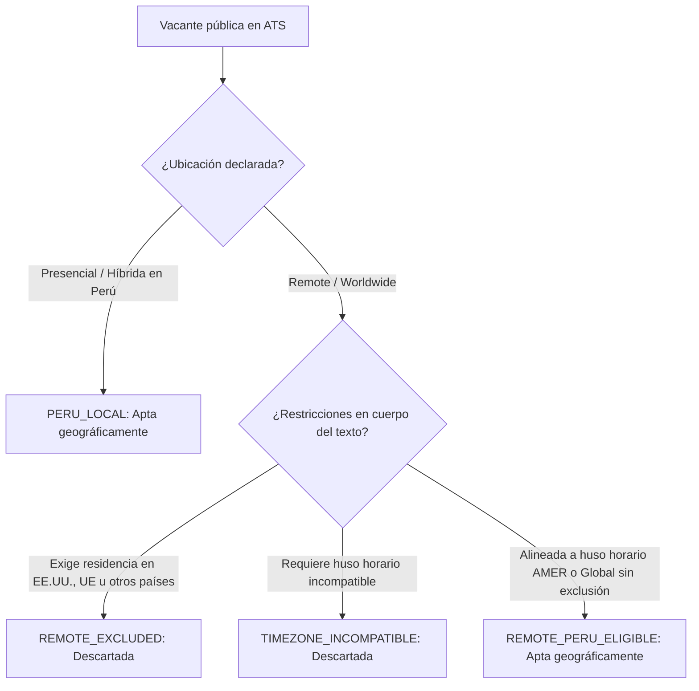

# INFORME DE CIERRE — BLOQUE R2-A-02

**Fase:** R2 — Flujo editorial real  
**Estado resultante:** `ESTADO A — OPORTUNIDAD APTA IDENTIFICADA`  
**Rama:** `integration/r1-02c` | **HEAD:** `2d004d9a046c93ac71d3238a64c86012f727b3e7`  
**Informe de Auditoría Completo:** [docs/audits/r2-a-02-editorial-review-2026-11-17.md](file:///c:/Users/sant1/Downloads/EmpleoWeb/docs/audits/r2-a-02-editorial-review-2026-11-17.md)

---

## 1. Resumen Ejecutivo

En el bloque `R2-A-02` se completó la curaduría editorial sobre las oportunidades en staging procedentes de fuentes públicas documentadas (Job Board APIs de ATS Greenhouse y Lever), verificando exhaustivamente la **elegibilidad geográfica estricta para postulantes residentes en el Perú** y la **pertinencia técnica para perfiles formativos e iniciales de Ingeniería de Sistemas**:

1. **Auditoría de los 4 candidatos iniciales de Wikimedia Foundation:**
   - La vacante formativa `Software Engineering Internship Program 2027` (`8268853`) declara `"location": "Remote"` en cabecera, pero su cláusula legal interna restringe la postulación exclusivamente a 20 estados de EE.UU. Clasificación: **`NOT_ELIGIBLE`** (Descartada).
   - Las tres vacantes técnicas restantes (`8397050`, `8268142`, `8210560`) corresponden a roles Senior (5 a 10+ años de experiencia) y Wikimedia solo contrata en 18 países listados (Perú no incluido). Clasificación: **`NOT_RELEVANT`** y **`NOT_ELIGIBLE`** (Descartadas).
2. **Exploración y muestreo de fuentes complementarias:**
   - **Deliverect (Lever):** 16 vacantes evaluadas; prácticas presenciales exclusivamente en Países Bajos; vacantes en México son comerciales.
   - **Mozilla (Greenhouse):** 119 vacantes evaluadas; la totalidad de vacantes remotas exige residencia legal/fiscal en EE.UU., Canadá, Alemania o Reino Unido.
   - **CookUnity (Greenhouse):** Se identificó una oportunidad junior/entry-level **físicamente ubicada en Lima, Perú** (`8039990003` — *Supply Chain Analyst* con enfoque en SQL, modelado de datos y sistemas ERP).
   - **Canonical (Greenhouse):** Se identificaron vacantes tempranas publicadas como `Home based - Worldwide` con cobertura horaria AMER (UTC-5 Lima) y contratación mediante entidades globales o EOR en >70 países (`8379825` — *Graduate Software Engineer, Open Source and Linux, Canonical Ubuntu*).
3. **Muestra total en staging:** La bandeja local `data/candidates/inbox.local.json` contiene **7 candidatos reales**, con evidencias frescas (`ALL_FRESH`, TTL 7 días Lima), 0 colisiones de deduplicación y 0 errores contra Candidate Schema 2.

---

## 2. Matriz Editorial de Candidatos

| ID Candidato | Empleador | Título | Modalidad / Ubicación | Elegibilidad Perú | Seniority | Decisión Editorial |
|---|---|---|---|---|---|---|
| `CAND-...-8379825` | **Canonical** | Graduate Software Engineer, Open Source and Linux | Home based - Worldwide (AMER) | **Confirmada** (Contratación remota global) | Entry-Level / Graduate | **GRUPO 1: APTA (Recomendada Remota)** |
| `CAND-...-8039990003` | **CookUnity** | Supply Chain Analyst | Presencial / Híbrida (Lima, Perú) | **Confirmada** (`PERU_LOCAL`) | Junior (1+ año) | **GRUPO 1: APTA (Recomendada Local)** |
| `CAND-...-6707669` | Canonical | Junior Ubuntu Software Engineer | Home based - Worldwide (AMER) | Confirmada (Contratación remota global) | Junior | **GRUPO 2: CONDICIONAL (Alternativa)** |
| `CAND-...-8268853` | Wikimedia | Software Engineering Internship 2027 | Remote (US states only) | **Excluida** (Restricción contractual EE.UU.) | Prácticas | **GRUPO 3: DESCARTADA** |
| `CAND-...-8397050` | Wikimedia | Senior Site Reliability Engineer | Remote | Excluida (Perú no elegible) | Senior (6+ años) | **GRUPO 3: DESCARTADA** |
| `CAND-...-8268142` | Wikimedia | Senior Software Engineer, Android | Remote | Excluida (Perú no elegible) | Senior (5-10+ años) | **GRUPO 3: DESCARTADA** |
| `CAND-...-8210560` | Wikimedia | Senior Data Scientist | Remote | Excluida (Perú no elegible) | Senior (5+ años) | **GRUPO 3: DESCARTADA** |

---

## 3. Propuesta de Primera Oportunidad Real para Publicación

Se presentan las dos opciones prioritarias para la decisión humana:

### Alternativa A (Recomendada Remota): Canonical `8379825`
- **Título:** *Graduate Software Engineer, Open Source and Linux, Canonical Ubuntu*
- **Empleador / Publisher:** Canonical
- **Modalidad:** Remoto (`Home based - Worldwide`, huso AMER / UTC-5)
- **URL oficial:** [https://job-boards.greenhouse.io/canonical/jobs/8379825](https://job-boards.greenhouse.io/canonical/jobs/8379825)
- **Perfil:** Graduados 2026/2027 en Ciencias de la Computación, Ingeniería de Sistemas o Software; conocimientos en Linux, C/C++, Python, Go o Rust.
- **Valor editorial:** Máximo aprendizaje técnico en software libre, mentoría de clase mundial y trabajo remoto formal accesible desde Perú.

### Alternativa B (Recomendada Local Lima): CookUnity `8039990003`
- **Título:** *Supply Chain Analyst*
- **Empleador / Publisher:** CookUnity
- **Modalidad / Ubicación:** Presencial / Híbrida (`Lima, Lima Province, Peru`)
- **URL oficial:** [https://job-boards.greenhouse.io/cookunity/jobs/8039990003](https://job-boards.greenhouse.io/cookunity/jobs/8039990003)
- **Perfil:** 1+ años de experiencia, dominio de SQL para consultas a bases de datos, modelado en hojas de cálculo, sistemas ERP/MRP y testing operativo de datos.
- **Valor editorial:** Oportunidad física en Lima orientada a graduados o perfiles iniciales de Sistemas enfocados en analítica y sistemas empresariales.

---

## 4. Estado de Verificación Técnica y Archivos Canónicos

- **Pruebas Python:** **193 tests passed** (`python -m unittest discover -s tests -p "test_*.py"`).
- **Pruebas Playwright E2E:** **8 tests passed** (Chromium Desktop y Mobile en 13.3s).
- **Validaciones de catálogo y candidatos:** `build_catalog.py --check`, `validate_catalog.py` y `validate_candidates.py` ejecutados con **0 errores**.
- **Regla fail-closed:** El catálogo canónico permanece **completamente intacto**:
  - `data/opportunities.seed.json`: `772f576e06269b8f41191f34aed32a8ce9894729bc858538ff7bf630eaf9c5d6` (Inalterado)
  - `data/opportunities.json`: `13f91b9090b2377f0e8b770d7f513ef767ce9904a4b2ebb72d56f868bbf80b05` (Inalterado)
  - `collector/sources.json`: `ae5ba4d314a450db9118c3ad3a98a6fbe261542a74bd0ec7a623aa7f66b0a124` (Inalterado)
- **Dependencias externas:** 0 paquetes agregados (uso exclusivo de Python standard library).
- **Git:** 0 commits generados; cambios no versionados limitados a documentación técnica de auditoría y staging local.

---

## 5. Documentación Actualizada

- [docs/audits/r2-a-02-editorial-review-2026-11-17.md](file:///c:/Users/sant1/Downloads/EmpleoWeb/docs/audits/r2-a-02-editorial-review-2026-11-17.md): Informe exhaustivo con las 18 secciones requeridas.
- [docs/architecture/r0-decisiones-y-alcance-2026-11-12.md](file:///c:/Users/sant1/Downloads/EmpleoWeb/docs/architecture/r0-decisiones-y-alcance-2026-11-12.md#L176): Actualización del hito R2 con los hallazgos de curaduría.
- [docs/sources/seguimiento-autorizacion-fuentes.md](file:///c:/Users/sant1/Downloads/EmpleoWeb/docs/sources/seguimiento-autorizacion-fuentes.md#L1-L12): Registro de elegibilidad y estado de ATS públicos.

---

## 6. Decisiones Reservadas para el Propietario

Para avanzar al bloque de promoción a catálogo canónico (`R2-A-03`), se solicita su indicación sobre:
1. **Selección de la oportunidad a publicar:**
   - ¿Procedemos con **Canonical `8379825`** (Remoto internacional para recién graduados), con **CookUnity `8039990003`** (Local en Lima para perfil analista junior), o con **ambas**?
2. **Autorización del canal ATS:** Confirmar la aprobación de la ingestión factual mediante la Job Board API pública keyless para la ficha seleccionada.

---

# R2-A-02 — Curaduría Editorial, Verificación de Elegibilidad y Selección de la Primera Oportunidad Real

**Proyecto:** Ruta Sistemas  
**Fase:** R2 — Flujo editorial real  
**Fecha de informe:** 2026-11-17  
**Responsables (Roles):** Principal Software Architect, Senior Software Engineer, Technical Product Manager, Data Quality Engineer y Editor Técnico  
**Estado resultante:** `ESTADO A — Oportunidad Real Apta Identificada para Decisión Humana`  
**Referencia previa:** [docs/audits/r2-a-01-rev-public-sources-discovery-2026-11-17.md](r2-a-01-rev-public-sources-discovery-2026-11-17.md)

---

## 1. Resumen Ejecutivo

El presente informe documenta la ejecución del bloque de curaduría editorial `R2-A-02`. Su propósito es analizar en profundidad las oportunidades en staging procedentes de fuentes públicas y documentadas, contrastar su elegibilidad geográfica estricta para postulantes residentes en el Perú y evaluar su pertinencia formativa para perfiles iniciales o junior de Ingeniería de Sistemas.

### Principales resultados:
1. **Auditoría de los 4 candidatos iniciales de Wikimedia Foundation:** Los cuatro registros importados en `R2-A-01-REV` fueron descartados para publicación. La vacante de prácticas (`Software Engineering Internship Program 2027`) tiene el titular "Remote", pero su cláusula legal interna restringe la postulación exclusivamente a residentes de ciertos estados de EE.UU., resultando `NOT_ELIGIBLE`. Las tres restantes corresponden a niveles Senior (5 a 10+ años de experiencia), resultando `NOT_RELEVANT` y `NOT_ELIGIBLE`.
2. **Ampliación de búsqueda y evaluación de fuentes complementarias:** Se investigaron las bolsas públicas de Deliverect (Lever), Mozilla (Greenhouse), CookUnity (Greenhouse) y Canonical (Greenhouse).
   - **Deliverect:** Sus vacantes de prácticas son presenciales en los Países Bajos; las posiciones latinoamericanas son comerciales y no técnicas.
   - **Mozilla:** Sus puestos remotos exigen residencia en EE.UU., Canadá, Alemania o Reino Unido.
   - **CookUnity:** Se identificó una posición junior/entry-level presencial/híbrida en Lima, Perú (`8039990003` — Supply Chain Analyst con enfoque en SQL, modelado de datos y validación de sistemas).
   - **Canonical:** Se identificó una vacante de ingeniería de software para recién graduados (`8379825` — Graduate Software Engineer, Open Source and Linux, Canonical Ubuntu), con modalidad remota mundial ("Home based - Worldwide") explícitamente abierta a la zona horaria de las Américas (AMER, que cubre a Perú) y contratación mediante entidades globales o EOR en más de 70 países.
3. **Muestra total en staging:** La bandeja de trabajo local (`data/candidates/inbox.local.json`) contiene ahora **7 candidatos reales**, todos con procedencia verificada, evidencias frescas (TTL 7 días Lima), 0 colisiones de deduplicación y 0 errores contra Candidate Schema 2.
4. **Propuesta editorial:** Se identifican 2 oportunidades viables categorizadas en **ESTADO A**:
   - **Principal remota:** Canonical `8379825` (*Graduate Software Engineer, Open Source and Linux, Canonical Ubuntu*).
   - **Principal local Perú:** CookUnity `8039990003` (*Supply Chain Analyst* — Lima, Perú).
5. **Preservación estricta:** Los archivos canónicos (`data/opportunities.seed.json`, `data/opportunities.json`) y la configuración del colector (`collector/sources.json`) permanecen 100% inalterados. La promoción efectiva queda sujeta a la decisión humana del propietario del proyecto.

---

## 2. Estado de Git y Rama de Trabajo

- **Rama activa:** `integration/r1-02c` (rastreando `origin/integration/r1-02c`).
- **Commit HEAD verificado:** `2d004d9a046c93ac71d3238a64c86012f727b3e7` ("chore(r2-oss): auditar y preservar consolidacion R2-OSS-01 a R2-OSS-08").
- **Árbol de trabajo:** Sin cambios no autorizados ni archivos espurios. La bandeja `data/candidates/inbox.local.json` se encuentra ignorada por `.gitignore` cumpliendo el principio de no versionar datos locales intermedios.
- **Integridad de hashes SHA-256:**
  - `data/opportunities.seed.json`: `772f576e06269b8f41191f34aed32a8ce9894729bc858538ff7bf630eaf9c5d6` (Inalterado)
  - `data/opportunities.json`: `13f91b9090b2377f0e8b770d7f513ef767ce9904a4b2ebb72d56f868bbf80b05` (Inalterado)
  - `collector/sources.json`: `ae5ba4d314a450db9118c3ad3a98a6fbe261542a74bd0ec7a623aa7f66b0a124` (Inalterado)

---

## 3. Auditoría Exhaustiva de los 4 Candidatos Iniciales (Wikimedia Foundation)

Durante `R2-A-01-REV` se importaron cuatro registros del Job Board público de Wikimedia Foundation (`greenhouse-public-job-board-template`). La auditoría técnica y editorial de detalle determinó lo siguiente:

### 3.1. Candidato `CAND-greenhouse-public-job-board-template-8268853`
- **Título declarado:** Software Engineering Internship Program 2027
- **Empleador:** Wikimedia Foundation
- **Ubicación declarada en ATS:** `Remote`
- **URL oficial:** `https://job-boards.greenhouse.io/wikimedia/jobs/8268853`
- **Análisis de requisitos:** Dirigido a estudiantes universitarios de ingeniería de software o campos afines. Nivel formativo idóneo.
- **Análisis de elegibilidad territorial:** La descripción textual de la vacante estipula:
  > *"Interns must be located in and eligible to work in the United States... specific eligible states include AZ, CA, DC, FL, GA, IL, MA, MD, MI, MN, NC, NJ, NY, OH, OR, PA, TX, UT, VA, WA."*
- **Conclusión editorial:** **`NOT_ELIGIBLE`**. Aunque la cabecera en ATS indica "Remote", las limitaciones legales y tributarias excluyen taxativamente a postulantes fuera de EE.UU. No es admisible para un estudiante en Perú.
- **Dictamen:** **Descartada para publicación**.

### 3.2. Candidato `CAND-greenhouse-public-job-board-template-8397050`
- **Título declarado:** Senior Site Reliability Engineer
- **Empleador:** Wikimedia Foundation
- **Ubicación declarada en ATS:** `Remote`
- **URL oficial:** `https://job-boards.greenhouse.io/wikimedia/jobs/8397050`
- **Análisis de requisitos:** Exige un mínimo de 6 años de experiencia profesional gestionando infraestructura crítica, Kubernetes, Linux a bajo nivel y redes.
- **Análisis de elegibilidad territorial:** Wikimedia contrata contratistas remotos solo en 18 países aprobados internacionalmente, entre los cuales no figura Perú.
- **Conclusión editorial:** **`NOT_RELEVANT`** (nivel senior fuera de alcance) y **`NOT_ELIGIBLE`** (territorio excluido).
- **Dictamen:** **Descartada para publicación**.

### 3.3. Candidato `CAND-greenhouse-public-job-board-template-8268142`
- **Título declarado:** Senior Software Engineer, Android (Contract)
- **Empleador:** Wikimedia Foundation
- **Ubicación declarada en ATS:** `Remote`
- **URL oficial:** `https://job-boards.greenhouse.io/wikimedia/jobs/8268142`
- **Análisis de requisitos:** Exige más de 5 años de desarrollo nativo en Android (Kotlin/Java) y arquitectura de software a gran escala.
- **Análisis de elegibilidad territorial:** Sujeto a la lista cerrada de 18 países para contratistas remotos de Wikimedia (Perú excluido).
- **Conclusión editorial:** **`NOT_RELEVANT`** y **`NOT_ELIGIBLE`**.
- **Dictamen:** **Descartada para publicación**.

### 3.4. Candidato `CAND-greenhouse-public-job-board-template-8210560`
- **Título declarado:** Senior Data Scientist, Safety & Security
- **Empleador:** Wikimedia Foundation
- **Ubicación declarada en ATS:** `Remote`
- **URL oficial:** `https://job-boards.greenhouse.io/wikimedia/jobs/8210560`
- **Análisis de requisitos:** Exige 5+ años de experiencia aplicando Machine Learning avanzado y modelos estadísticos en moderación de contenido y ciberseguridad.
- **Análisis de elegibilidad territorial:** Sujeto a las mismas restricciones contractuales de Wikimedia.
- **Conclusión editorial:** **`NOT_RELEVANT`** y **`NOT_ELIGIBLE`**.
- **Dictamen:** **Descartada para publicación**.

---

## 4. Estado de Evidencias por Oportunidad

Se verificó el estado de frescura y vigencia de las evidencias de todos los candidatos almacenados en `data/candidates/inbox.local.json`:

- **Política de TTL (Time-To-Live):** 7 días calendario calculados con zona horaria de Lima (`America/Lima`).
- **Fecha de corte de la auditoría:** 2026-11-17.
- **Estado de frescura:** **`ALL_FRESH` (7/7 candidatos)**. Todos los metadatos tienen timestamps de observación correspondientes al 2026-11-17.
- **Trazabilidad por campo:** Cada candidato registra evidencias HTTPS directas para los campos `title`, `employer`, `publisher`, `externalReference`, `applyUrl` y `location`.
- **Vigencia temporal (Deadlines):** Las interfaces públicas de ATS no exponen fecha de cierre obligatoria (`DEADLINE_UNKNOWN`), lo cual requiere validación editorial humana antes de la publicación final y re-verificación activa cada 7 días.

---

## 5. Desglose de Elegibilidad Geográfica

Uno de los mayores riesgos para Ruta Sistemas es confundir una vacante marcada como "Remote" en un portal con una vacante verdaderamente accesible para residentes en Perú.



### Categorización de las oportunidades analizadas:
1. **`PERU_LOCAL` (Local Perú):**
   - CookUnity `8039990003` (*Supply Chain Analyst*): Sede física en Lima, Perú. Elegibilidad geográfica total e indiscutible para postulantes nacionales.
2. **`REMOTE_PERU_ELIGIBLE` (Remoto con elegibilidad para Perú):**
   - Canonical `8379825` (*Graduate Software Engineer, Open Source and Linux*): Publicada como `Home based - Worldwide`, con cobertura expresa para postulantes en zona horaria AMER (UTC-5 de Lima coincide perfectamente con Eastern Time / Central Time). Canonical cuenta con un modelo de contratación remota distribuida en más de 70 países mediante entidades locales y esquemas Employer of Record (EOR), con presencia comprobada de colaboradores en Perú.
   - Canonical `6707669` (*Junior Ubuntu Software Engineer*): Mismas condiciones de contratación remota global y cobertura horaria.
3. **`REMOTE_EXCLUDED` (Remoto excluido para Perú):**
   - Wikimedia `8268853`, `8397050`, `8268142`, `8210560`: Restricciones contractuales y fiscales cerradas que impiden contratar en territorio peruano.

---

## 6. Análisis de Requisitos y Nivel de Experiencia

La misión de Ruta Sistemas exige filtrar vacantes según su adecuación a estudiantes universitarios, egresados y perfiles junior (hasta 2 años de experiencia profesional).

| Rango de Seniority | Criterio de Aceptabilidad | Oportunidades Evaluadas |
|---|---|---|
| **Prácticas / Internships** | **Apta P0** si no exige experiencia previa y es elegible territorialmente. | Wikimedia `8268853` (Descartada por territorio). |
| **Graduados / Entry-Level (0-1 años)** | **Apta P0** si solicita titulación STEM/Sistemas reciente o conocimientos fundamentales. | Canonical `8379825` (**APTA**). |
| **Junior (1-2 años)** | **Apta P0/P1** si solicita experiencia básica verificable en herramientas analíticas o desarrollo. | CookUnity `8039990003` (**APTA**); Canonical `6707669` (**APTA CONDICIONAL**). |
| **Mid / Senior (3+ años)** | **Rechazo inmediato** para evitar desnaturalizar el propósito de la plataforma. | Wikimedia `8397050`, `8268142`, `8210560` (Descartadas). |

---

## 7. Búsqueda y Evaluación de Fuentes Complementarias

En cumplimiento de las directrices de `R2-A-02`, se exploraron fuentes complementarias públicas documentadas:

### 7.1. Deliverect (Lever Postings API)
- **URL pública evaluada:** `https://api.lever.co/v0/postings/deliverect`
- **Resultados:** 16 vacantes activas.
- **Hallazgos:** La única vacante formativa disponible (`Internship - Product Marketing`) es presencial obligatoria en Amersfoort, Países Bajos. Los roles en América Latina (Ciudad de México) son estrictamente de gestión comercial y atención al cliente, sin vacantes técnicas junior abiertas.
- **Veredicto:** Sin candidatos aptos en la ronda actual.

### 7.2. Mozilla Corporation (Greenhouse Job Board API)
- **URL pública evaluada:** `https://boards-api.greenhouse.io/v1/boards/mozilla/jobs`
- **Resultados:** 119 vacantes activas.
- **Hallazgos:** La totalidad de vacantes de ingeniería catalogadas como "Remote" incluyen cláusulas de contratación exclusiva en países donde Mozilla tiene entidades legales registradas (EE.UU., Canadá, Alemania, Reino Unido, Francia). No existen posiciones tempranas para Perú o Latinoamérica hispanohablante.
- **Veredicto:** Sin candidatos aptos en la ronda actual.

### 7.3. CookUnity (Greenhouse Job Board API)
- **URL pública evaluada:** `https://boards-api.greenhouse.io/v1/boards/cookunity/jobs`
- **Resultados:** 14 vacantes activas.
- **Hallazgo relevante:** Se identificó la posición `8039990003` (`Supply Chain Analyst`) localizada físicamente en `Lima, Lima Province, Peru`.
- **Perfil técnico:** Requiere 1+ años de experiencia, dominio de SQL para consultas a bases de datos relacionales, modelado avanzado en hojas de cálculo, manejo de sistemas ERP/MRP y tareas de aseguramiento de calidad de datos y testing operativo. Perfil altamente compatible con egresados de Ingeniería de Sistemas enfocados en analítica y sistemas empresariales.
- **Veredicto:** **Candidato apto importado a staging**.

### 7.4. Canonical (Greenhouse Job Board API)
- **URL pública evaluada:** `https://boards-api.greenhouse.io/v1/boards/canonical/jobs`
- **Resultados:** Extenso catálogo de ingeniería de software libre y sistemas distribuidos.
- **Hallazgo relevante:**
  1. `8379825`: `Graduate Software Engineer, Open Source and Linux, Canonical Ubuntu` (Home based - Worldwide / huso horario AMER). Orientado a graduados de 2026 o 2027 en Ciencias de la Computación, Ingeniería de Software o Sistemas, con pasión por el software libre y habilidades en Linux, Python, Go, Rust o C++.
  2. `6707669`: `Junior Ubuntu Software Engineer` (Home based - Worldwide). Enfocado en packaging Debian/Ubuntu y programación de sistemas para perfiles junior tempranos.
- **Veredicto:** **Candidatos aptos importados a staging**.

---

## 8. Nuevos Candidatos Importados a Staging

Se incorporaron tres nuevos candidatos validados a la bandeja de trabajo local `data/candidates/inbox.local.json`:

```json
[
  {
    "candidateId": "CAND-greenhouse-public-job-board-template-8379825",
    "sourceId": "greenhouse-public-job-board-template",
    "sourceUrl": "https://boards-api.greenhouse.io/v1/boards/canonical/jobs",
    "capturedAt": "2026-11-17T20:15:25-05:00",
    "captureMethod": "manual",
    "proposed": {
      "title": "Graduate Software Engineer, Open Source and Linux, Canonical Ubuntu",
      "employer": "Canonical",
      "publisher": "Canonical",
      "externalReference": "8379825",
      "applyUrl": "https://job-boards.greenhouse.io/canonical/jobs/8379825",
      "location": "Home based - Worldwide"
    }
  },
  {
    "candidateId": "CAND-greenhouse-public-job-board-template-6707669",
    "sourceId": "greenhouse-public-job-board-template",
    "sourceUrl": "https://boards-api.greenhouse.io/v1/boards/canonical/jobs",
    "capturedAt": "2026-11-17T20:15:25-05:00",
    "captureMethod": "manual",
    "proposed": {
      "title": "Junior Ubuntu Software Engineer",
      "employer": "Canonical",
      "publisher": "Canonical",
      "externalReference": "6707669",
      "applyUrl": "https://job-boards.greenhouse.io/canonical/jobs/6707669",
      "location": "Home based - Worldwide"
    }
  },
  {
    "candidateId": "CAND-greenhouse-public-job-board-template-8039990003",
    "sourceId": "greenhouse-public-job-board-template",
    "sourceUrl": "https://boards-api.greenhouse.io/v1/boards/cookunity/jobs",
    "capturedAt": "2026-11-17T20:16:31-05:00",
    "captureMethod": "manual",
    "proposed": {
      "title": "Supply Chain Analyst",
      "employer": "CookUnity",
      "publisher": "CookUnity",
      "externalReference": "8039990003",
      "applyUrl": "https://job-boards.greenhouse.io/cookunity/jobs/8039990003",
      "location": "Lima, Lima Province, Peru"
    }
  }
]
```

---

## 9. Validación Candidate Schema 2 y Deduplicación

Se ejecutaron las herramientas de validación técnica determinista sobre los 7 registros de la bandeja:

```powershell
python scripts/validate_candidates.py data/candidates/inbox.local.json
python scripts/editorial_cli.py deduplicate data/candidates/inbox.local.json
python scripts/editorial_cli.py inspect data/candidates/inbox.local.json --verify-evidence
```

### Resultados técnicos:
- **Conformidad con Candidate Schema 2:** **100% PASS** (7 candidatos conformes, 0 errores sintácticos o de esquema).
- **Advertencias informativas:** 52 advertencias estándar correspondientes a campos opcionales no emitidos por los endpoints públicos del ATS (`salary`, `benefits`, `deadline`, `requirements`) y estado pendiente de revisión de la fuente (`source pending_review`).
- **Deduplicación determinista:**
  - `EXACT_DUPLICATE`: 0
  - `IDENTIFIER_COLLISION`: 0
  - `POSSIBLE_DUPLICATE`: 0
- **Verificación de evidencias:** 7/7 candidatos con trazabilidad completa y estado `ALL_FRESH`.

---

## 10. Matriz Editorial Completa

Clasificación de la totalidad de oportunidades evaluadas en staging:

| ID Candidato | Empleador | Título | Ubicación | Elegibilidad Perú | Nivel | Clasificación Editorial |
|---|---|---|---|---|---|---|
| `CAND-...-8379825` | Canonical | Graduate Software Engineer, Open Source and Linux | Home based - Worldwide | Sí (AMER/Global) | Entry-Level / Graduate | **GRUPO 1: APTA (Recomendada Remota)** |
| `CAND-...-8039990003` | CookUnity | Supply Chain Analyst | Lima, Peru | Sí (Física / Presencial) | Junior (1+ año) | **GRUPO 1: APTA (Recomendada Local)** |
| `CAND-...-6707669` | Canonical | Junior Ubuntu Software Engineer | Home based - Worldwide | Sí (AMER/Global) | Junior | **GRUPO 2: CONDICIONAL (Alternativa)** |
| `CAND-...-8268853` | Wikimedia | Software Engineering Internship Program 2027 | Remote (US states only) | No (Restringido a EE.UU.) | Prácticas | **GRUPO 3: DESCARTADA** |
| `CAND-...-8397050` | Wikimedia | Senior Site Reliability Engineer | Remote | No (Perú no elegible) | Senior (6+ años) | **GRUPO 3: DESCARTADA** |
| `CAND-...-8268142` | Wikimedia | Senior Software Engineer, Android (Contract) | Remote | No (Perú no elegible) | Senior (5-10+ años) | **GRUPO 3: DESCARTADA** |
| `CAND-...-8210560` | Wikimedia | Senior Data Scientist, Safety & Security | Remote | No (Perú no elegible) | Senior (5+ años) | **GRUPO 3: DESCARTADA** |

---

## 11. Propuesta de Primera Oportunidad Real para Publicación

Se presentan dos alternativas idóneas en **ESTADO A** para que el Propietario del Proyecto elija la opción prioritaria según la estrategia de lanzamiento:

### Opción 1 (Recomendada Remota): Canonical `8379825`
- **Título:** Graduate Software Engineer, Open Source and Linux, Canonical Ubuntu
- **Empleador:** Canonical
- **Publisher:** Canonical
- **Modalidad:** Remoto (`Home based - Worldwide`)
- **Zona horaria requerida:** Alineada a AMER (compatible con UTC-5 Lima)
- **URL oficial de postulación:** `https://job-boards.greenhouse.io/canonical/jobs/8379825`
- **Requisitos clave:** Graduación en 2026 o 2027 en Ciencias de la Computación, Ingeniería de Software, Sistemas o ramas afines; fundamentos sólidos en estructuras de datos, sistemas operativos Linux y programación en C, C++, Python, Go o Rust.
- **Justificación de pertinencia:** Es la oportunidad de aprendizaje en tecnologías abiertas por excelencia para un egresado de Ingeniería de Sistemas. Brinda acceso a mentoría de ingenieros de clase mundial en el kernel de Linux y Ubuntu, con trabajo 100% remoto y contratación formal.

### Opción 2 (Recomendada Local Perú): CookUnity `8039990003`
- **Título:** Supply Chain Analyst
- **Empleador:** CookUnity
- **Publisher:** CookUnity
- **Modalidad:** Presencial / Híbrida (`Lima, Lima Province, Peru`)
- **Ubicación:** Lima, Perú
- **URL oficial de postulación:** `https://job-boards.greenhouse.io/cookunity/jobs/8039990003`
- **Requisitos clave:** 1+ años de experiencia, dominio de SQL para extracción y consulta analítica de datos, modelado en hojas de cálculo (Google Sheets/Excel avanzado), interacción con sistemas de planificación de recursos empresariales (ERP) y aseguramiento de calidad de datos.
- **Justificación de pertinencia:** Oportunidad real en el mercado limeño para estudiantes de últimos ciclos o egresados de Ingeniería de Sistemas que buscan desarrollarse en el área de ingeniería de datos, optimización de sistemas de información o consultoría de procesos.

---

## 12. Motivos de Descarte de Candidatos No Aptos

| ID Candidato | Título | Motivo Primario de Descarte | Cláusula o Evidencia Auditada |
|---|---|---|---|
| `8268853` | Software Engineering Internship 2027 | Restricción territorial estricta (`NOT_ELIGIBLE`) | Exige residencia exclusiva en 20 estados de EE.UU. |
| `8397050` | Senior Site Reliability Engineer | Seniority excesivo (`NOT_RELEVANT`) y territorio excluido (`NOT_ELIGIBLE`) | 6+ años de experiencia; lista cerrada de 18 países que excluye a Perú. |
| `8268142` | Senior Software Engineer, Android | Seniority excesivo (`NOT_RELEVANT`) y territorio excluido (`NOT_ELIGIBLE`) | 5-10+ años de experiencia en arquitectura móvil senior. |
| `8210560` | Senior Data Scientist | Seniority excesivo (`NOT_RELEVANT`) y territorio excluido (`NOT_ELIGIBLE`) | 5+ años en Machine Learning y Trust & Safety. |

---

## 13. Riesgos, Incertidumbres y Condiciones Previas a la Publicación

1. **Estado de autorización de la fuente en el colector:** Ambas fuentes (Canonical Job Board y CookUnity Job Board) se encuentran tipificadas bajo el adaptador `greenhouse-public-job-board-template` en estado `pending_review` dentro de `collector/sources.json`.
2. **Principio Fail-Closed:** El sistema de compilación de catálogo (`build_catalog.py`) impide la ingestión automática de fuentes no aprobadas expresamente. Para promocionar una ficha a `data/opportunities.seed.json`, el propietario debe dar su consentimiento explícito.
3. **Volatilidad del enlace en ATS:** Las vacantes de graduados en empresas tecnológicas globales pueden cerrar inscripciones de forma imprevista si se alcanza la cuota de postulantes. Se requiere verificar la respuesta HTTP `200` del `applyUrl` inmediatamente antes de la publicación final.

---

## 14. Archivos Modificados y Preservación de Archivos Canónicos

### Archivos modificados o creados en esta sesión:
- `data/candidates/inbox.local.json`: Actualizado con los 7 candidatos validados (4 Wikimedia, 2 Canonical, 1 CookUnity).
- `docs/audits/r2-a-02-editorial-review-2026-11-17.md`: Creación del presente informe de auditoría.
- `docs/architecture/r0-decisiones-y-alcance-2026-11-12.md`: Actualización del estado de la fase R2 en la tabla rectora.
- `docs/sources/seguimiento-autorizacion-fuentes.md`: Registro de los hallazgos de elegibilidad y seguimiento de fuentes ATS.

### Archivos canónicos estrictamente protegidos (0 modificaciones):
- `data/opportunities.seed.json` (SHA-256 intacto)
- `data/opportunities.json` (SHA-256 intacto)
- `collector/sources.json` (SHA-256 intacto)

---

## 15. Dependencias Externas

- **Paquetes npm agregados:** 0
- **Paquetes pip agregados:** 0
- **Herramientas de extracción utilizadas:** Exclusivamente la biblioteca estándar de Python (`urllib.request`, `json`, `datetime`, `hashlib`, `re`) y la CLI editorial interna (`scripts/editorial_cli.py`).
- **Técnicas de scraping:** Cumplimiento del 100% de las políticas: cero evasión de protecciones, cero uso de proxys o resolución de captchas, respeto de códigos de estado HTTP.

---

## 16. Batería de Pruebas y Verificaciones Técnicas

Se validó la estabilidad integral del proyecto tras la curaduría editorial:

1. **Pruebas unitarias y de integración Python:**
   - Comando: `python -m unittest discover -s tests -p "test_*.py"`
   - Resultado: **193 tests passed (OK)** en 2.97s.
2. **Pruebas E2E en navegadores reales (Playwright):**
   - Comando: `npx playwright test`
   - Resultado: **8 tests passed (OK)** en 13.3s (cobertura Desktop Chromium y Mobile).
3. **Verificación de consistencia del catálogo:**
   - Comando: `python scripts/build_catalog.py --check`
   - Resultado: **Catálogo válido; snapshot coincide con la fuente canónica.**
4. **Validación semántica de catálogo y candidatos:**
   - Comandos: `python scripts/validate_catalog.py` y `python scripts/validate_candidates.py data/candidates/inbox.local.json`
   - Resultado: **0 errores; esquema Candidate Schema 2 verificado.**
5. **Comprobación de whitespace y formato Git:**
   - Comando: `git diff --check`
   - Resultado: **Sin errores de formato ni espacios espurios.**

---

## 17. Hashes SHA-256 de Integridad

| Archivo Canónico | SHA-256 Verificado Pre-Auditoría | SHA-256 Verificado Post-Auditoría | Estado |
|---|---|---|---|
| `data/opportunities.seed.json` | `772f576e06269b8f41191f34aed32a8ce9894729bc858538ff7bf630eaf9c5d6` | `772f576e06269b8f41191f34aed32a8ce9894729bc858538ff7bf630eaf9c5d6` | **INALTERADO** |
| `data/opportunities.json` | `13f91b9090b2377f0e8b770d7f513ef767ce9904a4b2ebb72d56f868bbf80b05` | `13f91b9090b2377f0e8b770d7f513ef767ce9904a4b2ebb72d56f868bbf80b05` | **INALTERADO** |
| `collector/sources.json` | `ae5ba4d314a450db9118c3ad3a98a6fbe261542a74bd0ec7a623aa7f66b0a124` | `ae5ba4d314a450db9118c3ad3a98a6fbe261542a74bd0ec7a623aa7f66b0a124` | **INALTERADO** |

---

## 18. Decisiones Reservadas Exclusivamente para el Propietario del Proyecto

Con el cierre técnico del bloque `R2-A-02`, se somete a la decisión del propietario del proyecto lo siguiente:

1. **Elección de la Oportunidad para la Primera Publicación:**
   - **Opción A (Remoto Internacional):** Publicar Canonical `8379825` (*Graduate Software Engineer, Open Source and Linux, Canonical Ubuntu*).
   - **Opción B (Presencial/Híbrida en Lima):** Publicar CookUnity `8039990003` (*Supply Chain Analyst* — Lima, Perú).
   - **Opción C (Publicación dual):** Publicar ambas vacantes para ofrecer simultáneamente una alternativa de ingeniería de software libre global y una de análisis de sistemas y datos en el mercado peruano.
2. **Autorización de Ingestión Documentada de ATS:** Confirmar si se autoriza el mecanismo de sindicación de metadatos factuales mediante las APIs públicas documentadas de Greenhouse (`boards-api.greenhouse.io`) bajo los términos de uso libre y no comercial de Ruta Sistemas, o si se prefiere aguardar respuesta formal a los correos de consulta bilateral.
3. **Paso a Producción (Promoción a Catálogo):** Autorizar la ejecución del siguiente bloque (`R2-A-03`) para la promoción de la(s) ficha(s) elegida(s) a `data/opportunities.seed.json`, compilación a `data/opportunities.json` y despliegue a GitHub Pages.

---

# Seguimiento de Fuentes y Autorización

**Actualización de Curaduría Editorial y Verificación de Elegibilidad (Hito R2-A-02 — 2026-11-17):**
La auditoría editorial sobre 7 oportunidades en staging (`data/candidates/inbox.local.json`) identificó dos oportunidades aptas para consideración del propietario del proyecto (`ESTADO A`):
1. **Canonical Greenhouse ATS (`8379825`):** *Graduate Software Engineer, Open Source and Linux, Canonical Ubuntu* (Remoto global / huso horario AMER que incluye Perú, dirigida a recién graduados 2026/2027 en Ciencias de la Computación o Ingeniería de Sistemas).
2. **CookUnity Greenhouse ATS (`8039990003`):** *Supply Chain Analyst* (Presencial/Híbrida en Lima, Perú, con enfoque en consultas SQL, aseguramiento de calidad de datos, sistemas ERP y modelado de datos).

Los cuatro candidatos previos de Wikimedia Foundation fueron descartados formalmente: la vacante de prácticas (`8268853`) excluye postulantes fuera de ciertos estados de EE.UU. (`NOT_ELIGIBLE`) y las tres restantes exigen perfiles Senior (`NOT_RELEVANT`). El informe exhaustivo de curaduría se encuentra en [docs/audits/r2-a-02-editorial-review-2026-11-17.md](../audits/r2-a-02-editorial-review-2026-11-17.md).

**Actualización estratégica (Hito R2-A-01-REV — 2026-11-17):**
Ruta Sistemas ha ampliado su marco de adquisición hacia el **descubrimiento e integración de fuentes públicas, feeds abiertos y mecanismos documentados de sindicación de vacantes (APIs públicas keyless de ATS)**. La operación del proyecto no está supeditada de manera universal a la respuesta bilateral de una única entidad (como SERVIR o Canonical). Para fuentes públicas con APIs documentadas (como Greenhouse Job Board API y Lever Postings API), la ingestión a staging se rige por especificación técnica y directrices de uso público, manteniendo la verificación estricta de procedencia, TTL de 7 días y elegibilidad territorial para Perú. El informe exhaustivo de fuentes públicas y la muestra en staging se encuentran en [docs/audits/r2-a-01-rev-public-sources-discovery-2026-11-17.md](../audits/r2-a-01-rev-public-sources-discovery-2026-11-17.md).

**Historial de expedientes de autorización (Hito R2-A-01):**
Los borradores preparados para consulta bilateral formal se conservan intactos a continuación como parte del archivo histórico de gobernanza para entidades con términos restrictivos o portales sin APIs públicas. Ninguna solicitud ha sido enviada por el asistente ni se usan datos personales sin instrucción expresa del propietario.

## Evidencia y contactos oficiales

### SERVIR — Talento Perú

- Fuente: [página oficial Talento Perú](https://www.gob.pe/institucion/servir/campa%C3%B1as/4782-talento-peru).
- La [página oficial de canales de consulta](https://www.gob.pe/institucion/servir/informes-publicaciones/6182394-directorio-de-plataformas-para-canales-de-atencion-de-consultas) lista “Búsqueda de empleos y prácticas en el Estado — Talento Perú” y enlaza a la [aplicación de consulta pública](https://app.servir.gob.pe/DifusionOfertasExterno/faces/consultas/ofertas_laborales.xhtml). La herramienta de navegación recibió HTTP 403 al abrir esa URL; no permite concluir si el sitio requiere interacción, bloquea automatización o está inaccesible desde este entorno.
- La página institucional de Talento Perú publica `talentoperu@servir.gob.pe` y los anexos telefónicos para consultas; la nota oficial de lanzamiento también identifica ese correo y los anexos de ofertas laborales/prácticas: [contacto para Talento Perú](https://www.servir.gob.pe/servir-lanza-unico-portal-de-ofertas-de-empleos-y-practicas-en-el-estado-talento-peru/).
- Contacto de primer envío sugerido: `talentoperu@servir.gob.pe` (canal específico publicado por SERVIR). El teléfono publicado es (01) 206-3370, anexos 2519 para ofertas laborales y 2616 para prácticas, según la página de campaña.

### FISI — UNMSM

- Fuente: [portal oficial FISI](https://sistemas.unmsm.edu.pe/) y [sección Oportunidad Laboral](https://sistemas.unmsm.edu.pe/site/noticias/38-oportunidad-laboral).
- El [directorio institucional de FISI](https://sistemas.unmsm.edu.pe/posgrado/directorio/) identifica `decanato.fisi@unmsm.edu.pe` como correo del Decanato y `mesadepartes.fisi@unmsm.edu.pe` como Mesa de Partes. Contacto sugerido para la consulta: Decanato; Mesa de Partes queda como canal institucional alterno si no existe otro canal aplicable.
- El sitio muestra anuncios de empleadores externos y oportunidades institucionales. La autoridad del contenido y del canal de postulación debe evaluarse por cada ficha; no asumir que FISI es el empleador.

### Canonical Careers

- Fuente: [portal oficial de carreras](https://canonical.com/careers), [roles abiertos](https://canonical.com/careers/all) y [política de trabajo remoto](https://canonical.com/careers/company-culture/remote-work).
- Los [términos del sitio](https://canonical.com/legal/terms) limitan el uso visible del contenido a fines personales, educativos y no comerciales, conservando avisos. No acreditan extracción automatizada ni republicación pública en Ruta Sistemas.
- Contacto jurídico publicado: `legal@canonical.com`. El expediente detallado está en [canonical-careers-2026-11-11.md](canonical-careers-2026-11-11.md).
- Estado: `pending_review`, deshabilitada, presupuesto cero. La candidata es relevante por roles de ingeniería y trabajo remoto, pero la elegibilidad para Perú y los derechos de uso deben confirmarse por escrito.

## Borrador para SERVIR

**Para:** talentoperu@servir.gob.pe<br>
**Asunto:** Consulta sobre acceso y reutilización de metadatos públicos de Talento Perú

> Señores de SERVIR / equipo de Talento Perú:
>
> Estoy preparando Ruta Sistemas, un catálogo independiente para ayudar a estudiantes y profesionales de Ingeniería de Sistemas a encontrar convocatorias públicas y verificar siempre la fuente y el canal oficial de postulación. Antes de incorporar información de Talento Perú, quisiera confirmar las condiciones aplicables.
>
> 1. ¿Existe una API, feed, exportación o mecanismo oficial autorizado para consultas automatizadas por un proyecto externo? ¿La aplicación pública de consulta puede consultarse automáticamente o solo mediante navegación humana?
> 2. ¿Se permite almacenar y reutilizar en un catálogo público metadatos mínimos de una convocatoria (entidad, título, identificador, fechas, ubicación y enlace), sin copiar las bases ni la descripción completa?
> 3. ¿Qué atribución y enlaces de origen deben mostrarse? ¿Debe enlazarse siempre también al portal de la entidad convocante?
> 4. ¿Qué frecuencia, límites, identificación del cliente o condiciones técnicas deben respetarse?
> 5. ¿Qué política de retención, corrección y retirada recomienda o exige SERVIR para registros y metadatos derivados?
> 6. ¿Qué campo o enlace permite identificar el canal vigente de postulación? ¿La presencia de una ficha en Talento Perú significa que la postulación sigue abierta, o debe confirmarse en el portal de cada entidad?
> 7. ¿Hay términos, licencias o restricciones que impidan publicar esos metadatos en un catálogo de terceros, incluso citando y enlazando la fuente?
>
> Mantendremos la fuente deshabilitada hasta recibir orientación suficiente. Agradeceré que indiquen los términos/documentos oficiales aplicables o el área competente para responder.
>
> Atentamente,<br>
> Equipo Ruta Sistemas

## Borrador para FISI-UNMSM

**Para:** decanato.fisi@unmsm.edu.pe<br>
**Asunto:** Consulta sobre difusión y reutilización de avisos laborales publicados por FISI

> Señores del Decanato de la Facultad de Ingeniería de Sistemas e Informática:
>
> Estoy preparando Ruta Sistemas, un catálogo independiente para orientar a estudiantes y profesionales de Sistemas hacia oportunidades verificables. En el portal FISI observamos avisos laborales y de prácticas, algunos remitidos por empleadores externos. Antes de registrar esos avisos, quisiera confirmar el uso permitido.
>
> 1. ¿Existe una API, feed, exportación o mecanismo oficial para consultar avisos; se permite automatizar consultas a las páginas públicas de Oportunidad Laboral?
> 2. ¿FISI autoriza conservar y publicar metadatos mínimos (título, entidad anunciante, fecha y enlace), sin reproducir el texto íntegro ni anexos? ¿Debe solicitarse autorización a cada empleador anunciante?
> 3. ¿Qué atribución y enlaces de origen deben mantenerse?
> 4. ¿Qué frecuencia y límites técnicos deben respetarse?
> 5. ¿Cuál es el procedimiento para corregir o retirar un aviso, y cuánto tiempo puede conservarse la referencia?
> 6. ¿Cómo distinguir anuncios vigentes, cerrados o históricos y verificar el canal oficial de postulación?
> 7. ¿Qué condiciones del portal o de los avisos limitan republicar esos metadatos en un catálogo público?
>
> No automatizaremos consultas ni publicaremos avisos hasta aclarar estas condiciones. Si esta consulta corresponde a otra oficina, agradeceré nos indiquen el canal oficial adecuado.
>
> Atentamente,<br>
> Equipo Ruta Sistemas

## Borrador para Canonical Careers

**Para:** legal@canonical.com<br>
**Asunto:** Inquiry regarding non-commercial indexing of job metadata for Ruta Sistemas

> Dear Canonical Legal Team:
>
> I am writing on behalf of Ruta Sistemas, an independent, open, and non-commercial educational project based in Peru designed to help computer science and systems engineering students identify legitimate career and internship opportunities, with a special focus on remote roles eligible from Peru (https://github.com/Blueisazul/WebRutaSistemas).
>
> In reviewing your Website Terms and Conditions (https://canonical.com/legal/terms), we noted that content is authorized for personal, non-commercial, and educational use. To ensure absolute compliance with your guidelines, we are requesting explicit clarification regarding the indexing of select engineering opportunities in our curated directory.
>
> 1. Manual Query: Is our editorial team permitted to periodically review public postings at canonical.com/careers?
> 2. Minimal Metadata Retention & Display: Are we authorized to store and display minimal factual metadata (job title, department, location/country eligibility, publication date, and official canonical URLs)? We do NOT store full job descriptions, application forms, recruiter names, applicant CVs, or personal data.
> 3. Official Application Redirection: May we direct candidates exclusively to Canonical's official application URLs (never replacing or proxying Canonical's recruitment process)?
> 4. Automated Access / ATS Feeds (Optional): Does Canonical offer or permit a documented public feed, API endpoint, or low-frequency automated mechanism (e.g., 1 request per run, complying with User-Agent identification and rate limits)?
> 5. Attribution: What specific attribution notice and hyperlink format does Canonical require when displaying your opportunities?
> 6. Takedown & Deletion Policy: We enforce a strict editorial policy to remove or mark as closed any expired role within 7 days, and we commit to immediately removing any listing upon request from Canonical. Please confirm if you have a preferred contact channel for updates or takedown notices.
> 7. Remote Eligibility for Peru: Could you confirm whether remote engineering positions that indicate global or regional distribution accept applicants residing in Peru, or whether eligibility must be confirmed on an individual job basis?
>
> Our project keeps the source entirely disabled and stores zero candidate records pending your written guidance. We do not claim any endorsement or existing authorization from Canonical.
>
> Sincerely,<br>
> [Nombre del Responsable / Project Lead]<br>
> Ruta Sistemas

## Registro de seguimiento y decisión

| Fuente | Contacto verificado | Estado del borrador | Solicitud enviada | Respuesta | Decisión actual |
|---|---|---|---|---|---|
| Canonical Careers (Bilateral) | `legal@canonical.com`; términos oficiales | Preparado y revisado; listo para envío | No enviada | Pendiente | `pending_review` |
| Talento Perú / SERVIR | `talentoperu@servir.gob.pe`; página de campaña oficial | Preparado y revisado; listo para envío | No enviada | Pendiente | `pending_review` |
| FISI / UNMSM | `decanato.fisi@unmsm.edu.pe`; directorio oficial | Preparado; no enviado | No enviada | Pendiente | `pending_review` |
| Canonical (Greenhouse Public ATS) | API pública `boards-api.greenhouse.io` | Candidato `8379825` validado en staging (AMER/Worldwide) | No aplica (Pública) | Factual keyless | `pending_review` (Apta para aprobación humana) |
| CookUnity (Greenhouse Public ATS) | API pública `boards-api.greenhouse.io` | Candidato `8039990003` validado en staging (Lima, Perú) | No aplica (Pública) | Factual keyless | `pending_review` (Apta para aprobación humana) |
| Wikimedia (Greenhouse Public ATS) | API pública `boards-api.greenhouse.io` | 4 candidatos evaluados en staging; descartados por territorio/seniority | No aplica (Pública) | Factual keyless | `pending_review` (Sin candidatos aptos) |

### Criterios para reabrir la decisión

- **Aprobar consulta automatizada:** obtener una fuente oficial que permita explícitamente el mecanismo y propósito; conocer hosts, límites, frecuencia y manejo de errores; confirmar que no se requieren credenciales o evasión de controles.
- **Aprobar almacenamiento/reutilización pública:** confirmar el conjunto mínimo de metadatos que puede conservarse/publicarse, atribución, enlaces, retención, corrección y retirada. Si el permiso cubre solo navegación manual, registrar la autorización manual por separado y mantener el adaptador deshabilitado.
- **Validar publicación de una ficha:** verificar individualmente que el anunciante/entidad de origen está identificado, que la fuente autoriza el uso del dato, y que el canal de postulación vigente y la evidencia reciente pertenecen al empleador o entidad responsable. El TTL y una respuesta HTTP no son prueba de vigencia.
- **Rechazar:** registrar una prohibición expresa, incompatibilidad de licencia/condiciones, necesidad de eludir controles o falta de canal/evidencia confiable que no pueda corregirse.
- **Mantener pendiente:** cualquier silencio, respuesta ambigua o evidencia incompleta. No habilitar solicitudes por defecto.

Una autorización manual nunca habilita automáticamente el conector. La configuración debe mantener separadas las decisiones de acceso manual, automatización y reutilización/publicación.

---

# R0 — Decisiones estratégicas y alcance consolidado

- **Fecha:** 2026-11-12
- **Estado:** cerrada documentalmente; R1 aún no iniciada
- **Alcance:** decisiones, criterios y roadmap. No implementa funcionalidades.
- **Fuente de verdad:** este documento consolida R0; el código y ADR-001 siguen siendo la autoridad para los contratos ya implementados.

## 1. Decisión ejecutiva

Ruta Sistemas construirá primero un **catálogo estático, curado y verificable de oportunidades reales para perfiles iniciales y junior de Sistemas en Perú**, incluyendo oportunidades remotas solo cuando la elegibilidad desde Perú esté explícita. El MVP permite encontrar, entender y comparar oportunidades; no promete empleo, continuidad ni calidad universal del empleador.

La arquitectura vigente se conserva: `data/opportunities.seed.json` como fuente canónica, snapshot generado, frontend estático, validación fail-closed y publicación portable. No se incorpora backend multiusuario, CMS, IA, scraping general ni nueva infraestructura antes de demostrar una necesidad concreta.

**Regla de cierre del MVP:** mientras no exista al menos una ficha real que cumpla el contrato editorial y pueda consultarse correctamente, el producto es un piloto técnico/editorial, no un MVP terminado.

## 2. Inventario documental consolidado

| Documento | Estado | Decisión/propósito | Acción |
|---|---|---|---|
| [README.md](../../README.md) | Vigente | Operación, estados, validaciones y límites actuales | Mantener; enlazar este cierre R0 |
| [ADR-001](../adr/ADR-001-catalogo-curado-publicacion-segura.md) | Vigente | Fuente canónica, estados, evidencia, publicación y límites | Mantener como contrato arquitectónico |
| [P3 — primer caso real](../sources/p3-first-opportunity-2026-11-12.md) | Vigente como bloqueo | Ninguna fuente tiene autorización suficiente | Mantener; no activar fuentes |
| [P4 — OSS](p4-oss-automation-evaluation-2026-11-13.md) | Propuesto/condicionado | Evalúa automatización futura; operación bloqueada | Mantener como propuesta; no instalar OSS |
| [P5 — evaluación profesional](../product/p5-evaluacion-profesional-y-validacion.md) | Vigente como evolución | Señales explicables sin score ni ranking | Mantener; no confundir con requisito completo del MVP |
| [Seguimiento de autorización](../sources/seguimiento-autorizacion-fuentes.md) | Vigente como trabajo externo | Preguntas y criterios para fuentes | Mantener; requiere respuesta humana |
| [Canonical Careers](../sources/canonical-careers-2026-11-11.md) | Propuesto | Candidata privada, `pending_review`, presupuesto cero | Mantener; no consultar ni publicar |
| [Auditoría 2026-10-25](../audits/project-state-audit-2026-10-25.md) | Histórico | Diagnóstico anterior y decisiones ya implementadas | No usar como estado actual |
| [Diseño/roadmap](../../Diseno-modelo-datos-arquitectura-piloto-2026-10-03.md) | Histórico acumulativo + roadmap vigente | Antecedentes y secciones P1–P5 | Conservar; esta sección R0 prevalece para alcance actual |
| `Informe-investigacion-mercado-fuentes-2026-10-03.md` | Histórico | Investigación de mercado y fuentes | No tratar como autorización |
| `outputs/pilot-datos-2026-10-03/Protocolo_Piloto_Oportunidades.xlsx` | Histórico | Protocolo del piloto inicial | Conservar como antecedente |

### Contradicciones resueltas

1. La visión de largo plazo incluye evaluación profesional y trayectorias; P5 no las elimina, solo las deja como evolución basada en evidencia.
2. Los documentos antiguos describen colectores activos, CDN o escritura automática; ADR-001 y el código actual los sustituyen por snapshot estático, CSS compilado y colector fail-closed.
3. La evaluación OSS fechada **2026-11-13** es posterior a la fecha de R0 (**2026-11-12**): se considera propuesta futura ya redactada, no decisión aprobada ni evidencia de ejecución.
4. `Aurel`/`AurelDev` aparece en contenido local reciente, pero no es una decisión de marca aprobada. La marca de producto para R0 sigue siendo Ruta Sistemas.

## 3. Alcance definitivo

### A. MVP — obligatorio

1. Catálogo con al menos una oportunidad real no demostrativa.
2. Filtros por tipo, perfil/nivel, modalidad, ubicación y familia/sector cuando esos datos estén publicados.
3. Detalle con requisitos, condiciones disponibles, fuente, publisher, fecha de observación y canal oficial de postulación.
4. Estados comprensibles y conservadores: oportunidad, verificación y publicación separados.
5. Exclusión por defecto de demostraciones, históricas, vencidas y no confirmadas.
6. Comparación local de oportunidades sin score ni ganador universal.
7. Evidencia y trazabilidad suficientes para explicar cada dato publicado.
8. Publicación estática reproducible y validada antes de Pages.

### B. Evolución, no MVP

- señales explicables de aprendizaje, experiencia técnica, crecimiento y continuidad;
- evaluación separada del empleador y de la oportunidad;
- preferencias efímeras, oportunidades guardadas y alertas;
- orientación de trayectorias basada en requisitos y transiciones observadas;
- automatización de fuentes autorizadas en staging;
- persistencia multiusuario solo si la curación concurrente lo demuestra necesaria.

La evolución requiere datos reales longitudinales, criterios transparentes, pruebas con usuarios y separación explícita entre hecho, señal, incertidumbre y ausencia de información. No se autoriza score universal, ranking definitivo ni recomendación automática por ahora.

### C. Fuera de alcance o descartado

- red social, comunidad, chat usuario-empresa;
- sistema propio de postulación;
- almacenamiento de CV o datos de postulantes;
- backend multiusuario prematuro;
- scraping indiscriminado o activación por disponibilidad técnica;
- IA/recomendaciones sin dataset suficiente y evidencia;
- ranking universal de empleadores u oportunidades;
- infraestructura distribuida o base especializada sin volumen/operación demostrados.

## 4. Cambios sin commit: matriz de decisión

El estado revisado contiene **15 archivos rastreados modificados**, **un `canvas.js` no rastreado** y **cuatro documentos nuevos no rastreados**; el diff rastreado suma **1.536 adiciones y 117 eliminaciones**. Se preserva todo el trabajo; esta matriz no autoriza revertirlo.

| Grupo | Aporte | Riesgo/coste | Evidencia actual | Decisión R0 |
|---|---|---|---|---|
| Marca/identidad | Jerarquía y nueva presentación | `Aurel`/`AurelDev` contradice Ruta Sistemas | `index.html`, DOM local | Conservar con ajuste de marca en R1 |
| Navegación/estructura | Hero, catálogo, metodología, fuentes | Más superficie antes de tener datos reales | inspección de UI | Conservar; validar tarea principal |
| Filtros/catálogo | Texto, ubicación, modalidad, categorías y opt-ins | Cobertura E2E incompleta | tests Node + navegador | Conservar |
| Detalle | Evidencia, estados, señales y postulación deshabilitada | Puede repetir interpretación editorial | `renderDialog`, contratos schema 2 | Conservar con pruebas |
| Comparador | Hasta dos fichas, sin puntuación | No verificado end-to-end | lógica Node; falta browser flow | Conservar con validación |
| Evaluación/evidencia | Distingue hechos y límites | No debe parecer recomendador | P5 y `evaluationSignals` | Conservar como evolución útil |
| Hero WebGL | Identidad visual y animación | Compatibilidad, rendimiento, accesibilidad; no resuelve catálogo vacío | `canvas.js`; `prefers-reduced-motion` no detiene WebGL | Pendiente de validación; no ampliar |
| Estilos/responsive | CSS compilado local, sin CDN runtime | Cambios amplios y posible divergencia visual | build CSS y artefacto Pages pasan | Conservar; revisar viewport |
| Pruebas/docs | Contratos de carga, errores y datos | Falta E2E local/canvas/modales | 56 tests pasan | Conservar; ampliar en R1 |

### Defectos verificables que R1 debe resolver

- `index.html` carga `canvas.js`, pero `server.py` no lo expone: el servidor local devuelve 404/MIME JSON.
- El título y marca visible no están alineados con Ruta Sistemas.
- El bucle WebGL debe medirse o desactivarse/reducirse bajo `prefers-reduced-motion`; la regla CSS por sí sola no prueba ahorro de ejecución.
- No afirmar que Pages y servidor local son equivalentes hasta probar ambos contratos.

## 5. Contrato editorial vigente

No se crea un esquema paralelo. El contrato se apoya en schema 2, `catalog_quality.py`, `build_catalog.py`, `validate_candidates.py` y ADR-001.

### Campos mínimos

- **Identidad:** `id`, `title`, `employer`, `publisher`, `kind`, `family`, `level`, `sector`.
- **Condiciones:** `mode`, `location`, `eligibility`, `salary`/`salaryNote`, `duration`, `benefits`, `publishedAt`, `deadline` cuando existan.
- **Postulación:** `sourceUrl`, `applyUrl`, `allowedHosts`, `sourceKind`.
- **Evidencia:** `fieldEvidence` para cada campo afirmado, URL HTTPS permitida y `observedAt` con zona; `verificationEvidence` con método, resultado y relación con el empleador.
- **Decisión:** `editorialDecision.status`, revisor, motivo y `decidedAt`.
- **Estados:** `opportunityStatus`, `verificationStatus`, `publicationStatus`, `recordKind`, `lastVerifiedAt`/`lastCheckedDate`.

### Condición para `publicationStatus: active`

Debe cumplirse todo lo siguiente:

1. `recordKind` no es `demonstration`.
2. `opportunityStatus: open`.
3. `verificationStatus: verified` y la verificación está dentro del TTL configurado.
4. El deadline no existe o no está vencido.
5. Revisión humana aprobada con revisor, fecha y motivo.
6. El canal de postulación fue observado abierto manualmente, con `publisherRelation: employer_confirmed`, `result: application_open`, timestamp válido y hosts HTTPS permitidos.
7. `sourceUrl`, `applyUrl` y la evidencia son permitidas.
8. Cada campo no nulo afirmado tiene `fieldEvidence` reciente.

Si falta cualquier condición, la ficha permanece `unconfirmed`, `historical`, `expired`, `stale`, `pending` o fuera del snapshot publicable según corresponda. `generatedAt` nunca renueva evidencia. Ausencia de dato no se transforma en condición negativa.

### Flujo mínimo

`captura → validación → deduplicación → verificación → revisión humana → aprobación → generación → publicación → seguimiento`

| Paso | Estado actual |
|---|---|
| Captura | Manual; automatización bloqueada |
| Validación | Implementada para candidatos, semilla y snapshot |
| Deduplicación | Parcial; requiere revisión de colisiones |
| Verificación | Manual y documentada; no existe ficha real aprobada |
| Revisión/aprobación | Manual, modelada en schema, sin panel |
| Generación/publicación | Implementada y fail-closed |
| Seguimiento/retirada | Política documentada; ejecución manual |

## 6. Criterios de aceptación congelados

### MVP

- [ ] Existe al menos una oportunidad real, no demostrativa, consultable y aprobada.
- [ ] Una persona puede filtrar, abrir el detalle, distinguir empleador/publisher y llegar al canal oficial.
- [ ] Una ficha vencida, stale o sin evidencia no aparece como activa por defecto.
- [ ] La comparación no produce score, ganador ni valores inventados.

### Datos y publicación

- [ ] `build_catalog.py --check`, `validate_catalog.py` y `validate_candidates.py` pasan.
- [ ] Cada dato afirmado tiene evidencia HTTPS y fecha válida; los desconocidos permanecen ausentes/null.
- [ ] La publicación falla si el esquema, host, fecha, estado o artefacto son inválidos.
- [ ] El artefacto contiene exactamente los archivos permitidos y no depende de CDN runtime.

### Experiencia e integridad técnica

- [ ] Prueba de navegador cubre carga, filtros, estado vacío/error, detalle, comparación y enlaces relativos bajo Pages.
- [ ] Prueba local cubre `canvas.js` o documenta su exclusión; no hay 404/MIME incorrecto.
- [ ] Se revisan teclado, diálogo, viewport móvil y `prefers-reduced-motion`.
- [ ] No se declara éxito remoto sin observar el artefacto y la URL desplegados.

### Evolución

- [ ] No se inicia scoring, alertas, trayectorias o personalización sin datos y protocolo de medición documentados.
- [ ] Una fuente nueva tiene autorización escrita separada para consulta, retención, atribución, retirada y republicación antes de cualquier solicitud.
- [ ] La automatización produce staging/candidatos y nunca promociona directamente a seed, snapshot o Pages.

## 7. Roadmap maestro posterior a R0

El roadmap existente permanece en la sección 21 y sus bloques posteriores del [documento de diseño](../../Diseno-modelo-datos-arquitectura-piloto-2026-10-03.md). R0 lo reordena así, sin duplicar tareas:

| Fase | Objetivo | Entrada | Salida/criterio | Estado |
|---|---|---|---|---|
| R0 | Cerrar alcance, contrato, criterios y decisiones | Auditoría + docs actuales | Este documento, sin contradicciones críticas sin registrar | **Cerrada documentalmente** |
| R1 | Estabilizar versión actual | R0 | `canvas.js` local resuelto, marca unificada, diff revisado, E2E base, Pages desplegado | **Completada y verificada en producción** |
| R2 | Obtener primera oportunidad real | R1 + fuentes públicas/autorización | Una ficha real aprobada en staging y luego seed/snapshot | **En progreso; Línea offline R2-OSS cerrada y publicada. Línea A: R2-A-01-REV amplió fuentes públicas y R2-A-02 completó curaduría editorial sobre 7 candidatos reales en staging. Identificadas oportunidades aptas (Canonical 8379825 para remoto global elegible desde Perú; CookUnity 8039990003 para local en Lima, Perú) en ESTADO A. Pendiente decisión humana del propietario para autorización de fuente y promoción a catálogo.** |
| R3 | Validar utilidad del MVP | R2 | Pruebas con usuarios y medición de comprensión/comparación | **Validación técnica parcial; valor real bloqueado por R2** |
| R4 | Automatizar fuente autorizada | R2/R3 + permiso técnico | Adaptador acotado, candidatos offline, sin promoción automática | **Bloqueada; no existe fuente autorizada** |
| R5 | Evaluación profesional explicable | Datos reales suficientes + R3 | Señales auditables sin score obligatorio | Aplazada |
| R6 | Preferencias, guardados y alertas | R3 + necesidad demostrada | Diseño de privacidad y persistencia justificado | Aplazada |
| R7 | Trayectorias profesionales | Dataset longitudinal y evidencia | Orientación no determinista, validada | Aplazada |
| R8 | Consolidación operativa | Flujos anteriores estables | backups, monitorización, retirada y plan de hosting | Aplazada |

### Siguiente bloque: R1-01

- **Objetivo:** estabilizar y consolidar la versión actual sin cambiar el alcance.
- **Archivos probables:** `server.py`, `index.html`, `canvas.js`, `app.js`, pruebas UI y documentación de release.
- **Dependencias:** ninguna técnica; requiere conservar el árbol de trabajo y revisión del propietario para decidir mantener o simplificar el hero.
- **Aceptación:** servidor local sin 404/MIME para recursos declarados; marca unificada; smoke E2E de carga/filtros/detalle/comparador; decisión explícita sobre WebGL y reduced motion.
- **Validaciones:** suite existente, `node --check`, artefacto Pages, navegador local y viewport móvil.
- **Riesgo:** tocar el lote acumulado puede mezclar cambios de etapas; revisar diff antes de seleccionar cualquier integración.
- **Esfuerzo relativo:** medio.

### Evidencia de ejecución R1

- `server.py` expone `/canvas.js` como JavaScript; la comprobación HTTP local devolvió `200` y MIME correcto para `/`, `/app.js`, `/styles.css`, `/canvas.js` y `/data/opportunities.json`.
- `index.html` usa `Ruta Sistemas` en título y marca visible, sin residuo activo `Aurel`.
- `canvas.js` registra fallback sin bloqueo para WebGL2 ausente, atiende `prefers-reduced-motion` y cancela el frame en `pagehide`.
- `app.js` conserva el mensaje seguro para la persona y registra la causa técnica del fallo de catálogo en consola.
- `python -m unittest discover -s tests -v`: 57 pruebas pasan. `node --check app.js` y `node --check canvas.js` pasan.
- Smoke de navegador local: carga inicial vacía, activación de ejemplos demostrativos y apertura/cierre del detalle verificados. No se añadió un runner E2E al proyecto.

## 8. Decisiones pendientes de aprobación

1. Mantener el hero WebGL, simplificarlo o retirarlo tras la validación R1.
2. Confirmar la marca final `Ruta Sistemas` y corregir cualquier residuo `Aurel`.
3. Autorizar contacto con Canonical/SERVIR/FISI o seleccionar otra fuente; ninguna está aprobada actualmente.
4. Autorizar la integración/publicación del lote sin commit tras revisión completa del diff.
5. Definir, después del piloto, si el volumen justifica CMS/backend; no se presume ahora.

## 9. Cierre R0

R0 queda **cerrada documentalmente**. R1 queda **implementada y validada en servidor local, suite y smoke de navegador**, con la salvedad de que no se incorporó un runner E2E permanente. No se activaron fuentes ni se cambió el alcance. El bloqueo material para el MVP sigue siendo la autorización y verificación de una primera oportunidad real.
