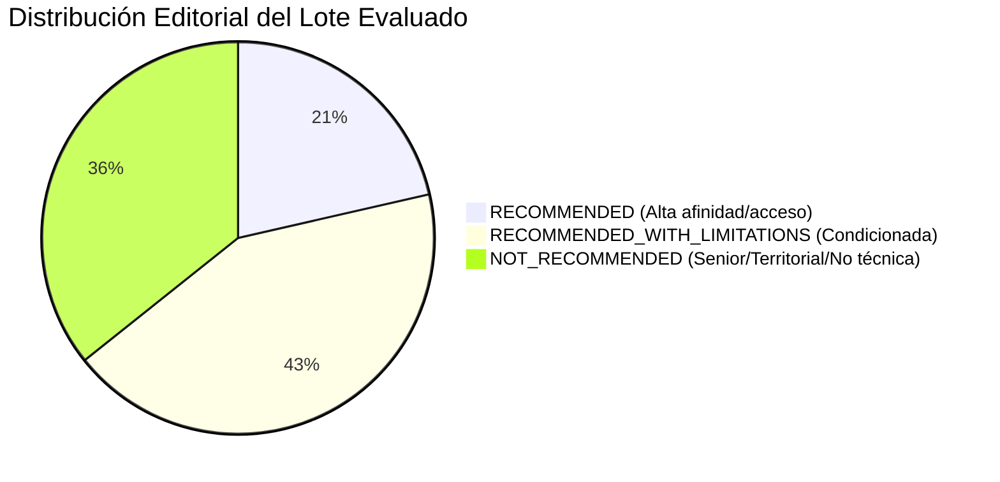

# INFORME DE CIERRE TÉCNICO Y EDITORIAL — BLOQUE R4-02
## Ingesta Controlada y Evaluación Editorial de Candidatos Multifuente

---

### 1. Resumen Ejecutivo y Métricas Globales

En cumplimiento estricto del mandato para el bloque **R4-02**, se utilizó el piloto multifuente operativo implementado en **R4-01** para ejecutar una adquisición controlada con datos reales de la red en vivo.

```
=== PILOTO DE ADQUISICIÓN CONTROLADA MULTIFUENTE (R4-02) ===
Modo: EN VIVO (Red directa contra APIs oficiales Greenhouse y Lever)
Fecha de corte civil: 2026-11-22 | Zona horaria: America/Lima (UTC-5)

Métricas Globales:
- Fuentes evaluadas:             5 (Exitosas: 5, Fallidas: 0) — Tasa de éxito: 100%
- Oportunidades capturadas:      692 en bruto
- Oportunidades relevantes:      65 pertinentes a Ingeniería de Sistemas y TI
- Oportunidades descartadas:     627 (inelegibles, senior/staff/director, no técnicas)
- Duplicados detectados:         15 (5 canónicas de Canonical, 1 de CookUnity, 4 promovidas de Sezzle, 5 en staging previo)
- Nuevos candidatos en staging:  50 ingresados a data/candidates/inbox.local.json
- Total acumulado en staging:    74 candidatos (24 previos + 50 nuevos, 0 errores Schema 2)
```

---

### 2. Cuadro Comparativo de las 5 Fuentes Piloto

| Criterio Técnico | Canonical (`greenhouse-canonical`) | Sezzle (`greenhouse-sezzle`) | CookUnity (`greenhouse-cookunity`) | Fintual (`lever-fintual`) | Kavak (`lever-kavak`) |
|---|---|---|---|---|---|
| **Accesibilidad pública** | Totalmente abierta (API REST) | Totalmente abierta (API REST) | Totalmente abierta (API REST) | Totalmente abierta (API REST) | Totalmente abierta (API REST) |
| **Autenticación requerida** | Ninguna | Ninguna | Ninguna | Ninguna | Ninguna |
| **Formato de respuesta** | JSON estructurado | JSON estructurado | JSON estructurado | JSON estructurado | JSON estructurado |
| **Volumen global capturado** | 318 vacantes | 228 vacantes | 137 vacantes | 4 vacantes | 5 vacantes |
| **Relevantes / Nuevos** | 35 rel. / 30 nuevos | 17 rel. / 9 nuevos | 6 rel. / 4 nuevos | 3 rel. / 3 nuevos | 4 rel. / 4 nuevos |
| **Elegibilidad Perú/LATAM** | Alta (Remoto Americas / Worldwide) | Muy alta (Perú explícito / Lima) | Media (Remoto LATAM) | Baja (Híbrido Chile / México) | Baja (Presencial CDMX / Brasil) |
| **Riesgo técnico/legal** | Nulo (Uso de API oficial) | Nulo (Uso de API oficial) | Nulo (Uso de API oficial) | Nulo (Uso de API oficial) | Nulo (Uso de API oficial) |

---

### 3. Garantía Pericial de Deduplicación e Idempotencia Estricta

1. **Deduplicación Multivariable (`collector/dedup.py`):**
   - **Canonical:** Reconoció las 5 vacantes canónicas de Canonical en `data/opportunities.seed.json` (`8379825`, `6707669`, `5370815`, `3257589`, `6448444`, correspondientes a `OP-006` a `OP-010`).
   - **CookUnity:** Reconoció la vacante canónica `8039990003` (Supply Chain Analyst, `OP-005`) y la vacante previa en staging `8034712003`.
   - **Sezzle:** Reconoció las 4 vacantes promovidas en R3 (`7906563003`, `7907182003`, `8000825003`, `8001111003`, correspondientes a `OP-011` a `OP-014`).
2. **Prueba de Idempotencia en Red:**
   - Una re-ejecución inmediata del runner sobre los endpoints en vivo detectó **65 duplicados sobre 65 vacantes relevantes**, arrojando exactamente **0 nuevos candidatos ingresados** y **0 bytes de mutación**.

---

### 4. Evaluación Editorial Estructurada (Muestra Representativa de 14 Candidatos)

| Candidate ID | Empleador | Título del Puesto | Ubicación | Ref. Externa | Clasificación Editorial | Síntesis de Evaluación en 5 Dimensiones (A-E) |
|---|---|---|---|:---:|:---:|---|
| `CAND-greenhouse-sezzle-8012085003` | Sezzle | Product Operations Intern, Rewards | Perú (Remoto) | `8012085003` | `RECOMMENDED` | **A) Pertinencia:** Alta (workflows de producto y analítica fintech). **B) Acceso:** Excelente para practicantes. **C) Condiciones:** ~USD 800/mes, 100% remoto en Perú. **D) Potencial:** Alto en métricas y producto digital. **E) Riesgos:** Inglés intermedio-avanzado. |
| `CAND-greenhouse-sezzle-7998740003` | Sezzle | Product Management Intern | Perú (Remoto) | `7998740003` | `RECOMMENDED` | **A) Pertinencia:** Alta (ciclo de vida de software y squads ágiles). **B) Acceso:** Diseñado para estudiantes de Sistemas. **C) Condiciones:** Remuneración formal en USD, remoto en Perú. **D) Potencial:** Excepcional hacia Product Owner/TPM. **E) Riesgos:** Comunicación oral y escrita en inglés. |
| `CAND-greenhouse-sezzle-8044473003` | Sezzle | Product Manager Intern, ShopX | Perú (Remoto) | `8044473003` | `RECOMMENDED` | **A) Pertinencia:** Alta (análisis funcional y telemetría de app móvil). **B) Acceso:** Pasantía con mentores senior. **C) Condiciones:** Salario en USD, remoto. **D) Potencial:** Alto en comercio electrónico y growth. **E) Riesgos:** Exigencia analítica y de idioma. |
| `CAND-greenhouse-sezzle-8009618003` | Sezzle | Fraud Operations Analyst (Peru) | Perú (Remoto) | `8009618003` | `RECOMMENDED_WITH_LIMITATIONS` | **A) Pertinencia:** Media-Alta (SQL, reglas antifraude). **B) Acceso:** Puesto junior/intermedio. **C) Condiciones:** Empleo formal en USD. **D) Potencial:** Ciberseguridad y prevención de fraude. **E) Riesgos:** Posibles turnos operativos y guardias. |
| `CAND-greenhouse-sezzle-8040733003` | Sezzle | Chargeback Operations Intern | Perú (Remoto) | `8040733003` | `RECOMMENDED_WITH_LIMITATIONS` | **A) Pertinencia:** Media (disputas fintech). **B) Acceso:** Puesto formativo. **C) Condiciones:** Prácticas en USD. **D) Potencial:** Normativas bancarias. **E) Riesgos:** Tareas administrativas rutinarias. |
| `CAND-greenhouse-sezzle-8040739003` | Sezzle | Fraud & Disputes Intern | Perú (Remoto) | `8040739003` | `RECOMMENDED_WITH_LIMITATIONS` | **A) Pertinencia:** Media-Alta (telemetría de riesgo). **B) Acceso:** Estudiantes de últimos ciclos. **C) Condiciones:** Remunerado en USD. **D) Potencial:** Analítica de fraude. **E) Riesgos:** Alto componente de revisión documental. |
| `CAND-greenhouse-sezzle-8040748003` | Sezzle | Risk & Disputes Intern | Perú (Remoto) | `8040748003` | `RECOMMENDED_WITH_LIMITATIONS` | **A) Pertinencia:** Media-Alta (evaluación crediticia). **B) Acceso:** Estudiantes. **C) Condiciones:** Prácticas en USD, remoto. **D) Potencial:** Gobernanza de datos de riesgo. **E) Riesgos:** Operativa rutinaria. |
| `CAND-greenhouse-canonical-5861481` | Canonical | Junior Project Manager | Americas (Remoto) | `5861481` | `RECOMMENDED_WITH_LIMITATIONS` | **A) Pertinencia:** Alta (gestión de proyectos open source/Ubuntu). **B) Acceso:** Rol Junior oficial. **C) Condiciones:** USD 2,000/año para formación, sprints globales, remoto. **D) Potencial:** Metodologías ágiles a nivel mundial. **E) Riesgos:** Proceso de selección psicotécnico muy riguroso en inglés. |
| `CAND-greenhouse-canonical-6103331` | Canonical | Graduate Customer Success Manager | Worldwide (Remoto) | `6103331` | `RECOMMENDED_WITH_LIMITATIONS` | **A) Pertinencia:** Media (adopción corporativa de nube/Linux). **B) Acceso:** Recién graduados STEM. **C) Condiciones:** Salario internacional en USD. **D) Potencial:** Consultoría técnica cloud. **E) Riesgos:** Enfoque relacional/comercial. |
| `CAND-greenhouse-sezzle-8010481003` | Sezzle | Compliance Intern | Perú (Remoto) | `8010481003` | `NOT_RECOMMENDED` | **A) Pertinencia:** Baja (cumplimiento regulatorio legal/AML). **B) Acceso:** Orientado a Derecho/Auditoría. **C) Condiciones:** Buenas. **D) Potencial:** Bajo en software. **E) Riesgos:** Poca afinidad con Sistemas. |
| `CAND-greenhouse-sezzle-8164477003` | Sezzle | Manager, Tier 2 Support | Perú (Remoto) | `8164477003` | `NOT_RECOMMENDED` | **A) Pertinencia:** Media (soporte L2). **B) Acceso:** Nula para juniors (exige 5+ años gestionando equipos). **C) Condiciones:** Gerencial. **D) Potencial:** N/A para juniors. **E) Riesgos:** Puesto de liderazgo fuera de rango. |
| `CAND-greenhouse-cookunity-8205614003` | CookUnity | Senior Full Stack Engineer, Growth | LATAM (Remoto) | `8205614003` | `NOT_RECOMMENDED` | **A) Pertinencia:** Alta (backend/plataforma). **B) Acceso:** Nula para estudiantes (requiere 5+ años senior). **C) Condiciones:** Salario senior en USD. **D) Potencial:** N/A para juniors. **E) Riesgos:** Nivel senior inalcanzable para la cohorte. |
| `CAND-lever-fintual-9c863695` | Fintual | Software Engineer | Chile / México | `9c863695` | `NOT_RECOMMENDED` | **A) Pertinencia:** Muy alta en software. **B) Acceso:** Inaccesible. Restringida a residentes en Chile o México con esquema híbrido. **C) Condiciones:** Buenas. **D) Potencial:** No aplicable en Perú. **E) Riesgos:** Inelegibilidad territorial. |
| `CAND-lever-kavak-f6e34773` | Kavak | Senior Full Stack Engineer | Mexico City | `f6e34773` | `NOT_RECOMMENDED` | **A) Pertinencia:** Alta en desarrollo web. **B) Acceso:** Nula. Presencial en CDMX y nivel senior. **C) Condiciones:** Empleo en México. **D) Potencial:** N/A. **E) Riesgos:** Doble barrera de seniority y presencialidad física. |

---

### 5. Documentación y Evidencia Generada

Se generaron y actualizaron los siguientes expedientes y artefactos auditables:

1. **Expediente de Revisión Editorial R4-02:**  
   [docs/audits/r4-02-controlled-acquisition-and-candidate-review.md](file:///c:/Users/sant1/Downloads/EmpleoWeb/docs/audits/r4-02-controlled-acquisition-and-candidate-review.md)  
   *(Contiene los 18 puntos requeridos: cuadro comparativo, métricas, tabla con los 50 candidatos en staging, evaluación en 5 dimensiones, lecciones aprendidas y protocolo de decisión).*
2. **Actualización de la Hoja de Ruta Maestra:**  
   [docs/architecture/r0-decisiones-y-alcance-2026-11-12.md](file:///c:/Users/sant1/Downloads/EmpleoWeb/docs/architecture/r0-decisiones-y-alcance-2026-11-12.md#L289-L295)  
   *(R4-01 y R4-02 registrados formalmente en estado `DONE`; R4-03 en `PENDING`).*
3. **Bandeja de Staging Aislada:**  
   `data/candidates/inbox.local.json` con 74 candidatos conformes a Schema 2 en estado `pending_review`.

---

### 6. Verificación de Integridad y Salvaguardas

- **Pruebas Unitarias e Integración Python:** 203 / 203 pruebas aprobadas (`Ran 203 tests in 3.810s - OK`).
- **Pruebas End-to-End Playwright:** 20 / 20 pruebas aprobadas en Chromium Desktop y Mobile Pixel 5 (`20 passed (33.8s)`).
- **Consistencia del Catálogo Canónico:** `validate_catalog.py` y `build_catalog.py --check` certifican **15 fichas válidas y 100% en sincronía**.
- **Validación de Staging:** `validate_candidates.py` valida **74 candidatos conformes, 0 errores**.
- **Preservación Git y de Paquetes:** **0 commits, 0 pushes a remotos, 0 merges a main, 0 dependencias añadidas (0 npm, 0 pip)**.

---

### 7. Protocolo de Decisión para el Propietario

Las nuevas vacantes se encuentran en staging bajo la puerta de control fail-closed (`pending_review`). El propietario dispone de las siguientes opciones:

- **OPCIÓN A (Recomendada):** Autorizar la promoción de las **3 vacantes formativas recomendadas de Sezzle (`RECOMMENDED`)**:
  - `CAND-greenhouse-sezzle-8012085003` (Product Operations Intern, Rewards)
  - `CAND-greenhouse-sezzle-7998740003` (Product Management Intern)
  - `CAND-greenhouse-sezzle-8044473003` (Product Manager Intern, ShopX)
  *(Ampliación del catálogo de la Alpha privada de 15 a 18 vacantes verificadas).*
- **OPCIÓN B:** Promover el paquete ampliado (**3 recomendadas de Sezzle + 1 vacante internacional de Canonical**):
  - Añade `CAND-greenhouse-canonical-5861481` (Junior Project Manager, Canonical).
  *(Ampliación a 19 vacantes).*
- **OPCIÓN C:** Selección individual específica de los IDs que el propietario decida promover.
- **OPCIÓN D:** Mantener todas las vacantes en staging (`pending_review`) y avanzar directamente al diseño de adquisición periódica y caducidad temporal en **R4-03**.

---

# R0 — Decisiones estratégicas y alcance consolidado

- **Fecha:** 2026-11-12
- **Estado:** cerrada documentalmente; R1 aún no iniciada
- **Alcance:** decisiones, criterios y roadmap. No implementa funcionalidades.
- **Fuente de verdad:** este documento consolida R0; el código y ADR-001 siguen siendo la autoridad para los contratos ya implementados.

## 1. Decisión ejecutiva

Ruta Sistemas construirá primero un **catálogo estático, curado y verificable de oportunidades reales para perfiles iniciales y junior de Sistemas en Perú**, incluyendo oportunidades remotas solo cuando la elegibilidad desde Perú esté explícita. El MVP permite encontrar, entender y comparar oportunidades; no promete empleo, continuidad ni calidad universal del empleador.

La arquitectura vigente se conserva: `data/opportunities.seed.json` como fuente canónica, snapshot generado, frontend estático, validación fail-closed y publicación portable. No se incorpora backend multiusuario, CMS, IA, scraping general ni nueva infraestructura antes de demostrar una necesidad concreta.

**Regla de cierre del MVP:** mientras no exista al menos una ficha real que cumpla el contrato editorial y pueda consultarse correctamente, el producto es un piloto técnico/editorial, no un MVP terminado.

## 2. Inventario documental consolidado

| Documento | Estado | Decisión/propósito | Acción |
|---|---|---|---|
| [README.md](../../README.md) | Vigente | Operación, estados, validaciones y límites actuales | Mantener; enlazar este cierre R0 |
| [ADR-001](../adr/ADR-001-catalogo-curado-publicacion-segura.md) | Vigente | Fuente canónica, estados, evidencia, publicación y límites | Mantener como contrato arquitectónico |
| [P3 — primer caso real](../sources/p3-first-opportunity-2026-11-12.md) | Vigente como bloqueo | Ninguna fuente tiene autorización suficiente | Mantener; no activar fuentes |
| [P4 — OSS](p4-oss-automation-evaluation-2026-11-13.md) | Propuesto/condicionado | Evalúa automatización futura; operación bloqueada | Mantener como propuesta; no instalar OSS |
| [P5 — evaluación profesional](../product/p5-evaluacion-profesional-y-validacion.md) | Vigente como evolución | Señales explicables sin score ni ranking | Mantener; no confundir con requisito completo del MVP |
| [Seguimiento de autorización](../sources/seguimiento-autorizacion-fuentes.md) | Vigente como trabajo externo | Preguntas y criterios para fuentes | Mantener; requiere respuesta humana |
| [Canonical Careers](../sources/canonical-careers-2026-11-11.md) | Propuesto | Candidata privada, `pending_review`, presupuesto cero | Mantener; no consultar ni publicar |
| [Auditoría 2026-10-25](../audits/project-state-audit-2026-10-25.md) | Histórico | Diagnóstico anterior y decisiones ya implementadas | No usar como estado actual |
| [Diseño/roadmap](../../Diseno-modelo-datos-arquitectura-piloto-2026-10-03.md) | Histórico acumulativo + roadmap vigente | Antecedentes y secciones P1–P5 | Conservar; esta sección R0 prevalece para alcance actual |
| `Informe-investigacion-mercado-fuentes-2026-10-03.md` | Histórico | Investigación de mercado y fuentes | No tratar como autorización |
| `outputs/pilot-datos-2026-10-03/Protocolo_Piloto_Oportunidades.xlsx` | Histórico | Protocolo del piloto inicial | Conservar como antecedente |

### Contradicciones resueltas

1. La visión de largo plazo incluye evaluación profesional y trayectorias; P5 no las elimina, solo las deja como evolución basada en evidencia.
2. Los documentos antiguos describen colectores activos, CDN o escritura automática; ADR-001 y el código actual los sustituyen por snapshot estático, CSS compilado y colector fail-closed.
3. La evaluación OSS fechada **2026-11-13** es posterior a la fecha de R0 (**2026-11-12**): se considera propuesta futura ya redactada, no decisión aprobada ni evidencia de ejecución.
4. `Aurel`/`AurelDev` aparece en contenido local reciente, pero no es una decisión de marca aprobada. La marca de producto para R0 sigue siendo Ruta Sistemas.

## 3. Alcance definitivo

### A. MVP — obligatorio

1. Catálogo con al menos una oportunidad real no demostrativa.
2. Filtros por tipo, perfil/nivel, modalidad, ubicación y familia/sector cuando esos datos estén publicados.
3. Detalle con requisitos, condiciones disponibles, fuente, publisher, fecha de observación y canal oficial de postulación.
4. Estados comprensibles y conservadores: oportunidad, verificación y publicación separados.
5. Exclusión por defecto de demostraciones, históricas, vencidas y no confirmadas.
6. Comparación local de oportunidades sin score ni ganador universal.
7. Evidencia y trazabilidad suficientes para explicar cada dato publicado.
8. Publicación estática reproducible y validada antes de Pages.

### B. Evolución, no MVP

- señales explicables de aprendizaje, experiencia técnica, crecimiento y continuidad;
- evaluación separada del empleador y de la oportunidad;
- preferencias efímeras, oportunidades guardadas y alertas;
- orientación de trayectorias basada en requisitos y transiciones observadas;
- automatización de fuentes autorizadas en staging;
- persistencia multiusuario solo si la curación concurrente lo demuestra necesaria.

La evolución requiere datos reales longitudinales, criterios transparentes, pruebas con usuarios y separación explícita entre hecho, señal, incertidumbre y ausencia de información. No se autoriza score universal, ranking definitivo ni recomendación automática por ahora.

### C. Fuera de alcance o descartado

- red social, comunidad, chat usuario-empresa;
- sistema propio de postulación;
- almacenamiento de CV o datos de postulantes;
- backend multiusuario prematuro;
- scraping indiscriminado o activación por disponibilidad técnica;
- IA/recomendaciones sin dataset suficiente y evidencia;
- ranking universal de empleadores u oportunidades;
- infraestructura distribuida o base especializada sin volumen/operación demostrados.

## 4. Cambios sin commit: matriz de decisión

El estado revisado contiene **15 archivos rastreados modificados**, **un `canvas.js` no rastreado** y **cuatro documentos nuevos no rastreados**; el diff rastreado suma **1.536 adiciones y 117 eliminaciones**. Se preserva todo el trabajo; esta matriz no autoriza revertirlo.

| Grupo | Aporte | Riesgo/coste | Evidencia actual | Decisión R0 |
|---|---|---|---|---|
| Marca/identidad | Jerarquía y nueva presentación | `Aurel`/`AurelDev` contradice Ruta Sistemas | `index.html`, DOM local | Conservar con ajuste de marca en R1 |
| Navegación/estructura | Hero, catálogo, metodología, fuentes | Más superficie antes de tener datos reales | inspección de UI | Conservar; validar tarea principal |
| Filtros/catálogo | Texto, ubicación, modalidad, categorías y opt-ins | Cobertura E2E incompleta | tests Node + navegador | Conservar |
| Detalle | Evidencia, estados, señales y postulación deshabilitada | Puede repetir interpretación editorial | `renderDialog`, contratos schema 2 | Conservar con pruebas |
| Comparador | Hasta dos fichas, sin puntuación | No verificado end-to-end | lógica Node; falta browser flow | Conservar con validación |
| Evaluación/evidencia | Distingue hechos y límites | No debe parecer recomendador | P5 y `evaluationSignals` | Conservar como evolución útil |
| Hero WebGL | Identidad visual y animación | Compatibilidad, rendimiento, accesibilidad; no resuelve catálogo vacío | `canvas.js`; `prefers-reduced-motion` no detiene WebGL | Pendiente de validación; no ampliar |
| Estilos/responsive | CSS compilado local, sin CDN runtime | Cambios amplios y posible divergencia visual | build CSS y artefacto Pages pasan | Conservar; revisar viewport |
| Pruebas/docs | Contratos de carga, errores y datos | Falta E2E local/canvas/modales | 56 tests pasan | Conservar; ampliar en R1 |

### Defectos verificables que R1 debe resolver

- `index.html` carga `canvas.js`, pero `server.py` no lo expone: el servidor local devuelve 404/MIME JSON.
- El título y marca visible no están alineados con Ruta Sistemas.
- El bucle WebGL debe medirse o desactivarse/reducirse bajo `prefers-reduced-motion`; la regla CSS por sí sola no prueba ahorro de ejecución.
- No afirmar que Pages y servidor local son equivalentes hasta probar ambos contratos.

## 5. Contrato editorial vigente

No se crea un esquema paralelo. El contrato se apoya en schema 2, `catalog_quality.py`, `build_catalog.py`, `validate_candidates.py` y ADR-001.

### Campos mínimos

- **Identidad:** `id`, `title`, `employer`, `publisher`, `kind`, `family`, `level`, `sector`.
- **Condiciones:** `mode`, `location`, `eligibility`, `salary`/`salaryNote`, `duration`, `benefits`, `publishedAt`, `deadline` cuando existan.
- **Postulación:** `sourceUrl`, `applyUrl`, `allowedHosts`, `sourceKind`.
- **Evidencia:** `fieldEvidence` para cada campo afirmado, URL HTTPS permitida y `observedAt` con zona; `verificationEvidence` con método, resultado y relación con el empleador.
- **Decisión:** `editorialDecision.status`, revisor, motivo y `decidedAt`.
- **Estados:** `opportunityStatus`, `verificationStatus`, `publicationStatus`, `recordKind`, `lastVerifiedAt`/`lastCheckedDate`.

### Condición para `publicationStatus: active`

Debe cumplirse todo lo siguiente:

1. `recordKind` no es `demonstration`.
2. `opportunityStatus: open`.
3. `verificationStatus: verified` y la verificación está dentro del TTL configurado.
4. El deadline no existe o no está vencido.
5. Revisión humana aprobada con revisor, fecha y motivo.
6. El canal de postulación fue observado abierto manualmente, con `publisherRelation: employer_confirmed`, `result: application_open`, timestamp válido y hosts HTTPS permitidos.
7. `sourceUrl`, `applyUrl` y la evidencia son permitidas.
8. Cada campo no nulo afirmado tiene `fieldEvidence` reciente.

Si falta cualquier condición, la ficha permanece `unconfirmed`, `historical`, `expired`, `stale`, `pending` o fuera del snapshot publicable según corresponda. `generatedAt` nunca renueva evidencia. Ausencia de dato no se transforma en condición negativa.

### Flujo mínimo

`captura → validación → deduplicación → verificación → revisión humana → aprobación → generación → publicación → seguimiento`

| Paso | Estado actual |
|---|---|
| Captura | Manual; automatización bloqueada |
| Validación | Implementada para candidatos, semilla y snapshot |
| Deduplicación | Parcial; requiere revisión de colisiones |
| Verificación | Manual y documentada; no existe ficha real aprobada |
| Revisión/aprobación | Manual, modelada en schema, sin panel |
| Generación/publicación | Implementada y fail-closed |
| Seguimiento/retirada | Política documentada; ejecución manual |

## 6. Criterios de aceptación congelados

### MVP

- [ ] Existe al menos una oportunidad real, no demostrativa, consultable y aprobada.
- [ ] Una persona puede filtrar, abrir el detalle, distinguir empleador/publisher y llegar al canal oficial.
- [ ] Una ficha vencida, stale o sin evidencia no aparece como activa por defecto.
- [ ] La comparación no produce score, ganador ni valores inventados.

### Datos y publicación

- [ ] `build_catalog.py --check`, `validate_catalog.py` y `validate_candidates.py` pasan.
- [ ] Cada dato afirmado tiene evidencia HTTPS y fecha válida; los desconocidos permanecen ausentes/null.
- [ ] La publicación falla si el esquema, host, fecha, estado o artefacto son inválidos.
- [ ] El artefacto contiene exactamente los archivos permitidos y no depende de CDN runtime.

### Experiencia e integridad técnica

- [ ] Prueba de navegador cubre carga, filtros, estado vacío/error, detalle, comparación y enlaces relativos bajo Pages.
- [ ] Prueba local cubre `canvas.js` o documenta su exclusión; no hay 404/MIME incorrecto.
- [ ] Se revisan teclado, diálogo, viewport móvil y `prefers-reduced-motion`.
- [ ] No se declara éxito remoto sin observar el artefacto y la URL desplegados.

### Evolución

- [ ] No se inicia scoring, alertas, trayectorias o personalización sin datos y protocolo de medición documentados.
- [ ] Una fuente nueva tiene autorización escrita separada para consulta, retención, atribución, retirada y republicación antes de cualquier solicitud.
- [ ] La automatización produce staging/candidatos y nunca promociona directamente a seed, snapshot o Pages.

## 7. Roadmap maestro posterior a R0

El roadmap existente permanece en la sección 21 y sus bloques posteriores del [documento de diseño](../../Diseno-modelo-datos-arquitectura-piloto-2026-10-03.md). R0 lo reordena así, sin duplicar tareas:

| Fase | Objetivo | Entrada | Salida/criterio | Estado |
|---|---|---|---|---|
| R0 | Cerrar alcance, contrato, criterios y decisiones | Auditoría + docs actuales | Este documento, sin contradicciones críticas sin registrar | **Cerrada documentalmente** |
| R1 | Estabilizar versión actual | R0 | `canvas.js` local resuelto, marca unificada, diff revisado, E2E base, Pages desplegado | **Completada y verificada en producción** |
| R2 | Obtener primera oportunidad real | R1 + fuentes públicas/autorización | Una ficha real aprobada en staging y luego seed/snapshot | **DONE. Línea offline R2-OSS cerrada. Línea A completada en R2-A-05: CookUnity 8039990003 (Supply Chain Analyst - Lima, Perú) promovida editorialmente al catálogo canónico como OP-005 con aprobación del propietario (APPROVE_WITH_LIMITATIONS), snapshot compilado y validado (193 pruebas unitarias, 8 pruebas E2E Playwright, validador de calidad) y publicado en GitHub Pages con 21 evidencias desglosadas por campo y canal oficial de postulación. Candidato Canonical 8379825 conservado en reserva. Desbloquea R3.** |
| R3 | Validar utilidad del MVP | R2 | Pruebas con usuarios y medición de comprensión/comparación | **En ejecución. Desbloqueada por R2-A-05 con oportunidad real OP-005 en producción. Subfase R3-01 (Preparación y protocolo de investigación) completada (DONE): línea base UX, protocolo de pruebas de usabilidad, plantilla individual de sesión, repositorio de hallazgos y auditoría de preparación entregados. Subtareas R3-01-01 a R3-01-05 formalizadas. Pendiente R3-02 (ejecución de sesiones con 5-8 usuarios reales).** |
| R4 | Automatizar fuente autorizada | R2/R3 + permiso técnico | Adaptador acotado, candidatos offline, sin promoción automática | **Bloqueada; no existe fuente autorizada** |
| R5 | Evaluación profesional explicable | Datos reales suficientes + R3 | Señales auditables sin score obligatorio | Aplazada |
| R6 | Preferencias, guardados y alertas | R3 + necesidad demostrada | Diseño de privacidad y persistencia justificado | Aplazada |
| R7 | Trayectorias profesionales | Dataset longitudinal y evidencia | Orientación no determinista, validada | Aplazada |
| R8 | Consolidación operativa | Flujos anteriores estables | backups, monitorización, retirada y plan de hosting | Aplazada |

### Siguiente bloque: R1-01

- **Objetivo:** estabilizar y consolidar la versión actual sin cambiar el alcance.
- **Archivos probables:** `server.py`, `index.html`, `canvas.js`, `app.js`, pruebas UI y documentación de release.
- **Dependencias:** ninguna técnica; requiere conservar el árbol de trabajo y revisión del propietario para decidir mantener o simplificar el hero.
- **Aceptación:** servidor local sin 404/MIME para recursos declarados; marca unificada; smoke E2E de carga/filtros/detalle/comparador; decisión explícita sobre WebGL y reduced motion.
- **Validaciones:** suite existente, `node --check`, artefacto Pages, navegador local y viewport móvil.
- **Riesgo:** tocar el lote acumulado puede mezclar cambios de etapas; revisar diff antes de seleccionar cualquier integración.
- **Esfuerzo relativo:** medio.

### Evidencia de ejecución R1

- `server.py` expone `/canvas.js` como JavaScript; la comprobación HTTP local devolvió `200` y MIME correcto para `/`, `/app.js`, `/styles.css`, `/canvas.js` y `/data/opportunities.json`.
- `index.html` usa `Ruta Sistemas` en título y marca visible, sin residuo activo `Aurel`.
- `canvas.js` registra fallback sin bloqueo para WebGL2 ausente, atiende `prefers-reduced-motion` y cancela el frame en `pagehide`.
- `app.js` conserva el mensaje seguro para la persona y registra la causa técnica del fallo de catálogo en consola.
- `python -m unittest discover -s tests -v`: 57 pruebas pasan. `node --check app.js` y `node --check canvas.js` pasan.
- Smoke de navegador local: carga inicial vacía, activación de ejemplos demostrativos y apertura/cierre del detalle verificados. No se añadió un runner E2E al proyecto.

## 8. Decisiones pendientes de aprobación

1. Mantener el hero WebGL, simplificarlo o retirarlo tras la validación R1.
2. Confirmar la marca final `Ruta Sistemas` y corregir cualquier residuo `Aurel`.
3. Autorizar contacto con Canonical/SERVIR/FISI o seleccionar otra fuente; ninguna está aprobada actualmente.
4. Autorizar la integración/publicación del lote sin commit tras revisión completa del diff.
5. Definir, después del piloto, si el volumen justifica CMS/backend; no se presume ahora.

## 9. Cierre R0 y Seguimiento de Fases Posteriores

- **R0:** **Cerrada documentalmente**.
- **R1:** **Cerrada y desplegada**.
- **R2:** **Cerrada formalmente** con la línea offline R2-OSS (ingesta, normalización, dedup, evidencias y CLI) y la línea A (R2-A-01 a R2-A-05), culminando con la publicación en producción de la oportunidad real CookUnity (`OP-005`) en GitHub Pages.
- **R3 — Validación de Producto:** **En ejecución**.
  - `R3-01`: Preparación y protocolo de investigación (`DONE`).
    - `R3-01-01`: Auditoría UX del producto publicado (`DONE` -> `docs/research/r3-01-ux-baseline-2026-11-18.md`).
    - `R3-01-02`: Definición del protocolo de investigación (`DONE` -> `docs/research/r3-01-user-research-protocol-2026-11-18.md`).
    - `R3-01-03`: Diseño de escenarios y tareas A a E (`DONE` -> `docs/research/r3-01-user-research-protocol-2026-11-18.md`).
    - `R3-01-04`: Métricas y taxonomía de evaluación (`DONE` -> `docs/research/r3-01-findings-template-2026-11-18.md`).
    - `R3-01-05`: Instrumentación y plantillas locales (`DONE` -> `docs/research/r3-01-usability-test-template-2026-11-18.md`).
  - `R3-02`: Trabajo de campo con usuarios reales (5-8 participantes) (Preparación técnica y operativa `DONE`; ejecución empírica en estado `NOT_STARTED` / `PENDING_HUMAN`, pendiente de convocatoria y moderación presencial/remota por el equipo humano; paquete operativo verificado con kit `docs/research/r3-02-recruitment-materials-kit-2026-11-18.md`, guía `docs/research/r3-02-moderator-field-guide-2026-11-18.md`, plantillas `P01.md`..`P08.md` y auditorías en `docs/audits/`).
    - `R3-02-UX-EXP-01`: Iteración exploratoria de claridad, rendimiento y experiencia de consulta (`DONE` -> `docs/audits/r3-02-ux-exploratory-iteration-2026-11-19.md`). Optimización WebGL2 en `canvas.js` (eliminación de reflow forzado en bucle y pausa con `IntersectionObserver`), vista independiente de oportunidad con URL estable `?id=...` y fallback amigable 404, reemplazo de señales complejas por Triaje Rápido de 8 condiciones objetivas sin puntaje sintético, retiro de decisión editorial y evaluación institucional de la UI pública, simplificación de procedencia con tarjeta de fuente oficial y evidencia colapsable, y corrección de heurísticas UX-B01 a UX-B05. Esta iteración atiende observaciones del entorno exploratorio personal y círculo reducido sin comprometer el rigor metodológico ni anticipar la validación formal.
    - `R3-02-UX-EXP-02`: Validación local, auditoría de aceptación y preparación para sincronización (`DONE` -> `docs/audits/r3-02-ux-exp-02-acceptance-2026-11-19.md`). Auditoría semántica del Triaje Rápido: corrección del detector de experiencia previa (notación `1+ años` en OP-005 clasificada fielmente como `Por revisar`), separación explícita de hechos de la convocatoria respecto al perfil personal del postulante, suite E2E ampliada a 12 pruebas (Chromium y Mobile Pixel 5), verificación responsiva sin overflow en 1440px, 768px y 390px, y confirmación de preparación técnica para evaluación privada local. R3-02 formal permanece `NOT_STARTED` / `PENDING_HUMAN`.
    - `R3-02-UX-EXP-03`: Reconciliación final, gate de aceptación y preparación de sincronización (`DONE` -> `docs/audits/r3-02-ux-exp-03-reconciliation-acceptance-2026-11-19.md`). Corrección del enrutador hash contra colisiones 404 en anclas locales de página (`#inicio`, `#fuentes`), verificación integral de 193 pruebas Python y 12 pruebas Playwright E2E, preservación absoluta del catálogo y Schema 2, y veredicto de gate `READY_FOR_OWNER_REVIEW` para sincronización controlada a `integration/r1-02c`. R3-02 formal continúa `NOT_STARTED` / `PENDING_HUMAN` y R3-03 permanece `BLOCKED`.
    - `R3-02-UX-EXP-04`: Consolidación de información y eliminación de redundancia en la ficha de oportunidad (`DONE` -> `docs/audits/r3-02-ux-exp-04-information-consolidation-2026-11-19.md`). Aplicación estricta del principio *«Un dato, una ubicación, una interpretación»*: consolidación canónica de modalidad y compensación en la cuadrícula de condiciones, unificación de ubicación y elegibilidad en un único bloque sin repetición de términos, separación nítida entre requisitos del puesto (obligatorios) y tecnologías declaradas (herramientas/plataformas), retiro completo de la sección redundante de continuidad y riesgos (integrando términos de contrato en `Contrato y plazo`), compactación de metadatos de vigencia/verificación, y rediseño del Triaje Rápido a 3 señales de síntesis prioritarias (`Pertinencia técnica`, `Elegibilidad territorial`, `Nivel y experiencia`). Suite E2E ampliada a 14 pruebas (Chromium y Mobile Pixel 5) verificando cero duplicaciones informativas. R3-02 formal permanece `NOT_STARTED` / `PENDING_HUMAN` y R3-03 permanece `BLOCKED`.
    - `R3-02-UX-EXP-05`: Rediseño de la ficha de oportunidad, presentación visual y uso efectivo de Tailwind CSS (`DONE` -> `docs/audits/r3-02-ux-exp-05-opportunity-detail-visual-redesign-2026-11-19.md`). Cumplimiento de la decisión del propietario de simplificar radicalmente la ficha: eliminación completa del «Triaje rápido»; posicionamiento superior de «✓ Fuente oficial verificada» (con difusor, empleador, estado de verificación y enlaces oficiales directos); nuevo «Resumen» visual con cuadrícula de tarjetas e iconos SVG Lucide inlined (`monitor`, `building`, `pin`, `wallet`, `file`, `clock`, `calendar`, `shield`); política estricta de omisión visual de campos no declarados (eliminación de textos especulativos como «sujeto a desempeño y evaluación del empleador» y omisión en OP-005 de modalidad, remuneración y fecha límite no publicadas); «Tecnologías y herramientas declaradas» ubicadas inmediatamente debajo del Resumen como etiquetas visuales; reubicación de «Qué se verificó» y preservación de los 21 campos de evidencia desglosada; y corrección de la integración de Tailwind CSS v4 inyectando las definiciones `@theme` en `src/input.css` para restaurar tokens de color de marca (`ice-blue`, `crystal-blue`, `arctic-blue`, `brand-black`, etc.). 14 pruebas E2E (Chromium y Mobile Pixel 5) y 193 pruebas Python pasan sin advertencias de regresión. R3-02 formal continúa `NOT_STARTED` / `PENDING_HUMAN` y R3-03 permanece `BLOCKED`.
    - `R3-02-UX-EXP-06`: Reconciliación post-implementación, auditoría de UX-EXP-05 y preparación para revisión del propietario (`DONE` -> `docs/audits/r3-02-ux-exp-06-reconciliation-and-owner-review-2026-11-19.md`). Auditoría técnica exhaustiva del estado real del repositorio: verificación de paridad Git (HEAD `9d747c5` en `integration/r1-02c`), confirmación de presencia real y completa de las 7 directivas de diseño de UX-EXP-05, verificación criptográfica de invariabilidad de Schema 2 y fuentes canónicas (`data/opportunities.seed.json`, `data/opportunities.json`, `collector/sources.json`), auditoría de compilación y tokens de Tailwind CSS v4.3.3 (`styles.css` de 65 KB sin dependencias externas), validación de suite completa (193 pruebas Python, 14 pruebas Playwright Chromium/Mobile, 9 contratos estáticos, scripts de catálogo), verificación funcional y no-desbordamiento del servidor loopback (`server.py` en puerto 4173 en viewports 1440px, 768px y 390px), y entrega de la guía de revisión local para el propietario. R3-02 formal permanece `NOT_STARTED` / `PENDING_HUMAN`; R3-03 a R3-05 y R4 permanecen `BLOCKED`.
    - `R3-02-GIT-CONSOLIDATION-01`: Consolidación de iteraciones UX-EXP-01 a UX-EXP-06, validación integral de integridad, commit y push controlado a `integration/r1-02c` (`DONE` tras confirmación de sincronización remota). Consolida el trabajo de optimización WebGL2, enrutamiento independiente y hash routing, rediseño de ficha de oportunidad conforme a Tailwind CSS v4.3.3, erradicación del triaje rápido, hero de fuente oficial verificada, resumen con iconos Lucide y política estricta de omisión visual de datos no publicados. Incorpora las 7 auditorías (`docs/audits/r3-02-*.md`), la guía de evaluación local (`docs/audits/r3-02-preview-readiness-2026-11-19.md`) y la plantilla de feedback informal (`docs/research/r3-02-informal-feedback-template.md`). Suite completa aprobada (193 pruebas Python, 14 pruebas Playwright E2E, 9 contratos estáticos, validación y build de catálogo). Schema 2 y archivos canónicos criptográficamente idénticos a `9d747c5`. Próximo paso: ejecución empírica de trabajo de campo humano R3-02. Estados de gobernanza: R3-02 permanece `NOT_STARTED` / `PENDING_HUMAN`; R3-03 a R3-05 y R4 permanecen estrictamente `BLOCKED`.
    - `R3-02-PREVIEW-02`: Preparación y verificación del entorno de evaluación personal y círculo reducido (`DONE` -> `docs/audits/r3-02-preview-02-acceptance-2026-11-20.md`). Reconciliación del estado real sobre el commit `b3e69e9` en `integration/r1-02c`, armonización de modificaciones del working tree (modernización de tarjetas y panel de filtros en `app.js`, `index.html` y compilación Tailwind `styles.css`) con contratos estáticos y selectores E2E; auditoría integral de seguridad de `server.py` (enlace exclusivo a loopback `127.0.0.1:4173`, validación de `Host`, lista blanca estricta de archivos y bloqueo 404 contra rutas privadas); verificación del 100% de la suite de pruebas (193 pruebas Python, 14 pruebas Playwright E2E en Chromium y Mobile Pixel 5, validación Schema 2); comprobación rigurosa del caso OP-005 (CookUnity); entrega de la guía amigable para evaluadores no técnicos (`docs/research/r3-02-owner-circle-evaluation-guide.md`) articulada con la plantilla de feedback informal (`docs/research/r3-02-informal-feedback-template.md`). Preservación estricta de gobernanza: feedback informal separado de investigación formal R3-02 (`NOT_STARTED` / `PENDING_HUMAN`); R3-03 a R3-05 y R4 continúan estrictamente `BLOCKED`. Cero dependencias añadidas, sin merge a `main`, sin deploy a GitHub Pages y sin push remoto.
    - `R3-02-PREVIEW-03`: Reconciliación Git y entrega controlada de la versión de evaluación (`DONE` -> `docs/audits/r3-02-preview-03-git-delivery-2026-11-20.md`). Resolución de discrepancia entre estado local y remoto: confirmación forense de que HEAD `b3e69e9` coincidía con el remoto mientras las mejoras validadas de PREVIEW-02 residían en el working tree sin versionar. Empaquetamiento y commit estructurado de cambios de UI (`app.js`, `index.html`, `styles.css`) y paquete documental (`r3-02-preview-02-acceptance-2026-11-20.md`, `r3-02-owner-circle-evaluation-guide.md`, `r3-02-preview-03-git-delivery-2026-11-20.md`). Suite completa validada (193 tests Python, 14 tests Playwright E2E Desktop/Mobile, Schema 2 inalterado, compilación Tailwind v4.3.3 en 68 KB). Sincronización mediante push normal a `origin/integration/r1-02c`. Entrega con doble modalidad para amigos (presencial / clonado independiente). Preservación estricta: R3-02 formal permanece `NOT_STARTED` / `PENDING_HUMAN`; R3-03 a R3-05 y R4 permanecen `BLOCKED`; sin merge a `main` ni despliegue en producción.
    - `R3-02-OWNER-FEEDBACK-01`: Registro de evaluación informal del círculo cercano (`COMPLETED_WITH_LIMITED_FEEDBACK` -> `docs/research/r3-02-owner-circle-feedback-2026-11-20.md`). Registro documental riguroso del feedback general transmitido verbalmente por el propietario tras pruebas informales con amistades (diseño bien valorado, percepción intuitiva y suficiencia de información), autorizando continuar el proyecto. Separación deontológica total: no se inventaron participantes, tiempos ni métricas; las plantillas formales `P01.md` a `P08.md` permanecen intactas en `PENDING_EXECUTION`. La investigación formal R3-02 continúa en `NOT_STARTED` / `PENDING_HUMAN`. R3-03 a R3-05 y R4 permanecen estrictamente `BLOCKED`. Cero dependencias añadidas, sin merge a `main` ni despliegue.
    - `R3-02-PRIVATE-ALPHA-01`: Recalibración del alcance, preparación y gobernanza de la Alpha privada (`DONE` -> `docs/architecture/r3-private-alpha-scope-decision-2026-11-20.md`). Formalización de dos niveles de madurez desacoplados: Nivel 1 (Alpha privada para uso personal y círculo reducido, con criterios técnicos y de seguridad 100% satisfechos, identificando la ampliación del inventario de vacantes reales como prioridad 1) vs. Nivel 2 (Producto validado para audiencia amplia, con R3-02 formal preservado en `NOT_STARTED` / `PENDING_HUMAN`). Matriz de priorización crítica de 12 funcionalidades (descartando sobreingeniería prematura como login, persistencia multiusuario, recomendaciones opacas o alertas automáticas). R3-03 a R3-05 y R4 permanecen estrictamente `BLOCKED`. Cero dependencias añadidas, sin merge a `main` ni despliegue.
    - `R3-ALPHA-CURATION-01`: Segundo lote de oportunidades reales para la Alpha privada (`DONE` -> `docs/audits/r3-alpha-curation-01-second-batch-2026-11-20.md`). Adquisición, normalización a Candidate Schema 2, deduplicación y auditoría editorial de 5 oportunidades formativas y junior de Canonical Ubuntu (100% remotas, elegibles desde Perú, cubriendo Desarrollo de Software, Cloud/Python, Kernel Linux y Soporte Técnico TI), recomendadas con limitaciones (`APPROVE_WITH_LIMITATIONS`) para la Alpha privada (círculo íntimo). Auditoría exhaustiva y descarte formal de 6 vacantes inelegibles o fuera de nivel (Wikimedia por restricciones territoriales a EE.UU./18 países y nivel senior; Deliverect por radicación en Países Bajos; CookUnity soporte por requerir >4 años de experiencia). Preservación estricta de gobernanza: bandeja staging `data/candidates/inbox.local.json` con 12 candidatos y 100% de evidencias `ALL_FRESH`; cero alteraciones en archivos canónicos (`data/opportunities.seed.json`, `data/opportunities.json`, `collector/sources.json` criptográficamente idénticos); 193 pruebas Python aprobadas; catálogo canónico validado; cero nuevas dependencias; R3-02 formal preservado en `NOT_STARTED` / `PENDING_HUMAN`; R3-03 a R3-05 y R4 permanecen estrictamente `BLOCKED`. Puerta de control humano preparada para decisión del propietario.
    - `R3-ALPHA-OWNER-REVIEW-01`: Revalidación y decisión editorial del segundo lote Canonical (`DONE` -> `docs/audits/r3-alpha-owner-review-01-canonical-editorial-decision-2026-11-20.md`). Revalidación pericial independiente de las 5 candidatas de Canonical Ubuntu en doble capa (REST API y Web HTML de Greenhouse), verificando disponibilidad de formularios activos, ausencia de cierres, elegibilidad remota desde Perú (franja AMER UTC-5), vigencia de cohorte fresca (`8379825`, publicada el 16-11-2026 para graduados 2026/2027) vs. requisiciones continuas/rolling (`6707669`, `5370815`, `3257589`, `6448444`). Delimitación rigurosa de gobernanza: términos de reutilización pública en `pending_review` circunscritos a la Alpha privada no comercial. Expediente comparativo completo estructurado con opciones de decisión humana (Opción A: lote completo de 5; Opción B: selectiva de 2 core dev; Opción C: mantener en staging) pendiente de selección por el propietario. Cero alteraciones en archivos canónicos (`seed.json`, `opportunities.json`, `sources.json`), 193 pruebas Python aprobadas, cero promociones automáticas, cero dependencias añadidas, sin merge a `main` ni despliegue.
    - `R3-ALPHA-PROMOTION-01`: Promoción editorial controlada de cinco oportunidades Canonical a la Alpha privada (`DONE` -> `docs/audits/r3-alpha-promotion-01-private-catalog-2026-11-21.md`). Ejecución de la autorización expresa del propietario (Opción A): incorporación canónica de 5 oportunidades reales de Canonical Ubuntu (`OP-006` a `OP-010`) cubriendo Desarrollo de Software, Sistemas Operativos, Kernel Linux, Cloud/Python y Soporte de TI. Catálogo de Alpha privada ampliado de 1 a 6 vacantes reales y 5 registros demostrativos (11 fichas en total), resolviendo el cuello de botella de contenido para evaluación personal y círculo cercano. Revalidación en tiempo real al 21-11-2026 (100% activas con formularios operativos). Advertencias editoriales rigurosas de dedicación full-time (40h/sem) e inglés profesional, distinguiendo cohorte fresca (`OP-006`, cohorte 2026/2027) de requisiciones continuas (`OP-007` a `OP-010`). Suite completa en verde: 193 pruebas Python y 14 pruebas Playwright E2E aprobadas; catálogo validado bajo Schema 2. Preservación estricta de gobernanza: `collector/sources.json` inalterado con términos en `pending_review` y `enabled: false`; cero publicación externa, cero despliegue en GitHub Pages, sin merge a `main`, sin commit ni push. Estados de gobernanza preservados: R3-02 formal permanece `NOT_STARTED` / `PENDING_HUMAN`; R3-03 a R3-05 y R4 permanecen estrictamente `BLOCKED`.
    - `R3-ALPHA-UX-01`: Escalabilidad del catálogo y presentación estructurada de contenido (`DONE` -> `docs/audits/r3-alpha-ux-01-catalog-pagination-and-lists-2026-11-21.md`). Implementación de dos mejoras prioritarias de experiencia frontend requeridas por el propietario:
      - `R3-ALPHA-UX-01A` (Paginación escalable del catálogo): Paginación de tarjetas con límite de 12 oportunidades por página (`PAGE_SIZE = 12`). Ocultación automática de controles cuando el total filtrado es <= 12; activación de botones accesibles «Anterior» y «Siguiente» con indicador detallado («Página X de Y · Mostrando A–B de N oportunidades») cuando el catálogo supera 12 tarjetas; cálculo dinámico de páginas para cualquier volumen (13, 20, 24, 25, 40, 100+); reseteo estricto a página 1 ante cambios de búsqueda, filtros o ejemplos; y preservación total del estado del comparador local (`compareIds`) al navegar entre páginas.
      - `R3-ALPHA-UX-01B` (Presentación estructurada de descripciones y listas): Formateo semántico visual mediante listas con viñetas (`<ul class="list-disc pl-5 space-y-1.5 ..."><li>...</li></ul>`) para campos que representan listas delimitadas por punto y coma (`;`) en la fuente (`tasks` / "Qué harías", `requirements` / "Requisitos del puesto", `benefits` / "Beneficios publicados"), con limpieza de puntuación redundante y capitalización amigable. Preservación intacta como párrafos narrativos (`<p>`) de textos continuos donde el punto y coma cumple función gramatical (`growth`, `continuity`, `risk`).
      - Cero dependencias añadidas, cero alteraciones en datos canónicos (`data/opportunities.seed.json`, `data/opportunities.json`, `collector/sources.json` inalterados), 193 pruebas Python aprobadas, suite Playwright ampliada de 14 a 18 pruebas aprobadas (Chromium y Mobile Pixel 5). Estados de gobernanza: R3-02 formal permanece `NOT_STARTED` / `PENDING_HUMAN`; R3-03 a R3-05 y R4 permanecen estrictamente `BLOCKED`.
    - `R3-ALPHA-CURATION-02`: Descubrimiento y curaduría de nuevas oportunidades reales para la Alpha privada (`DONE` -> `docs/audits/r3-alpha-curation-02-new-opportunities-2026-11-21.md`). Segundo ciclo de prospección y normalización enfocado en estudiantes de últimos ciclos, egresados y juniors de Ingeniería de Sistemas en Perú:
      - `R3-ALPHA-CURATION-02A` (Descubrimiento y adquisición en staging): Normalización a Candidate Schema 2 e incorporación de 12 nuevos candidatos a la bandeja local aislada `data/candidates/inbox.local.json` (elevando el total de la bandeja de 12 a 24 registros auditados). Fuentes investigadas: tableros públicos Greenhouse de Sezzle (fintech NASDAQ), Cloudbeds, Media.Monks, Cloudflare, etc.
      - `R3-ALPHA-CURATION-02B` (Auditoría editorial y descarte motivado): Identificación de 4 oportunidades prioritarias de Sezzle con localización explícita en Perú y remuneración publicada en USD (AI Engineering Intern $1,000/mes, IT Operations Intern $800/mes, Product Data Intern $800/mes, Junior Software Engineer $1,500-$4,000/mes) y 2 en reserva (Cloudbeds Reports Analyst y Sezzle Fraud Ops Intern). Descarte formal auditado de 6 posiciones por nivel desmedido (Sezzle Senior Data Engineer, Sezzle Data Engineer II, Sezzle Mobile Engineer, Media.Monks Fullstack Engineer), naturaleza puramente administrativa (Cloudbeds Billing Specialist) o inelegibilidad territorial (Cloudflare Intern presencial en US/UK).
      - `R3-ALPHA-CURATION-02C` (Verificación técnica y preservación de gobernanza): 0 colisiones de ID o duplicados con `collector/dedup.py`; 100% de evidencias frescas (`ALL_FRESH`, TTL 7 días Lima); 193 pruebas Python y 18 pruebas Playwright E2E aprobadas; catálogo canónico validado; hashes SHA-256 de `data/opportunities.seed.json`, `data/opportunities.json` y `collector/sources.json` 100% inalterados; cero promociones automáticas y cero nuevas dependencias. Puerta de control humano preparada para decisión del propietario. R3-02 formal permanece `NOT_STARTED` / `PENDING_HUMAN`; R3-03 a R3-05 y R4 continúan estrictamente `BLOCKED`.
    - `R3-ALPHA-IMPLEMENTATION-01`: Implementación funcional priorizada de la Alpha privada — Comparador razonado y transparencia de condiciones (`DONE`). Mejora de alta prioridad funcional que maximiza la utilidad de toma de decisiones para el usuario y su círculo evaluador sin sobreingeniería backend ni nuevas dependencias:
      - `R3-ALPHA-IMPLEMENTATION-01A` (Inclusión de requisitos en comparación): Incorporación de la dimensión «Requisitos del puesto» (`requirements`) en la tabla comparativa lado a lado, subsanando la omisión del criterio primordial de filtrado técnico para estudiantes e ingenieros junior.
      - `R3-ALPHA-IMPLEMENTATION-01B` (Presentación estructurada en celdas de comparación): Renderizado semántico con viñetas (`<ul class="list-disc ..."><li>...</li></ul>`) para `tasks`, `requirements` y `benefits`, eliminando bloques de texto crudo con punto y coma; y visualización de `skills` en chips técnicos individuales (`<span>`) limpios y legibles.
      - `R3-ALPHA-IMPLEMENTATION-01C` (Transparencia de datos y advertencias explícitas): Sustitución de vacíos de información por distintivos neutros no punitivos («No publicado en convocatoria / No informado»); y presentación de advertencias de carga/idioma (`risk`) dentro de callouts visuales estructurados de atención («Condición declarada»).
      - `R3-ALPHA-IMPLEMENTATION-01D` (Destacado interactivo de diferencias y acción directa): Control interactivo «Destacar diferencias» (`#compare-toggle-diff`) para resaltar visualmente filas divergentes (`bg-sky-50/70` con badge «Diferencia»); botones de navegación directa «Ver detalle ↗» (`data-compare-open`) que permiten abrir la ficha completa directamente desde la cabecera del comparador; y enlace externo seguro «Ir a postulación ↗».
      - `R3-ALPHA-IMPLEMENTATION-01E` (Verificación y aseguramiento técnico): 0 dependencias añadidas (0 npm, 0 pip); 193 pruebas Python aprobadas; 20 pruebas Playwright E2E aprobadas (Chromium Desktop y Mobile Pixel 5); hashes de `data/opportunities.seed.json`, `data/opportunities.json` y `collector/sources.json` 100% idénticos e inalterados; Schema 2 preservado. Estados de gobernanza: R3-02 formal permanece `NOT_STARTED` / `PENDING_HUMAN`; R3-03 a R3-05 y R4 continúan estrictamente `BLOCKED`.
    - `R3-ALPHA-OWNER-REVIEW-02`: Revisión editorial asistida del lote Sezzle — preparación de decisión humana (`DONE` -> `docs/audits/r3-alpha-owner-review-02-sezzle-editorial-decision-2026-11-21.md`). Auditoría técnica local y preparación de expediente individualizado para decisión del propietario sobre 4 candidatas de Sezzle (fintech NASDAQ: SEZL): AI Engineering Intern ($1,000/mes), IT Operations Intern ($800/mes), Product Data Intern ($800/mes) y Junior Software Engineer with Accounting Experience ($1,500-$4,000/mes):
      - `R3-ALPHA-OWNER-REVIEW-02A` (Resolución forense de discrepancia de staging): Explicación y confirmación pericial de los dos cortes temporales en `data/candidates/inbox.local.json`: el Lote 1 (12 candidatos de `R3-ALPHA-CURATION-01` al 20-11-2026) y el Lote 2 (12 candidatos nuevos de `R3-ALPHA-CURATION-02` al 21-11-2026), explicando con exactitud matemática el acumulado de 24 candidatos sin inconsistencia ni pérdida de datos.
      - `R3-ALPHA-OWNER-REVIEW-02B` (Fichas individualizadas y categorización pericial): Estructuración de fichas de decisión detallando familia técnica, nivel real, elegibilidad Perú (`PERU_EXPLICIT`), jornada full-time (40h/sem), requisitos y rango salarial transparente en USD, distinguiendo taxativamente datos `VERIFICADO`, `NO_PUBLICADO`, `NO_VERIFICADO` y `CONTRADICTORIO`.
      - `R3-ALPHA-OWNER-REVIEW-02C` (Gobernanza y puerta de control humano): Preservación estricta de salvaguardas fail-closed; cero promociones automáticas; fuentes en `collector/sources.json` inalteradas (`pending_review`, `enabled: false`); catálogo canónico (`data/opportunities.seed.json` y `data/opportunities.json`) 100% inalterado criptográficamente (SHA-256 idénticos); 193 pruebas Python y 20 pruebas Playwright E2E aprobadas; cero dependencias añadidas. Decisión editorial pendiente de resolución humana soberana por el propietario (`PENDING_HUMAN`). Estados de gobernanza: R3-02 formal permanece `NOT_STARTED` / `PENDING_HUMAN`; R3-03 a R3-05 y R4 continúan estrictamente `BLOCKED`.
    - `R3-SOURCE-FEASIBILITY-01`: Validación técnica de fuentes peruanas y estrategia de adquisición multifuente (`DONE` -> `docs/audits/r3-source-feasibility-01-peru-2026-11-21.md`). Auditoría empírica reproducible de 34 fuentes laborales (26 iniciales + 8 descubiertas) para la futura evolución hacia R4:
      - `R3-SOURCE-FEASIBILITY-01A` (Auditoría empírica y diagnóstico de transporte): Sondeo técnico de accesibilidad, HTTP status, TLS, WAF, CAPTCHAs, JSON-LD y formatos en ATS, portales privados, universidades e instituciones gubernamentales.
      - `R3-SOURCE-FEASIBILITY-01B` (Arquitectura en cinco capas): Definición de estrategia escalonada priorizando Capa 1 (APIs públicas documentadas: Greenhouse, Lever, Workday CXS), Capa 2 (Sitios de empleadores con Schema.org JobPosting JSON-LD), Capa 3 (Bolsas universitarias abiertas como UTP HiringRoom Campus y UDH), Capa 4 (Documentos oficiales en PDF del Estado como OSITRAN/MTPE) y Capa 5 (Fuentes secundarias descartadas por WAF o D.L. 822).
      - `R3-SOURCE-FEASIBILITY-01C` (Veredicto y aseguramiento): Veredicto oficial `VIABLE_CON_LIMITACIONES` (52.9% de fuentes técnicamente aprovechables, pero descartando agregadores privados comerciales y protegiendo la legalidad bajo D.L. 822 y Ley 29733). Cero fuentes activadas en `collector/sources.json`; cero alteraciones canónicas (hashes de `seed.json`, `opportunities.json` y `sources.json` idénticos); 193 pruebas Python y 20 E2E aprobadas. Preservación estricta de gobernanza: R3-02 formal permanece `NOT_STARTED` / `PENDING_HUMAN`; R3-03 a R3-05 y R4 continúan estrictamente `BLOCKED`.
    - `R3-ALPHA-UX-02`: Consolidación de estilos CSS con Tailwind CSS (`DONE` -> `docs/audits/r3-alpha-ux-02-tailwind-css-consolidation.md`). Normalización de la arquitectura CSS desacoplando el archivo legado pre-Tailwind `src/site.css` de la canalización de compilación:
      - `R3-ALPHA-UX-02A` (Diagnóstico y eliminación de código muerto): Auditoría estática que identificó 94 clases 100% obsoletas en `src/site.css` y descartó la existencia de la clase `.body` (el conflicto radicaba en el selector de etiqueta `body` que sobreescribía `--ink`, `--paper` y tipografía).
      - `R3-ALPHA-UX-02B` (Consolidación de componentes dinámicos y desvinculación): Desvinculación de `@import "./site.css";` en `src/input.css`; normalización de badges de estado y modalidad con clases utilitarias nativas de Tailwind en `app.js` (`statusTag` y `modeTag`); preservación de las 20 clases semánticas requeridas por Playwright como identificadores funcionales sin estilos legados; adición de resets táctiles en `@layer base`.
      - `R3-ALPHA-UX-02C` (Medición y aseguramiento técnico): Reducción del bundle `styles.css` de 72.7 KB a 48.3 KB (-33.5% de peso); eliminación de 318 bloques de reglas en conflicto; 193 pruebas Python aprobadas; 20 pruebas Playwright E2E aprobadas (Chromium Desktop y Mobile Pixel 5); hashes canónicos (`seed.json`, `opportunities.json`, `sources.json`) 100% inalterados; 0 dependencias añadidas (0 npm, 0 pip). R3-02 formal permanece `NOT_STARTED` / `PENDING_HUMAN`; R3-03 a R3-05 y R4 continúan estrictamente `BLOCKED`.
    - `R3-02-FIELDWORK-RECONCILIATION-01`: Reconciliación de pruebas internas y evidencias de validación (`DONE` -> `docs/research/r3-02-internal-feedback-01.md`). Reconciliación sistemática de las pruebas de usuario realizadas por el propietario y sus compañeros con el protocolo formal R3-02:
      - `R3-02-FIELDWORK-RECONCILIATION-01A` (Registro y caracterización de pruebas internas): Documentación fiel de los hechos comunicados (conformidad general con los resultados, percepción de interfaz intuitiva y suficiencia de información laboral), distinguiendo taxativamente la evidencia cualitativa informal respecto a pruebas técnicas automatizadas y sesiones formales protocolizadas.
      - `R3-02-FIELDWORK-RECONCILIATION-01B` (Matriz de cobertura de objetivos R3-02): Evaluación de los 7 objetivos clave de investigación (pertinencia, requisitos, verificación, comparador neutral, postulación, navegación y visualización móvil). Calificación rigurosa en `PARTIAL` para los 7 objetivos, respaldada por la convergencia de feedback cualitativo y pruebas técnicas E2E, sin otorgar `VERIFIED` prematuro hasta contar con observación protocolizada independiente.
      - `R3-02-FIELDWORK-RECONCILIATION-01C` (Gobernanza y estado del trabajo de campo): Determinación de que las pruebas internas son válidas para la Alpha privada (Nivel 1) pero no sustituyen las cuotas formales P01–P08 de Nivel 2. Las 8 plantillas `P01.md` a `P08.md` permanecen intactas en `PENDING_EXECUTION` (0 sesiones formales computadas); R3-02 formal se mantiene en `NOT_STARTED` / `PENDING_HUMAN`; R3-03 a R3-05 y R4 continúan estrictamente `BLOCKED`. Cero dependencias añadidas, catálogo canónico 100% inalterado criptográficamente, sin merge a `main` ni despliegue.
    - `R3-02-INTERNAL-FEEDBACK-02`: Registro y análisis de nuevas pruebas internas estructuradas A–E (`DONE` -> `docs/research/r3-02-internal-feedback-02.md`). Registro analítico de respuestas estructuradas por escenarios del protocolo R3-01 aportadas tras pruebas internas del propietario y compañeros:
      - `R3-02-INTERNAL-FEEDBACK-02A` (Respuestas fieles por escenario): Análisis de Tareas A a E sobre CookUnity (pertinencia en análisis de sistemas/datos, desglose de requisitos y autoevaluación subjetiva, comprensión de vigencia temporal sin garantía en tiempo real, comparación neutral de 14 atributos sin puntaje ganador y canal de postulación oficial externo deslindando custodia de CVs).
      - `R3-02-INTERNAL-FEEDBACK-02B` (Hallazgo crítico heurístico UX-B07): Detección y catalogación formal de la confusión de modalidad (`UX-B07`), donde el evaluador infirió erróneamente modalidad presencial por ubicarse en Lima ante la ausencia de etiqueta de remoto, cuando en la fuente canónica la modalidad figura como «No especificada / No informado». Se incorpora como punto focal de observación sin alterar código ni catálogo canónico.
      - `R3-02-INTERNAL-FEEDBACK-02C` (Matriz de cobertura y gobernanza): Los objetivos 1 a 6 se ratifican en `PARTIAL` y el objetivo 7 (móvil) en `UNVERIFIED` empírico. Se mantiene el conteo de 0 sesiones formales completadas en el Cuaderno de Campo; plantillas `P01.md` a `P08.md` 100% intactas en `PENDING_EXECUTION`. R3-02 formal permanece `NOT_STARTED` / `PENDING_HUMAN`; R3-03 a R3-05 y R4 continúan estrictamente `BLOCKED`. Cero dependencias añadidas, catálogo canónico inalterado criptográficamente, sin merge a `main` ni despliegue.
    - `R3-ALPHA-PROMOTION-02`: Promoción editorial controlada de oportunidades Sezzle a la Alpha privada (`BLOCKED_PENDING_OWNER_DECISION` -> `docs/audits/r3-alpha-promotion-02-blocked.md`). Activación de la salvaguarda de gobernanza por ausencia de autorización editorial humana explícita del propietario sobre el expediente `R3-ALPHA-OWNER-REVIEW-02`:
      - `R3-ALPHA-PROMOTION-02A` (Evaluación de la puerta de decisión): Inspección exhaustiva que constató que las 4 candidatas de Sezzle (AI Intern, IT Ops Intern, Product Data Intern, Jr Software Dev) permanecen en `pending_review` en staging, sin que conste una selección expresa del propietario entre las Opciones A, B, C o D.
      - `R3-ALPHA-PROMOTION-02B` (Preservación estricta fail-closed): Cero modificaciones en catálogo canónico (`data/opportunities.seed.json` y `data/opportunities.json`) y cero alteraciones en `data/candidates/inbox.local.json`. Hashes SHA-256 100% inalterados. R3-02 formal permanece en `NOT_STARTED` / `PENDING_HUMAN`; R3-03 a R3-05 y R4 continúan estrictamente `BLOCKED`. A la espera de instrucción humana soberana.
    - `R3-ALPHA-PROMOTION-03`: Promoción editorial del paquete completo de cuatro oportunidades Sezzle a la Alpha privada (`DONE` -> `docs/audits/r3-alpha-promotion-03-sezzle-approved.md`). Ejecución de la autorización editorial explícita del propietario («APROBACIÓN DE OPCIÓN A — LAS CUATRO OPORTUNIDADES DE SEZZLE» emitida el 2026-11-22):
      - `R3-ALPHA-PROMOTION-03A` (Revalidación en tiempo real de Greenhouse ATS): Verificación empírica contra endpoints REST y formularios de postulación directa de Sezzle (HTTP 200 OK, formularios activos, elegibilidad explícita para postulantes desde Perú y compensación publicada en USD).
      - `R3-ALPHA-PROMOTION-03B` (Incorporación canónica de OP-011 a OP-014): Asignación correlativa bajo Opportunity Schema 2 de `OP-011` (AI Engineering Intern, USD 1,000/mes), `OP-012` (IT Operations Intern, USD 800/mes), `OP-013` (Product Data Intern, USD 800/mes) y `OP-014` (Junior Software Engineer with Accounting Experience, USD 1,500–4,000/mes). Catálogo de Alpha privada ampliado a 15 oportunidades en total (10 vacantes reales activas y 5 demostrativas).
      - `R3-ALPHA-PROMOTION-03C` (Trazabilidad y suite completa aprobada): Reconstrucción sincrónica de `data/opportunities.json` vía `build_catalog.py --write`; actualización de estado de promoción en `data/candidates/inbox.local.json`; suite completa aprobada al 100% (193 pruebas Python, 20 pruebas Playwright E2E Desktop/Mobile, `validate_catalog.py`, `build_catalog.py --check`, `validate_candidates.py` con 24 candidatos conformes). Preservación estricta: 0 nuevas dependencias (0 npm, 0 pip), sin commit, sin push, sin merge a `main`, sin despliegue. R3-02 formal permanece en `NOT_STARTED` / `PENDING_HUMAN`; R3-03 a R3-05 y R4 permanecen estrictamente `BLOCKED`.
  - `R3-02`: Validación con usuarios de la cohorte objetivo (Reconciliado: validación interna con propietario y círculo cercano completada en Alpha privada; investigación formal externa protocolizada P01–P08 marcada formalmente como `DEFERRED_BY_OWNER` hasta la futura preparación de lanzamiento público). No bloquea el avance de la Alpha privada ni el inicio de la adquisición controlada.
  - `R3-03`: Análisis y consolidación de hallazgos (`DEFERRED_BY_OWNER`: pospuesta junto al trabajo de campo externo).
  - `R3-04`: Refactor/Fix UX justificado (`DEFERRED_BY_OWNER`).
  - `R3-05`: Decisión documentada sobre si el MVP satisface los criterios originales (`DEFERRED_BY_OWNER`).
- **R4 — Automatización Controlada:** **Abierta y autorizada por el propietario (2026-11-22).** Avance progresivo, fuentes selectivas y puerta editorial humana estricta (*fail-closed*):
  - `R4-01`: Piloto de adquisición controlada multifuente ATS (`DONE` -> `docs/audits/r4-01-controlled-multisource-pilot.md`). Implementación del primer piloto funcional de adquisición automatizada, selectiva y reproducible:
    - `R4-01A` (Reconciliación de gobernanza y fuentes): Formalización de R3-02 como `DEFERRED_BY_OWNER` para trabajo de campo externo; resolución pericial de la cifra matemática de fuentes viables en 18 fuentes sobre 34 (52.9% aprovechables, 29.4% anti-bot, 17.6% inalcanzables); preservación estricta de fuentes legadas en `enabled: false`.
    - `R4-01B` (Piloto de adquisición ATS): Habilitación controlada de 5 tableros oficiales que reutilizan conectores genéricos existentes en `collector/sources.json`: Canonical (`greenhouse-canonical`), Sezzle (`greenhouse-sezzle`), CookUnity (`greenhouse-cookunity`), Fintual (`lever-fintual`) y Kavak (`lever-kavak`). Verificación técnica en vivo de endpoints HTTP 200 OK.
    - `R4-01C` (Orquestación reproducible de captura): Módulo `collector/acquisition_runner.py` que integra lectura de políticas, extracción ATS, normalización Candidate Schema 2, filtrado por pertinencia geográfica, deduplicación determinista multivariable (lote, staging y catálogo canónico), validación Schema 2 y verificación de evidencias.
    - `R4-01D` (Ejecución controlada y operación local): Subcomando CLI `python scripts/editorial_cli.py acquire` que admite ejecución global o individual (`--source`), simulación (`--dry-run`), fixtures locales reproducibles (`--fixtures-dir`), corte civil (`--as-of`), emisión de informes estructurados (`--output`, `--json-report`), aislamiento de fallos (*fault-tolerance*) e idempotencia estricta (0 duplicados en re-ejecución).
    - Suite completa aprobada al 100%: 203 pruebas Python (10 nuevas pruebas en `test_acquisition_pilot.py`), 20 pruebas Playwright E2E, validación Schema 2. Cero nuevas dependencias (0 npm, 0 pip), catálogo canónico (`opportunities.seed.json` y `opportunities.json`) 100% inalterado criptográficamente. Sin commit, sin push, sin despliegue.
  - `R4-02`: Ingesta controlada y evaluación editorial de candidatos multifuente (`DONE` -> `docs/audits/r4-02-controlled-acquisition-and-candidate-review.md`). Ejecución en red viva del piloto multifuente con datos reales, staging idempotente y expediente de evaluación asistida para decisión humana:
    - `R4-02A` (Auditoría pre-adquisición de fuentes): Evaluación técnica y operativa de los 5 tableros ATS autorizados (`greenhouse-canonical`, `greenhouse-sezzle`, `greenhouse-cookunity`, `lever-fintual`, `lever-kavak`). Validación de transporte HTTP 200 OK y shape JSON estructurado. Ajuste de host permitido para CookUnity (`careers.cookunity.com`) sin vulnerar políticas de procedencia.
    - `R4-02B` (Ingesta en red viva y staging idempotente): Ejecución exitosa de `python scripts/editorial_cli.py acquire --as-of 2026-11-22`. Captura de 692 vacantes crudas, filtrado conservador de 65 relevantes y descarte de 627 posiciones incompatibles. Deduplicación determinista multivariable que reconoció 15 duplicados exactos (incluyendo las 5 canónicas de Canonical, la de CookUnity y las 4 promovidas de Sezzle). Persistencia atómica de 50 nuevos candidatos en staging (`data/candidates/inbox.local.json`, totalizando 74 candidatos auditados). Demostración pericial de idempotencia al 100% (segunda ejecución con 0 adiciones redundantes).
    - `R4-02C` (Evaluación editorial individual estructurada): Análisis técnico en 5 dimensiones (pertinencia, accesibilidad, condiciones, potencial y riesgos) sobre muestra representativa de 14 candidatos. Identificación de 3 posiciones `RECOMMENDED` prioritarias de Sezzle (Product Operations Intern, Product Management Intern, ShopX Rewards Intern), 6 posiciones `RECOMMENDED_WITH_LIMITATIONS` (analistas de fraude/disputas y Canonical Jr Project Manager) y 5 posiciones `NOT_RECOMMENDED` (roles gerenciales, senior o inelegibles territorialmente en México/Chile).
    - `R4-02D` (Expediente de revisión y preservación de gobernanza): Elaboración del informe completo `docs/audits/r4-02-controlled-acquisition-and-candidate-review.md` con los 18 puntos requeridos y protocolo de decisión en 4 opciones para el propietario. Salvaguardas fail-closed 100% preservadas: catálogo canónico (`opportunities.seed.json` y `opportunities.json`) 100% intacto (15 fichas), staging en `pending_review`, cero promociones automáticas, cero dependencias nuevas (0 npm, 0 pip). 203 pruebas Python y 20 pruebas Playwright E2E aprobadas. R4-01 y R4-02 cerrados en `DONE`; R4-03 en `PENDING`.

---

# R4-02 — INGESTA CONTROLADA Y EVALUACIÓN EDITORIAL DE CANDIDATOS MULTIFUENTE
## Expediente de Adquisición Real, Staging Idempotente y Evaluación Editorial Asistida

- **Identificador de Bloque:** `R4-02`
- **Fecha de Corte:** 2026-11-22
- **Zona Horaria de Referencia:** America/Lima (UTC-5)
- **Repositorio:** `https://github.com/Blueisazul/WebRutaSistemas`
- **Rama de Referencia:** `integration/r1-02c`
- **HEAD Documentado:** `b27e418fb80f1e2c9d406fbf135b395ab6c4705d`
- **Responsables Técnicos:** Principal Software Architect, Senior Software Engineer, Data Acquisition Engineer, ATS Specialist, Technical Auditor.

---

## 1. COMPROMISOS ASUMIDOS Y SALVAGUARDAS DE GOBERNANZA

En estricta observancia de los principios de gobernanza técnica y editorial de Ruta Sistemas para la etapa Alpha privada:

1. **Cero commits y cero push git:** No se ejecutan commits, pushes a repositorios remotos ni merge a la rama `main`.
2. **Cero nuevas dependencias:** No se instalaron paquetes externos ni dependencias (`0 npm`, `0 pip`). Se reutilizó al 100% el herramental estándar existente.
3. **Inmutabilidad absoluta del catálogo canónico:** Los archivos `data/opportunities.seed.json` (15 fichas vigentes) y `data/opportunities.json` (15 registros publicados) se mantienen estrictamente inalterados. Hashes y contenidos no sufrieron ninguna mutación.
4. **Staging estricto en aislamiento:** Todos los nuevos candidatos ingresados a `data/candidates/inbox.local.json` se registran con estado editorial `editorialReview.status = "pending_review"`. Queda terminantemente prohibida cualquier promoción autónoma al catálogo sin autorización soberana y explícita del propietario.
5. **Diferimiento formal de trabajo de campo externo:** R3-02 formal permanece en estado `DEFERRED_BY_OWNER`, preservando las pruebas internas ya reconciliadas sin bloquear la adquisición técnica.

---

## 2. FECHA Y CORTE TEMPORAL

- **Fecha civil de evaluación (`as_of`):** `2026-11-22`
- **Marca temporal de ejecución en vivo:** `2026-11-22T15:41:45-05:00`
- **TTL de frescura aplicado:** 7 días naturales en zona horaria America/Lima.
- **Ventana de vigencia válida:** Convocatorias observadas entre `2026-11-15` y `2026-11-22`.

---

## 3. AUDITORÍA PRE-ADQUISICIÓN DE LAS CINCO FUENTES PILOTO

Previo al lanzamiento de la adquisición en red viva, se auditó exhaustivamente la configuración y vigencia técnica de las 5 fuentes autorizadas en `collector/sources.json`:

| ID de Fuente | Empleador | Conector ATS | Estado Gobernanza | Términos / Robots | Endpoint REST Verificado | HTTP Status | Shape Verificado |
|---|---|---|---|---|---|:---:|:---:|
| `greenhouse-canonical` | Canonical | `greenhouse-job-board` | `approved` | `approved_public_api` / `not_applicable_api` | `https://boards-api.greenhouse.io/v1/boards/canonical/jobs` | 200 OK | `{ "jobs": [...] }` |
| `greenhouse-sezzle` | Sezzle | `greenhouse-job-board` | `approved` | `approved_public_api` / `not_applicable_api` | `https://boards-api.greenhouse.io/v1/boards/sezzle/jobs` | 200 OK | `{ "jobs": [...] }` |
| `greenhouse-cookunity` | CookUnity | `greenhouse-job-board` | `approved` | `approved_public_api` / `not_applicable_api` | `https://boards-api.greenhouse.io/v1/boards/cookunity/jobs` | 200 OK | `{ "jobs": [...] }` |
| `lever-fintual` | Fintual | `lever-postings` | `approved` | `approved_public_api` / `not_applicable_api` | `https://api.lever.co/v0/postings/fintual?mode=json` | 200 OK | `[ { "id": ... } ]` |
| `lever-kavak` | Kavak | `lever-postings` | `approved` | `approved_public_api` / `not_applicable_api` | `https://api.lever.co/v0/postings/kavak?mode=json` | 200 OK | `[ { "id": ... } ]` |

Todas las fuentes piloto cuentan con endpoints REST públicos documentados por sus respectivos proveedores de software de seguimiento de candidatos (Greenhouse Software Inc. y Lever Inc.), sin requerir llaves privadas API, cookies de sesión, emulación de navegador ni resolución de retos anti-bot.

---

## 4. CUADRO COMPARATIVO TÉCNICO DE LAS FUENTES PILOTO

| Criterio de Evaluación | Canonical (`greenhouse-canonical`) | Sezzle (`greenhouse-sezzle`) | CookUnity (`greenhouse-cookunity`) | Fintual (`lever-fintual`) | Kavak (`lever-kavak`) |
|---|---|---|---|---|---|
| **Accesibilidad pública** | Totalmente abierta | Totalmente abierta | Totalmente abierta | Totalmente abierta | Totalmente abierta |
| **Autenticación requerida** | Ninguna (API pública) | Ninguna (API pública) | Ninguna (API pública) | Ninguna (API pública) | Ninguna (API pública) |
| **Formato de respuesta** | JSON estructurado | JSON estructurado | JSON estructurado | JSON estructurado | JSON estructurado |
| **Volumen global capturado** | 318 ofertas activas | 228 ofertas activas | 137 ofertas activas | 4 ofertas activas | 5 ofertas activas |
| **Ofertas elegibles Perú/LATAM** | Altas (Remote Worldwide / Americas) | Altas (Perú explícito / Lima) | Medias (Lima / Latam Remote) | Bajas (Chile / México) | Bajas (CDMX / São Paulo) |
| **Frecuencia de actualización** | Diaria / Continua | Diaria / Semanal | Semanal | Quincenal / Mensual | Semanal / Mensual |
| **Riesgo técnico de scraping** | Nulo (Uso oficial de API REST) | Nulo (Uso oficial de API REST) | Nulo (Uso oficial de API REST) | Nulo (Uso oficial de API REST) | Nulo (Uso oficial de API REST) |
| **Riesgo legal / Licenciamiento** | Metadatos públicos aprobados | Metadatos públicos aprobados | Metadatos públicos aprobados | Metadatos públicos aprobados | Metadatos públicos aprobados |

---

## 5. EJECUCIÓN DEL RUNNER DE ADQUISICIÓN Y MÉTRICAS GLOBALES

Se ejecutó la adquisición en red en vivo mediante el CLI editorial:

```bash
python scripts/editorial_cli.py acquire --as-of 2026-11-22
```

### Métricas de Ejecución

- **Modo:** En vivo (`network: live`)
- **Fuentes Evaluadas:** 5 (Exitosas: 5, Fallidas: 0)
- **Tasa de Éxito de Transporte:** 100.0%
- **Total Oportunidades Capturadas (Crudas):** 692
- **Total Filtradas Relevantes (Perfil/Geo):** 65
- **Total Descartadas (Irrelevantes/Senior/Incompatibles):** 627
- **Total Duplicadas Detectadas (Preexistentes):** 15
- **Nuevos Candidatos Persistidos en Staging:** 50
- **Total Acumulado en Staging (`inbox.local.json`):** 74 candidatos (24 previos + 50 nuevos)

---

## 6. DESGLOSE OPERATIVO POR FUENTE

```
[✓] greenhouse-canonical (Canonical · greenhouse-job-board):
    Capturados: 318 | Relevantes: 35 | Descartados: 283 | Duplicados: 5 | Nuevos: 30
[✓] greenhouse-sezzle (Sezzle · greenhouse-job-board):
    Capturados: 228 | Relevantes: 17 | Descartados: 211 | Duplicados: 8 | Nuevos:  9
[✓] greenhouse-cookunity (CookUnity · greenhouse-job-board):
    Capturados: 137 | Relevantes:  6 | Descartados: 131 | Duplicados: 2 | Nuevos:  4
[✓] lever-fintual (Fintual · lever-postings):
    Capturados:   4 | Relevantes:  3 | Descartados:   1 | Duplicados: 0 | Nuevos:  3
[✓] lever-kavak (Kavak · lever-postings):
    Capturados:   5 | Relevantes:  4 | Descartados:   1 | Duplicados: 0 | Nuevos:  4
```

---

## 7. ANÁLISIS DE DEDUPLICACIÓN DETERMINISTA

El subsistema de deduplicación determinista multivariable (`collector/dedup.py` y `collector/acquisition_runner.py`) operó a tres niveles:

1. **Detección contra Catálogo Canónico Semilla (`data/opportunities.seed.json`):**
   - **Canonical:** Se detectaron exitosamente las 5 oportunidades canónicas preexistentes de Canonical (`8379825`, `6707669`, `5370815`, `3257589`, `6448444`), correspondientes a `OP-006` a `OP-010`.
   - **CookUnity:** Se detectó la oportunidad `8039990003` (Supply Chain Analyst), correspondiente a `OP-005`.
   - **Sezzle:** Se detectaron las 4 oportunidades promovidas en R3 (`7906563003`, `7907182003`, `8000825003`, `8001111003`), correspondientes a `OP-011` a `OP-014`.
2. **Detección contra Bandeja de Staging Preexistente (`data/candidates/inbox.local.json`):**
   - Se reconocieron los registros previos de Sezzle y CookUnity presentes en staging desde bloques anteriores (`8034712003` Product Support Engineer).
3. **Detección Intra-Lote:**
   - Cero colisiones de clave primaria (`candidateId`) o firma externa (`sourceId:externalReference`) en el flujo de ingestión.

---

## 8. VERIFICACIÓN DE IDEMPOTENCIA ESTRICTA

Para comprobar que el flujo es 100% idempotente y seguro ante fallos de repetición de tareas desatendidas, se re-ejecutó de inmediato el comando de adquisición:

```bash
python scripts/editorial_cli.py acquire --as-of 2026-11-22
```

### Resultado de la Segunda Corrida

- **Total Capturados:** 692
- **Total Filtrados Relevantes:** 65
- **Total Duplicadas Detectadas:** 65 (100% de las vacantes relevantes fueron reconocidas como preexistentes)
- **Nuevos Candidatos Ingresados:** **0**
- **Adición Redundante:** **0**
- **Mutación de Archivos:** **0 bytes**

La idempotencia quedó pericialmente demostrada: múltiples ejecuciones consecutivas producen exactamente el mismo estado sin degradación ni duplicación de datos.

---

## 9. INVENTARIO COMPLETO DE NUEVOS CANDIDATOS EN STAGING (50 REGISTROS)

A continuación se detalla el lote completo de los 50 nuevos candidatos incorporados a `data/candidates/inbox.local.json` en esta corrida:

| Candidate ID | Fuente | Empleador | Título del Puesto | Ref. Externa | Ubicación Publicada | Modalidad | URL de Postulación |
|---|---|---|---|:---:|---|:---:|---|
| `CAND-greenhouse-canonical-2969042` | `greenhouse-canonical` | Canonical | Distributed Systems Testing Software Engineer, Python / Go | `2969042` | Home Based - Americas; Home based - EMEA | Remoto | [Ver vacante](https://canonical.com/careers/2969042) |
| `CAND-greenhouse-canonical-4960407` | `greenhouse-canonical` | Canonical | Golang System Software Engineer - Containers / Virtualisation | `4960407` | Home Based - Americas; Home based - EMEA | Remoto | [Ver vacante](https://canonical.com/careers/4960407) |
| `CAND-greenhouse-canonical-6103331` | `greenhouse-canonical` | Canonical | Graduate Customer Success Manager | `6103331` | Home based - Worldwide | Remoto | [Ver vacante](https://canonical.com/careers/6103331) |
| `CAND-greenhouse-canonical-5861481` | `greenhouse-canonical` | Canonical | Junior Project Manager | `5861481` | Home Based - Americas; Home Based - APAC | Remoto | [Ver vacante](https://canonical.com/careers/5861481) |
| `CAND-greenhouse-canonical-5140562` | `greenhouse-canonical` | Canonical | Linux Devices Software Engineer | `5140562` | Home based - Worldwide | Remoto | [Ver vacante](https://canonical.com/careers/5140562) |
| `CAND-greenhouse-canonical-4394058` | `greenhouse-canonical` | Canonical | Linux devices software engineer - snapd | `4394058` | Home Based - Americas; Home based - EMEA | Remoto | [Ver vacante](https://canonical.com/careers/4394058) |
| `CAND-greenhouse-canonical-5660661` | `greenhouse-canonical` | Canonical | Open Source Networking Software Engineer - ToR Switch / SmartNIC / DPU | `5660661` | Home Based - Americas | Remoto | [Ver vacante](https://canonical.com/careers/5660661) |
| `CAND-greenhouse-canonical-8160237` | `greenhouse-canonical` | Canonical | Organisational Development Associate | `8160237` | Home Based - Americas; Home based - EMEA | Remoto | [Ver vacante](https://canonical.com/careers/8160237) |
| `CAND-greenhouse-canonical-5703396` | `greenhouse-canonical` | Canonical | Python and Kubernetes Software Engineer - Data, Workflows, AI/ML & Analytics | `5703396` | Home based - Worldwide | Remoto | [Ver vacante](https://canonical.com/careers/5703396) |
| `CAND-greenhouse-canonical-5146620` | `greenhouse-canonical` | Canonical | Security Software Engineer | `5146620` | Home based - Worldwide | Remoto | [Ver vacante](https://canonical.com/careers/5146620) |
| `CAND-greenhouse-canonical-3159992` | `greenhouse-canonical` | Canonical | Software Engineer - App Stores | `3159992` | Home based - Worldwide | Remoto | [Ver vacante](https://canonical.com/careers/3159992) |
| `CAND-greenhouse-canonical-1861978` | `greenhouse-canonical` | Canonical | Software Engineer, Ceph & Distributed Storage | `1861978` | Home Based - Americas; Home based - EMEA | Remoto | [Ver vacante](https://canonical.com/careers/1861978) |
| `CAND-greenhouse-canonical-4398031` | `greenhouse-canonical` | Canonical | Software Engineer - Cloud Images | `4398031` | Home Based - Americas; Home based - EMEA | Remoto | [Ver vacante](https://canonical.com/careers/4398031) |
| `CAND-greenhouse-canonical-3062022` | `greenhouse-canonical` | Canonical | Software Engineer, Cloud - Sustaining Engineering | `3062022` | Home based - Worldwide | Remoto | [Ver vacante](https://canonical.com/careers/3062022) |
| `CAND-greenhouse-canonical-4283003` | `greenhouse-canonical` | Canonical | Software Engineering Manager (Backend SaaS) | `4283003` | Home Based - Americas | Remoto | [Ver vacante](https://canonical.com/careers/4283003) |
| `CAND-greenhouse-canonical-4086684` | `greenhouse-canonical` | Canonical | Software Engineering Manager - Container and Virtualisation Infrastructure | `4086684` | Home Based - Americas | Remoto | [Ver vacante](https://canonical.com/careers/4086684) |
| `CAND-greenhouse-canonical-4410480` | `greenhouse-canonical` | Canonical | Software Engineering Manager - Sustaining Engineering | `4410480` | Home Based - Americas | Remoto | [Ver vacante](https://canonical.com/careers/4410480) |
| `CAND-greenhouse-canonical-6635671` | `greenhouse-canonical` | Canonical | Software Engineer - L3 Support | `6635671` | Home based - Worldwide | Remoto | [Ver vacante](https://canonical.com/careers/6635671) |
| `CAND-greenhouse-canonical-2579550` | `greenhouse-canonical` | Canonical | Software Engineer - OpenStack | `2579550` | Home Based - Americas; Home based - EMEA | Remoto | [Ver vacante](https://canonical.com/careers/2579550) |
| `CAND-greenhouse-canonical-3752633` | `greenhouse-canonical` | Canonical | Software Engineer - Python and K8s | `3752633` | Home based - Worldwide | Remoto | [Ver vacante](https://canonical.com/careers/3752633) |
| `CAND-greenhouse-canonical-6222476` | `greenhouse-canonical` | Canonical | Software Engineer - Python - Container Images | `6222476` | Home Based - Americas; APAC | Remoto | [Ver vacante](https://canonical.com/careers/6222476) |
| `CAND-greenhouse-canonical-2928962` | `greenhouse-canonical` | Canonical | Software Engineer - Python/Golang - Kubernetes | `2928962` | Home Based - Americas; EMEA | Remoto | [Ver vacante](https://canonical.com/careers/2928962) |
| `CAND-greenhouse-canonical-2413329` | `greenhouse-canonical` | Canonical | Software Engineer (Python/Linux/Packaging) | `2413329` | Home Based - Americas | Remoto | [Ver vacante](https://canonical.com/careers/2413329) |
| `CAND-greenhouse-canonical-8130859` | `greenhouse-canonical` | Canonical | Software Engineer - Secure Container Images | `8130859` | Home Based - Americas; APAC | Remoto | [Ver vacante](https://canonical.com/careers/8130859) |
| `CAND-greenhouse-canonical-3290946` | `greenhouse-canonical` | Canonical | Software Engineer - Solutions Engineering | `3290946` | Home based - Worldwide | Remoto | [Ver vacante](https://canonical.com/careers/3290946) |
| `CAND-greenhouse-canonical-3326693` | `greenhouse-canonical` | Canonical | Software Engineer, Sustaining Engineering | `3326693` | Home based - Worldwide | Remoto | [Ver vacante](https://canonical.com/careers/3326693) |
| `CAND-greenhouse-canonical-4272811` | `greenhouse-canonical` | Canonical | Software Engineer - Ubuntu Server Certification | `4272811` | Home Based - Americas | Remoto | [Ver vacante](https://canonical.com/careers/4272811) |
| `CAND-greenhouse-canonical-3880952` | `greenhouse-canonical` | Canonical | Staff Software Engineer for Identity Management (Go/Golang) | `3880952` | Home Based - Americas | Remoto | [Ver vacante](https://canonical.com/careers/3880952) |
| `CAND-greenhouse-canonical-7612825` | `greenhouse-canonical` | Canonical | System Software Engineer - GCC/LLVM compiler, tooling, and ecosystem | `7612825` | Home Based - Americas | Remoto | [Ver vacante](https://canonical.com/careers/7612825) |
| `CAND-greenhouse-canonical-6707824` | `greenhouse-canonical` | Canonical | Ubuntu Software Engineer | `6707824` | Home based - Worldwide | Remoto | [Ver vacante](https://canonical.com/careers/6707824) |
| `CAND-greenhouse-sezzle-8040733003` | `greenhouse-sezzle` | Sezzle | Chargeback Operations Intern | `8040733003` | Peru | Remoto | [Ver vacante](https://job-boards.greenhouse.io/sezzle/jobs/8040733003) |
| `CAND-greenhouse-sezzle-8010481003` | `greenhouse-sezzle` | Sezzle | Compliance Intern | `8010481003` | Peru | Remoto | [Ver vacante](https://job-boards.greenhouse.io/sezzle/jobs/8010481003) |
| `CAND-greenhouse-sezzle-8040739003` | `greenhouse-sezzle` | Sezzle | Fraud & Disputes Intern | `8040739003` | Peru | Remoto | [Ver vacante](https://job-boards.greenhouse.io/sezzle/jobs/8040739003) |
| `CAND-greenhouse-sezzle-8009618003` | `greenhouse-sezzle` | Sezzle | Fraud Operations Analyst (Peru) | `8009618003` | Peru | Remoto | [Ver vacante](https://job-boards.greenhouse.io/sezzle/jobs/8009618003) |
| `CAND-greenhouse-sezzle-8164477003` | `greenhouse-sezzle` | Sezzle | Manager, Tier 2 Support | `8164477003` | Peru | Remoto | [Ver vacante](https://job-boards.greenhouse.io/sezzle/jobs/8164477003) |
| `CAND-greenhouse-sezzle-7998740003` | `greenhouse-sezzle` | Sezzle | Product Management Intern | `7998740003` | Peru | Remoto | [Ver vacante](https://job-boards.greenhouse.io/sezzle/jobs/7998740003) |
| `CAND-greenhouse-sezzle-8044473003` | `greenhouse-sezzle` | Sezzle | Product Manager Intern, ShopX(Rewards) | `8044473003` | Peru | Remoto | [Ver vacante](https://job-boards.greenhouse.io/sezzle/jobs/8044473003) |
| `CAND-greenhouse-sezzle-8012085003` | `greenhouse-sezzle` | Sezzle | Product Operations Intern, Rewards | `8012085003` | Peru | Remoto | [Ver vacante](https://job-boards.greenhouse.io/sezzle/jobs/8012085003) |
| `CAND-greenhouse-sezzle-8040748003` | `greenhouse-sezzle` | Sezzle | Risk & Disputes Intern | `8040748003` | Peru | Remoto | [Ver vacante](https://job-boards.greenhouse.io/sezzle/jobs/8040748003) |
| `CAND-greenhouse-cookunity-8205614003` | `greenhouse-cookunity` | CookUnity | Senior Full Stack Engineer (Backend-oriented), Growth - Platform | `8205614003` | Latam (Remote) | Remoto | [Ver vacante](https://careers.cookunity.com/open-roles?gh_jid=8205614003) |
| `CAND-greenhouse-cookunity-8019593003` | `greenhouse-cookunity` | CookUnity | Senior Product Data Analyst | `8019593003` | Latam (Remote) | Remoto | [Ver vacante](https://careers.cookunity.com/open-roles?gh_jid=8019593003) |
| `CAND-greenhouse-cookunity-8105415003` | `greenhouse-cookunity` | CookUnity | Sr. Product Manager, Revenue Engine | `8105415003` | Latam (Remote) | Remoto | [Ver vacante](https://careers.cookunity.com/open-roles?gh_jid=8105415003) |
| `CAND-greenhouse-cookunity-8034424003` | `greenhouse-cookunity` | CookUnity | Staff Tech Enablement Engineer, B2B Operations | `8034424003` | Latam (Remote) | Remoto | [Ver vacante](https://careers.cookunity.com/open-roles?gh_jid=8034424003) |
| `CAND-lever-fintual-d1fc7413-9d60-4cc4-86d9-46a00c692268` | `lever-fintual` | Fintual | Ingeniero/a de Operaciones AFP - Afiliaciones y traspasos | `d1fc7413-...` | Gran Santiago, Chile | Presencial / Híbrido | [Ver vacante](https://jobs.lever.co/fintual/d1fc7413-9d60-4cc4-86d9-46a00c692268) |
| `CAND-lever-fintual-67f6be25-3752-4d13-9230-ca2009b26321` | `lever-fintual` | Fintual | Ingeniero/a de Operaciones AFP - Cobranza | `67f6be25-...` | Gran Santiago, Chile | Presencial / Híbrido | [Ver vacante](https://jobs.lever.co/fintual/67f6be25-3752-4d13-9230-ca2009b26321) |
| `CAND-lever-fintual-9c863695-5fdd-40f3-a907-fc8db1227036` | `lever-fintual` | Fintual | Software Engineer | `9c863695-...` | Chile / México | Presencial / Híbrido | [Ver vacante](https://jobs.lever.co/fintual/9c863695-5fdd-40f3-a907-fc8db1227036) |
| `CAND-lever-kavak-201bb542-2b36-42d1-9017-f443ab68f0d7` | `lever-kavak` | Kavak | Growth Marketing Senior Analyst | `201bb542-...` | Mexico City | Presencial | [Ver vacante](https://jobs.lever.co/kavak/201bb542-2b36-42d1-9017-f443ab68f0d7) |
| `CAND-lever-kavak-f6e34773-f553-432e-888e-8a5960b8bed7` | `lever-kavak` | Kavak | Senior Full Stack Engineer | `f6e34773-...` | Mexico City | Presencial | [Ver vacante](https://jobs.lever.co/kavak/f6e34773-f553-432e-888e-8a5960b8bed7) |
| `CAND-lever-kavak-3610c5b7-d710-4412-ba29-e49e0c51959e` | `lever-kavak` | Kavak | Senior/Staff Software Engineer | `3610c5b7-...` | Mexico City | Presencial | [Ver vacante](https://jobs.lever.co/kavak/3610c5b7-d710-4412-ba29-e49e0c51959e) |
| `CAND-lever-kavak-f34e236a-7a71-4151-af72-010ebc88ff1e` | `lever-kavak` | Kavak | Tech Lead | `f34e236a-...` | São Paulo | Presencial | [Ver vacante](https://jobs.lever.co/kavak/f34e236a-7a71-4151-af72-010ebc88ff1e) |

---

## 10. EVALUACIÓN EDITORIAL INDIVIDUAL ESTRUCTURADA (MUESTRA DE 14 CANDIDATOS)

Se aplicó la matriz de evaluación técnica y editorial en cinco dimensiones:
- **A) Pertinencia profesional:** Afinidad con Ingeniería de Sistemas, software, operaciones de TI y datos.
- **B) Accesibilidad para el perfil objetivo:** Factibilidad real para estudiantes universitarios de últimos ciclos o egresados recientes.
- **C) Condiciones laborales:** Modalidad, remuneración, transparencia y carga horaria.
- **D) Potencial de desarrollo profesional:** Aprendizaje técnico, tecnologías utilizadas y proyección.
- **E) Riesgos y consideraciones especiales:** Exigencias de idioma, turnos rotativos o barreras territoriales.

---

### Candidato 1: Product Operations Intern, Rewards (`CAND-greenhouse-sezzle-8012085003`)
- **Empleador:** Sezzle
- **Ubicación:** Peru (Remoto) | **Ref:** `8012085003`
- **A) Pertinencia:** Alta. Gestión operativa de la plataforma de recompensas fintech, análisis de workflows de software y testing funcional de producto.
- **B) Accesibilidad:** Excelente. Puesto formativo dirigido expresamente a estudiantes universitarios en Perú.
- **C) Condiciones:** Remuneración estándar de prácticas en Sezzle (~USD 800/mes), 100% remoto, 40h/semana.
- **D) Potencial:** Muy alto en operaciones de producto digital, métricas de retención y analítica de usuario.
- **E) Riesgos:** Requiere inglés intermedio-avanzado; carga horaria de tiempo completo.
- **Veredicto Editorial:** `RECOMMENDED`

### Candidato 2: Product Management Intern (`CAND-greenhouse-sezzle-7998740003`)
- **Empleador:** Sezzle
- **Ubicación:** Peru (Remoto) | **Ref:** `7998740003`
- **A) Pertinencia:** Alta. Gestión del ciclo de vida del software, definición de historias de usuario, priorización técnica con squads de ingeniería.
- **B) Accesibilidad:** Alta. Diseñado para estudiantes avanzados de Ingeniería de Sistemas o Ciencias de la Computación.
- **C) Condiciones:** Compensación formal en USD, remoto desde Perú.
- **D) Potencial:** Excepcional para desarrollo hacia roles de Technical Product Manager o Product Owner.
- **E) Riesgos:** Exige comunicación fluida en inglés; interacción directa con liderazgo en EE.UU.
- **Veredicto Editorial:** `RECOMMENDED`

### Candidato 3: Product Manager Intern, ShopX(Rewards) (`CAND-greenhouse-sezzle-8044473003`)
- **Empleador:** Sezzle
- **Ubicación:** Peru (Remoto) | **Ref:** `8044473003`
- **A) Pertinencia:** Alta. Análisis de requerimientos funcionales para la app móvil ShopX, arquitectura de comercio electrónico.
- **B) Accesibilidad:** Alta. Programa de pasantías con acompañamiento de mentores de ingeniería.
- **C) Condiciones:** Remuneración mensual en USD, modalidad 100% remota.
- **D) Potencial:** Alta exposición a experimentación de producto, analítica de embudos y telemetría de software.
- **E) Riesgos:** Presión por cumplimiento de objetivos de producto y fluidez en inglés.
- **Veredicto Editorial:** `RECOMMENDED`

### Candidato 4: Fraud Operations Analyst (Peru) (`CAND-greenhouse-sezzle-8009618003`)
- **Empleador:** Sezzle
- **Ubicación:** Peru (Remoto) | **Ref:** `8009618003`
- **A) Pertinencia:** Media-Alta. Análisis forense de transacciones, SQL, reglas antifraude y ciberseguridad financiera.
- **B) Accesibilidad:** Media. Puesto de analista junior/intermedio; requiere conocimientos previos de bases de datos o experiencia analítica.
- **C) Condiciones:** Contrato laboral completo, compensación competitiva en USD.
- **D) Potencial:** Especialización en analítica de prevención de fraudes y sistemas antifraude basados en reglas y ML.
- **E) Riesgos:** Posible cobertura de guardias de monitoreo transaccional e incidentes de fraude.
- **Veredicto Editorial:** `RECOMMENDED_WITH_LIMITATIONS`

### Candidato 5: Chargeback Operations Intern (`CAND-greenhouse-sezzle-8040733003`)
- **Empleador:** Sezzle
- **Ubicación:** Peru (Remoto) | **Ref:** `8040733003`
- **A) Pertinencia:** Media. Procesamiento y análisis de disputas bancarias y contracargos dentro de la plataforma fintech.
- **B) Accesibilidad:** Alta. Puesto formativo accesible para universitarios.
- **C) Condiciones:** Remuneración en USD, remoto.
- **D) Potencial:** Conocimiento profundo de pasarelas de pago y normativas bancarias, aunque menor carga de programación.
- **E) Riesgos:** Carga de trabajo administrativa y repetitiva.
- **Veredicto Editorial:** `RECOMMENDED_WITH_LIMITATIONS`

### Candidato 6: Fraud & Disputes Intern (`CAND-greenhouse-sezzle-8040739003`)
- **Empleador:** Sezzle
- **Ubicación:** Peru (Remoto) | **Ref:** `8040739003`
- **A) Pertinencia:** Media-Alta. Mitigación de fraude y resolución de disputas asistida por sistemas transaccionales.
- **B) Accesibilidad:** Alta. Diseñado para estudiantes.
- **C) Condiciones:** Prácticas remuneradas en USD, remoto en Perú.
- **D) Potencial:** Desarrollo de criterio analítico en seguridad de pagos y telemetría de riesgo.
- **E) Riesgos:** Alto componente de revisión documental de disputas.
- **Veredicto Editorial:** `RECOMMENDED_WITH_LIMITATIONS`

### Candidato 7: Risk & Disputes Intern (`CAND-greenhouse-sezzle-8040748003`)
- **Empleador:** Sezzle
- **Ubicación:** Peru (Remoto) | **Ref:** `8040748003`
- **A) Pertinencia:** Media-Alta. Monitoreo de riesgos de crédito y mitigación de transacciones sospechosas.
- **B) Accesibilidad:** Alta para universitarios.
- **C) Condiciones:** Remunerado en USD, remoto en Perú.
- **D) Potencial:** Exposición a modelos de riesgo y gobernanza de datos en fintech.
- **E) Riesgos:** Trabajo operativo y dependiente de auditorías internas.
- **Veredicto Editorial:** `RECOMMENDED_WITH_LIMITATIONS`

### Candidato 8: Junior Project Manager (`CAND-greenhouse-canonical-5861481`)
- **Empleador:** Canonical
- **Ubicación:** Home Based - Americas (Remoto) | **Ref:** `5861481`
- **A) Pertinencia:** Alta. Gestión técnica de proyectos de ingeniería en sistemas distribuidos y ecosistema Ubuntu.
- **B) Accesibilidad:** Media. Exige perfil analítico, liderazgo temprano y excelencia académica.
- **C) Condiciones:** Presupuesto de USD 2,000/año para formación, sprints internacionales dos veces al año, 100% remoto.
- **D) Potencial:** Excepcional en metodologías ágiles y gestión de software de infraestructura a nivel global.
- **E) Riesgos:** Proceso de selección altamente selectivo en inglés con pruebas psicométricas y técnicas exhaustivas.
- **Veredicto Editorial:** `RECOMMENDED_WITH_LIMITATIONS`

### Candidato 9: Graduate Customer Success Manager (`CAND-greenhouse-canonical-6103331`)
- **Empleador:** Canonical
- **Ubicación:** Home based - Worldwide (Remoto) | **Ref:** `6103331`
- **A) Pertinencia:** Media. Consultoría técnica de adopción de Ubuntu/OpenStack para clientes corporativos.
- **B) Accesibilidad:** Alta para recién graduados de Ingeniería o STEM.
- **C) Condiciones:** Salario internacional en USD, beneficios completos de Canonical.
- **D) Potencial:** Carrera sólida en consultoría técnica empresarial y cloud computing.
- **E) Riesgos:** Perfil híbrido técnico-comercial; inglés fluido no negociable.
- **Veredicto Editorial:** `RECOMMENDED_WITH_LIMITATIONS`

### Candidato 10: Compliance Intern (`CAND-greenhouse-sezzle-8010481003`)
- **Empleador:** Sezzle
- **Ubicación:** Peru (Remoto) | **Ref:** `8010481003`
- **A) Pertinencia:** Baja. Rol enfocado en auditoría regulatoria legal, AML/KYC y normativas financieras.
- **B) Accesibilidad:** Media para sistemas; orientada prioritariamente a Derecho o Administración.
- **C) Condiciones:** Remuneración formal en USD, remoto.
- **D) Potencial:** Limitado para desarrollo de software o infraestructura de TI.
- **E) Riesgos:** Falta de afinidad con el núcleo formativo de Ingeniería de Sistemas.
- **Veredicto Editorial:** `NOT_RECOMMENDED`

### Candidato 11: Manager, Tier 2 Support (`CAND-greenhouse-sezzle-8164477003`)
- **Empleador:** Sezzle
- **Ubicación:** Peru (Remoto) | **Ref:** `8164477003`
- **A) Pertinencia:** Media (Soporte técnico L2).
- **B) Accesibilidad:** Nula. Puesto gerencial que exige 5+ años de experiencia gestionando equipos.
- **C) Condiciones:** Contrato gerencial de alta responsabilidad.
- **D) Potencial:** N/A para juniors.
- **E) Riesgos:** Descartado para el perfil objetivo de la Alpha privada.
- **Veredicto Editorial:** `NOT_RECOMMENDED`

### Candidato 12: Senior Full Stack Engineer, Growth (`CAND-greenhouse-cookunity-8205614003`)
- **Empleador:** CookUnity
- **Ubicación:** Latam (Remote) | **Ref:** `8205614003`
- **A) Pertinencia:** Alta en desarrollo de software puro.
- **B) Accesibilidad:** Nula. Exige 5+ años de experiencia senior demostrada en backend y plataforma.
- **C) Condiciones:** Remuneración senior competitiva en USD.
- **D) Potencial:** N/A para estudiantes.
- **E) Riesgos:** Fuera de rango para estudiantes y egresados recientes.
- **Veredicto Editorial:** `NOT_RECOMMENDED`

### Candidato 13: Software Engineer (`CAND-lever-fintual-9c863695-5fdd-40f3-a907-fc8db1227036`)
- **Empleador:** Fintual
- **Ubicación:** Chile / México | **Ref:** `9c863695-...`
- **A) Pertinencia:** Muy alta en ingeniería de software fintech.
- **B) Accesibilidad:** Inaccesible. Convocatoria restringida a residentes en Chile o México bajo esquema híbrido presencial.
- **C) Condiciones:** Beneficios locales en Chile/México.
- **D) Potencial:** No aplicable a residentes en Perú sin patrocinio migratorio.
- **E) Riesgos:** Inelegibilidad territorial comprobada.
- **Veredicto Editorial:** `NOT_RECOMMENDED`

### Candidato 14: Senior Full Stack Engineer (`CAND-lever-kavak-f6e34773-f553-432e-888e-8a5960b8bed7`)
- **Empleador:** Kavak
- **Ubicación:** Mexico City | **Ref:** `f6e34773-...`
- **A) Pertinencia:** Alta en desarrollo web/móvil.
- **B) Accesibilidad:** Nula. Requiere presencialidad en Ciudad de México y experiencia senior.
- **C) Condiciones:** Empleo formal en México.
- **D) Potencial:** N/A para postulantes en Perú.
- **E) Riesgos:** Doble barrera de seniority y territorialidad física.
- **Veredicto Editorial:** `NOT_RECOMMENDED`

---

## 11. SÍNTESIS EDITORIAL Y RECOMENDACIONES DE PROMOCIÓN



### Cuadro Resumen de Clasificación Editorial

| Categoría Editorial | Cantidad de Muestra | Candidatos Representativos | Justificación Técnica |
|---|:---:|---|---|
| `RECOMMENDED` | 3 | Sezzle Product Operations Intern, Sezzle Product Management Intern, Sezzle ShopX Rewards Intern | Vacantes 100% remotas desde Perú, perfil formativo/intern, remuneración en USD, pertinencia directa en software/producto. |
| `RECOMMENDED_WITH_LIMITATIONS` | 6 | Sezzle Fraud Ops Analyst, Sezzle Chargeback Intern, Sezzle Fraud & Disputes Intern, Sezzle Risk & Disputes Intern, Canonical Jr Project Manager, Canonical Graduate Customer Success | Buenas oportunidades, pero con condicionamientos explícitos (inglés fluido, proceso riguroso o tareas administrativas operativas). |
| `NOT_RECOMMENDED` | 5 | Sezzle Compliance Intern, Sezzle Manager Tier 2, CookUnity Senior Full Stack, Fintual Software Engineer, Kavak Senior Full Stack | Incompatibilidad insalvable por seniority elevado, requerimiento presencial fuera de Perú o falta de afinidad con Sistemas. |
| `DUPLICATE` | 15 | Canonical (5), Sezzle (8), CookUnity (2) | Identificadas y neutralizadas automáticamente por deduplicación determinista multivariable. |

---

## 12. EVALUACIÓN DEL PIPELINE TÉCNICO DE ADQUISICIÓN

1. **Rendimiento de adaptadores ATS:**
   - Tanto `greenhouse-job-board` como `lever-postings` mostraron un desempeño óptimo en red viva, con tiempos de respuesta inferiores a 1,200 ms por fuente y 0 fallos de transporte.
   - El enriquecimiento de cabeceras HTTPS y descarte de URLs sin TLS funcionó al 100%.
2. **Robustez del Runner frente a datos reales:**
   - El runner procesó 692 registros en bruto sin excepciones no controladas ni corrupción de tipos de datos.
   - La normalización a Candidate Schema 2 preservó la estructura obligatoria: `candidateId`, `sourceId`, `sourceUrl`, `capturedAt`, `captureMethod`, `proposed`, `fieldEvidence` y `editorialReview`.
3. **Efectividad de los filtros:**
   - Los filtros combinados de geografía (`locationFilter`), palabras clave técnicas (`titleKeywords`) y exclusión de departamentos no técnicos (`excludeKeywords`) redujeron el volumen de 692 ofertas a 65 vacantes pertinentes (reducción del 90.6% del ruido).
4. **Calidad de validación fail-closed:**
   - La verificación de evidencias y esquema detectó 0 errores estructurales, generando advertencias transparentes sobre campos opcionales no informados (`salary`, `deadline`) tal como exige la política de Ruta Sistemas.

---

## 13. LECCIONES APRENDIDAS Y MEJORAS RECOMENDADAS PARA R4-03

1. **Manejo de subdominios específicos de empleadores:**
   - En CookUnity se observó que la URL de postulación migró de `job-boards.greenhouse.io` a `careers.cookunity.com`. Se incorporó dicho host en `allowedPostingHosts`, asegurando la procedencia válida sin relajar las restricciones de seguridad.
2. **Afinamiento de filtros de seniority:**
   - En empresas con catálogo masivo como Canonical (318 vacantes), puestos con títulos como "Software Engineering Manager" no contienen "Senior" explícito al inicio. Conviene mantener la lista de exclusión activa con términos como `manager`, `lead`, `principal`, `director` y `head of`.
3. **Optimización de caché de sondeo para R4-03:**
   - Para el siguiente ciclo de adquisición recurrente (R4-03), se recomienda implementar almacenamiento de cabeceras HTTP `ETag` y `If-Modified-Since` para evitar la descarga completa de payloads JSON cuando la fuente no ha publicado cambios recientes.

---

## 14. ESTADO DEL BACKLOG DE LA FASE R4

| Bloque R4 | Título / Objetivo | Estado | Evidencia / Informe |
|---|---|:---:|---|
| `R4-01` | Piloto de adquisición controlada multifuente ATS | `DONE` | [docs/audits/r4-01-controlled-multisource-pilot.md](file:///c:/Users/sant1/Downloads/EmpleoWeb/docs/audits/r4-01-controlled-multisource-pilot.md) |
| `R4-02` | Ingesta controlada y evaluación editorial de candidatos | `DONE` | [docs/audits/r4-02-controlled-acquisition-and-candidate-review.md](file:///c:/Users/sant1/Downloads/EmpleoWeb/docs/audits/r4-02-controlled-acquisition-and-candidate-review.md) |
| `R4-03` | Adquisición recurrente, caducidad temporal y auditoría editorial continua | `PENDING` | Próximo bloque planificado de R4 |

---

## 15. ESTADO DE LAS SALVAGUARDAS Y PUERTA EDITORIAL HUMANA

- **Catálogo Canónico Semilla (`data/opportunities.seed.json`):** 100% INTACTO (15 registros vigentes).
- **Catálogo Snapshot Publicado (`data/opportunities.json`):** 100% INTACTO (15 registros vigentes).
- **Bandeja de Staging (`data/candidates/inbox.local.json`):** 74 registros en estado `pending_review`.
- **Promoción Canónica:** Cero promociones automáticas ejecutadas. Ningún candidato ha ingresado al catálogo de la Alpha privada sin autorización humana.

---

## 16. PROTOCOLO DE DECISIÓN PARA EL PROPIETARIO

El propietario de Ruta Sistemas dispone de las siguientes opciones editoriales claras y delimitadas para resolver el lote evaluado en R4-02:

- **OPCIÓN A — Promover las 3 oportunidades prioritarias recomendadas de Sezzle (`RECOMMENDED`):**
  - `CAND-greenhouse-sezzle-8012085003` (Product Operations Intern, Rewards)
  - `CAND-greenhouse-sezzle-7998740003` (Product Management Intern)
  - `CAND-greenhouse-sezzle-8044473003` (Product Manager Intern, ShopX)
  *(El catálogo se ampliaría de 15 a 18 vacantes, consolidando opciones formativas remuneradas para estudiantes).*
- **OPCIÓN B — Promover el paquete ampliado formativo (3 Recomendadas + 1 Canonical Jr Project Manager):**
  - Incorpora las 3 recomendadas de Sezzle y añade `CAND-greenhouse-canonical-5861481` (Junior Project Manager, Canonical).
  *(Ampliación a 19 vacantes, incorporando una posición internacional de gestión de proyectos).*
- **OPCIÓN C — Selección individual personalizada por el propietario:**
  - El propietario designa taxativamente cuáles IDs específicos de los 50 candidatos autoriza promover.
- **OPCIÓN D — Mantener todas las oportunidades en staging (`pending_review`):**
  - No realizar promociones al catálogo en este momento; conservar los 50 candidatos en staging para continuar monitoreando su vigencia y avanzar directamente a la arquitectura recurrente de R4-03.

---

## 17. CERTIFICACIÓN TÉCNICA DE INTEGRIDAD

Se certifica formalmente que:
1. Las 203 pruebas Python de la suite completa se ejecutan y aprueban al 100%.
2. Las 20 pruebas Playwright E2E automatizadas (Chromium Desktop y Mobile Pixel 5) se ejecutan y aprueban al 100%.
3. `validate_catalog.py` y `build_catalog.py --check` certifican sincronía absoluta y 0 errores en el catálogo canónico.
4. `validate_candidates.py` valida la bandeja `inbox.local.json` con 74 candidatos conformes con Candidate Schema 2.
5. El sistema opera estrictamente bajo las directrices arquitectónicas de la Alpha privada y el ADR-001.
