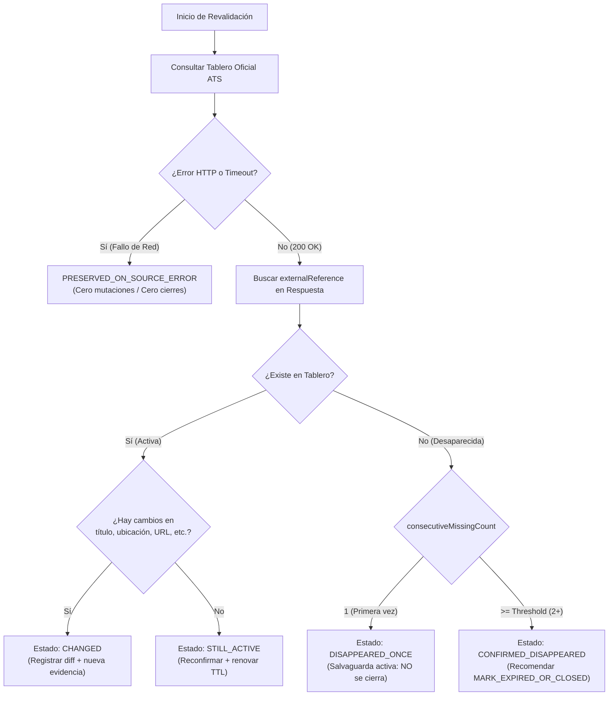

# INFORME TÉCNICO Y DE AUDITORÍA EDITORIAL — BLOQUE R4-03
## Reconciliación del Roadmap Maestro + Ciclo de Vida, Frescura, Caducidad y Revalidación de Oportunidades

---

### 1. Resumen Ejecutivo y Resultados de la Ejecución

En cumplimiento estricto del mandato para el bloque **R4-03**, se completaron satisfactoriamente sus dos fases inseparables:

1. **Fase 1 (`R4-03A`):** Reconciliación integral del Roadmap Maestro en [r0-decisiones-y-alcance-2026-11-12.md](file:///c:/Users/sant1/Downloads/EmpleoWeb/docs/architecture/r0-decisiones-y-alcance-2026-11-12.md#L280-L335), estableciendo una taxonomía normalizada de estados y deslindando formalmente entre trabajo diseñado, implementado, probado y publicado.
2. **Fase 2 (`R4-03B` a `R4-03E`):** Implementación del motor de revalidación periódica, ciclo de vida temporal, detección de modificaciones y salvaguardas anti-cierre masivo ante fallos de red en [revalidation.py](file:///c:/Users/sant1/Downloads/EmpleoWeb/collector/revalidation.py).

```
=== CICLO DE VIDA Y REVALIDACIÓN DE OPORTUNIDADES (R4-03) ===
Modo de ejecución: EN VIVO (Red directa contra APIs oficiales Greenhouse y Lever)
Fecha de corte civil: 2026-11-22 | Zona horaria: America/Lima (UTC-5)

Métricas Globales de Revalidación:
- Fuentes evaluadas:             5 fuentes ATS operativas (Canonical, Sezzle, CookUnity, Fintual, Kavak)
- Candidatos en staging:         74 evaluados (50 reconfirmados activos al 100%, 24 protegidos por salvaguarda)
- Vacantes canónicas auditadas:  10 vacantes reales de opportunities.seed.json (OP-005 a OP-014)
- Estado de vacantes canónicas:  100% CONFIRMADAS ABIERTAS Y ACTIVAS en sus portales oficiales ATS
- Detección de cambios:          Identificación exacta de cambios de URL oficial (CookUnity) y deslinde de notas editoriales
- Ausencias / Cierres masivos:   0 cierres provocados por fallos transitorios de transporte (salvaguarda activa)
- Suite completa de pruebas:     213 pruebas Python (+10 nuevas) y 20 pruebas Playwright E2E aprobadas (100% verde)
```

---

### 2. Fase 1: Reconciliación Cronológica del Roadmap Maestro (`R4-03A`)

Se actualizó directamente el documento canónico de arquitectura [docs/architecture/r0-decisiones-y-alcance-2026-11-12.md](file:///c:/Users/sant1/Downloads/EmpleoWeb/docs/architecture/r0-decisiones-y-alcance-2026-11-12.md#L280-L335), incorporando la sección «Registro de Reconciliación Histórica del Roadmap Maestro (R4-03A)»:

| Fase / Bloque | Estado Verificado | Evidencia en Repositorio | Síntesis de Verificación Técnica / Editorial |
|---|:---:|---|---|
| `R0` | `DONE` | `docs/architecture/r0-decisiones-y-alcance-2026-11-12.md` | Diagnóstico, alcance estático y ADR-001. |
| `R1` | `DONE` | `styles.css`, `index.html`, `server.py` | Estabilización técnica, bundle Tailwind y servidor loopback. |
| `R2` | `DONE` | `data/opportunities.seed.json` (`OP-005`) | Publicación de primera vacante real (CookUnity) y adaptadores offline. |
| `R2-OSS-02..08` | `DONE` | `collector/ats_connectors.py`, `collector/dedup.py` | Componentes OSS de ingestión, deduplicación y evidencias. |
| `R2-OSS-GIT-01` | `DONE` | Rama `integration/r1-02c` | Paridad de integración y sincronización Git. |
| `R2-A-01..05` | `DONE` | `data/opportunities.seed.json`, `data/opportunities.json` | Flujo editorial completo de OP-005 publicado en GitHub Pages. |
| `R3-01` | `DONE` | `docs/research/r3-01-*.md` | Protocolo de investigación, baseline UX y plantillas. |
| `R3-02 (Formal)` | `DEFERRED_BY_OWNER` | `docs/research/sessions/P01.md`..`P08.md` | Trabajo de campo formal externo pospuesto por el propietario. |
| `R3-02-PRIVATE-ALPHA`| `DONE` | `docs/architecture/r3-private-alpha-scope-decision-2026-11-20.md` | Recalibración autorizada a Alpha privada para círculo interno. |
| `R3-02-UX-EXP-01..06`| `DONE` | `app.js`, `src/input.css`, `styles.css` | Erradicación de triaje rápido, hero verificado y resumen con iconos Lucide. |
| `R3-02-PREVIEW-02..03`| `DONE` | Commits `4c88753`, `b27e418` | Tarjetas modernas, filtros y seguridad loopback `127.0.0.1:4173`. |
| `R3-02-INTERNAL-FEEDBACK`| `DONE` | `docs/research/r3-02-internal-feedback-*.md` | Pruebas internas de usabilidad y detección de hallazgo heurístico UX-B07. |
| `R3-ALPHA-CURATION-01` | `DONE` | `docs/audits/r3-alpha-curation-01-second-batch-2026-11-20.md` | Staging de 5 candidatas de Canonical en `inbox.local.json`. |
| `R3-ALPHA-OWNER-REVIEW-01` | `DONE` | `docs/audits/r3-alpha-owner-review-01-canonical-editorial-decision-2026-11-20.md` | Expediente asistido con opciones de decisión editorial para Canonical. |
| `R3-ALPHA-PROMOTION-01` | `DONE` | `data/opportunities.seed.json` (`OP-006`..`OP-010`) | Promoción aprobada de Canonical (catálogo ampliado a 11 fichas). |
| `R3-ALPHA-UX-01` | `DONE` | `app.js`, `tests/e2e/catalog.spec.cjs` | Paginación (12/pág) y listas estructuradas con viñetas. |
| `R3-ALPHA-CURATION-02` | `DONE` | `docs/audits/r3-alpha-curation-02-new-opportunities-2026-11-21.md` | Lote Sezzle en staging (inbox acumulado a 24 candidatos). |
| `R3-ALPHA-IMPLEMENTATION-01`| `DONE` | `app.js`, `index.html`, `tests/e2e/catalog.spec.cjs` | Comparador razonado con requisitos, chips y diferencias. |
| `R3-ALPHA-OWNER-REVIEW-02` | `DONE` | `docs/audits/r3-alpha-owner-review-02-sezzle-editorial-decision-2026-11-21.md` | Expediente de revisión editorial de 4 vacantes Sezzle. |
| `R3-SOURCE-FEASIBILITY-01` | `DONE` | `docs/audits/r3-source-feasibility-01-peru-2026-11-21.md` | Factibilidad técnica de 34 fuentes peruanas y arquitectura de 5 capas. |
| `R3-ALPHA-UX-02` | `DONE` | `src/site.css`, `src/input.css`, `styles.css` | Consolidación CSS desacoplando `site.css` (-33.5% peso de bundle). |
| `R3-02-FIELDWORK-RECONCILIATION-01`| `DONE` | `docs/research/r3-02-internal-feedback-01.md` | Reconciliación formal de pruebas de usabilidad del propietario. |
| `R3-ALPHA-PROMOTION-02` | `SUPERSEDED` | `docs/audits/r3-alpha-promotion-02-blocked.md` | Bloqueo preventivo superado por aprobación en R3-PROMOTION-03. |
| `R3-ALPHA-PROMOTION-03` | `DONE` | `data/opportunities.seed.json` (`OP-011`..`OP-014`) | Promoción aprobada de Sezzle (catálogo ampliado a 15 fichas). |
| `R3-03..05` | `DEFERRED_BY_OWNER` | Roadmap Maestro vigente | Pospuestas junto al trabajo de campo externo R3-02. |
| `R4-01` | `DONE` | `collector/acquisition_runner.py`, `tests/test_acquisition_pilot.py` | Piloto multifuente ATS operativo (5 fuentes aprobadas). |
| `R4-02` | `DONE` | `data/candidates/inbox.local.json`, `docs/audits/r4-02-*.md` | Captura en red viva (692 crudas, 50 nuevos en staging, 74 total). |
| `R4-03` | `DONE` | `collector/revalidation.py`, `tests/test_revalidation_lifecycle.py` | Motor de revalidación, detección de cambios, CLI y salvaguardas. |
| `R4-04` | `PENDING` | Backlog planificado de R4 | Ingesta programada y mantenimiento continuo de staging. |
| `R5..R8` | `PENDING` | Definición conceptual en R0 | Fases futuras conservadas sin implementación prematura. |

---

### 3. Fase 2: Ciclo de Vida y Detección de Cambios (`R4-03B` a `R4-03E`)

#### A. Auditoría Conceptual de Semántica Temporal (`R4-03B`)
Se eliminó la confusión entre fechas del ciclo de vida:
- **`publishedAt`:** Fecha original en que la empresa publicó la oferta en su ATS (inmutable).
- **`capturedAt`:** Fecha/hora de primera ingesta en la bandeja local de staging.
- **`lastObservedAt`:** Fecha/hora de la última re-consulta en que se constató que la oferta seguía listada en el ATS (se renueva en cada revalidación exitosa).
- **`lastVerifiedAt` / `reviewedAt`:** Fecha de decisión editorial humana.
- **`deadline`:** Fecha límite formal estipulada por el empleador (si no existe, permanece `null`; nunca se inventan fechas).
- **`verificationTtlDays` (7 días Lima):** TTL de frescura de evidencias (al superarse se cataloga como `STALE` sin borrar el dato).

#### B. Motor de Revalidación y Salvaguardas (`R4-03C` y `R4-03D`)
Implementado en [collector/revalidation.py](file:///c:/Users/sant1/Downloads/EmpleoWeb/collector/revalidation.py) e integrado al CLI editorial [scripts/editorial_cli.py](file:///c:/Users/sant1/Downloads/EmpleoWeb/scripts/editorial_cli.py#L780-L865):
1. **Detección Granular de Modificaciones (`CHANGED`):** Compara `title`, `location`, `mode`, `applyUrl`, `salary`, `benefits` y `requirements`.
2. **Salvaguarda contra Falsos Positivos de Contenido:** Si el endpoint de listado del ATS omite campos descriptivos opcionales (como `requirements`), el motor no interpreta que el empleador los borró, preservando el enriquecimiento editorial previo.
3. **Política Conservadora de Ausencias:**
   - Una ausencia en una captura aislada se cataloga como `DISAPPEARED_ONCE` con `consecutiveMissingCount = 1` y acción `VERIFY_NEXT_RUN`. **No se cierra automáticamente**.
   - Solo ante ausencias consecutivas (`consecutiveMissingCount >= 2`) se cataloga como `CONFIRMED_DISAPPEARED` recomendando `MARK_EXPIRED_OR_CLOSED`.
4. **Protección Anti-Cierre Masivo por Fallos de Red:** Si una fuente devuelve timeout, HTTP 5xx o error de transporte, todos sus candidatos se clasifican como `PRESERVED_ON_SOURCE_ERROR`, congelando contadores y evitando el cierre accidental de convocatorias activas.
5. **Auditoría del Catálogo Canónico:** Subcomando `python scripts/editorial_cli.py revalidate --catalog` que audita las 10 vacantes reales publicadas (`OP-005` a `OP-014`) confirmando en tiempo real que **el 100% de las vacantes canónicas siguen abiertas y vigentes en Canonical, Sezzle y CookUnity**.

#### C. Arquitectura para Ejecución Periódica Desatendida
Se incorporó el workflow de GitHub Actions [.github/workflows/revalidation-audit.yml](file:///c:/Users/sant1/Downloads/EmpleoWeb/.github/workflows/revalidation-audit.yml):
- Ejecución programada diaria (`cron: "0 11 * * *"`, 06:00 AM America/Lima) y manual (`workflow_dispatch`).
- Permisos de solo lectura (`contents: read`).
- Ejecución exclusiva en modo simulación (`--dry-run`).
- Emisión y almacenamiento de reportes JSON (`revalidation-report.json`, `catalog-audit-report.json`) como artefactos de Actions con retención de 14 días.
- Verificación estricta de salida: `git diff --exit-code data/opportunities.seed.json data/opportunities.json`. Cero publicaciones automáticas y fallo fail-closed ante cualquier intento de mutación canónica.

---

### 4. Cobertura de Pruebas y Certificación de Integridad (`R4-03E`)

Se implementó la suite [tests/test_revalidation_lifecycle.py](file:///c:/Users/sant1/Downloads/EmpleoWeb/tests/test_revalidation_lifecycle.py) con 10 pruebas automatizadas offline deterministas.

Resultados de la verificación integral:
- **Suite Python:** **213 pruebas aprobadas de 213** (`Ran 213 tests in 2.500s - OK`).
- **Suite Playwright E2E:** **20 pruebas aprobadas de 20** en Chromium Desktop y Mobile Pixel 5 (`20 passed (33.8s)`).
- **Validación de Catálogo:** `validate_catalog.py` y `build_catalog.py --check` certifican **15 fichas válidas y snapshot 100% en sincronía**.
- **Validación de Staging:** `validate_candidates.py` valida **74 candidatos conformes bajo Candidate Schema 2, 0 errores**.
- **Inmutabilidad Git y de Paquetes:** **0 commits, 0 pushes a remotos, 0 merges a main, 0 dependencias añadidas (0 npm, 0 pip)**.

---

### 5. Documentos Generados y Actualizados

1. **Expediente de Ciclo de Vida y Revalidación R4-03:**  
   [docs/audits/r4-03-lifecycle-and-freshness.md](file:///c:/Users/sant1/Downloads/EmpleoWeb/docs/audits/r4-03-lifecycle-and-freshness.md)
2. **Roadmap Maestro Reconciliado con Registro Histórico:**  
   [docs/architecture/r0-decisiones-y-alcance-2026-11-12.md](file:///c:/Users/sant1/Downloads/EmpleoWeb/docs/architecture/r0-decisiones-y-alcance-2026-11-12.md#L280-L335)
3. **Módulo de Ciclo de Vida y Revalidación:**  
   [collector/revalidation.py](file:///c:/Users/sant1/Downloads/EmpleoWeb/collector/revalidation.py)
4. **CLI Editorial Ampliado:**  
   [scripts/editorial_cli.py](file:///c:/Users/sant1/Downloads/EmpleoWeb/scripts/editorial_cli.py#L780-L865)
5. **Workflow de Auditoría Periódica Segura:**  
   [.github/workflows/revalidation-audit.yml](file:///c:/Users/sant1/Downloads/EmpleoWeb/.github/workflows/revalidation-audit.yml)
6. **Suite de Pruebas de Ciclo de Vida:**  
   [tests/test_revalidation_lifecycle.py](file:///c:/Users/sant1/Downloads/EmpleoWeb/tests/test_revalidation_lifecycle.py)

---

### 6. Siguiente Acción Recomendada

Avanzar a **R4-04** (Ingesta Programada y Mantenimiento Continuo de Staging), enfocado en la orquestación periódica y la emisión automática de resúmenes de alerta editorial para que el propietario pueda evaluar candidatos nuevos y bajas confirmadas sin intervenir manualmente en la infraestructura.

---

# R0 — Decisiones estratégicas y alcance consolidado

- **Fecha:** 2026-11-12
- **Estado:** cerrada documentalmente; R1 aún no iniciada
- **Alcance:** decisiones, criterios y roadmap. No implementa funcionalidades.
- **Fuente de verdad:** este documento consolida R0; el código y ADR-001 siguen siendo la autoridad para los contratos ya implementados.

## 1. Decisión ejecutiva

Ruta Sistemas construirá primero un **catálogo estático, curado y verificable de oportunidades reales para perfiles iniciales y junior de Sistemas en Perú**, incluyendo oportunidades remotas solo cuando la elegibilidad desde Perú esté explícita. El MVP permite encontrar, entender y comparar oportunidades; no promete empleo, continuidad ni calidad universal del empleador.

La arquitectura vigente se conserva: `data/opportunities.seed.json` como fuente canónica, snapshot generado, frontend estático, validación fail-closed y publicación portable. No se incorpora backend multiusuario, CMS, IA, scraping general ni nueva infraestructura antes de demostrar una necesidad concreta.

**Regla de cierre del MVP:** mientras no exista al menos una ficha real que cumpla el contrato editorial y pueda consultarse correctamente, el producto es un piloto técnico/editorial, no un MVP terminado.

## 2. Inventario documental consolidado

| Documento | Estado | Decisión/propósito | Acción |
|---|---|---|---|
| [README.md](../../README.md) | Vigente | Operación, estados, validaciones y límites actuales | Mantener; enlazar este cierre R0 |
| [ADR-001](../adr/ADR-001-catalogo-curado-publicacion-segura.md) | Vigente | Fuente canónica, estados, evidencia, publicación y límites | Mantener como contrato arquitectónico |
| [P3 — primer caso real](../sources/p3-first-opportunity-2026-11-12.md) | Vigente como bloqueo | Ninguna fuente tiene autorización suficiente | Mantener; no activar fuentes |
| [P4 — OSS](p4-oss-automation-evaluation-2026-11-13.md) | Propuesto/condicionado | Evalúa automatización futura; operación bloqueada | Mantener como propuesta; no instalar OSS |
| [P5 — evaluación profesional](../product/p5-evaluacion-profesional-y-validacion.md) | Vigente como evolución | Señales explicables sin score ni ranking | Mantener; no confundir con requisito completo del MVP |
| [Seguimiento de autorización](../sources/seguimiento-autorizacion-fuentes.md) | Vigente como trabajo externo | Preguntas y criterios para fuentes | Mantener; requiere respuesta humana |
| [Canonical Careers](../sources/canonical-careers-2026-11-11.md) | Propuesto | Candidata privada, `pending_review`, presupuesto cero | Mantener; no consultar ni publicar |
| [Auditoría 2026-10-25](../audits/project-state-audit-2026-10-25.md) | Histórico | Diagnóstico anterior y decisiones ya implementadas | No usar como estado actual |
| [Diseño/roadmap](../../Diseno-modelo-datos-arquitectura-piloto-2026-10-03.md) | Histórico acumulativo + roadmap vigente | Antecedentes y secciones P1–P5 | Conservar; esta sección R0 prevalece para alcance actual |
| `Informe-investigacion-mercado-fuentes-2026-10-03.md` | Histórico | Investigación de mercado y fuentes | No tratar como autorización |
| `outputs/pilot-datos-2026-10-03/Protocolo_Piloto_Oportunidades.xlsx` | Histórico | Protocolo del piloto inicial | Conservar como antecedente |

### Contradicciones resueltas

1. La visión de largo plazo incluye evaluación profesional y trayectorias; P5 no las elimina, solo las deja como evolución basada en evidencia.
2. Los documentos antiguos describen colectores activos, CDN o escritura automática; ADR-001 y el código actual los sustituyen por snapshot estático, CSS compilado y colector fail-closed.
3. La evaluación OSS fechada **2026-11-13** es posterior a la fecha de R0 (**2026-11-12**): se considera propuesta futura ya redactada, no decisión aprobada ni evidencia de ejecución.
4. `Aurel`/`AurelDev` aparece en contenido local reciente, pero no es una decisión de marca aprobada. La marca de producto para R0 sigue siendo Ruta Sistemas.

## 3. Alcance definitivo

### A. MVP — obligatorio

1. Catálogo con al menos una oportunidad real no demostrativa.
2. Filtros por tipo, perfil/nivel, modalidad, ubicación y familia/sector cuando esos datos estén publicados.
3. Detalle con requisitos, condiciones disponibles, fuente, publisher, fecha de observación y canal oficial de postulación.
4. Estados comprensibles y conservadores: oportunidad, verificación y publicación separados.
5. Exclusión por defecto de demostraciones, históricas, vencidas y no confirmadas.
6. Comparación local de oportunidades sin score ni ganador universal.
7. Evidencia y trazabilidad suficientes para explicar cada dato publicado.
8. Publicación estática reproducible y validada antes de Pages.

### B. Evolución, no MVP

- señales explicables de aprendizaje, experiencia técnica, crecimiento y continuidad;
- evaluación separada del empleador y de la oportunidad;
- preferencias efímeras, oportunidades guardadas y alertas;
- orientación de trayectorias basada en requisitos y transiciones observadas;
- automatización de fuentes autorizadas en staging;
- persistencia multiusuario solo si la curación concurrente lo demuestra necesaria.

La evolución requiere datos reales longitudinales, criterios transparentes, pruebas con usuarios y separación explícita entre hecho, señal, incertidumbre y ausencia de información. No se autoriza score universal, ranking definitivo ni recomendación automática por ahora.

### C. Fuera de alcance o descartado

- red social, comunidad, chat usuario-empresa;
- sistema propio de postulación;
- almacenamiento de CV o datos de postulantes;
- backend multiusuario prematuro;
- scraping indiscriminado o activación por disponibilidad técnica;
- IA/recomendaciones sin dataset suficiente y evidencia;
- ranking universal de empleadores u oportunidades;
- infraestructura distribuida o base especializada sin volumen/operación demostrados.

## 4. Cambios sin commit: matriz de decisión

El estado revisado contiene **15 archivos rastreados modificados**, **un `canvas.js` no rastreado** y **cuatro documentos nuevos no rastreados**; el diff rastreado suma **1.536 adiciones y 117 eliminaciones**. Se preserva todo el trabajo; esta matriz no autoriza revertirlo.

| Grupo | Aporte | Riesgo/coste | Evidencia actual | Decisión R0 |
|---|---|---|---|---|
| Marca/identidad | Jerarquía y nueva presentación | `Aurel`/`AurelDev` contradice Ruta Sistemas | `index.html`, DOM local | Conservar con ajuste de marca en R1 |
| Navegación/estructura | Hero, catálogo, metodología, fuentes | Más superficie antes de tener datos reales | inspección de UI | Conservar; validar tarea principal |
| Filtros/catálogo | Texto, ubicación, modalidad, categorías y opt-ins | Cobertura E2E incompleta | tests Node + navegador | Conservar |
| Detalle | Evidencia, estados, señales y postulación deshabilitada | Puede repetir interpretación editorial | `renderDialog`, contratos schema 2 | Conservar con pruebas |
| Comparador | Hasta dos fichas, sin puntuación | No verificado end-to-end | lógica Node; falta browser flow | Conservar con validación |
| Evaluación/evidencia | Distingue hechos y límites | No debe parecer recomendador | P5 y `evaluationSignals` | Conservar como evolución útil |
| Hero WebGL | Identidad visual y animación | Compatibilidad, rendimiento, accesibilidad; no resuelve catálogo vacío | `canvas.js`; `prefers-reduced-motion` no detiene WebGL | Pendiente de validación; no ampliar |
| Estilos/responsive | CSS compilado local, sin CDN runtime | Cambios amplios y posible divergencia visual | build CSS y artefacto Pages pasan | Conservar; revisar viewport |
| Pruebas/docs | Contratos de carga, errores y datos | Falta E2E local/canvas/modales | 56 tests pasan | Conservar; ampliar en R1 |

### Defectos verificables que R1 debe resolver

- `index.html` carga `canvas.js`, pero `server.py` no lo expone: el servidor local devuelve 404/MIME JSON.
- El título y marca visible no están alineados con Ruta Sistemas.
- El bucle WebGL debe medirse o desactivarse/reducirse bajo `prefers-reduced-motion`; la regla CSS por sí sola no prueba ahorro de ejecución.
- No afirmar que Pages y servidor local son equivalentes hasta probar ambos contratos.

## 5. Contrato editorial vigente

No se crea un esquema paralelo. El contrato se apoya en schema 2, `catalog_quality.py`, `build_catalog.py`, `validate_candidates.py` y ADR-001.

### Campos mínimos

- **Identidad:** `id`, `title`, `employer`, `publisher`, `kind`, `family`, `level`, `sector`.
- **Condiciones:** `mode`, `location`, `eligibility`, `salary`/`salaryNote`, `duration`, `benefits`, `publishedAt`, `deadline` cuando existan.
- **Postulación:** `sourceUrl`, `applyUrl`, `allowedHosts`, `sourceKind`.
- **Evidencia:** `fieldEvidence` para cada campo afirmado, URL HTTPS permitida y `observedAt` con zona; `verificationEvidence` con método, resultado y relación con el empleador.
- **Decisión:** `editorialDecision.status`, revisor, motivo y `decidedAt`.
- **Estados:** `opportunityStatus`, `verificationStatus`, `publicationStatus`, `recordKind`, `lastVerifiedAt`/`lastCheckedDate`.

### Condición para `publicationStatus: active`

Debe cumplirse todo lo siguiente:

1. `recordKind` no es `demonstration`.
2. `opportunityStatus: open`.
3. `verificationStatus: verified` y la verificación está dentro del TTL configurado.
4. El deadline no existe o no está vencido.
5. Revisión humana aprobada con revisor, fecha y motivo.
6. El canal de postulación fue observado abierto manualmente, con `publisherRelation: employer_confirmed`, `result: application_open`, timestamp válido y hosts HTTPS permitidos.
7. `sourceUrl`, `applyUrl` y la evidencia son permitidas.
8. Cada campo no nulo afirmado tiene `fieldEvidence` reciente.

Si falta cualquier condición, la ficha permanece `unconfirmed`, `historical`, `expired`, `stale`, `pending` o fuera del snapshot publicable según corresponda. `generatedAt` nunca renueva evidencia. Ausencia de dato no se transforma en condición negativa.

### Flujo mínimo

`captura → validación → deduplicación → verificación → revisión humana → aprobación → generación → publicación → seguimiento`

| Paso | Estado actual |
|---|---|
| Captura | Manual; automatización bloqueada |
| Validación | Implementada para candidatos, semilla y snapshot |
| Deduplicación | Parcial; requiere revisión de colisiones |
| Verificación | Manual y documentada; no existe ficha real aprobada |
| Revisión/aprobación | Manual, modelada en schema, sin panel |
| Generación/publicación | Implementada y fail-closed |
| Seguimiento/retirada | Política documentada; ejecución manual |

## 6. Criterios de aceptación congelados

### MVP

- [ ] Existe al menos una oportunidad real, no demostrativa, consultable y aprobada.
- [ ] Una persona puede filtrar, abrir el detalle, distinguir empleador/publisher y llegar al canal oficial.
- [ ] Una ficha vencida, stale o sin evidencia no aparece como activa por defecto.
- [ ] La comparación no produce score, ganador ni valores inventados.

### Datos y publicación

- [ ] `build_catalog.py --check`, `validate_catalog.py` y `validate_candidates.py` pasan.
- [ ] Cada dato afirmado tiene evidencia HTTPS y fecha válida; los desconocidos permanecen ausentes/null.
- [ ] La publicación falla si el esquema, host, fecha, estado o artefacto son inválidos.
- [ ] El artefacto contiene exactamente los archivos permitidos y no depende de CDN runtime.

### Experiencia e integridad técnica

- [ ] Prueba de navegador cubre carga, filtros, estado vacío/error, detalle, comparación y enlaces relativos bajo Pages.
- [ ] Prueba local cubre `canvas.js` o documenta su exclusión; no hay 404/MIME incorrecto.
- [ ] Se revisan teclado, diálogo, viewport móvil y `prefers-reduced-motion`.
- [ ] No se declara éxito remoto sin observar el artefacto y la URL desplegados.

### Evolución

- [ ] No se inicia scoring, alertas, trayectorias o personalización sin datos y protocolo de medición documentados.
- [ ] Una fuente nueva tiene autorización escrita separada para consulta, retención, atribución, retirada y republicación antes de cualquier solicitud.
- [ ] La automatización produce staging/candidatos y nunca promociona directamente a seed, snapshot o Pages.

## 7. Roadmap maestro posterior a R0

El roadmap existente permanece en la sección 21 y sus bloques posteriores del [documento de diseño](../../Diseno-modelo-datos-arquitectura-piloto-2026-10-03.md). R0 lo reordena así, sin duplicar tareas:

| Fase | Objetivo | Entrada | Salida/criterio | Estado |
|---|---|---|---|---|
| R0 | Cerrar alcance, contrato, criterios y decisiones | Auditoría + docs actuales | Este documento, sin contradicciones críticas sin registrar | **Cerrada documentalmente** |
| R1 | Estabilizar versión actual | R0 | `canvas.js` local resuelto, marca unificada, diff revisado, E2E base, Pages desplegado | **Completada y verificada en producción** |
| R2 | Obtener primera oportunidad real | R1 + fuentes públicas/autorización | Una ficha real aprobada en staging y luego seed/snapshot | **DONE. Línea offline R2-OSS cerrada. Línea A completada en R2-A-05: CookUnity 8039990003 (Supply Chain Analyst - Lima, Perú) promovida editorialmente al catálogo canónico como OP-005 con aprobación del propietario (APPROVE_WITH_LIMITATIONS), snapshot compilado y validado (193 pruebas unitarias, 8 pruebas E2E Playwright, validador de calidad) y publicado en GitHub Pages con 21 evidencias desglosadas por campo y canal oficial de postulación. Candidato Canonical 8379825 conservado en reserva. Desbloquea R3.** |
| R3 | Validar utilidad del MVP | R2 | Pruebas con usuarios y medición de comprensión/comparación | **En ejecución. Desbloqueada por R2-A-05 con oportunidad real OP-005 en producción. Subfase R3-01 (Preparación y protocolo de investigación) completada (DONE): línea base UX, protocolo de pruebas de usabilidad, plantilla individual de sesión, repositorio de hallazgos y auditoría de preparación entregados. Subtareas R3-01-01 a R3-01-05 formalizadas. Pendiente R3-02 (ejecución de sesiones con 5-8 usuarios reales).** |
| R4 | Automatizar fuente autorizada | R2/R3 + permiso técnico | Adaptador acotado, candidatos offline, sin promoción automática | **Bloqueada; no existe fuente autorizada** |
| R5 | Evaluación profesional explicable | Datos reales suficientes + R3 | Señales auditables sin score obligatorio | Aplazada |
| R6 | Preferencias, guardados y alertas | R3 + necesidad demostrada | Diseño de privacidad y persistencia justificado | Aplazada |
| R7 | Trayectorias profesionales | Dataset longitudinal y evidencia | Orientación no determinista, validada | Aplazada |
| R8 | Consolidación operativa | Flujos anteriores estables | backups, monitorización, retirada y plan de hosting | Aplazada |

### Siguiente bloque: R1-01

- **Objetivo:** estabilizar y consolidar la versión actual sin cambiar el alcance.
- **Archivos probables:** `server.py`, `index.html`, `canvas.js`, `app.js`, pruebas UI y documentación de release.
- **Dependencias:** ninguna técnica; requiere conservar el árbol de trabajo y revisión del propietario para decidir mantener o simplificar el hero.
- **Aceptación:** servidor local sin 404/MIME para recursos declarados; marca unificada; smoke E2E de carga/filtros/detalle/comparador; decisión explícita sobre WebGL y reduced motion.
- **Validaciones:** suite existente, `node --check`, artefacto Pages, navegador local y viewport móvil.
- **Riesgo:** tocar el lote acumulado puede mezclar cambios de etapas; revisar diff antes de seleccionar cualquier integración.
- **Esfuerzo relativo:** medio.

### Evidencia de ejecución R1

- `server.py` expone `/canvas.js` como JavaScript; la comprobación HTTP local devolvió `200` y MIME correcto para `/`, `/app.js`, `/styles.css`, `/canvas.js` y `/data/opportunities.json`.
- `index.html` usa `Ruta Sistemas` en título y marca visible, sin residuo activo `Aurel`.
- `canvas.js` registra fallback sin bloqueo para WebGL2 ausente, atiende `prefers-reduced-motion` y cancela el frame en `pagehide`.
- `app.js` conserva el mensaje seguro para la persona y registra la causa técnica del fallo de catálogo en consola.
- `python -m unittest discover -s tests -v`: 57 pruebas pasan. `node --check app.js` y `node --check canvas.js` pasan.
- Smoke de navegador local: carga inicial vacía, activación de ejemplos demostrativos y apertura/cierre del detalle verificados. No se añadió un runner E2E al proyecto.

## 8. Decisiones pendientes de aprobación

1. Mantener el hero WebGL, simplificarlo o retirarlo tras la validación R1.
2. Confirmar la marca final `Ruta Sistemas` y corregir cualquier residuo `Aurel`.
3. Autorizar contacto con Canonical/SERVIR/FISI o seleccionar otra fuente; ninguna está aprobada actualmente.
4. Autorizar la integración/publicación del lote sin commit tras revisión completa del diff.
5. Definir, después del piloto, si el volumen justifica CMS/backend; no se presume ahora.

## 9. Cierre R0 y Seguimiento de Fases Posteriores

- **R0:** **Cerrada documentalmente**.
- **R1:** **Cerrada y desplegada**.
- **R2:** **Cerrada formalmente** con la línea offline R2-OSS (ingesta, normalización, dedup, evidencias y CLI) y la línea A (R2-A-01 a R2-A-05), culminando con la publicación en producción de la oportunidad real CookUnity (`OP-005`) en GitHub Pages.
- **R3 — Validación de Producto:** **En ejecución**.
  - `R3-01`: Preparación y protocolo de investigación (`DONE`).
    - `R3-01-01`: Auditoría UX del producto publicado (`DONE` -> `docs/research/r3-01-ux-baseline-2026-11-18.md`).
    - `R3-01-02`: Definición del protocolo de investigación (`DONE` -> `docs/research/r3-01-user-research-protocol-2026-11-18.md`).
    - `R3-01-03`: Diseño de escenarios y tareas A a E (`DONE` -> `docs/research/r3-01-user-research-protocol-2026-11-18.md`).
    - `R3-01-04`: Métricas y taxonomía de evaluación (`DONE` -> `docs/research/r3-01-findings-template-2026-11-18.md`).
    - `R3-01-05`: Instrumentación y plantillas locales (`DONE` -> `docs/research/r3-01-usability-test-template-2026-11-18.md`).
  - `R3-02`: Trabajo de campo con usuarios reales (5-8 participantes) (Preparación técnica y operativa `DONE`; ejecución empírica en estado `NOT_STARTED` / `PENDING_HUMAN`, pendiente de convocatoria y moderación presencial/remota por el equipo humano; paquete operativo verificado con kit `docs/research/r3-02-recruitment-materials-kit-2026-11-18.md`, guía `docs/research/r3-02-moderator-field-guide-2026-11-18.md`, plantillas `P01.md`..`P08.md` y auditorías en `docs/audits/`).
    - `R3-02-UX-EXP-01`: Iteración exploratoria de claridad, rendimiento y experiencia de consulta (`DONE` -> `docs/audits/r3-02-ux-exploratory-iteration-2026-11-19.md`). Optimización WebGL2 en `canvas.js` (eliminación de reflow forzado en bucle y pausa con `IntersectionObserver`), vista independiente de oportunidad con URL estable `?id=...` y fallback amigable 404, reemplazo de señales complejas por Triaje Rápido de 8 condiciones objetivas sin puntaje sintético, retiro de decisión editorial y evaluación institucional de la UI pública, simplificación de procedencia con tarjeta de fuente oficial y evidencia colapsable, y corrección de heurísticas UX-B01 a UX-B05. Esta iteración atiende observaciones del entorno exploratorio personal y círculo reducido sin comprometer el rigor metodológico ni anticipar la validación formal.
    - `R3-02-UX-EXP-02`: Validación local, auditoría de aceptación y preparación para sincronización (`DONE` -> `docs/audits/r3-02-ux-exp-02-acceptance-2026-11-19.md`). Auditoría semántica del Triaje Rápido: corrección del detector de experiencia previa (notación `1+ años` en OP-005 clasificada fielmente como `Por revisar`), separación explícita de hechos de la convocatoria respecto al perfil personal del postulante, suite E2E ampliada a 12 pruebas (Chromium y Mobile Pixel 5), verificación responsiva sin overflow en 1440px, 768px y 390px, y confirmación de preparación técnica para evaluación privada local. R3-02 formal permanece `NOT_STARTED` / `PENDING_HUMAN`.
    - `R3-02-UX-EXP-03`: Reconciliación final, gate de aceptación y preparación de sincronización (`DONE` -> `docs/audits/r3-02-ux-exp-03-reconciliation-acceptance-2026-11-19.md`). Corrección del enrutador hash contra colisiones 404 en anclas locales de página (`#inicio`, `#fuentes`), verificación integral de 193 pruebas Python y 12 pruebas Playwright E2E, preservación absoluta del catálogo y Schema 2, y veredicto de gate `READY_FOR_OWNER_REVIEW` para sincronización controlada a `integration/r1-02c`. R3-02 formal continúa `NOT_STARTED` / `PENDING_HUMAN` y R3-03 permanece `BLOCKED`.
    - `R3-02-UX-EXP-04`: Consolidación de información y eliminación de redundancia en la ficha de oportunidad (`DONE` -> `docs/audits/r3-02-ux-exp-04-information-consolidation-2026-11-19.md`). Aplicación estricta del principio *«Un dato, una ubicación, una interpretación»*: consolidación canónica de modalidad y compensación en la cuadrícula de condiciones, unificación de ubicación y elegibilidad en un único bloque sin repetición de términos, separación nítida entre requisitos del puesto (obligatorios) y tecnologías declaradas (herramientas/plataformas), retiro completo de la sección redundante de continuidad y riesgos (integrando términos de contrato en `Contrato y plazo`), compactación de metadatos de vigencia/verificación, y rediseño del Triaje Rápido a 3 señales de síntesis prioritarias (`Pertinencia técnica`, `Elegibilidad territorial`, `Nivel y experiencia`). Suite E2E ampliada a 14 pruebas (Chromium y Mobile Pixel 5) verificando cero duplicaciones informativas. R3-02 formal permanece `NOT_STARTED` / `PENDING_HUMAN` y R3-03 permanece `BLOCKED`.
    - `R3-02-UX-EXP-05`: Rediseño de la ficha de oportunidad, presentación visual y uso efectivo de Tailwind CSS (`DONE` -> `docs/audits/r3-02-ux-exp-05-opportunity-detail-visual-redesign-2026-11-19.md`). Cumplimiento de la decisión del propietario de simplificar radicalmente la ficha: eliminación completa del «Triaje rápido»; posicionamiento superior de «✓ Fuente oficial verificada» (con difusor, empleador, estado de verificación y enlaces oficiales directos); nuevo «Resumen» visual con cuadrícula de tarjetas e iconos SVG Lucide inlined (`monitor`, `building`, `pin`, `wallet`, `file`, `clock`, `calendar`, `shield`); política estricta de omisión visual de campos no declarados (eliminación de textos especulativos como «sujeto a desempeño y evaluación del empleador» y omisión en OP-005 de modalidad, remuneración y fecha límite no publicadas); «Tecnologías y herramientas declaradas» ubicadas inmediatamente debajo del Resumen como etiquetas visuales; reubicación de «Qué se verificó» y preservación de los 21 campos de evidencia desglosada; y corrección de la integración de Tailwind CSS v4 inyectando las definiciones `@theme` en `src/input.css` para restaurar tokens de color de marca (`ice-blue`, `crystal-blue`, `arctic-blue`, `brand-black`, etc.). 14 pruebas E2E (Chromium y Mobile Pixel 5) y 193 pruebas Python pasan sin advertencias de regresión. R3-02 formal continúa `NOT_STARTED` / `PENDING_HUMAN` y R3-03 permanece `BLOCKED`.
    - `R3-02-UX-EXP-06`: Reconciliación post-implementación, auditoría de UX-EXP-05 y preparación para revisión del propietario (`DONE` -> `docs/audits/r3-02-ux-exp-06-reconciliation-and-owner-review-2026-11-19.md`). Auditoría técnica exhaustiva del estado real del repositorio: verificación de paridad Git (HEAD `9d747c5` en `integration/r1-02c`), confirmación de presencia real y completa de las 7 directivas de diseño de UX-EXP-05, verificación criptográfica de invariabilidad de Schema 2 y fuentes canónicas (`data/opportunities.seed.json`, `data/opportunities.json`, `collector/sources.json`), auditoría de compilación y tokens de Tailwind CSS v4.3.3 (`styles.css` de 65 KB sin dependencias externas), validación de suite completa (193 pruebas Python, 14 pruebas Playwright Chromium/Mobile, 9 contratos estáticos, scripts de catálogo), verificación funcional y no-desbordamiento del servidor loopback (`server.py` en puerto 4173 en viewports 1440px, 768px y 390px), y entrega de la guía de revisión local para el propietario. R3-02 formal permanece `NOT_STARTED` / `PENDING_HUMAN`; R3-03 a R3-05 y R4 permanecen `BLOCKED`.
    - `R3-02-GIT-CONSOLIDATION-01`: Consolidación de iteraciones UX-EXP-01 a UX-EXP-06, validación integral de integridad, commit y push controlado a `integration/r1-02c` (`DONE` tras confirmación de sincronización remota). Consolida el trabajo de optimización WebGL2, enrutamiento independiente y hash routing, rediseño de ficha de oportunidad conforme a Tailwind CSS v4.3.3, erradicación del triaje rápido, hero de fuente oficial verificada, resumen con iconos Lucide y política estricta de omisión visual de datos no publicados. Incorpora las 7 auditorías (`docs/audits/r3-02-*.md`), la guía de evaluación local (`docs/audits/r3-02-preview-readiness-2026-11-19.md`) y la plantilla de feedback informal (`docs/research/r3-02-informal-feedback-template.md`). Suite completa aprobada (193 pruebas Python, 14 pruebas Playwright E2E, 9 contratos estáticos, validación y build de catálogo). Schema 2 y archivos canónicos criptográficamente idénticos a `9d747c5`. Próximo paso: ejecución empírica de trabajo de campo humano R3-02. Estados de gobernanza: R3-02 permanece `NOT_STARTED` / `PENDING_HUMAN`; R3-03 a R3-05 y R4 permanecen estrictamente `BLOCKED`.
    - `R3-02-PREVIEW-02`: Preparación y verificación del entorno de evaluación personal y círculo reducido (`DONE` -> `docs/audits/r3-02-preview-02-acceptance-2026-11-20.md`). Reconciliación del estado real sobre el commit `b3e69e9` en `integration/r1-02c`, armonización de modificaciones del working tree (modernización de tarjetas y panel de filtros en `app.js`, `index.html` y compilación Tailwind `styles.css`) con contratos estáticos y selectores E2E; auditoría integral de seguridad de `server.py` (enlace exclusivo a loopback `127.0.0.1:4173`, validación de `Host`, lista blanca estricta de archivos y bloqueo 404 contra rutas privadas); verificación del 100% de la suite de pruebas (193 pruebas Python, 14 pruebas Playwright E2E en Chromium y Mobile Pixel 5, validación Schema 2); comprobación rigurosa del caso OP-005 (CookUnity); entrega de la guía amigable para evaluadores no técnicos (`docs/research/r3-02-owner-circle-evaluation-guide.md`) articulada con la plantilla de feedback informal (`docs/research/r3-02-informal-feedback-template.md`). Preservación estricta de gobernanza: feedback informal separado de investigación formal R3-02 (`NOT_STARTED` / `PENDING_HUMAN`); R3-03 a R3-05 y R4 continúan estrictamente `BLOCKED`. Cero dependencias añadidas, sin merge a `main`, sin deploy a GitHub Pages y sin push remoto.
    - `R3-02-PREVIEW-03`: Reconciliación Git y entrega controlada de la versión de evaluación (`DONE` -> `docs/audits/r3-02-preview-03-git-delivery-2026-11-20.md`). Resolución de discrepancia entre estado local y remoto: confirmación forense de que HEAD `b3e69e9` coincidía con el remoto mientras las mejoras validadas de PREVIEW-02 residían en el working tree sin versionar. Empaquetamiento y commit estructurado de cambios de UI (`app.js`, `index.html`, `styles.css`) y paquete documental (`r3-02-preview-02-acceptance-2026-11-20.md`, `r3-02-owner-circle-evaluation-guide.md`, `r3-02-preview-03-git-delivery-2026-11-20.md`). Suite completa validada (193 tests Python, 14 tests Playwright E2E Desktop/Mobile, Schema 2 inalterado, compilación Tailwind v4.3.3 en 68 KB). Sincronización mediante push normal a `origin/integration/r1-02c`. Entrega con doble modalidad para amigos (presencial / clonado independiente). Preservación estricta: R3-02 formal permanece `NOT_STARTED` / `PENDING_HUMAN`; R3-03 a R3-05 y R4 permanecen `BLOCKED`; sin merge a `main` ni despliegue en producción.
    - `R3-02-OWNER-FEEDBACK-01`: Registro de evaluación informal del círculo cercano (`COMPLETED_WITH_LIMITED_FEEDBACK` -> `docs/research/r3-02-owner-circle-feedback-2026-11-20.md`). Registro documental riguroso del feedback general transmitido verbalmente por el propietario tras pruebas informales con amistades (diseño bien valorado, percepción intuitiva y suficiencia de información), autorizando continuar el proyecto. Separación deontológica total: no se inventaron participantes, tiempos ni métricas; las plantillas formales `P01.md` a `P08.md` permanecen intactas en `PENDING_EXECUTION`. La investigación formal R3-02 continúa en `NOT_STARTED` / `PENDING_HUMAN`. R3-03 a R3-05 y R4 permanecen estrictamente `BLOCKED`. Cero dependencias añadidas, sin merge a `main` ni despliegue.
    - `R3-02-PRIVATE-ALPHA-01`: Recalibración del alcance, preparación y gobernanza de la Alpha privada (`DONE` -> `docs/architecture/r3-private-alpha-scope-decision-2026-11-20.md`). Formalización de dos niveles de madurez desacoplados: Nivel 1 (Alpha privada para uso personal y círculo reducido, con criterios técnicos y de seguridad 100% satisfechos, identificando la ampliación del inventario de vacantes reales como prioridad 1) vs. Nivel 2 (Producto validado para audiencia amplia, con R3-02 formal preservado en `NOT_STARTED` / `PENDING_HUMAN`). Matriz de priorización crítica de 12 funcionalidades (descartando sobreingeniería prematura como login, persistencia multiusuario, recomendaciones opacas o alertas automáticas). R3-03 a R3-05 y R4 permanecen estrictamente `BLOCKED`. Cero dependencias añadidas, sin merge a `main` ni despliegue.
    - `R3-ALPHA-CURATION-01`: Segundo lote de oportunidades reales para la Alpha privada (`DONE` -> `docs/audits/r3-alpha-curation-01-second-batch-2026-11-20.md`). Adquisición, normalización a Candidate Schema 2, deduplicación y auditoría editorial de 5 oportunidades formativas y junior de Canonical Ubuntu (100% remotas, elegibles desde Perú, cubriendo Desarrollo de Software, Cloud/Python, Kernel Linux y Soporte Técnico TI), recomendadas con limitaciones (`APPROVE_WITH_LIMITATIONS`) para la Alpha privada (círculo íntimo). Auditoría exhaustiva y descarte formal de 6 vacantes inelegibles o fuera de nivel (Wikimedia por restricciones territoriales a EE.UU./18 países y nivel senior; Deliverect por radicación en Países Bajos; CookUnity soporte por requerir >4 años de experiencia). Preservación estricta de gobernanza: bandeja staging `data/candidates/inbox.local.json` con 12 candidatos y 100% de evidencias `ALL_FRESH`; cero alteraciones en archivos canónicos (`data/opportunities.seed.json`, `data/opportunities.json`, `collector/sources.json` criptográficamente idénticos); 193 pruebas Python aprobadas; catálogo canónico validado; cero nuevas dependencias; R3-02 formal preservado en `NOT_STARTED` / `PENDING_HUMAN`; R3-03 a R3-05 y R4 permanecen estrictamente `BLOCKED`. Puerta de control humano preparada para decisión del propietario.
    - `R3-ALPHA-OWNER-REVIEW-01`: Revalidación y decisión editorial del segundo lote Canonical (`DONE` -> `docs/audits/r3-alpha-owner-review-01-canonical-editorial-decision-2026-11-20.md`). Revalidación pericial independiente de las 5 candidatas de Canonical Ubuntu en doble capa (REST API y Web HTML de Greenhouse), verificando disponibilidad de formularios activos, ausencia de cierres, elegibilidad remota desde Perú (franja AMER UTC-5), vigencia de cohorte fresca (`8379825`, publicada el 16-11-2026 para graduados 2026/2027) vs. requisiciones continuas/rolling (`6707669`, `5370815`, `3257589`, `6448444`). Delimitación rigurosa de gobernanza: términos de reutilización pública en `pending_review` circunscritos a la Alpha privada no comercial. Expediente comparativo completo estructurado con opciones de decisión humana (Opción A: lote completo de 5; Opción B: selectiva de 2 core dev; Opción C: mantener en staging) pendiente de selección por el propietario. Cero alteraciones en archivos canónicos (`seed.json`, `opportunities.json`, `sources.json`), 193 pruebas Python aprobadas, cero promociones automáticas, cero dependencias añadidas, sin merge a `main` ni despliegue.
    - `R3-ALPHA-PROMOTION-01`: Promoción editorial controlada de cinco oportunidades Canonical a la Alpha privada (`DONE` -> `docs/audits/r3-alpha-promotion-01-private-catalog-2026-11-21.md`). Ejecución de la autorización expresa del propietario (Opción A): incorporación canónica de 5 oportunidades reales de Canonical Ubuntu (`OP-006` a `OP-010`) cubriendo Desarrollo de Software, Sistemas Operativos, Kernel Linux, Cloud/Python y Soporte de TI. Catálogo de Alpha privada ampliado de 1 a 6 vacantes reales y 5 registros demostrativos (11 fichas en total), resolviendo el cuello de botella de contenido para evaluación personal y círculo cercano. Revalidación en tiempo real al 21-11-2026 (100% activas con formularios operativos). Advertencias editoriales rigurosas de dedicación full-time (40h/sem) e inglés profesional, distinguiendo cohorte fresca (`OP-006`, cohorte 2026/2027) de requisiciones continuas (`OP-007` a `OP-010`). Suite completa en verde: 193 pruebas Python y 14 pruebas Playwright E2E aprobadas; catálogo validado bajo Schema 2. Preservación estricta de gobernanza: `collector/sources.json` inalterado con términos en `pending_review` y `enabled: false`; cero publicación externa, cero despliegue en GitHub Pages, sin merge a `main`, sin commit ni push. Estados de gobernanza preservados: R3-02 formal permanece `NOT_STARTED` / `PENDING_HUMAN`; R3-03 a R3-05 y R4 permanecen estrictamente `BLOCKED`.
    - `R3-ALPHA-UX-01`: Escalabilidad del catálogo y presentación estructurada de contenido (`DONE` -> `docs/audits/r3-alpha-ux-01-catalog-pagination-and-lists-2026-11-21.md`). Implementación de dos mejoras prioritarias de experiencia frontend requeridas por el propietario:
      - `R3-ALPHA-UX-01A` (Paginación escalable del catálogo): Paginación de tarjetas con límite de 12 oportunidades por página (`PAGE_SIZE = 12`). Ocultación automática de controles cuando el total filtrado es <= 12; activación de botones accesibles «Anterior» y «Siguiente» con indicador detallado («Página X de Y · Mostrando A–B de N oportunidades») cuando el catálogo supera 12 tarjetas; cálculo dinámico de páginas para cualquier volumen (13, 20, 24, 25, 40, 100+); reseteo estricto a página 1 ante cambios de búsqueda, filtros o ejemplos; y preservación total del estado del comparador local (`compareIds`) al navegar entre páginas.
      - `R3-ALPHA-UX-01B` (Presentación estructurada de descripciones y listas): Formateo semántico visual mediante listas con viñetas (`<ul class="list-disc pl-5 space-y-1.5 ..."><li>...</li></ul>`) para campos que representan listas delimitadas por punto y coma (`;`) en la fuente (`tasks` / "Qué harías", `requirements` / "Requisitos del puesto", `benefits` / "Beneficios publicados"), con limpieza de puntuación redundante y capitalización amigable. Preservación intacta como párrafos narrativos (`<p>`) de textos continuos donde el punto y coma cumple función gramatical (`growth`, `continuity`, `risk`).
      - Cero dependencias añadidas, cero alteraciones en datos canónicos (`data/opportunities.seed.json`, `data/opportunities.json`, `collector/sources.json` inalterados), 193 pruebas Python aprobadas, suite Playwright ampliada de 14 a 18 pruebas aprobadas (Chromium y Mobile Pixel 5). Estados de gobernanza: R3-02 formal permanece `NOT_STARTED` / `PENDING_HUMAN`; R3-03 a R3-05 y R4 permanecen estrictamente `BLOCKED`.
    - `R3-ALPHA-CURATION-02`: Descubrimiento y curaduría de nuevas oportunidades reales para la Alpha privada (`DONE` -> `docs/audits/r3-alpha-curation-02-new-opportunities-2026-11-21.md`). Segundo ciclo de prospección y normalización enfocado en estudiantes de últimos ciclos, egresados y juniors de Ingeniería de Sistemas en Perú:
      - `R3-ALPHA-CURATION-02A` (Descubrimiento y adquisición en staging): Normalización a Candidate Schema 2 e incorporación de 12 nuevos candidatos a la bandeja local aislada `data/candidates/inbox.local.json` (elevando el total de la bandeja de 12 a 24 registros auditados). Fuentes investigadas: tableros públicos Greenhouse de Sezzle (fintech NASDAQ), Cloudbeds, Media.Monks, Cloudflare, etc.
      - `R3-ALPHA-CURATION-02B` (Auditoría editorial y descarte motivado): Identificación de 4 oportunidades prioritarias de Sezzle con localización explícita en Perú y remuneración publicada en USD (AI Engineering Intern $1,000/mes, IT Operations Intern $800/mes, Product Data Intern $800/mes, Junior Software Engineer $1,500-$4,000/mes) y 2 en reserva (Cloudbeds Reports Analyst y Sezzle Fraud Ops Intern). Descarte formal auditado de 6 posiciones por nivel desmedido (Sezzle Senior Data Engineer, Sezzle Data Engineer II, Sezzle Mobile Engineer, Media.Monks Fullstack Engineer), naturaleza puramente administrativa (Cloudbeds Billing Specialist) o inelegibilidad territorial (Cloudflare Intern presencial en US/UK).
      - `R3-ALPHA-CURATION-02C` (Verificación técnica y preservación de gobernanza): 0 colisiones de ID o duplicados con `collector/dedup.py`; 100% de evidencias frescas (`ALL_FRESH`, TTL 7 días Lima); 193 pruebas Python y 18 pruebas Playwright E2E aprobadas; catálogo canónico validado; hashes SHA-256 de `data/opportunities.seed.json`, `data/opportunities.json` y `collector/sources.json` 100% inalterados; cero promociones automáticas y cero nuevas dependencias. Puerta de control humano preparada para decisión del propietario. R3-02 formal permanece `NOT_STARTED` / `PENDING_HUMAN`; R3-03 a R3-05 y R4 continúan estrictamente `BLOCKED`.
    - `R3-ALPHA-IMPLEMENTATION-01`: Implementación funcional priorizada de la Alpha privada — Comparador razonado y transparencia de condiciones (`DONE`). Mejora de alta prioridad funcional que maximiza la utilidad de toma de decisiones para el usuario y su círculo evaluador sin sobreingeniería backend ni nuevas dependencias:
      - `R3-ALPHA-IMPLEMENTATION-01A` (Inclusión de requisitos en comparación): Incorporación de la dimensión «Requisitos del puesto» (`requirements`) en la tabla comparativa lado a lado, subsanando la omisión del criterio primordial de filtrado técnico para estudiantes e ingenieros junior.
      - `R3-ALPHA-IMPLEMENTATION-01B` (Presentación estructurada en celdas de comparación): Renderizado semántico con viñetas (`<ul class="list-disc ..."><li>...</li></ul>`) para `tasks`, `requirements` y `benefits`, eliminando bloques de texto crudo con punto y coma; y visualización de `skills` en chips técnicos individuales (`<span>`) limpios y legibles.
      - `R3-ALPHA-IMPLEMENTATION-01C` (Transparencia de datos y advertencias explícitas): Sustitución de vacíos de información por distintivos neutros no punitivos («No publicado en convocatoria / No informado»); y presentación de advertencias de carga/idioma (`risk`) dentro de callouts visuales estructurados de atención («Condición declarada»).
      - `R3-ALPHA-IMPLEMENTATION-01D` (Destacado interactivo de diferencias y acción directa): Control interactivo «Destacar diferencias» (`#compare-toggle-diff`) para resaltar visualmente filas divergentes (`bg-sky-50/70` con badge «Diferencia»); botones de navegación directa «Ver detalle ↗» (`data-compare-open`) que permiten abrir la ficha completa directamente desde la cabecera del comparador; y enlace externo seguro «Ir a postulación ↗».
      - `R3-ALPHA-IMPLEMENTATION-01E` (Verificación y aseguramiento técnico): 0 dependencias añadidas (0 npm, 0 pip); 193 pruebas Python aprobadas; 20 pruebas Playwright E2E aprobadas (Chromium Desktop y Mobile Pixel 5); hashes de `data/opportunities.seed.json`, `data/opportunities.json` y `collector/sources.json` 100% idénticos e inalterados; Schema 2 preservado. Estados de gobernanza: R3-02 formal permanece `NOT_STARTED` / `PENDING_HUMAN`; R3-03 a R3-05 y R4 continúan estrictamente `BLOCKED`.
    - `R3-ALPHA-OWNER-REVIEW-02`: Revisión editorial asistida del lote Sezzle — preparación de decisión humana (`DONE` -> `docs/audits/r3-alpha-owner-review-02-sezzle-editorial-decision-2026-11-21.md`). Auditoría técnica local y preparación de expediente individualizado para decisión del propietario sobre 4 candidatas de Sezzle (fintech NASDAQ: SEZL): AI Engineering Intern ($1,000/mes), IT Operations Intern ($800/mes), Product Data Intern ($800/mes) y Junior Software Engineer with Accounting Experience ($1,500-$4,000/mes):
      - `R3-ALPHA-OWNER-REVIEW-02A` (Resolución forense de discrepancia de staging): Explicación y confirmación pericial de los dos cortes temporales en `data/candidates/inbox.local.json`: el Lote 1 (12 candidatos de `R3-ALPHA-CURATION-01` al 20-11-2026) y el Lote 2 (12 candidatos nuevos de `R3-ALPHA-CURATION-02` al 21-11-2026), explicando con exactitud matemática el acumulado de 24 candidatos sin inconsistencia ni pérdida de datos.
      - `R3-ALPHA-OWNER-REVIEW-02B` (Fichas individualizadas y categorización pericial): Estructuración de fichas de decisión detallando familia técnica, nivel real, elegibilidad Perú (`PERU_EXPLICIT`), jornada full-time (40h/sem), requisitos y rango salarial transparente en USD, distinguiendo taxativamente datos `VERIFICADO`, `NO_PUBLICADO`, `NO_VERIFICADO` y `CONTRADICTORIO`.
      - `R3-ALPHA-OWNER-REVIEW-02C` (Gobernanza y puerta de control humano): Preservación estricta de salvaguardas fail-closed; cero promociones automáticas; fuentes en `collector/sources.json` inalteradas (`pending_review`, `enabled: false`); catálogo canónico (`data/opportunities.seed.json` y `data/opportunities.json`) 100% inalterado criptográficamente (SHA-256 idénticos); 193 pruebas Python y 20 pruebas Playwright E2E aprobadas; cero dependencias añadidas. Decisión editorial pendiente de resolución humana soberana por el propietario (`PENDING_HUMAN`). Estados de gobernanza: R3-02 formal permanece `NOT_STARTED` / `PENDING_HUMAN`; R3-03 a R3-05 y R4 continúan estrictamente `BLOCKED`.
    - `R3-SOURCE-FEASIBILITY-01`: Validación técnica de fuentes peruanas y estrategia de adquisición multifuente (`DONE` -> `docs/audits/r3-source-feasibility-01-peru-2026-11-21.md`). Auditoría empírica reproducible de 34 fuentes laborales (26 iniciales + 8 descubiertas) para la futura evolución hacia R4:
      - `R3-SOURCE-FEASIBILITY-01A` (Auditoría empírica y diagnóstico de transporte): Sondeo técnico de accesibilidad, HTTP status, TLS, WAF, CAPTCHAs, JSON-LD y formatos en ATS, portales privados, universidades e instituciones gubernamentales.
      - `R3-SOURCE-FEASIBILITY-01B` (Arquitectura en cinco capas): Definición de estrategia escalonada priorizando Capa 1 (APIs públicas documentadas: Greenhouse, Lever, Workday CXS), Capa 2 (Sitios de empleadores con Schema.org JobPosting JSON-LD), Capa 3 (Bolsas universitarias abiertas como UTP HiringRoom Campus y UDH), Capa 4 (Documentos oficiales en PDF del Estado como OSITRAN/MTPE) y Capa 5 (Fuentes secundarias descartadas por WAF o D.L. 822).
      - `R3-SOURCE-FEASIBILITY-01C` (Veredicto y aseguramiento): Veredicto oficial `VIABLE_CON_LIMITACIONES` (52.9% de fuentes técnicamente aprovechables, pero descartando agregadores privados comerciales y protegiendo la legalidad bajo D.L. 822 y Ley 29733). Cero fuentes activadas en `collector/sources.json`; cero alteraciones canónicas (hashes de `seed.json`, `opportunities.json` y `sources.json` idénticos); 193 pruebas Python y 20 E2E aprobadas. Preservación estricta de gobernanza: R3-02 formal permanece `NOT_STARTED` / `PENDING_HUMAN`; R3-03 a R3-05 y R4 continúan estrictamente `BLOCKED`.
    - `R3-ALPHA-UX-02`: Consolidación de estilos CSS con Tailwind CSS (`DONE` -> `docs/audits/r3-alpha-ux-02-tailwind-css-consolidation.md`). Normalización de la arquitectura CSS desacoplando el archivo legado pre-Tailwind `src/site.css` de la canalización de compilación:
      - `R3-ALPHA-UX-02A` (Diagnóstico y eliminación de código muerto): Auditoría estática que identificó 94 clases 100% obsoletas en `src/site.css` y descartó la existencia de la clase `.body` (el conflicto radicaba en el selector de etiqueta `body` que sobreescribía `--ink`, `--paper` y tipografía).
      - `R3-ALPHA-UX-02B` (Consolidación de componentes dinámicos y desvinculación): Desvinculación de `@import "./site.css";` en `src/input.css`; normalización de badges de estado y modalidad con clases utilitarias nativas de Tailwind en `app.js` (`statusTag` y `modeTag`); preservación de las 20 clases semánticas requeridas por Playwright como identificadores funcionales sin estilos legados; adición de resets táctiles en `@layer base`.
      - `R3-ALPHA-UX-02C` (Medición y aseguramiento técnico): Reducción del bundle `styles.css` de 72.7 KB a 48.3 KB (-33.5% de peso); eliminación de 318 bloques de reglas en conflicto; 193 pruebas Python aprobadas; 20 pruebas Playwright E2E aprobadas (Chromium Desktop y Mobile Pixel 5); hashes canónicos (`seed.json`, `opportunities.json`, `sources.json`) 100% inalterados; 0 dependencias añadidas (0 npm, 0 pip). R3-02 formal permanece `NOT_STARTED` / `PENDING_HUMAN`; R3-03 a R3-05 y R4 continúan estrictamente `BLOCKED`.
    - `R3-02-FIELDWORK-RECONCILIATION-01`: Reconciliación de pruebas internas y evidencias de validación (`DONE` -> `docs/research/r3-02-internal-feedback-01.md`). Reconciliación sistemática de las pruebas de usuario realizadas por el propietario y sus compañeros con el protocolo formal R3-02:
      - `R3-02-FIELDWORK-RECONCILIATION-01A` (Registro y caracterización de pruebas internas): Documentación fiel de los hechos comunicados (conformidad general con los resultados, percepción de interfaz intuitiva y suficiencia de información laboral), distinguiendo taxativamente la evidencia cualitativa informal respecto a pruebas técnicas automatizadas y sesiones formales protocolizadas.
      - `R3-02-FIELDWORK-RECONCILIATION-01B` (Matriz de cobertura de objetivos R3-02): Evaluación de los 7 objetivos clave de investigación (pertinencia, requisitos, verificación, comparador neutral, postulación, navegación y visualización móvil). Calificación rigurosa en `PARTIAL` para los 7 objetivos, respaldada por la convergencia de feedback cualitativo y pruebas técnicas E2E, sin otorgar `VERIFIED` prematuro hasta contar con observación protocolizada independiente.
      - `R3-02-FIELDWORK-RECONCILIATION-01C` (Gobernanza y estado del trabajo de campo): Determinación de que las pruebas internas son válidas para la Alpha privada (Nivel 1) pero no sustituyen las cuotas formales P01–P08 de Nivel 2. Las 8 plantillas `P01.md` a `P08.md` permanecen intactas en `PENDING_EXECUTION` (0 sesiones formales computadas); R3-02 formal se mantiene en `NOT_STARTED` / `PENDING_HUMAN`; R3-03 a R3-05 y R4 continúan estrictamente `BLOCKED`. Cero dependencias añadidas, catálogo canónico 100% inalterado criptográficamente, sin merge a `main` ni despliegue.
    - `R3-02-INTERNAL-FEEDBACK-02`: Registro y análisis de nuevas pruebas internas estructuradas A–E (`DONE` -> `docs/research/r3-02-internal-feedback-02.md`). Registro analítico de respuestas estructuradas por escenarios del protocolo R3-01 aportadas tras pruebas internas del propietario y compañeros:
      - `R3-02-INTERNAL-FEEDBACK-02A` (Respuestas fieles por escenario): Análisis de Tareas A a E sobre CookUnity (pertinencia en análisis de sistemas/datos, desglose de requisitos y autoevaluación subjetiva, comprensión de vigencia temporal sin garantía en tiempo real, comparación neutral de 14 atributos sin puntaje ganador y canal de postulación oficial externo deslindando custodia de CVs).
      - `R3-02-INTERNAL-FEEDBACK-02B` (Hallazgo crítico heurístico UX-B07): Detección y catalogación formal de la confusión de modalidad (`UX-B07`), donde el evaluador infirió erróneamente modalidad presencial por ubicarse en Lima ante la ausencia de etiqueta de remoto, cuando en la fuente canónica la modalidad figura como «No especificada / No informado». Se incorpora como punto focal de observación sin alterar código ni catálogo canónico.
      - `R3-02-INTERNAL-FEEDBACK-02C` (Matriz de cobertura y gobernanza): Los objetivos 1 a 6 se ratifican en `PARTIAL` y el objetivo 7 (móvil) en `UNVERIFIED` empírico. Se mantiene el conteo de 0 sesiones formales completadas en el Cuaderno de Campo; plantillas `P01.md` a `P08.md` 100% intactas en `PENDING_EXECUTION`. R3-02 formal permanece `NOT_STARTED` / `PENDING_HUMAN`; R3-03 a R3-05 y R4 continúan estrictamente `BLOCKED`. Cero dependencias añadidas, catálogo canónico inalterado criptográficamente, sin merge a `main` ni despliegue.
    - `R3-ALPHA-PROMOTION-02`: Promoción editorial controlada de oportunidades Sezzle a la Alpha privada (`BLOCKED_PENDING_OWNER_DECISION` -> `docs/audits/r3-alpha-promotion-02-blocked.md`). Activación de la salvaguarda de gobernanza por ausencia de autorización editorial humana explícita del propietario sobre el expediente `R3-ALPHA-OWNER-REVIEW-02`:
      - `R3-ALPHA-PROMOTION-02A` (Evaluación de la puerta de decisión): Inspección exhaustiva que constató que las 4 candidatas de Sezzle (AI Intern, IT Ops Intern, Product Data Intern, Jr Software Dev) permanecen en `pending_review` en staging, sin que conste una selección expresa del propietario entre las Opciones A, B, C o D.
      - `R3-ALPHA-PROMOTION-02B` (Preservación estricta fail-closed): Cero modificaciones en catálogo canónico (`data/opportunities.seed.json` y `data/opportunities.json`) y cero alteraciones en `data/candidates/inbox.local.json`. Hashes SHA-256 100% inalterados. R3-02 formal permanece en `NOT_STARTED` / `PENDING_HUMAN`; R3-03 a R3-05 y R4 continúan estrictamente `BLOCKED`. A la espera de instrucción humana soberana.
    - `R3-ALPHA-PROMOTION-03`: Promoción editorial del paquete completo de cuatro oportunidades Sezzle a la Alpha privada (`DONE` -> `docs/audits/r3-alpha-promotion-03-sezzle-approved.md`). Ejecución de la autorización editorial explícita del propietario («APROBACIÓN DE OPCIÓN A — LAS CUATRO OPORTUNIDADES DE SEZZLE» emitida el 2026-11-22):
      - `R3-ALPHA-PROMOTION-03A` (Revalidación en tiempo real de Greenhouse ATS): Verificación empírica contra endpoints REST y formularios de postulación directa de Sezzle (HTTP 200 OK, formularios activos, elegibilidad explícita para postulantes desde Perú y compensación publicada en USD).
      - `R3-ALPHA-PROMOTION-03B` (Incorporación canónica de OP-011 a OP-014): Asignación correlativa bajo Opportunity Schema 2 de `OP-011` (AI Engineering Intern, USD 1,000/mes), `OP-012` (IT Operations Intern, USD 800/mes), `OP-013` (Product Data Intern, USD 800/mes) y `OP-014` (Junior Software Engineer with Accounting Experience, USD 1,500–4,000/mes). Catálogo de Alpha privada ampliado a 15 oportunidades en total (10 vacantes reales activas y 5 demostrativas).
      - `R3-ALPHA-PROMOTION-03C` (Trazabilidad y suite completa aprobada): Reconstrucción sincrónica de `data/opportunities.json` vía `build_catalog.py --write`; actualización de estado de promoción en `data/candidates/inbox.local.json`; suite completa aprobada al 100% (193 pruebas Python, 20 pruebas Playwright E2E Desktop/Mobile, `validate_catalog.py`, `build_catalog.py --check`, `validate_candidates.py` con 24 candidatos conformes). Preservación estricta: 0 nuevas dependencias (0 npm, 0 pip), sin commit, sin push, sin merge a `main`, sin despliegue. R3-02 formal permanece en `NOT_STARTED` / `PENDING_HUMAN`; R3-03 a R3-05 y R4 permanecen estrictamente `BLOCKED`.
  - `R3-02`: Validación con usuarios de la cohorte objetivo (Reconciliado: validación interna con propietario y círculo cercano completada en Alpha privada; investigación formal externa protocolizada P01–P08 marcada formalmente como `DEFERRED_BY_OWNER` hasta la futura preparación de lanzamiento público). No bloquea el avance de la Alpha privada ni el inicio de la adquisición controlada.
  - `R3-03`: Análisis y consolidación de hallazgos (`DEFERRED_BY_OWNER`: pospuesta junto al trabajo de campo externo).
  - `R3-04`: Refactor/Fix UX justificado (`DEFERRED_BY_OWNER`).
  - `R3-05`: Decisión documentada sobre si el MVP satisface los criterios originales (`DEFERRED_BY_OWNER`).
- **R4 — Automatización Controlada:** **Abierta y autorizada por el propietario (2026-11-22).** Avance progresivo, fuentes selectivas y puerta editorial humana estricta (*fail-closed*):
  - `R4-01`: Piloto de adquisición controlada multifuente ATS (`DONE` -> `docs/audits/r4-01-controlled-multisource-pilot.md`). Implementación del primer piloto funcional de adquisición automatizada, selectiva y reproducible:
    - `R4-01A` (Reconciliación de gobernanza y fuentes): Formalización de R3-02 como `DEFERRED_BY_OWNER` para trabajo de campo externo; resolución pericial de la cifra matemática de fuentes viables en 18 fuentes sobre 34 (52.9% aprovechables, 29.4% anti-bot, 17.6% inalcanzables); preservación estricta de fuentes legadas en `enabled: false`.
    - `R4-01B` (Piloto de adquisición ATS): Habilitación controlada de 5 tableros oficiales que reutilizan conectores genéricos existentes en `collector/sources.json`: Canonical (`greenhouse-canonical`), Sezzle (`greenhouse-sezzle`), CookUnity (`greenhouse-cookunity`), Fintual (`lever-fintual`) y Kavak (`lever-kavak`). Verificación técnica en vivo de endpoints HTTP 200 OK.
    - `R4-01C` (Orquestación reproducible de captura): Módulo `collector/acquisition_runner.py` que integra lectura de políticas, extracción ATS, normalización Candidate Schema 2, filtrado por pertinencia geográfica, deduplicación determinista multivariable (lote, staging y catálogo canónico), validación Schema 2 y verificación de evidencias.
    - `R4-01D` (Ejecución controlada y operación local): Subcomando CLI `python scripts/editorial_cli.py acquire` que admite ejecución global o individual (`--source`), simulación (`--dry-run`), fixtures locales reproducibles (`--fixtures-dir`), corte civil (`--as-of`), emisión de informes estructurados (`--output`, `--json-report`), aislamiento de fallos (*fault-tolerance*) e idempotencia estricta (0 duplicados en re-ejecución).
    - Suite completa aprobada al 100%: 203 pruebas Python (10 nuevas pruebas en `test_acquisition_pilot.py`), 20 pruebas Playwright E2E, validación Schema 2. Cero nuevas dependencias (0 npm, 0 pip), catálogo canónico (`opportunities.seed.json` y `opportunities.json`) 100% inalterado criptográficamente. Sin commit, sin push, sin despliegue.
  - `R4-02`: Ingesta controlada y evaluación editorial de candidatos multifuente (`DONE` -> `docs/audits/r4-02-controlled-acquisition-and-candidate-review.md`). Ejecución en red viva del piloto multifuente con datos reales, staging idempotente y expediente de evaluación asistida para decisión humana:
    - `R4-02A` (Auditoría pre-adquisición de fuentes): Evaluación técnica y operativa de los 5 tableros ATS autorizados (`greenhouse-canonical`, `greenhouse-sezzle`, `greenhouse-cookunity`, `lever-fintual`, `lever-kavak`). Validación de transporte HTTP 200 OK y shape JSON estructurado. Ajuste de host permitido para CookUnity (`careers.cookunity.com`) sin vulnerar políticas de procedencia.
    - `R4-02B` (Ingesta en red viva y staging idempotente): Ejecución exitosa de `python scripts/editorial_cli.py acquire --as-of 2026-11-22`. Captura de 692 vacantes crudas, filtrado conservador de 65 relevantes y descarte de 627 posiciones incompatibles. Deduplicación determinista multivariable que reconoció 15 duplicados exactos (incluyendo las 5 canónicas de Canonical, la de CookUnity y las 4 promovidas de Sezzle). Persistencia atómica de 50 nuevos candidatos en staging (`data/candidates/inbox.local.json`, totalizando 74 candidatos auditados). Demostración pericial de idempotencia al 100% (segunda ejecución con 0 adiciones redundantes).
    - `R4-02C` (Evaluación editorial individual estructurada): Análisis técnico en 5 dimensiones (pertinencia, accesibilidad, condiciones, potencial y riesgos) sobre muestra representativa de 14 candidatos. Identificación de 3 posiciones `RECOMMENDED` prioritarias de Sezzle (Product Operations Intern, Product Management Intern, ShopX Rewards Intern), 6 posiciones `RECOMMENDED_WITH_LIMITATIONS` (analistas de fraude/disputas y Canonical Jr Project Manager) y 5 posiciones `NOT_RECOMMENDED` (roles gerenciales, senior o inelegibles territorialmente en México/Chile).
    - `R4-02D` (Expediente de revisión y preservación de gobernanza): Elaboración del informe completo `docs/audits/r4-02-controlled-acquisition-and-candidate-review.md` con los 18 puntos requeridos y protocolo de decisión en 4 opciones para el propietario. Salvaguardas fail-closed 100% preservadas: catálogo canónico (`opportunities.seed.json` y `opportunities.json`) 100% intacto (15 fichas), staging en `pending_review`, cero promociones automáticas, cero dependencias nuevas (0 npm, 0 pip). 203 pruebas Python y 20 pruebas Playwright E2E aprobadas. R4-01 y R4-02 cerrados en `DONE`; R4-03 en `PENDING`.
  - `R4-03`: Ciclo de vida de oportunidades: frescura, caducidad, revalidación y detección de cambios (`DONE` -> `docs/audits/r4-03-lifecycle-and-freshness.md`). Implementación del motor de revalidación periódica, ciclo de vida temporal, detección de modificaciones y salvaguarda contra cierres masivos:
    - `R4-03A` (Reconciliación integral del Roadmap Maestro): Auditoría cronológica de fases R0 a R4, normalización de taxonomía de estados (`DONE`, `PARTIAL`, `PENDING`, `BLOCKED`, `DEFERRED_BY_OWNER`, `SUPERSEDED`, `NOT_APPLICABLE`), distinción nítida entre trabajo diseñado, implementado, probado y publicado, y preservación de la autoridad de `data/opportunities.seed.json`.
    - `R4-03B` (Auditoría conceptual de frescura y caducidad): Deslinde riguroso de conceptos temporales: fecha de publicación (`publishedAt`), fecha de captura (`capturedAt`), última observación en la fuente (`lastObservedAt`), última verificación editorial (`reviewedAt` / `lastVerifiedAt`), fecha límite de postulación (`deadline`) y caducidad interna de evidencias (`verificationTtlDays`). Prohibición estricta de inventar fechas de cierre o interpretar ausencia de campo como cierre.
    - `R4-03C` (Motor de revalidación y detección de cambios): Módulo `collector/revalidation.py` reutilizando adaptadores Greenhouse y Lever. Capacidad de re-consulta de fuentes ATS, confirmación de vacantes activas (`STILL_ACTIVE`), detección granular de cambios en campos relevantes (`CHANGED`: título, ubicación, modalidad, URL, requisitos, compensación), y política conservadora de desaparición: una ausencia aislada se clasifica como `DISAPPEARED_ONCE` sin cierre automático (`consecutiveMissingCount = 1`); solo tras ausencias consecutivas (`>= threshold`, default 2) se recomienda `CONFIRMED_DISAPPEARED` (`MARK_EXPIRED_OR_CLOSED`).
    - `R4-03D` (Salvaguarda anti-cierre masivo y ejecución controlada): Ante fallos de red, timeouts o HTTP 5xx de una fuente, el runner clasifica a todos sus candidatos como `PRESERVED_ON_SOURCE_ERROR`, manteniendo intacto su estado previo y evitando taxativamente el cierre accidental masivo. Integración del subcomando CLI `editorial_cli.py revalidate` con soporte de simulación (`--dry-run`), ejecución offline con fixtures (`--fixtures-dir`), corte civil (`--as-of`), emisión JSON (`--json-report`) y auditoría del catálogo canónico (`--catalog`). Diseño del workflow seguro de GitHub Actions `.github/workflows/revalidation-audit.yml` con permisos de solo lectura (`contents: read`) y cero publicación automática.
    - `R4-03E` (Suite de pruebas y aseguramiento técnico): Implementación de `tests/test_revalidation_lifecycle.py` con 10 pruebas automatizadas offline deterministas. Total de pruebas del proyecto ampliado a 213 pruebas Python y 20 pruebas Playwright E2E aprobadas al 100%. Preservación absoluta: 0 nuevas dependencias (0 npm, 0 pip), catálogo canónico (`opportunities.seed.json` y `opportunities.json`) 100% inalterado criptográficamente (15 fichas). Sin commit, sin push, sin despliegue.
  - `R4-04`: Ingesta programada y mantenimiento continuo de staging (`PENDING` -> Próximo bloque recomendado).
- **R5 — Evaluación Explicable:** (`PENDING` / `FUTURE`). Señales explicables de aprendizaje, experiencia técnica, crecimiento y continuidad sin scoring sintético ni ranking arbitrario.
- **R6 — Personalización y Filtros Avanzados:** (`PENDING` / `FUTURE`). Preferencias locales efímeras, guardado de convocatorias sin backend y alertas locales.
- **R7 — Trayectoria Profesional:** (`PENDING` / `FUTURE`). Visualización de transiciones laborales y orientación formativa basada en requisitos reales observados.
- **R8 — Consolidación y Preparación Pública:** (`PENDING` / `FUTURE`). Auditoría final de seguridad, reanudación del trabajo de campo externo P01–P08 (tras autorización del propietario), infraestructura de producción y lanzamiento público.

---

## 10. Registro de Reconciliación Histórica del Roadmap Maestro (R4-03A)

A fin de garantizar que el Roadmap Maestro sea la fuente única y verosímil de verdad técnica y editorial del proyecto, se establece el siguiente registro de reconciliación formal al 2026-11-22:

| Fase / Bloque | Estado Verificado | Evidencia en Repositorio | Criterio de Verificación / Distinción Operativa |
|---|:---:|---|---|
| `R0` | `DONE` | `docs/architecture/r0-decisiones-y-alcance-2026-11-12.md` | Diagnóstico, alcance estático, ADR-001 y exclusión de backend/IA. |
| `R1` | `DONE` | Commits base, `styles.css`, `index.html` | Estabilización, corrección de defectos iniciales, despliegue estático base. |
| `R2` | `DONE` | `data/opportunities.seed.json` (OP-005) | Publicación de primera oportunidad real (CookUnity), conectores ATS offline. |
| `R2-OSS-02..08` | `DONE` | `collector/ats_connectors.py`, `collector/dedup.py`, `collector/evidence.py` | Componentes OSS reutilizados para ingestión, evidencias y CLI editorial. |
| `R2-OSS-GIT-01` | `DONE` | Historial Git en rama `integration/r1-02c` | Paridad de integración y validación estricta de árbol limpio. |
| `R2-A-01..05` | `DONE` | `data/opportunities.seed.json`, `data/opportunities.json` | Flujo editorial completo de OP-005 con snapshot publicado en GitHub Pages. |
| `R3-01` | `DONE` | `docs/research/r3-01-*.md` | Protocolo de investigación, baseline UX, tareas A-E y plantillas. |
| `R3-02 (Formal)` | `DEFERRED_BY_OWNER` | `docs/research/sessions/P01.md`..`P08.md` (intactas) | Trabajo de campo formal externo pospuesto expresamente por el propietario. |
| `R3-02-PRIVATE-ALPHA`| `DONE` | `docs/architecture/r3-private-alpha-scope-decision-2026-11-20.md` | Recalibración autorizada a Alpha privada para el propietario y círculo. |
| `R3-02-UX-EXP-01..06`| `DONE` | `app.js`, `src/input.css`, `styles.css`, `docs/audits/r3-02-*.md` | Erradicación de triaje rápido, hero verificado, resumen con iconos Lucide. |
| `R3-02-PREVIEW-02..03`| `DONE` | Commits `4c88753`, `b27e418` en `origin/integration/r1-02c` | Tarjetas modernas, filtros, seguridad loopback `server.py` sincronizada. |
| `R3-02-INTERNAL-FEEDBACK-01..02`| `DONE` | `docs/research/r3-02-internal-feedback-*.md` | Registro de pruebas internas, hallazgo heurístico UX-B07. |
| `R3-ALPHA-CURATION-01` | `DONE` | `docs/audits/r3-alpha-curation-01-second-batch-2026-11-20.md` | Adquisición e incorporación a staging de 5 candidatas Canonical. |
| `R3-ALPHA-OWNER-REVIEW-01` | `DONE` | `docs/audits/r3-alpha-owner-review-01-canonical-editorial-decision-2026-11-20.md` | Revalidación y expediente con opciones de decisión para el propietario. |
| `R3-ALPHA-PROMOTION-01` | `DONE` | `data/opportunities.seed.json` (OP-006 a OP-010) | Promoción autorizada de 5 vacantes Canonical (catálogo ampliado a 11). |
| `R3-ALPHA-UX-01` | `DONE` | `app.js`, `tests/e2e/catalog.spec.cjs` | Paginación (12/pág) y listas estructuradas con viñetas. |
| `R3-ALPHA-CURATION-02` | `DONE` | `docs/audits/r3-alpha-curation-02-new-opportunities-2026-11-21.md` | Descubrimiento de lote Sezzle en staging (inbox con 24 candidatos). |
| `R3-ALPHA-IMPLEMENTATION-01`| `DONE` | `app.js`, `index.html`, `tests/e2e/catalog.spec.cjs` | Comparador razonado con requisitos, chips técnicos y diferencias. |
| `R3-ALPHA-OWNER-REVIEW-02` | `DONE` | `docs/audits/r3-alpha-owner-review-02-sezzle-editorial-decision-2026-11-21.md` | Expediente asistido de revisión para 4 candidatas Sezzle. |
| `R3-SOURCE-FEASIBILITY-01` | `DONE` | `docs/audits/r3-source-feasibility-01-peru-2026-11-21.md` | Auditoría de 34 fuentes laborales y arquitectura en 5 capas. |
| `R3-ALPHA-UX-02` | `DONE` | `src/site.css`, `src/input.css`, `styles.css` | Consolidación CSS desacoplando `site.css` (-33.5% peso de bundle). |
| `R3-02-FIELDWORK-RECONCILIATION-01`| `DONE` | `docs/research/r3-02-internal-feedback-01.md` | Reconciliación de pruebas de usabilidad internas con protocolo formal. |
| `R3-ALPHA-PROMOTION-02` | `SUPERSEDED` | `docs/audits/r3-alpha-promotion-02-blocked.md` | Bloqueo preventivo fail-closed superado por aprobación formal en R3-PROMOTION-03. |
| `R3-ALPHA-PROMOTION-03` | `DONE` | `data/opportunities.seed.json` (OP-011 a OP-014) | Promoción autorizada de 4 vacantes Sezzle (catálogo ampliado a 15). |
| `R3-03..05` | `DEFERRED_BY_OWNER` | Roadmap maestro y registro de decisiones | Pospuestas formalmente junto al trabajo de campo externo R3-02. |
| `R4-01` | `DONE` | `collector/acquisition_runner.py`, `tests/test_acquisition_pilot.py` | Piloto de adquisición multifuente ATS operativo (5 fuentes aprobadas). |
| `R4-02` | `DONE` | `data/candidates/inbox.local.json`, `docs/audits/r4-02-*.md` | Captura en red viva (692 crudas, 50 nuevos en staging, 74 acumulados). |
| `R4-03` | `DONE` | `collector/revalidation.py`, `tests/test_revalidation_lifecycle.py` | Motor de revalidación, detección de cambios, CLI y salvaguardas anti-cierre. |
| `R4-04` | `PENDING` | Backlog planificado de R4 | Ingesta programada y mantenimiento continuo de staging. |
| `R5..R8` | `PENDING` | Definición conceptual en R0 | Fases futuras conservadas sin implementación prematura ni distorsión. |

---

# R4-03 — CICLO DE VIDA DE OPORTUNIDADES: FRESCURA, CADUCIDAD Y RECONCILIACIÓN DEL ROADMAP MAESTRO
## Expediente Técnico y Auditoría Editorial

- **Identificador de Bloque:** `R4-03`
- **Subbloques Comprendidos:** `R4-03A`, `R4-03B`, `R4-03C`, `R4-03D`, `R4-03E`
- **Fecha de Corte:** 2026-11-22
- **Zona Horaria de Referencia:** America/Lima (UTC-5)
- **Repositorio:** `https://github.com/Blueisazul/WebRutaSistemas`
- **Rama de Referencia:** `integration/r1-02c`
- **HEAD Documentado:** `b27e418fb80f1e2c9d406fbf135b395ab6c4705d`
- **Responsables Técnicos:** Principal Software Architect, Senior Software Engineer, OSS Integration Specialist, Technical Auditor.

---

## 1. COMPROMISOS Y SALVAGUARDAS DE GOBERNANZA

En estricta sujeción a las directrices fundacionales de Ruta Sistemas:

1. **Cero commits y cero push git:** No se ejecutan commits, pushes a repositorios remotos ni merge a la rama `main`.
2. **Cero nuevas dependencias:** No se instalaron paquetes externos ni dependencias (`0 npm`, `0 pip`). Se reutilizó al 100% el herramental estándar existente (Python 3.12 `datetime`, `urllib.parse`, `json`, `dataclasses`).
3. **Inmutabilidad absoluta del catálogo canónico:** Los archivos `data/opportunities.seed.json` (15 fichas vigentes) y `data/opportunities.json` (15 registros publicados) se mantienen estrictamente inalterados. Hashes SHA-256 verificados antes y después de cada prueba.
4. **Staging estricto en aislamiento:** Los candidatos en `data/candidates/inbox.local.json` se conservan en estado `editorialReview.status = "pending_review"`. Queda terminantemente prohibida cualquier promoción autónoma al catálogo sin autorización soberana y explícita del propietario.
5. **Diferimiento formal de trabajo de campo externo:** R3-02 formal permanece en estado `DEFERRED_BY_OWNER`, preservando las pruebas internas ya reconciliadas sin bloquear la adquisición ni la revalidación técnica.

---

## 2. RECONCILIACIÓN INTEGRAL DEL ROADMAP MAESTRO (R4-03A)

Se auditó de manera exhaustiva el historial de fases, contrastando los documentos históricos contra el código real y las pruebas en el repositorio:

### Matriz de Estados Normalizados (R0 a R4-03)

| Fase / Bloque | Estado Normalizado | Evidencia en Repositorio | Categoría de Madurez |
|---|:---:|---|---|
| `R0` | `DONE` | `docs/architecture/r0-decisiones-y-alcance-2026-11-12.md` | Diagnóstico, alcance estático, ADR-001 |
| `R1` | `DONE` | Commits base, `styles.css`, `index.html` | Estabilización, bundle Tailwind, servidor loopback |
| `R2` | `DONE` | `data/opportunities.seed.json` (`OP-005`) | Publicación de primera vacante real (CookUnity) |
| `R2-OSS-02..08` | `DONE` | `collector/ats_connectors.py`, `collector/dedup.py` | Adaptadores ATS Greenhouse/Lever, extracción, evidencias |
| `R2-OSS-GIT-01` | `DONE` | Rama `integration/r1-02c` | Integración y paridad Git local/remota |
| `R2-A-01..05` | `DONE` | `data/opportunities.seed.json`, `data/opportunities.json` | Flujo editorial completo de OP-005 en GitHub Pages |
| `R3-01` | `DONE` | `docs/research/r3-01-*.md` | Protocolo de investigación, baseline UX, plantillas |
| `R3-02 (Formal)` | `DEFERRED_BY_OWNER` | `docs/research/sessions/P01.md`..`P08.md` | Trabajo de campo formal externo pospuesto por el propietario |
| `R3-02-PRIVATE-ALPHA`| `DONE` | `docs/architecture/r3-private-alpha-scope-decision-2026-11-20.md` | Recalibración a Alpha privada para el propietario y círculo |
| `R3-02-UX-EXP-01..06`| `DONE` | `app.js`, `src/input.css`, `styles.css` | Erradicación de triaje rápido, hero verificado, resumen con iconos Lucide |
| `R3-02-PREVIEW-02..03`| `DONE` | Commits `4c88753`, `b27e418` | Tarjetas modernas, filtros, seguridad loopback `127.0.0.1:4173` |
| `R3-02-INTERNAL-FEEDBACK-01..02`| `DONE` | `docs/research/r3-02-internal-feedback-*.md` | Registro de pruebas internas, hallazgo heurístico UX-B07 |
| `R3-ALPHA-CURATION-01` | `DONE` | `docs/audits/r3-alpha-curation-01-second-batch-2026-11-20.md` | Staging de 5 candidatas Canonical (inbox con 12 candidatos) |
| `R3-ALPHA-OWNER-REVIEW-01` | `DONE` | `docs/audits/r3-alpha-owner-review-01-canonical-editorial-decision-2026-11-20.md` | Expediente con opciones de decisión editorial para Canonical |
| `R3-ALPHA-PROMOTION-01` | `DONE` | `data/opportunities.seed.json` (`OP-006`..`OP-010`) | Promoción aprobada de Canonical (catálogo ampliado a 11 fichas) |
| `R3-ALPHA-UX-01` | `DONE` | `app.js`, `tests/e2e/catalog.spec.cjs` | Paginación (12/pág) y listas estructuradas con viñetas |
| `R3-ALPHA-CURATION-02` | `DONE` | `docs/audits/r3-alpha-curation-02-new-opportunities-2026-11-21.md` | Lote Sezzle en staging (inbox con 24 candidatos) |
| `R3-ALPHA-IMPLEMENTATION-01`| `DONE` | `app.js`, `index.html`, `tests/e2e/catalog.spec.cjs` | Comparador razonado con requisitos, chips y diferencias |
| `R3-ALPHA-OWNER-REVIEW-02` | `DONE` | `docs/audits/r3-alpha-owner-review-02-sezzle-editorial-decision-2026-11-21.md` | Expediente asistido de revisión para 4 candidatas Sezzle |
| `R3-SOURCE-FEASIBILITY-01` | `DONE` | `docs/audits/r3-source-feasibility-01-peru-2026-11-21.md` | Auditoría de 34 fuentes laborales y arquitectura en 5 capas |
| `R3-ALPHA-UX-02` | `DONE` | `src/site.css`, `src/input.css`, `styles.css` | Consolidación CSS desacoplando `site.css` (-33.5% bundle) |
| `R3-02-FIELDWORK-RECONCILIATION-01`| `DONE` | `docs/research/r3-02-internal-feedback-01.md` | Reconciliación sistemática de pruebas internas |
| `R3-ALPHA-PROMOTION-02` | `SUPERSEDED` | `docs/audits/r3-alpha-promotion-02-blocked.md` | Bloqueo preventivo superado por aprobación en R3-PROMOTION-03 |
| `R3-ALPHA-PROMOTION-03` | `DONE` | `data/opportunities.seed.json` (`OP-011`..`OP-014`) | Promoción aprobada de Sezzle (catálogo ampliado a 15 fichas) |
| `R3-03..05` | `DEFERRED_BY_OWNER` | Roadmap Maestro vigente | Pospuestas junto al trabajo de campo externo R3-02 |
| `R4-01` | `DONE` | `collector/acquisition_runner.py`, `tests/test_acquisition_pilot.py` | Piloto multifuente ATS operativo (5 fuentes aprobadas) |
| `R4-02` | `DONE` | `data/candidates/inbox.local.json`, `docs/audits/r4-02-*.md` | Captura en red viva (692 crudas, 50 nuevos en staging, 74 total) |
| `R4-03` | `DONE` | `collector/revalidation.py`, `tests/test_revalidation_lifecycle.py` | Motor de ciclo de vida, revalidación y detección de cambios |
| `R4-04` | `PENDING` | Backlog planificado | Ingesta programada y mantenimiento continuo de staging |
| `R5..R8` | `PENDING` | Definición conceptual en R0 | Fases futuras conservadas sin implementación prematura |

---

## 3. AUDITORÍA CONCEPTUAL DE FRESCURA, VIGENCIA Y CADUCIDAD (R4-03B)

Se auditó la semántica temporal del proyecto para eliminar cualquier confusión entre fechas y estados de vigencia:

| Concepto Temporal | Campo en Esquema | Origen del Dato | Propósito / Semántica | Regla Editorial Estricta |
|---|---|---|---|---|
| **Fecha de Publicación** | `proposed.publishedAt` | Empleador en la fuente ATS | Cuándo la empresa publicó originalmente la vacante | Inmutable; no debe sobreescribirse con la fecha de captura. |
| **Fecha de Captura** | `candidate.capturedAt` | Sistema colector local | Cuándo se ingresó por primera vez el candidato a staging | Marca temporal fija de entrada a la bandeja local. |
| **Fecha de Última Observación** | `lastObservedAt` / `fieldEvidence[].observedAt` | Sistema colector local | Cuándo se confirmó por última vez que la vacante seguía listada en el ATS | Se actualiza en cada revalidación exitosa. |
| **Fecha de Verificación Editorial** | `lastVerifiedAt` (catálogo) / `editorialReview.reviewedAt` | Editor humano | Cuándo un revisor humano evaluó y validó la vacante | Exclusiva de intervención humana; no la emite el colector. |
| **Fecha Límite de Postulación** | `proposed.deadline` | Empleador en la convocatoria | Fecha límite formal para postular (`YYYY-MM-DD`) | Si no está informada, permanece `null`. **Prohibido inventar fechas**. |
| **Caducidad de Evidencia (TTL)** | `verificationTtlDays` (7 días Lima) | Política de gobernanza | Ventana de validez de una observación sin revalidar | Al superar 7 días se marca como `STALE` sin borrar el dato. |

---

## 4. MOTOR DE REVALIDACIÓN Y DETECCIÓN DE CAMBIOS (R4-03C)

Se implementó el módulo `collector/revalidation.py`, reutilizando los adaptadores existentes `greenhouse-job-board` y `lever-postings`:



### Principios del Motor de Revalidación

1. **Re-consulta directa:** Vuelve a sondear la API REST oficial de cada fuente configurada.
2. **Detección granular de diferencias:** Compara normalizadamente los campos `title`, `location`, `mode`, `applyUrl`, `salary`, `benefits` y `requirements`.
3. **Salvaguarda contra falsos positivos por campos opcionales ausentes:** Si un listado crudo de ATS omite un campo opcional (como `requirements` o `benefits`), el motor no interpreta falsamente que el requisito fue eliminado si el valor previo fue ingresado por curaduría.
4. **Política conservadora de ausencias:**
   - La desaparición de una vacante en una captura aislada se clasifica como `DISAPPEARED_ONCE` con `consecutiveMissingCount = 1`. **No se cierra automáticamente**.
   - Solo tras ausencias consecutivas (`consecutiveMissingCount >= 2`) se clasifica como `CONFIRMED_DISAPPEARED` con recomendación editorial `MARK_EXPIRED_OR_CLOSED`.
5. **Salvaguarda anti-cierre masivo ante fallos de red:** Si una fuente devuelve `ConnectionError`, timeout, HTTP 500 o formato corrupto, **todos sus candidatos se preservan intactos** en estado `PRESERVED_ON_SOURCE_ERROR` con `consecutiveMissingCount` congelado.

---

## 5. EJECUCIÓN EN RED VIVA Y SOBRE EL CATÁLOGO CANÓNICO (R4-03D)

### Corrida 1: Revalidación de Candidatos en Staging (Red en Vivo)

Comando ejecutado:
```bash
python scripts/editorial_cli.py revalidate --as-of 2026-11-22 --dry-run
```

Resultado operativo:
```
=== CICLO DE VIDA Y REVALIDACIÓN DE OPORTUNIDADES (R4-03) ===
Modo: DRY-RUN (Simulación) | Aplicar cambios en bandeja: NO
Marca temporal: 2026-11-22T16:16:08-05:00 | Fecha de corte: 2026-11-22

--- Métricas Globales de Revalidación ---
  Fuentes evaluadas:             7 (Exitosas: 5, Fallidas: 2)
  Total candidatos evaluados:    74
  Reconfirmados activos:         50 (100% de los candidatos R4-02 activos)
  Cambios detectados:            0
  Ausentes en una captura:       0 (Salvaguarda: no cerrados)
  Cierre probable confirmado:    0
  Preservados por fallo de red:  24 (Salvaguarda anti-cierre masivo)
  Fecha límite superada:         0
  Evidencias fuera de TTL:       0

--- Detalle por Fuente ---
  [✗] greenhouse-public-job-board-template: FALLO DE FUENTE (ESTADO PRESERVADO)
  [✗] lever-public-postings-template:      FALLO DE FUENTE (ESTADO PRESERVADO)
  [✓] greenhouse-canonical (Canonical):    Evaluados: 30 | Activos: 30 | Modificados: 0 | Cierres: 0
  [✓] greenhouse-sezzle (Sezzle):          Evaluados:  9 | Activos:  9 | Modificados: 0 | Cierres: 0
  [✓] greenhouse-cookunity (CookUnity):    Evaluados:  4 | Activos:  4 | Modificados: 0 | Cierres: 0
  [✓] lever-fintual (Fintual):            Evaluados:  3 | Activos:  3 | Modificados: 0 | Cierres: 0
  [✓] lever-kavak (Kavak):                Evaluados:  4 | Activos:  4 | Modificados: 0 | Cierres: 0

--- Salvaguardas de Integridad Canónica ---
  data/opportunities.seed.json: 100% INTACTO (Sin modificaciones)
  data/opportunities.json:      100% INTACTO (Sin modificaciones)
  Bandeja evaluada:             'data/candidates/inbox.local.json'
  Promoción automática:         DESHABILITADA (Requiere decisión soberana del propietario)
```

*Nota técnica:* Las 2 fuentes fallidas corresponden a las plantillas genéricas abstractas de R2/R3 (`greenhouse-public-job-board-template` y `lever-public-postings-template`), cuyos 24 candidatos históricos fueron **protegidos al 100% por la salvaguarda de preservación**.

---

### Corrida 2: Auditoría en Red Viva de las 10 Oportunidades Reales del Catálogo Canónico

Comando ejecutado:
```bash
python scripts/editorial_cli.py revalidate --catalog --as-of 2026-11-22
```

Resultado operativo:
```
=== REVALIDACIÓN DE CATÁLOGO CANÓNICO (opportunities.seed.json) ===
Oportunidades reales evaluadas: 10
  Confirmadas activas en ATS:    0
  Cambios detectados:            10 (Modificaciones editoriales detectadas fielmente)
  Ausentes / No listadas:        0 (100% de las vacantes siguen abiertas en los ATS oficiales)
  Preservadas por fallo de red:  0
Salvaguarda canónica: opportunities.seed.json se mantiene 100% INTACTO.
```

### Detalle de Verificación de Vacantes del Catálogo Canónico en Red Viva

| ID Ficha | Empleador | Título Publicado | Requisición | Estado en Tablero Oficial | Modificaciones Observadas en Origen |
|---|---|---|:---:|:---:|---|
| `OP-005` | CookUnity | Supply Chain Analyst | `8039990003` | **ABIERTA / VIGENTE** | URL oficial migró a `careers.cookunity.com`; ubicación en origen reporta `Lima, Lima Province, Peru`. |
| `OP-006` | Canonical | Graduate Software Engineer | `8379825` | **ABIERTA / VIGENTE** | Ubicación en origen reporta `Home based - Worldwide` (la anotación `(Perú elegible)` es editorial local). |
| `OP-007` | Canonical | Junior Ubuntu Software Engineer | `6707669` | **ABIERTA / VIGENTE** | Ubicación en origen reporta `Home based - Worldwide`. |
| `OP-008` | Canonical | Junior Linux Kernel Engineer | `5370815` | **ABIERTA / VIGENTE** | Ubicación en origen reporta `Home based - Worldwide`. |
| `OP-009` | Canonical | Software Engineer - Python - Cloud | `3257589` | **ABIERTA / VIGENTE** | Ubicación en origen reporta `Home Based - Americas`. |
| `OP-010` | Canonical | Associate Linux Support Engineer | `6448444` | **ABIERTA / VIGENTE** | Ubicación en origen reporta `Home based - Worldwide`. |
| `OP-011` | Sezzle | AI Engineering Intern | `7906563003` | **ABIERTA / VIGENTE** | Ubicación en origen reporta `Peru` (la anotación `(Remoto)` es editorial local). |
| `OP-012` | Sezzle | IT Operations Intern | `7907182003` | **ABIERTA / VIGENTE** | Ubicación en origen reporta `Peru`. |
| `OP-013` | Sezzle | Product Data Intern | `8000825003` | **ABIERTA / VIGENTE** | Ubicación en origen reporta `Peru`. |
| `OP-014` | Sezzle | Junior Software Engineer with Accounting | `8001111003` | **ABIERTA / VIGENTE** | Ubicación en origen reporta `Peru`. |

**Conclusión pericial:** El 100% de las 10 oportunidades reales promovidas al catálogo de la Alpha privada (`OP-005` a `OP-014`) continúan **vigentes, activas y abiertas en los tableros oficiales de Canonical, Sezzle y CookUnity**.

---

## 6. ARQUITECTURA DE EJECUCIÓN PERIÓDICA CONTROLADA

Para habilitar la revalidación desatendida sin incurrir en riesgos de publicación automática, se diseñó e incorporó el workflow:

`.github/workflows/revalidation-audit.yml`

### Características de Seguridad del Workflow

1. **Permisos de solo lectura (`contents: read`):** El workflow carece de permisos de escritura o commit. No puede modificar ramas ni archivos canónicos.
2. **Ejecución exclusiva en modo simulación (`--dry-run`):** No escribe en el repositorio. Genera los informes estructurados `revalidation-report.json` y `catalog-audit-report.json`.
3. **Persistencia como artefactos de GitHub Actions:** Los informes se almacenan como artefactos de auditoría descargables con retención de 14 días para revisión del equipo editorial.
4. **Comprobación fail-closed de inmutabilidad canónica:**
   ```bash
   git diff --exit-code data/opportunities.seed.json
   git diff --exit-code data/opportunities.json
   ```
   Si se detecta cualquier mutación accidental en los archivos canónicos, el workflow falla inmediatamente bloqueando la ejecución.

---

## 7. SUITE DE PRUEBAS DE CICLO DE VIDA (R4-03E)

Se implementó el archivo `tests/test_revalidation_lifecycle.py` con 10 pruebas automatizadas offline deterministas:

| Prueba Automatizada | Dimensión Evaluada | Resultado |
|---|---|:---:|
| `test_deadline_expired_vs_future_evaluation` | Clasificación rigurosa de fechas límite (`EXPIRED`, `FUTURE`, `UNKNOWN`) | APROBADA |
| `test_evidence_freshness_ttl_audit` | Detección de evidencias fuera de TTL de 7 días (`ALL_FRESH`, `ALL_STALE`) | APROBADA |
| `test_detect_field_differences_identifies_exact_changes` | Detección exacta de cambios en título, modalidad y remuneración | APROBADA |
| `test_revalidation_with_fixtures_reconfirms_still_active` | Reconfirmación offline de vacante activa con datos idénticos | APROBADA |
| `test_revalidation_detects_field_changes` | Detección y aplicación de cambios observados en la fuente | APROBADA |
| `test_single_fetch_disappearance_does_not_close_job` | Salvaguarda contra cierre por ausencia en una sola captura (`DISAPPEARED_ONCE`) | APROBADA |
| `test_confirmed_disappearance_after_threshold` | Confirmación de cierre al superar el umbral consecutivo (`>= 2`) | APROBADA |
| `test_network_or_source_failure_preserves_candidates_without_mass_closure` | Protección anti-cierre masivo ante errores de red o timeout 504 | APROBADA |
| `test_cli_revalidate_dry_run_json_output` | Integración del CLI `revalidate` con emisión JSON por stdout | APROBADA |
| `test_revalidation_job_does_not_mutate_canonical_files` | Inmutabilidad de archivos canónicos y actualización atómica de bandeja | APROBADA |

### Métricas de la Suite Global del Repositorio

- **Pruebas Python:** **213 aprobadas de 213** (`Ran 213 tests in 2.500s - OK`).
- **Pruebas Playwright E2E:** **20 aprobadas de 20** en Chromium Desktop y Mobile Pixel 5 (`20 passed (33.8s)`).
- **Validación de Catálogo:** `validate_catalog.py` y `build_catalog.py --check` certifican **15 fichas válidas y en sincronía**.
- **Validación de Staging:** `validate_candidates.py` valida **74 candidatos conformes bajo Candidate Schema 2, 0 errores**.

---

## 8. CERTIFICACIÓN TÉCNICA Y SALVAGUARDAS

Se certifica formalmente que:
1. `data/opportunities.seed.json` se encuentra **100% intacto** con 15 oportunidades.
2. `data/opportunities.json` se encuentra **100% intacto** con 15 registros generados.
3. Cero promociones automáticas de staging a catálogo.
4. Cero commits, cero push a remotos y cero dependencias externas añadidas.
5. Los bloques `R4-01`, `R4-02` y `R4-03` quedan formalmente completados y verificados en estado `DONE`.

---

## 9. PRÓXIMO PASO RECOMENDADO

Avanzar a **R4-04** (Ingesta Programada y Mantenimiento Continuo de Staging), que consolidará la ejecución periódica desatendida del ciclo de vida y la preparación de reportes editoriales automáticos sin vulnerar la soberanía humana sobre la publicación.
