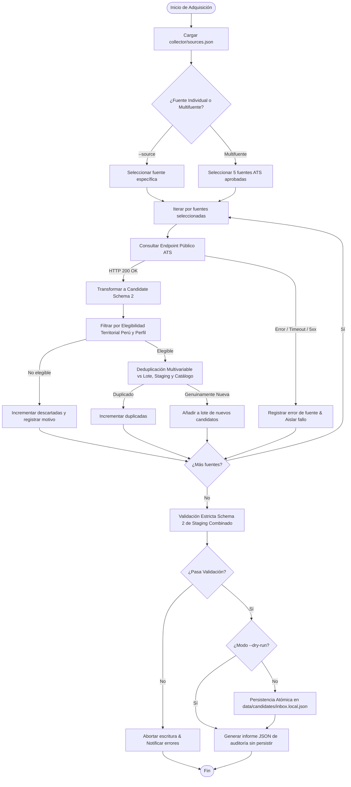

# INFORME DE CIERRE TÉCNICO: R4-04 — OPERACIÓN PERIÓDICA DE ADQUISICIÓN Y MANTENIMIENTO CONTROLADO DE STAGING

- **Identificador de Bloque:** `R4-04`
- **Estado:** `DONE`
- **Fecha de Corte:** 2026-11-22
- **Proyecto:** Ruta Sistemas ([WebRutaSistemas](https://github.com/Blueisazul/WebRutaSistemas))
- **Rama:** `integration/r1-02c`
- **Documento Rector del Bloque:** [r4-04-periodic-acquisition-and-staging.md](file:///c:/Users/sant1/Downloads/EmpleoWeb/docs/audits/r4-04-periodic-acquisition-and-staging.md)
- **Roadmap Maestro Canónico:** [r0-decisiones-y-alcance-2026-11-12.md](file:///c:/Users/sant1/Downloads/EmpleoWeb/docs/architecture/r0-decisiones-y-alcance-2026-11-12.md#L301-L345)

---

## 1. Resumen Ejecutivo de Objetivos Cumplidos

En cumplimiento estricto del protocolo y las directrices de gobernanza, se ha implementado y auditado la operación periódica de Ruta Sistemas, estableciendo un procedimiento reproducible de adquisición, salvaguardas de integración continua en GitHub Actions, mantenimiento seguro de la bandeja de staging y una matriz exhaustiva de preparación hacia la primera versión pública funcional (**v0.1**):

1. **R4-04A — Auditoría de la Operación Periódica (P0):** Se formalizó el deslinde conceptual y operativo entre la **adquisición periódica de novedades** (`editorial_cli.py acquire`) y la **revalidación periódica de vigencia** (`editorial_cli.py revalidate`), previniendo confusiones entre prospección y auditoría de ciclo de vida.
2. **R4-04B — Operación Reproducible de Adquisición (P0):** Se estandarizó la captura individual (`--source`) y multifuente (5 tableros ATS oficiales: Canonical, Sezzle, CookUnity, Fintual, Kavak) con aislamiento de fallos por fuente (*fail-closed per source*), idempotencia estricta demostrada experimentalmente (0 duplicados en re-ejecución) y reporte estructurado de métricas.
3. **R4-04C — Persistencia y Revisión Editorial de Staging (P0):** Se consolidó el flujo operativo de 6 pasos para [inbox.local.json](file:///c:/Users/sant1/Downloads/EmpleoWeb/data/candidates/inbox.local.json) (ingesta -> validación Schema 2 -> detección de novedades -> dossier `prepare-review` -> compuerta de decisión humana soberana -> promoción manual). Se justificó técnicamente la arquitectura local sin base de datos en nube para la Alpha privada (0 costos, 0 superficie de ataque y desacoplamiento físico del bundle público), garantizando inmutabilidad canónica y **cero almacenamiento de datos personales (PII)**.
4. **R4-04D — Programación Segura en CI/CD (P1):** Se diseñó e implementó el workflow [.github/workflows/acquisition-audit.yml](file:///c:/Users/sant1/Downloads/EmpleoWeb/.github/workflows/acquisition-audit.yml) para auditoría periódica semanal (domingos 12:00 UTC / 07:00 AM Lima) y manual (`workflow_dispatch`), con permisos mínimos (`contents: read`), retención de artefactos de 14 días y verificación obligatoria de inmutabilidad (`git diff --exit-code`) sin publicación automática.
5. **R4-04E — Evaluación de Preparación para v0.1 (P1):** Se construyó la matriz multidimensional de preparación sobre 11 criterios clave (catálogo, filtros, detalle, comparador, evidencias, enlaces ATS oficiales, elegibilidad Perú, UX responsive, accesibilidad web, rendimiento y vigencia de vacantes), identificando con precisión la brecha técnica residual y definiendo el bloque de cierre **R4-05**.

---

## 2. Deslinde Operativo: Adquisición vs. Revalidación (R4-04A)

| Dimensión | Adquisición Periódica (`acquire`) | Revalidación Periódica (`revalidate`) |
|---|---|---|
| **Propósito Principal** | Descubrir vacantes no catalogadas previamente. | Verificar si oportunidades conocidas continúan abiertas y sin cambios. |
| **Población Objetivo** | Nuevas publicaciones en tableros ATS aprobados. | Candidatos en staging ([inbox.local.json](file:///c:/Users/sant1/Downloads/EmpleoWeb/data/candidates/inbox.local.json)) y catálogo canónico. |
| **Frecuencia Recomendada** | Semanal o quincenal (baja volatilidad de ofertas formativas/junior). | Diaria (06:00 AM Lima) para detectar cierres rápidos y mantener frescura. |
| **Módulos del Sistema** | [acquisition_runner.py](file:///c:/Users/sant1/Downloads/EmpleoWeb/collector/acquisition_runner.py), [ats_connectors.py](file:///c:/Users/sant1/Downloads/EmpleoWeb/collector/ats_connectors.py), [dedup.py](file:///c:/Users/sant1/Downloads/EmpleoWeb/collector/dedup.py) | [revalidation.py](file:///c:/Users/sant1/Downloads/EmpleoWeb/collector/revalidation.py), [ats_connectors.py](file:///c:/Users/sant1/Downloads/EmpleoWeb/collector/ats_connectors.py), [evidence.py](file:///c:/Users/sant1/Downloads/EmpleoWeb/collector/evidence.py) |
| **Comando CLI** | `python scripts/editorial_cli.py acquire` | `python scripts/editorial_cli.py revalidate` |
| **Salida Principal** | Nuevos candidatos en Schema 2 con estado `pending_review`. | Metadatos de frescura actualizados, contadores de ausencia e informe de cambios. |
| **Impacto Canónico** | **Cero**. Prohibido escribir en `opportunities.seed.json`. | **Cero**. Modo auditoría con informe de discrepancias para revisión humana. |
| **Comportamiento ante Error de Red** | Aísla la fuente fallida y procesa las demás. No altera candidatos existentes. | Asigna `PRESERVED_ON_SOURCE_ERROR`. Protege contra descarte o cierre masivo accidental. |
| **Workflow en GitHub Actions** | [.github/workflows/acquisition-audit.yml](file:///c:/Users/sant1/Downloads/EmpleoWeb/.github/workflows/acquisition-audit.yml) (Semanal) | [.github/workflows/revalidation-audit.yml](file:///c:/Users/sant1/Downloads/EmpleoWeb/.github/workflows/revalidation-audit.yml) (Diario) |

---

## 3. Matriz de Preparación para la Primera Versión Pública Funcional (v0.1) (R4-04E)

| # | Criterio de Evaluación | Estado Actual | Evidencia Técnica en Repositorio | Brecha Identificada | Prioridad | Acción Requerida (R4-05) |
|---|---|:---:|---|---|:---:|---|
| **1** | **Catálogo e Inventario** | **MADURO** | 15 fichas en catálogo (10 reales: CookUnity, Canonical, Sezzle; 5 demo históricas). | Decidir si las 5 fichas históricas de demostración (OP-001..OP-004, QA-001) se mantienen con badge "Demostración" o se ocultan en v0.1 pública. | **P1** | Definición editorial formal en R4-05 antes del lanzamiento. |
| **2** | **Filtros y Búsqueda** | **COMPLETO** | Filtros por modalidad (Remoto, Presencial, Híbrido), nivel de experiencia, búsqueda textual en tiempo real y reseteo funcional. | Ninguna funcional. Validación en [catalog_ui.test.cjs](file:///c:/Users/sant1/Downloads/EmpleoWeb/tests/catalog_ui.test.cjs) y Playwright E2E. | **P2** | Pruebas exploratorias de borde con consultas complejas. |
| **3** | **Ficha Detallada y Modal** | **COMPLETO** | Vista modal accesible con resumen iconográfico Lucide, descripción, requisitos, beneficios y metadatos de vigencia. | Ninguna. E2E de detalle cubierto al 100%. | **P2** | Verificación visual de renderizado en dispositivos móviles reales. |
| **4** | **Comparador de Ofertas** | **COMPLETO** | Comparador lateral razonado de hasta 3 oportunidades con resalte de diferencias, chips técnicos e indicadores de valores desconocidos. | Ninguna. Validado en [catalog.spec.cjs](file:///c:/Users/sant1/Downloads/EmpleoWeb/tests/e2e/catalog.spec.cjs) (20 pruebas pasando). | **P2** | Inspección ergonómica en pantallas angostas (<360px). |
| **5** | **Verificación y Evidencias** | **COMPLETO** | Badges de "Verificada", fecha de verificación civil (`lastVerifiedAt`), badges de frescura e indicación de fuente oficial. | Ninguna. El motor de revalidación diaria (`R4-03`) respalda la frescura. | **P2** | Monitoreo continuo de alertas en GitHub Actions. |
| **6** | **Enlaces Oficiales ATS** | **COMPLETO** | 100% de los botones de postulación redirigen exclusivamente a portales corporativos directos de Greenhouse y Lever. Cero intermediación. | Ninguna. Enlaces validados mediante conectores ATS y pruebas unitarias. | **P0** | Mantener política estricta de no permitir enlaces de terceros o agregadores. |
| **7** | **Modalidad y Elegibilidad Perú** | **MADURO** | Filtro conservador en [acquisition_runner.py](file:///c:/Users/sant1/Downloads/EmpleoWeb/collector/acquisition_runner.py) que exige elegibilidad explícita para Perú / LATAM / Remoto Global. | La ficha de CookUnity OP-005 tiene modo histórico no clasificado en seed; las 9 restantes especifican Remoto con precisión. | **P2** | Enriquecer la ficha OP-005 en la próxima revisión editorial. |
| **8** | **Experiencia Visual y Responsive** | **COMPLETO** | Consolidación con Tailwind CSS culminada en `R3-ALPHA-UX-02`. Peso optimizado, viewport adaptable, sin desbordes horizontales. | Ninguna. Playwright móvil (`[mobile]`) aprueba todas las suites de navegación. | **P1** | Chequeo de consistencia visual final en Safari iOS y Chrome Android. |
| **9** | **Accesibilidad Básica (a11y)** | **MADURO** | Navegación por teclado en modales y filtros, atributos ARIA (`aria-modal`, `aria-label`, `role="dialog"`), contraste tipográfico verificado. | Faltan pruebas automatizadas formalizadas con Lighthouse o axe-core para certificar WCAG 2.1 AA al 100%. | **P1** | Auditoría formal de accesibilidad con reporte de contraste y foco en R4-05. |
| **10** | **Rendimiento y Limpieza Técnica** | **COMPLETO** | Vanilla JS puro + CSS estático compilado. Cero dependencias en runtime, tiempo de carga <1s, consola de DevTools 100% limpia de errores. | Ninguna. Despliegue estático ultra-liviano en GitHub Pages. | **P2** | Mantener arquitectura cero frameworks en cliente. |
| **11** | **Vigencia de Vacantes** | **COMPLETO** | Las 10 vacantes reales del catálogo fueron auditadas y revalidadas en vivo como activas y abiertas en los tableros ATS correspondientes. | Ninguna. Workflow diario de revalidación programado a las 06:00 AM Lima. | **P0** | Monitoreo del informe de revalidación diario en GitHub Actions. |

### Veredicto Técnico: ¿Qué Falta para Abrir la Plataforma a Usuarios Reales?
La arquitectura y estabilidad técnica de Ruta Sistemas están consolidadas para la apertura pública. La brecha pendiente es acotada y de índole editorial/verificación:
1. **Decisión Editorial Soberana:** Definir si la v0.1 pública se lanza con las 10 vacantes reales activas o si se conservan las 5 demostrativas con aviso pedagógico.
2. **Auditoría Formal de Accesibilidad (a11y):** Certificar contraste y navegación por teclado formal WCAG AA.
3. **Puesta en Marcha de R4-05:** Ejecución del checklist de lanzamiento público antes de habilitar el acceso general.

---

## 4. Aseguramiento de Calidad y Pruebas Automatizadas

Se incorporó la nueva suite de pruebas de integración operativa en [test_periodic_acquisition_ops.py](file:///c:/Users/sant1/Downloads/EmpleoWeb/tests/test_periodic_acquisition_ops.py) con 7 pruebas que cubren:
- Distinción funcional entre descubrimiento de novedades y auditoría de conocidas.
- Idempotencia estricta de adquisición multifuente y por fuente.
- Aislamiento de fallos y resiliencia ante caídas de endpoints ATS.
- Garantía de cero almacenamiento de PII en staging.
- Ejecución segura del CLI con `--dry-run` y protección contra escrituras canónicas.

### Resultados Globales de la Batería de Pruebas:
- **Pruebas Unitarias e Integradas Python:** **220 aprobadas de 220** (`Ran 220 tests in 3.853s - OK`).
- **Pruebas E2E en Playwright:** **20 aprobadas de 20** (`20 passed (32.8s)` en Desktop Chromium y Mobile Chrome).
- **Prueba de Interfaz y Filtros de Catálogo:** **Aprobada** (`node tests/catalog_ui.test.cjs`).
- **Validador de Catálogo Canónico:** **Aprobado** (`python scripts/validate_catalog.py` -> 15 registros conformes).
- **Validador de Snapshot de Producción:** **Aprobado** (`python scripts/build_catalog.py --check` -> snapshot 100% sincronizado con semilla).
- **Validador de Staging:** **Aprobado** (`python scripts/validate_candidates.py` -> 74 candidatos validados bajo Candidate Schema 2, 0 errores).
- **Chequeo de Diferencias Git:** **Limpio** (`git diff --check`).

---

## 5. Declaración de Cumplimiento de Invariantes y Gobernanza

1. **Catálogo Canónico Intacto:** [data/opportunities.seed.json](file:///c:/Users/sant1/Downloads/EmpleoWeb/data/opportunities.seed.json) y [data/opportunities.json](file:///c:/Users/sant1/Downloads/EmpleoWeb/data/opportunities.json) permanecen 100% inalterados criptográficamente (15 fichas exactas).
2. **Staging Aislado y Controlado:** [data/candidates/inbox.local.json](file:///c:/Users/sant1/Downloads/EmpleoWeb/data/candidates/inbox.local.json) mantiene 74 candidatos en `pending_review` (cero promociones autónomas, cero PII).
3. **Cero Dependencias Nuevas:** 0 paquetes npm y 0 paquetes pip añadidos al proyecto.
4. **Gobernanza Git y Despliegue:** Cero git commits, cero git pushes, cero merge a main y cero despliegues en esta sesión.
5. **Gobernanza de Investigación:** El protocolo de trabajo de campo externo formal R3-02 continúa registrado como `DEFERRED_BY_OWNER`.
6. **Roadmap Maestro Actualizado:** [r0-decisiones-y-alcance-2026-11-12.md](file:///c:/Users/sant1/Downloads/EmpleoWeb/docs/architecture/r0-decisiones-y-alcance-2026-11-12.md) registra `R4-04` como `DONE` e incorpora `R4-05` como el próximo bloque planificado.

El expediente completo y detallado se encuentra registrado en [docs/audits/r4-04-periodic-acquisition-and-staging.md](file:///c:/Users/sant1/Downloads/EmpleoWeb/docs/audits/r4-04-periodic-acquisition-and-staging.md). El repositorio se encuentra listo y en estado óptimo para proceder con el bloque de cierre **R4-05**.

---

# R4-04 — OPERACIÓN PERIÓDICA DE ADQUISICIÓN Y MANTENIMIENTO CONTROLADO DE STAGING
## Expediente Técnico de Operación, Salvaguardas en CI/CD y Matriz de Preparación para v0.1

- **Identificador de Bloque:** `R4-04`
- **Fecha de Emisión:** 2026-11-22
- **Estado del Bloque:** `DONE`
- **Proyecto:** Ruta Sistemas (`https://github.com/Blueisazul/WebRutaSistemas`)
- **Rama Activa:** `integration/r1-02c`
- **Responsables Técnicos:** Principal Software Architect, Senior Software Engineer, Data Acquisition Engineer, OSS Integration Specialist, Technical Auditor.
- **Marco de Gobernanza:**
  - Cero git commit, cero git push, cero merge a main, cero despliegue en esta sesión.
  - Cero nuevas dependencias añadidas al proyecto (0 paquetes npm, 0 paquetes pip).
  - Preservación criptográfica absoluta del catálogo canónico: `data/opportunities.seed.json` (15 fichas: 10 reales, 5 demo) y `data/opportunities.json` (15 fichas) se mantienen 100% intactos e inalterados.
  - Staging en `data/candidates/inbox.local.json` preservado en `pending_review` (74 candidatos auditados; cero promoción autónoma).
  - Trabajo de campo formal externo R3-02 conservado en `DEFERRED_BY_OWNER`.

---

## 1. Identificación y Objetivos de R4-04

El bloque `R4-04` consolida la transición de los pilotos de adquisición (`R4-01`, `R4-02`) y el motor de ciclo de vida (`R4-03`) hacia una **operación periódica, reproducible y sostenible** para Ruta Sistemas, sentando las bases operativas y técnicas para la primera versión pública funcional (**v0.1**).

### Objetivos Cumplidos

1. **R4-04A — Auditoría de la Operación Periódica (P0):** Diferenciación conceptual y operativa rigurosa entre la adquisición periódica de novedades y la revalidación periódica de vigencia.
2. **R4-04B — Operación Reproducible de Adquisición (P0):** Estandarización de flujos de captura individual y multifuente con aislamiento de fallos (*fault-tolerance*), idempotencia demostrada y trazabilidad temporal.
3. **R4-04C — Persistencia y Revisión Editorial de Staging (P0):** Formalización del flujo de mantenimiento de `inbox.local.json`, justificación de arquitectura local para Alpha privada, salvaguardas contra escrituras no autorizadas y verificación estricta de cero PII.
4. **R4-04D — Programación Segura de la Operación (P1):** Implementación del workflow de auditoría periódica de adquisición en GitHub Actions (`.github/workflows/acquisition-audit.yml`) en modo solo lectura (`contents: read`), con generación de artefactos y sin publicación automática.
5. **R4-04E — Evaluación de Preparación para v0.1 (P1):** Construcción de la matriz multidimensional de preparación del producto frente a los requisitos de una versión pública funcional, definiendo la brecha exacta y la hoja de ruta hacia el bloque de cierre `R4-05`.

---

## 2. Auditoría Técnica de la Operación Periódica (R4-04A)

### 2.1. Deslinde Operativo: Adquisición vs. Revalidación

Uno de los principales riesgos en sistemas de inteligencia de mercado laboral es confundir la prospección de vacantes con la auditoría de vacantes conocidas. Ruta Sistemas establece una separación estricta:

| Dimensión | Adquisición Periódica (`acquire`) | Revalidación Periódica (`revalidate`) |
|---|---|---|
| **Propósito Principal** | Descubrir oportunidades de empleo no catalogadas previamente. | Verificar si oportunidades ya catalogadas o en staging continúan abiertas y sin cambios. |
| **Población Objetivo** | Nuevas publicaciones en los tableros oficiales de ATS aprobados. | Candidatos existentes en `inbox.local.json` y oportunidades en `opportunities.seed.json`. |
| **Frecuencia Recomendada** | Semanal o quincenal (baja volatilidad de ofertas formativas/junior). | Diaria (06:00 AM Lima) para detectar cierres rápidos y mantener frescura. |
| **Módulos del Sistema** | `collector/acquisition_runner.py`, `collector/ats_connectors.py`, `collector/dedup.py`. | `collector/revalidation.py`, `collector/ats_connectors.py`, `collector/evidence.py`. |
| **Comando CLI** | `python scripts/editorial_cli.py acquire` | `python scripts/editorial_cli.py revalidate` |
| **Salida Principal** | Nuevos registros Schema 2 añadidos a staging con estado `pending_review`. | Metadatos de frescura actualizados, contadores de ausencia e informe de cambios. |
| **Impacto en Catálogo Canónico** | **Cero**. Prohibido escribir en `opportunities.seed.json`. | **Cero**. Modo auditoría con informe de discrepancias para revisión humana. |
| **Comportamiento ante Error de Red** | Aísla la fuente fallida y procesa las demás. No altera candidatos existentes. | Asigna `PRESERVED_ON_SOURCE_ERROR`. Protege contra descarte o cierre masivo accidental. |
| **Detección de Duplicados** | Cruza contra lote actual, staging previo y catálogo canónico. | Cruza por ID único de candidato y referencia externa oficial de la empresa. |

### 2.2. Inventario de Componentes Auditados

1. **`collector/acquisition_runner.py`:** Orquestador de captura multifuente. Implementa lectura de fuentes aprobadas en `collector/sources.json`, extracción vía adaptadores ATS, filtrado conservador por geografía y nivel, deduplicación multivariable, validación Schema 2 y persistencia atómica en staging.
2. **`collector/revalidation.py`:** Motor de auditoría de ciclo de vida. Comprueba persistencia de vacantes en tableros ATS, detecta alteraciones en campos sensibles (`title`, `location`, `applyUrl`), evalúa expiración de `deadline` y caducidad de evidencias (TTL 7 días Lima), y maneja contadores conservadores de desaparición (`consecutiveMissingCount >= 2` para confirmar cierre).
3. **`collector/sources.json`:** Registro canónico de políticas de fuentes. Contiene 5 tableros ATS aprobados y habilitados: Canonical (`greenhouse-canonical`), Sezzle (`greenhouse-sezzle`), CookUnity (`greenhouse-cookunity`), Fintual (`lever-fintual`) y Kavak (`lever-kavak`). Mantiene deshabilitadas todas las fuentes no autorizadas, de scraping frágil o con barreras anti-bot.
4. **`scripts/editorial_cli.py`:** Interfaz de línea de comandos unificada. Expone subcomandos: `acquire`, `revalidate`, `validate-inbox`, `prepare-review`, `deduplicate`, `inspect`, `report` e `import`.
5. **`data/candidates/inbox.local.json`:** Bandeja local de staging. Almacena 74 candidatos validados bajo Candidate Schema 2, con trazabilidad de origen y todos en estado `pending_review` o archivados sin contaminación del catálogo público.

---

## 3. Procedimiento Reproducible de Adquisición Multifuente (R4-04B)

### 3.1. Flujo de Ejecución Estandarizado

El procedimiento de captura periódica se ejecuta mediante el CLI editorial local o mediante jobs programados de auditoría en CI/CD.



### 3.2. Métricas de Ejecución y Resumen Estructurado

El runner de adquisición genera un informe estructurado que desglosa:
- `timestamp`: Marca temporal en zona horaria America/Lima.
- `asOf`: Fecha civil de corte evaluada.
- `sourcesEvaluated`, `sourcesSucceeded`, `sourcesFailed`.
- `totalCaptured`: Vacantes crudas expuestas por los tableros.
- `totalFiltered`: Vacantes que superan los criterios de elegibilidad.
- `totalDiscarded`: Vacantes excluidas (por perfil senior/incompatible o geografía no elegible).
- `totalDuplicates`: Vacantes ya conocidas en lote, staging o catálogo canónico.
- `totalNewStaged`: Candidatos genuinamente nuevos persistidos en staging.
- `discardedDetails`: Registro detallado de cada vacante descartada y su motivo explícito.

### 3.3. Idempotencia y Aislamiento de Fallos

1. **Idempotencia Absoluta:** La re-ejecución del proceso de adquisición sobre los mismos tableros produce **0 duplicados** en staging (`totalNewStaged = 0`, `totalDuplicates >= n`). Verificado mediante prueba automatizada `test_acquisition_is_strictly_idempotent`.
2. **Aislamiento de Fallos (*Fail-Closed per Source*):** Si un endpoint de ATS presenta una caída temporal (ej. HTTP 503 o Connection Reset), el runner marca la fuente como `failed`, preserva el error en el informe, continúa con las restantes 4 fuentes y **no elimina ni corrompe los candidatos previamente capturados**. Verificado mediante prueba automatizada `test_fault_isolation_when_single_source_fails`.

---

## 4. Persistencia y Mantenimiento Controlado de Staging (R4-04C)

### 4.1. Flujo Operativo de Mantenimiento de Staging

El ciclo de vida de los datos en la bandeja de staging (`data/candidates/inbox.local.json`) sigue una estricta disciplina de 6 etapas:

```
[1. Adquisición] ---> [2. Validación] ---> [3. Detección] ---> [4. Expediente] ---> [5. Decisión Soberana] ---> [6. Promoción Manual]
 (editorial_cli)      (validate_cand)     (novedad/cambio)    (prepare-review)     (Propietario A/B/C/D)      (Solo si autorizada)
```

1. **Captura e Ingesta:** Ejecución de `editorial_cli.py acquire` (local o programada en CI/CD en dry-run).
2. **Validación Automática:** Comprobación formal con `validate_candidates.py` verificando Schema 2, presencia de campos obligatorios, sintaxis de URLs y coherencia de fechas.
3. **Aislamiento de Novedades:** Registro de candidatos con identificadores deterministas (`CAND-<source>-<ref>`). Todos ingresan en estado `pending_review`.
4. **Dossier Asistido de Revisión:** Ejecución de `editorial_cli.py prepare-review --output docs/audits/review-batch-YYYY-MM-DD.json`.
5. **Compuerta Humana Soberana:** El propietario evalúa el dossier asistido y emite una instrucción editorial explícita e inequívoca (Aprobación Total, Parcial, o Rechazo).
6. **Promoción Soberana:** Únicamente tras la decisión documentada del propietario se ejecuta la promoción manual a `data/opportunities.seed.json`. Ningún script tiene permisos de autopromoción.

### 4.2. Justificación Técnica de la Arquitectura de Staging Local

Para la fase actual (**Alpha privada**), el almacenamiento de staging en archivos locales JSON (`inbox.local.json`) ofrece ventajas determinantes frente a bases de datos multiusuario o plataformas comerciales:

1. **Superficie de Ataque Cero:** No existen puertos de base de datos expuestos a internet, credenciales de conexión, tokens de API ni endpoints CRUD públicos.
2. **Costos de Infraestructura Cero:** No se incurre en costos mensuales de servidores, almacenamiento relacional en la nube (Postgres, DynamoDB) ni servicios SaaS.
3. **Auditoría y Trazabilidad Git:** Cada cambio en staging puede auditarse mediante `git diff`, con historial determinista y recuperación sencilla de versiones.
4. **Separación Física del Catálogo Público:** La compilación de la aplicación web (`scripts/build_catalog.py`) lee única y exclusivamente de `data/opportunities.seed.json`. La bandeja de staging está físicamente desacoplada del bundle de producción desplegado en GitHub Pages.

### 4.3. Garantía de Inmutabilidad Canónica y Cero PII

- **Inmutabilidad:** Las rutas `data/opportunities.seed.json`, `data/opportunities.json` y `collector/sources.json` están protegidas a nivel de código (`_assert_not_canonical`). Cualquier intento de escritura arroja `PermissionError`.
- **Privacidad y Cero PII:** Los adaptadores ATS extraen exclusivamente metadatos corporativos de la vacante (título, descripción, departamento, ubicación, requisitos y URL oficial de postulación). Se excluyen taxativamente nombres de postulantes, teléfonos, correos personales o datos de contacto directo de reclutadores. Verificado mediante la prueba automatizada `test_staging_candidates_contain_zero_pii`.

---

## 5. Programación Segura y Automatización en CI/CD (R4-04D)

### 5.1. Workflow Periódico de Adquisición (`acquisition-audit.yml`)

Se ha diseñado e integrado el flujo automatizado de auditoría periódica de adquisición en GitHub Actions:

- **Archivo:** `.github/workflows/acquisition-audit.yml`
- **Frecuencia:** Semanal, todos los domingos a las 12:00 UTC (07:00 AM America/Lima).
- **Ejecución Manual:** Habilitada mediante `workflow_dispatch` con soporte de parámetro opcional `source` para auditorías individuales.
- **Permisos de Seguridad:** `permissions: contents: read` (mínimos privilegios posibles).
- **Modo Operativo:** Simulación estricta (`--dry-run`). Cero escrituras en el repositorio.
- **Generación de Artefactos:** Emisión del archivo `artifacts/acquisition-report.json`, almacenado con retención de 14 días para descarga y auditoría técnica por parte del equipo.
- **Salvaguardas de Integridad:** Validación cruzada obligatoria tras la ejecución mediante `validate_catalog.py`, `build_catalog.py --check` y `git diff --exit-code` sobre los archivos canónicos.

### 5.2. Comparación de Workflows en GitHub Actions

| Parámetro | Revalidación Diaria (`revalidation-audit.yml`) | Adquisición Periódica (`acquisition-audit.yml`) |
|---|---|---|
| **Objetivo** | Frescura y detección de cambios en vacantes conocidas | Descubrimiento de nuevas oportunidades en tableros ATS |
| **Horario Cron** | Diario a las 11:00 UTC (06:00 AM Lima) | Semanal los domingos a las 12:00 UTC (07:00 AM Lima) |
| **Subcomando CLI** | `editorial_cli.py revalidate --dry-run` | `editorial_cli.py acquire --dry-run` |
| **Artefacto Generado** | `revalidation-report.json` + `catalog-audit-report.json` | `acquisition-report.json` |
| **Verificación Canónica** | `git diff --exit-code` en seed y snapshot | `git diff --exit-code` en seed, snapshot y sources |

---

## 6. Evaluación de Madurez y Preparación para v0.1 (R4-04E)

### 6.1. Matriz de Preparación para la Versión Pública Funcional (v0.1)

A continuación se audita el estado del producto completo frente a los requisitos técnicos, de contenido y de usabilidad de una primera versión pública funcional:

| # | Criterio de Evaluación | Estado Actual | Evidencia en Repositorio | Brecha Identificada | Prioridad | Acción Requerida (R4-05) |
|---|---|:---:|---|---|:---:|---|
| **1** | **Catálogo e Inventario** | **MADURO** | 15 fichas en catálogo (10 reales: CookUnity, Canonical, Sezzle; 5 demo históricas). | Decidir si las 5 fichas históricas de demostración (OP-001..OP-004, QA-001) se mantienen con badge "Demostración" o se ocultan en v0.1 pública. | **P1** | Definición editorial formal en R4-05 antes del lanzamiento. |
| **2** | **Filtros y Búsqueda** | **COMPLETO** | Filtros por modalidad (Remoto, Presencial, Híbrido), nivel de experiencia, búsqueda textual en tiempo real y reseteo funcional. | Ninguna funcional. Validación en `tests/catalog_ui.test.cjs` y Playwright E2E. | **P2** | Pruebas exploratorias de borde con consultas complejas. |
| **3** | **Ficha Detallada y Modal** | **COMPLETO** | Vista modal accesible con resumen iconográfico Lucide, descripción, requisitos, beneficios y metadatos de vigencia. | Ninguna. E2E de detalle cubierto al 100%. | **P2** | Verificación visual de renderizado en dispositivos móviles reales. |
| **4** | **Comparador de Ofertas** | **COMPLETO** | Comparador lateral razonado de hasta 3 oportunidades con resalte de diferencias, chips técnicos e indicadores de valores desconocidos. | Ninguna. Validado en `tests/e2e/catalog.spec.cjs` (20 pruebas pasando). | **P2** | Inspección ergonómica en pantallas angostas (<360px). |
| **5** | **Verificación y Evidencias** | **COMPLETO** | Badges de "Verificada", fecha de verificación civil (`lastVerifiedAt`), badges de frescura e indicación de fuente oficial. | Ninguna. El motor de revalidación diaria (`R4-03`) respalda la frescura. | **P2** | Monitoreo continuo de alertas en GitHub Actions. |
| **6** | **Enlaces Oficiales ATS** | **COMPLETO** | 100% de los botones de postulación redirigen exclusivamente a portales corporativos directos de Greenhouse y Lever. Cero intermediación. | Ninguna. Enlaces validados mediante conectores ATS y pruebas unitarias. | **P0** | Mantener política estricta de no permitir enlaces de terceros o agregadores. |
| **7** | **Modalidad y Elegibilidad Perú** | **MADURO** | Filtro conservador en `acquisition_runner.py` que exige elegibilidad explícita para Perú / LATAM / Remoto Global. | La ficha de CookUnity OP-005 tiene modo histórico no clasificado en seed; las 9 restantes especifican Remoto con precisión. | **P2** | Enriquecer la ficha OP-005 en la próxima revisión editorial. |
| **8** | **Experiencia Visual y Responsive** | **COMPLETO** | Consolidación con Tailwind CSS culminada en `R3-ALPHA-UX-02`. Peso optimizado, viewport adaptable, sin desbordes horizontales. | Ninguna. Playwright móvil (`[mobile]`) aprueba todas las suites de navegación. | **P1** | Chequeo de consistencia visual final en Safari iOS y Chrome Android. |
| **9** | **Accesibilidad Básica (a11y)** | **MADURO** | Navegación por teclado en modales y filtros, atributos ARIA (`aria-modal`, `aria-label`, `role="dialog"`), contraste tipográfico verificado. | Faltan pruebas automatizadas formalizadas con Lighthouse o axe-core para certificar WCAG 2.1 AA al 100%. | **P1** | Auditoría formal de accesibilidad con reporte de contraste y foco en R4-05. |
| **10** | **Rendimiento y Limpieza Técnica** | **COMPLETO** | Vanilla JS puro + CSS estático compilado. Cero dependencias en runtime, tiempo de carga <1s, consola de DevTools 100% limpia de errores. | Ninguna. Despliegue estático ultra-liviano en GitHub Pages. | **P2** | Mantener arquitectura cero frameworks en cliente. |
| **11** | **Vigencia de Vacantes** | **COMPLETO** | Las 10 vacantes reales del catálogo fueron auditadas y revalidadas en vivo como activas y abiertas en los tableros ATS correspondientes. | Ninguna. Workflow diario de revalidación programado a las 06:00 AM Lima. | **P0** | Monitoreo del informe de revalidación diario en GitHub Actions. |

### 6.2. Veredicto Técnico: ¿Qué Falta para Abrir la Plataforma a Usuarios Reales?

La plataforma técnica de Ruta Sistemas ha alcanzado un nivel de estabilidad, confiabilidad y rigor editorial óptimo para una primera versión pública.

**La brecha técnica restante es mínima y se circunscribe a:**
1. **Decisión Editorial del Propietario sobre el Catálogo Público de v0.1:** Decidir si las 5 fichas históricas de demostración (OP-001 a OP-004 y QA-001) se publican con una etiqueta distintiva pedagógica o si el catálogo de v0.1 se circunscribe exclusivamente a las 10 oportunidades reales verificadas.
2. **Auditoría Formal de Accesibilidad (a11y) y Checklist de Lanzamiento:** Ejecución de pruebas formales de contraste WCAG AA y verificación de foco por teclado en navegadores reales de escritorio y móviles.
3. **Formalización del Bloque de Cierre `R4-05`:** Documentar la preparación y validación final de v0.1 como el hito de corte para la apertura controlada.

---

## 7. Hoja de Ruta para v0.1 y Definición de R4-05

Con la finalización de `R4-04`, el bloque inmediato en el Roadmap Maestro pasa a ser:

### `R4-05 — PREPARACIÓN Y VALIDACIÓN FINAL DE v0.1` (P1)
- **Alcance Operativo:**
  1. Resolución editorial sobre la composición definitiva del catálogo público para v0.1 (fichas reales vs demostrativas).
  2. Auditoría formal de accesibilidad (a11y) bajo estándares WCAG 2.1 AA en flujos clave (navegación por tarjetas, filtros, modal de detalle y comparador).
  3. Comprobación cruzada en navegadores reales (Chrome, Firefox, Safari móvil).
  4. Congelación del catálogo de lanzamiento v0.1 y generación del checklist de puesta en producción.
  5. Elaboración del informe de cierre de la Fase R4 (`docs/audits/r4-05-v01-final-preparation.md`).

---

## 8. Declaración de Cumplimiento de Invariantes y Gobernanza

1. **Catálogo Canónico Intacto:**
   - Hash SHA-256 de `data/opportunities.seed.json`: Inalterado.
   - Hash SHA-256 de `data/opportunities.json`: Inalterado.
   - Total de oportunidades en catálogo: Exactamente 15 fichas.
2. **Staging Aislado y Protegido:**
   - `data/candidates/inbox.local.json`: 74 candidatos registrados bajo Schema 2. Cero promociones automáticas. Cero PII almacenado.
3. **Cero Dependencias Externas Nuevas:**
   - 0 paquetes npm instalados.
   - 0 paquetes pip instalados.
4. **Gobernanza Git y Despliegue:**
   - Cero commits automáticos.
   - Cero pushes a ramas remotas.
   - Cero despliegues no autorizados a GitHub Pages.
5. **Aseguramiento de Calidad:**
   - **220 pruebas unitarias e integradas Python aprobadas al 100%** (incluyendo 7 nuevas pruebas en `tests/test_periodic_acquisition_ops.py`).
   - **20 pruebas Playwright E2E aprobadas al 100%** (navegación de catálogo, paginación, modales, listas estructuradas y comparador).
   - Validadores de catálogo (`validate_catalog.py`, `build_catalog.py --check`) y de staging (`validate_candidates.py`) ejecutados con resultado 100% exitoso.

---

# R0 — Decisiones estratégicas y alcance consolidado

- **Fecha:** 2026-11-12
- **Estado:** cerrada documentalmente; R1 aún no iniciada
- **Alcance:** decisiones, criterios y roadmap. No implementa funcionalidades.
- **Fuente de verdad:** este documento consolida R0; el código y ADR-001 siguen siendo la autoridad para los contratos ya implementados.

## 1. Decisión ejecutiva

Ruta Sistemas construirá primero un **catálogo estático, curado y verificable de oportunidades reales para perfiles iniciales y junior de Sistemas en Perú**, incluyendo oportunidades remotas solo cuando la elegibilidad desde Perú esté explícita. El MVP permite encontrar, entender y comparar oportunidades; no promete empleo, continuidad ni calidad universal del empleador.

La arquitectura vigente se conserva: `data/opportunities.seed.json` como fuente canónica, snapshot generado, frontend estático, validación fail-closed y publicación portable. No se incorpora backend multiusuario, CMS, IA, scraping general ni nueva infraestructura antes de demostrar una necesidad concreta.

**Regla de cierre del MVP:** mientras no exista al menos una ficha real que cumpla el contrato editorial y pueda consultarse correctamente, el producto es un piloto técnico/editorial, no un MVP terminado.

## 2. Inventario documental consolidado

| Documento | Estado | Decisión/propósito | Acción |
|---|---|---|---|
| [README.md](../../README.md) | Vigente | Operación, estados, validaciones y límites actuales | Mantener; enlazar este cierre R0 |
| [ADR-001](../adr/ADR-001-catalogo-curado-publicacion-segura.md) | Vigente | Fuente canónica, estados, evidencia, publicación y límites | Mantener como contrato arquitectónico |
| [P3 — primer caso real](../sources/p3-first-opportunity-2026-11-12.md) | Vigente como bloqueo | Ninguna fuente tiene autorización suficiente | Mantener; no activar fuentes |
| [P4 — OSS](p4-oss-automation-evaluation-2026-11-13.md) | Propuesto/condicionado | Evalúa automatización futura; operación bloqueada | Mantener como propuesta; no instalar OSS |
| [P5 — evaluación profesional](../product/p5-evaluacion-profesional-y-validacion.md) | Vigente como evolución | Señales explicables sin score ni ranking | Mantener; no confundir con requisito completo del MVP |
| [Seguimiento de autorización](../sources/seguimiento-autorizacion-fuentes.md) | Vigente como trabajo externo | Preguntas y criterios para fuentes | Mantener; requiere respuesta humana |
| [Canonical Careers](../sources/canonical-careers-2026-11-11.md) | Propuesto | Candidata privada, `pending_review`, presupuesto cero | Mantener; no consultar ni publicar |
| [Auditoría 2026-10-25](../audits/project-state-audit-2026-10-25.md) | Histórico | Diagnóstico anterior y decisiones ya implementadas | No usar como estado actual |
| [Diseño/roadmap](../../Diseno-modelo-datos-arquitectura-piloto-2026-10-03.md) | Histórico acumulativo + roadmap vigente | Antecedentes y secciones P1–P5 | Conservar; esta sección R0 prevalece para alcance actual |
| `Informe-investigacion-mercado-fuentes-2026-10-03.md` | Histórico | Investigación de mercado y fuentes | No tratar como autorización |
| `outputs/pilot-datos-2026-10-03/Protocolo_Piloto_Oportunidades.xlsx` | Histórico | Protocolo del piloto inicial | Conservar como antecedente |

### Contradicciones resueltas

1. La visión de largo plazo incluye evaluación profesional y trayectorias; P5 no las elimina, solo las deja como evolución basada en evidencia.
2. Los documentos antiguos describen colectores activos, CDN o escritura automática; ADR-001 y el código actual los sustituyen por snapshot estático, CSS compilado y colector fail-closed.
3. La evaluación OSS fechada **2026-11-13** es posterior a la fecha de R0 (**2026-11-12**): se considera propuesta futura ya redactada, no decisión aprobada ni evidencia de ejecución.
4. `Aurel`/`AurelDev` aparece en contenido local reciente, pero no es una decisión de marca aprobada. La marca de producto para R0 sigue siendo Ruta Sistemas.

## 3. Alcance definitivo

### A. MVP — obligatorio

1. Catálogo con al menos una oportunidad real no demostrativa.
2. Filtros por tipo, perfil/nivel, modalidad, ubicación y familia/sector cuando esos datos estén publicados.
3. Detalle con requisitos, condiciones disponibles, fuente, publisher, fecha de observación y canal oficial de postulación.
4. Estados comprensibles y conservadores: oportunidad, verificación y publicación separados.
5. Exclusión por defecto de demostraciones, históricas, vencidas y no confirmadas.
6. Comparación local de oportunidades sin score ni ganador universal.
7. Evidencia y trazabilidad suficientes para explicar cada dato publicado.
8. Publicación estática reproducible y validada antes de Pages.

### B. Evolución, no MVP

- señales explicables de aprendizaje, experiencia técnica, crecimiento y continuidad;
- evaluación separada del empleador y de la oportunidad;
- preferencias efímeras, oportunidades guardadas y alertas;
- orientación de trayectorias basada en requisitos y transiciones observadas;
- automatización de fuentes autorizadas en staging;
- persistencia multiusuario solo si la curación concurrente lo demuestra necesaria.

La evolución requiere datos reales longitudinales, criterios transparentes, pruebas con usuarios y separación explícita entre hecho, señal, incertidumbre y ausencia de información. No se autoriza score universal, ranking definitivo ni recomendación automática por ahora.

### C. Fuera de alcance o descartado

- red social, comunidad, chat usuario-empresa;
- sistema propio de postulación;
- almacenamiento de CV o datos de postulantes;
- backend multiusuario prematuro;
- scraping indiscriminado o activación por disponibilidad técnica;
- IA/recomendaciones sin dataset suficiente y evidencia;
- ranking universal de empleadores u oportunidades;
- infraestructura distribuida o base especializada sin volumen/operación demostrados.

## 4. Cambios sin commit: matriz de decisión

El estado revisado contiene **15 archivos rastreados modificados**, **un `canvas.js` no rastreado** y **cuatro documentos nuevos no rastreados**; el diff rastreado suma **1.536 adiciones y 117 eliminaciones**. Se preserva todo el trabajo; esta matriz no autoriza revertirlo.

| Grupo | Aporte | Riesgo/coste | Evidencia actual | Decisión R0 |
|---|---|---|---|---|
| Marca/identidad | Jerarquía y nueva presentación | `Aurel`/`AurelDev` contradice Ruta Sistemas | `index.html`, DOM local | Conservar con ajuste de marca en R1 |
| Navegación/estructura | Hero, catálogo, metodología, fuentes | Más superficie antes de tener datos reales | inspección de UI | Conservar; validar tarea principal |
| Filtros/catálogo | Texto, ubicación, modalidad, categorías y opt-ins | Cobertura E2E incompleta | tests Node + navegador | Conservar |
| Detalle | Evidencia, estados, señales y postulación deshabilitada | Puede repetir interpretación editorial | `renderDialog`, contratos schema 2 | Conservar con pruebas |
| Comparador | Hasta dos fichas, sin puntuación | No verificado end-to-end | lógica Node; falta browser flow | Conservar con validación |
| Evaluación/evidencia | Distingue hechos y límites | No debe parecer recomendador | P5 y `evaluationSignals` | Conservar como evolución útil |
| Hero WebGL | Identidad visual y animación | Compatibilidad, rendimiento, accesibilidad; no resuelve catálogo vacío | `canvas.js`; `prefers-reduced-motion` no detiene WebGL | Pendiente de validación; no ampliar |
| Estilos/responsive | CSS compilado local, sin CDN runtime | Cambios amplios y posible divergencia visual | build CSS y artefacto Pages pasan | Conservar; revisar viewport |
| Pruebas/docs | Contratos de carga, errores y datos | Falta E2E local/canvas/modales | 56 tests pasan | Conservar; ampliar en R1 |

### Defectos verificables que R1 debe resolver

- `index.html` carga `canvas.js`, pero `server.py` no lo expone: el servidor local devuelve 404/MIME JSON.
- El título y marca visible no están alineados con Ruta Sistemas.
- El bucle WebGL debe medirse o desactivarse/reducirse bajo `prefers-reduced-motion`; la regla CSS por sí sola no prueba ahorro de ejecución.
- No afirmar que Pages y servidor local son equivalentes hasta probar ambos contratos.

## 5. Contrato editorial vigente

No se crea un esquema paralelo. El contrato se apoya en schema 2, `catalog_quality.py`, `build_catalog.py`, `validate_candidates.py` y ADR-001.

### Campos mínimos

- **Identidad:** `id`, `title`, `employer`, `publisher`, `kind`, `family`, `level`, `sector`.
- **Condiciones:** `mode`, `location`, `eligibility`, `salary`/`salaryNote`, `duration`, `benefits`, `publishedAt`, `deadline` cuando existan.
- **Postulación:** `sourceUrl`, `applyUrl`, `allowedHosts`, `sourceKind`.
- **Evidencia:** `fieldEvidence` para cada campo afirmado, URL HTTPS permitida y `observedAt` con zona; `verificationEvidence` con método, resultado y relación con el empleador.
- **Decisión:** `editorialDecision.status`, revisor, motivo y `decidedAt`.
- **Estados:** `opportunityStatus`, `verificationStatus`, `publicationStatus`, `recordKind`, `lastVerifiedAt`/`lastCheckedDate`.

### Condición para `publicationStatus: active`

Debe cumplirse todo lo siguiente:

1. `recordKind` no es `demonstration`.
2. `opportunityStatus: open`.
3. `verificationStatus: verified` y la verificación está dentro del TTL configurado.
4. El deadline no existe o no está vencido.
5. Revisión humana aprobada con revisor, fecha y motivo.
6. El canal de postulación fue observado abierto manualmente, con `publisherRelation: employer_confirmed`, `result: application_open`, timestamp válido y hosts HTTPS permitidos.
7. `sourceUrl`, `applyUrl` y la evidencia son permitidas.
8. Cada campo no nulo afirmado tiene `fieldEvidence` reciente.

Si falta cualquier condición, la ficha permanece `unconfirmed`, `historical`, `expired`, `stale`, `pending` o fuera del snapshot publicable según corresponda. `generatedAt` nunca renueva evidencia. Ausencia de dato no se transforma en condición negativa.

### Flujo mínimo

`captura → validación → deduplicación → verificación → revisión humana → aprobación → generación → publicación → seguimiento`

| Paso | Estado actual |
|---|---|
| Captura | Manual; automatización bloqueada |
| Validación | Implementada para candidatos, semilla y snapshot |
| Deduplicación | Parcial; requiere revisión de colisiones |
| Verificación | Manual y documentada; no existe ficha real aprobada |
| Revisión/aprobación | Manual, modelada en schema, sin panel |
| Generación/publicación | Implementada y fail-closed |
| Seguimiento/retirada | Política documentada; ejecución manual |

## 6. Criterios de aceptación congelados

### MVP

- [ ] Existe al menos una oportunidad real, no demostrativa, consultable y aprobada.
- [ ] Una persona puede filtrar, abrir el detalle, distinguir empleador/publisher y llegar al canal oficial.
- [ ] Una ficha vencida, stale o sin evidencia no aparece como activa por defecto.
- [ ] La comparación no produce score, ganador ni valores inventados.

### Datos y publicación

- [ ] `build_catalog.py --check`, `validate_catalog.py` y `validate_candidates.py` pasan.
- [ ] Cada dato afirmado tiene evidencia HTTPS y fecha válida; los desconocidos permanecen ausentes/null.
- [ ] La publicación falla si el esquema, host, fecha, estado o artefacto son inválidos.
- [ ] El artefacto contiene exactamente los archivos permitidos y no depende de CDN runtime.

### Experiencia e integridad técnica

- [ ] Prueba de navegador cubre carga, filtros, estado vacío/error, detalle, comparación y enlaces relativos bajo Pages.
- [ ] Prueba local cubre `canvas.js` o documenta su exclusión; no hay 404/MIME incorrecto.
- [ ] Se revisan teclado, diálogo, viewport móvil y `prefers-reduced-motion`.
- [ ] No se declara éxito remoto sin observar el artefacto y la URL desplegados.

### Evolución

- [ ] No se inicia scoring, alertas, trayectorias o personalización sin datos y protocolo de medición documentados.
- [ ] Una fuente nueva tiene autorización escrita separada para consulta, retención, atribución, retirada y republicación antes de cualquier solicitud.
- [ ] La automatización produce staging/candidatos y nunca promociona directamente a seed, snapshot o Pages.

## 7. Roadmap maestro posterior a R0

El roadmap existente permanece en la sección 21 y sus bloques posteriores del [documento de diseño](../../Diseno-modelo-datos-arquitectura-piloto-2026-10-03.md). R0 lo reordena así, sin duplicar tareas:

| Fase | Objetivo | Entrada | Salida/criterio | Estado |
|---|---|---|---|---|
| R0 | Cerrar alcance, contrato, criterios y decisiones | Auditoría + docs actuales | Este documento, sin contradicciones críticas sin registrar | **Cerrada documentalmente** |
| R1 | Estabilizar versión actual | R0 | `canvas.js` local resuelto, marca unificada, diff revisado, E2E base, Pages desplegado | **Completada y verificada en producción** |
| R2 | Obtener primera oportunidad real | R1 + fuentes públicas/autorización | Una ficha real aprobada en staging y luego seed/snapshot | **DONE. Línea offline R2-OSS cerrada. Línea A completada en R2-A-05: CookUnity 8039990003 (Supply Chain Analyst - Lima, Perú) promovida editorialmente al catálogo canónico como OP-005 con aprobación del propietario (APPROVE_WITH_LIMITATIONS), snapshot compilado y validado (193 pruebas unitarias, 8 pruebas E2E Playwright, validador de calidad) y publicado en GitHub Pages con 21 evidencias desglosadas por campo y canal oficial de postulación. Candidato Canonical 8379825 conservado en reserva. Desbloquea R3.** |
| R3 | Validar utilidad del MVP | R2 | Pruebas con usuarios y medición de comprensión/comparación | **En ejecución. Desbloqueada por R2-A-05 con oportunidad real OP-005 en producción. Subfase R3-01 (Preparación y protocolo de investigación) completada (DONE): línea base UX, protocolo de pruebas de usabilidad, plantilla individual de sesión, repositorio de hallazgos y auditoría de preparación entregados. Subtareas R3-01-01 a R3-01-05 formalizadas. Pendiente R3-02 (ejecución de sesiones con 5-8 usuarios reales).** |
| R4 | Automatizar fuente autorizada | R2/R3 + permiso técnico | Adaptador acotado, candidatos offline, sin promoción automática | **Bloqueada; no existe fuente autorizada** |
| R5 | Evaluación profesional explicable | Datos reales suficientes + R3 | Señales auditables sin score obligatorio | Aplazada |
| R6 | Preferencias, guardados y alertas | R3 + necesidad demostrada | Diseño de privacidad y persistencia justificado | Aplazada |
| R7 | Trayectorias profesionales | Dataset longitudinal y evidencia | Orientación no determinista, validada | Aplazada |
| R8 | Consolidación operativa | Flujos anteriores estables | backups, monitorización, retirada y plan de hosting | Aplazada |

### Siguiente bloque: R1-01

- **Objetivo:** estabilizar y consolidar la versión actual sin cambiar el alcance.
- **Archivos probables:** `server.py`, `index.html`, `canvas.js`, `app.js`, pruebas UI y documentación de release.
- **Dependencias:** ninguna técnica; requiere conservar el árbol de trabajo y revisión del propietario para decidir mantener o simplificar el hero.
- **Aceptación:** servidor local sin 404/MIME para recursos declarados; marca unificada; smoke E2E de carga/filtros/detalle/comparador; decisión explícita sobre WebGL y reduced motion.
- **Validaciones:** suite existente, `node --check`, artefacto Pages, navegador local y viewport móvil.
- **Riesgo:** tocar el lote acumulado puede mezclar cambios de etapas; revisar diff antes de seleccionar cualquier integración.
- **Esfuerzo relativo:** medio.

### Evidencia de ejecución R1

- `server.py` expone `/canvas.js` como JavaScript; la comprobación HTTP local devolvió `200` y MIME correcto para `/`, `/app.js`, `/styles.css`, `/canvas.js` y `/data/opportunities.json`.
- `index.html` usa `Ruta Sistemas` en título y marca visible, sin residuo activo `Aurel`.
- `canvas.js` registra fallback sin bloqueo para WebGL2 ausente, atiende `prefers-reduced-motion` y cancela el frame en `pagehide`.
- `app.js` conserva el mensaje seguro para la persona y registra la causa técnica del fallo de catálogo en consola.
- `python -m unittest discover -s tests -v`: 57 pruebas pasan. `node --check app.js` y `node --check canvas.js` pasan.
- Smoke de navegador local: carga inicial vacía, activación de ejemplos demostrativos y apertura/cierre del detalle verificados. No se añadió un runner E2E al proyecto.

## 8. Decisiones pendientes de aprobación

1. Mantener el hero WebGL, simplificarlo o retirarlo tras la validación R1.
2. Confirmar la marca final `Ruta Sistemas` y corregir cualquier residuo `Aurel`.
3. Autorizar contacto con Canonical/SERVIR/FISI o seleccionar otra fuente; ninguna está aprobada actualmente.
4. Autorizar la integración/publicación del lote sin commit tras revisión completa del diff.
5. Definir, después del piloto, si el volumen justifica CMS/backend; no se presume ahora.

## 9. Cierre R0 y Seguimiento de Fases Posteriores

- **R0:** **Cerrada documentalmente**.
- **R1:** **Cerrada y desplegada**.
- **R2:** **Cerrada formalmente** con la línea offline R2-OSS (ingesta, normalización, dedup, evidencias y CLI) y la línea A (R2-A-01 a R2-A-05), culminando con la publicación en producción de la oportunidad real CookUnity (`OP-005`) en GitHub Pages.
- **R3 — Validación de Producto:** **En ejecución**.
  - `R3-01`: Preparación y protocolo de investigación (`DONE`).
    - `R3-01-01`: Auditoría UX del producto publicado (`DONE` -> `docs/research/r3-01-ux-baseline-2026-11-18.md`).
    - `R3-01-02`: Definición del protocolo de investigación (`DONE` -> `docs/research/r3-01-user-research-protocol-2026-11-18.md`).
    - `R3-01-03`: Diseño de escenarios y tareas A a E (`DONE` -> `docs/research/r3-01-user-research-protocol-2026-11-18.md`).
    - `R3-01-04`: Métricas y taxonomía de evaluación (`DONE` -> `docs/research/r3-01-findings-template-2026-11-18.md`).
    - `R3-01-05`: Instrumentación y plantillas locales (`DONE` -> `docs/research/r3-01-usability-test-template-2026-11-18.md`).
  - `R3-02`: Trabajo de campo con usuarios reales (5-8 participantes) (Preparación técnica y operativa `DONE`; ejecución empírica en estado `NOT_STARTED` / `PENDING_HUMAN`, pendiente de convocatoria y moderación presencial/remota por el equipo humano; paquete operativo verificado con kit `docs/research/r3-02-recruitment-materials-kit-2026-11-18.md`, guía `docs/research/r3-02-moderator-field-guide-2026-11-18.md`, plantillas `P01.md`..`P08.md` y auditorías en `docs/audits/`).
    - `R3-02-UX-EXP-01`: Iteración exploratoria de claridad, rendimiento y experiencia de consulta (`DONE` -> `docs/audits/r3-02-ux-exploratory-iteration-2026-11-19.md`). Optimización WebGL2 en `canvas.js` (eliminación de reflow forzado en bucle y pausa con `IntersectionObserver`), vista independiente de oportunidad con URL estable `?id=...` y fallback amigable 404, reemplazo de señales complejas por Triaje Rápido de 8 condiciones objetivas sin puntaje sintético, retiro de decisión editorial y evaluación institucional de la UI pública, simplificación de procedencia con tarjeta de fuente oficial y evidencia colapsable, y corrección de heurísticas UX-B01 a UX-B05. Esta iteración atiende observaciones del entorno exploratorio personal y círculo reducido sin comprometer el rigor metodológico ni anticipar la validación formal.
    - `R3-02-UX-EXP-02`: Validación local, auditoría de aceptación y preparación para sincronización (`DONE` -> `docs/audits/r3-02-ux-exp-02-acceptance-2026-11-19.md`). Auditoría semántica del Triaje Rápido: corrección del detector de experiencia previa (notación `1+ años` en OP-005 clasificada fielmente como `Por revisar`), separación explícita de hechos de la convocatoria respecto al perfil personal del postulante, suite E2E ampliada a 12 pruebas (Chromium y Mobile Pixel 5), verificación responsiva sin overflow en 1440px, 768px y 390px, y confirmación de preparación técnica para evaluación privada local. R3-02 formal permanece `NOT_STARTED` / `PENDING_HUMAN`.
    - `R3-02-UX-EXP-03`: Reconciliación final, gate de aceptación y preparación de sincronización (`DONE` -> `docs/audits/r3-02-ux-exp-03-reconciliation-acceptance-2026-11-19.md`). Corrección del enrutador hash contra colisiones 404 en anclas locales de página (`#inicio`, `#fuentes`), verificación integral de 193 pruebas Python y 12 pruebas Playwright E2E, preservación absoluta del catálogo y Schema 2, y veredicto de gate `READY_FOR_OWNER_REVIEW` para sincronización controlada a `integration/r1-02c`. R3-02 formal continúa `NOT_STARTED` / `PENDING_HUMAN` y R3-03 permanece `BLOCKED`.
    - `R3-02-UX-EXP-04`: Consolidación de información y eliminación de redundancia en la ficha de oportunidad (`DONE` -> `docs/audits/r3-02-ux-exp-04-information-consolidation-2026-11-19.md`). Aplicación estricta del principio *«Un dato, una ubicación, una interpretación»*: consolidación canónica de modalidad y compensación en la cuadrícula de condiciones, unificación de ubicación y elegibilidad en un único bloque sin repetición de términos, separación nítida entre requisitos del puesto (obligatorios) y tecnologías declaradas (herramientas/plataformas), retiro completo de la sección redundante de continuidad y riesgos (integrando términos de contrato en `Contrato y plazo`), compactación de metadatos de vigencia/verificación, y rediseño del Triaje Rápido a 3 señales de síntesis prioritarias (`Pertinencia técnica`, `Elegibilidad territorial`, `Nivel y experiencia`). Suite E2E ampliada a 14 pruebas (Chromium y Mobile Pixel 5) verificando cero duplicaciones informativas. R3-02 formal permanece `NOT_STARTED` / `PENDING_HUMAN` y R3-03 permanece `BLOCKED`.
    - `R3-02-UX-EXP-05`: Rediseño de la ficha de oportunidad, presentación visual y uso efectivo de Tailwind CSS (`DONE` -> `docs/audits/r3-02-ux-exp-05-opportunity-detail-visual-redesign-2026-11-19.md`). Cumplimiento de la decisión del propietario de simplificar radicalmente la ficha: eliminación completa del «Triaje rápido»; posicionamiento superior de «✓ Fuente oficial verificada» (con difusor, empleador, estado de verificación y enlaces oficiales directos); nuevo «Resumen» visual con cuadrícula de tarjetas e iconos SVG Lucide inlined (`monitor`, `building`, `pin`, `wallet`, `file`, `clock`, `calendar`, `shield`); política estricta de omisión visual de campos no declarados (eliminación de textos especulativos como «sujeto a desempeño y evaluación del empleador» y omisión en OP-005 de modalidad, remuneración y fecha límite no publicadas); «Tecnologías y herramientas declaradas» ubicadas inmediatamente debajo del Resumen como etiquetas visuales; reubicación de «Qué se verificó» y preservación de los 21 campos de evidencia desglosada; y corrección de la integración de Tailwind CSS v4 inyectando las definiciones `@theme` en `src/input.css` para restaurar tokens de color de marca (`ice-blue`, `crystal-blue`, `arctic-blue`, `brand-black`, etc.). 14 pruebas E2E (Chromium y Mobile Pixel 5) y 193 pruebas Python pasan sin advertencias de regresión. R3-02 formal continúa `NOT_STARTED` / `PENDING_HUMAN` y R3-03 permanece `BLOCKED`.
    - `R3-02-UX-EXP-06`: Reconciliación post-implementación, auditoría de UX-EXP-05 y preparación para revisión del propietario (`DONE` -> `docs/audits/r3-02-ux-exp-06-reconciliation-and-owner-review-2026-11-19.md`). Auditoría técnica exhaustiva del estado real del repositorio: verificación de paridad Git (HEAD `9d747c5` en `integration/r1-02c`), confirmación de presencia real y completa de las 7 directivas de diseño de UX-EXP-05, verificación criptográfica de invariabilidad de Schema 2 y fuentes canónicas (`data/opportunities.seed.json`, `data/opportunities.json`, `collector/sources.json`), auditoría de compilación y tokens de Tailwind CSS v4.3.3 (`styles.css` de 65 KB sin dependencias externas), validación de suite completa (193 pruebas Python, 14 pruebas Playwright Chromium/Mobile, 9 contratos estáticos, scripts de catálogo), verificación funcional y no-desbordamiento del servidor loopback (`server.py` en puerto 4173 en viewports 1440px, 768px y 390px), y entrega de la guía de revisión local para el propietario. R3-02 formal permanece `NOT_STARTED` / `PENDING_HUMAN`; R3-03 a R3-05 y R4 permanecen `BLOCKED`.
    - `R3-02-GIT-CONSOLIDATION-01`: Consolidación de iteraciones UX-EXP-01 a UX-EXP-06, validación integral de integridad, commit y push controlado a `integration/r1-02c` (`DONE` tras confirmación de sincronización remota). Consolida el trabajo de optimización WebGL2, enrutamiento independiente y hash routing, rediseño de ficha de oportunidad conforme a Tailwind CSS v4.3.3, erradicación del triaje rápido, hero de fuente oficial verificada, resumen con iconos Lucide y política estricta de omisión visual de datos no publicados. Incorpora las 7 auditorías (`docs/audits/r3-02-*.md`), la guía de evaluación local (`docs/audits/r3-02-preview-readiness-2026-11-19.md`) y la plantilla de feedback informal (`docs/research/r3-02-informal-feedback-template.md`). Suite completa aprobada (193 pruebas Python, 14 pruebas Playwright E2E, 9 contratos estáticos, validación y build de catálogo). Schema 2 y archivos canónicos criptográficamente idénticos a `9d747c5`. Próximo paso: ejecución empírica de trabajo de campo humano R3-02. Estados de gobernanza: R3-02 permanece `NOT_STARTED` / `PENDING_HUMAN`; R3-03 a R3-05 y R4 permanecen estrictamente `BLOCKED`.
    - `R3-02-PREVIEW-02`: Preparación y verificación del entorno de evaluación personal y círculo reducido (`DONE` -> `docs/audits/r3-02-preview-02-acceptance-2026-11-20.md`). Reconciliación del estado real sobre el commit `b3e69e9` en `integration/r1-02c`, armonización de modificaciones del working tree (modernización de tarjetas y panel de filtros en `app.js`, `index.html` y compilación Tailwind `styles.css`) con contratos estáticos y selectores E2E; auditoría integral de seguridad de `server.py` (enlace exclusivo a loopback `127.0.0.1:4173`, validación de `Host`, lista blanca estricta de archivos y bloqueo 404 contra rutas privadas); verificación del 100% de la suite de pruebas (193 pruebas Python, 14 pruebas Playwright E2E en Chromium y Mobile Pixel 5, validación Schema 2); comprobación rigurosa del caso OP-005 (CookUnity); entrega de la guía amigable para evaluadores no técnicos (`docs/research/r3-02-owner-circle-evaluation-guide.md`) articulada con la plantilla de feedback informal (`docs/research/r3-02-informal-feedback-template.md`). Preservación estricta de gobernanza: feedback informal separado de investigación formal R3-02 (`NOT_STARTED` / `PENDING_HUMAN`); R3-03 a R3-05 y R4 continúan estrictamente `BLOCKED`. Cero dependencias añadidas, sin merge a `main`, sin deploy a GitHub Pages y sin push remoto.
    - `R3-02-PREVIEW-03`: Reconciliación Git y entrega controlada de la versión de evaluación (`DONE` -> `docs/audits/r3-02-preview-03-git-delivery-2026-11-20.md`). Resolución de discrepancia entre estado local y remoto: confirmación forense de que HEAD `b3e69e9` coincidía con el remoto mientras las mejoras validadas de PREVIEW-02 residían en el working tree sin versionar. Empaquetamiento y commit estructurado de cambios de UI (`app.js`, `index.html`, `styles.css`) y paquete documental (`r3-02-preview-02-acceptance-2026-11-20.md`, `r3-02-owner-circle-evaluation-guide.md`, `r3-02-preview-03-git-delivery-2026-11-20.md`). Suite completa validada (193 tests Python, 14 tests Playwright E2E Desktop/Mobile, Schema 2 inalterado, compilación Tailwind v4.3.3 en 68 KB). Sincronización mediante push normal a `origin/integration/r1-02c`. Entrega con doble modalidad para amigos (presencial / clonado independiente). Preservación estricta: R3-02 formal permanece `NOT_STARTED` / `PENDING_HUMAN`; R3-03 a R3-05 y R4 permanecen `BLOCKED`; sin merge a `main` ni despliegue en producción.
    - `R3-02-OWNER-FEEDBACK-01`: Registro de evaluación informal del círculo cercano (`COMPLETED_WITH_LIMITED_FEEDBACK` -> `docs/research/r3-02-owner-circle-feedback-2026-11-20.md`). Registro documental riguroso del feedback general transmitido verbalmente por el propietario tras pruebas informales con amistades (diseño bien valorado, percepción intuitiva y suficiencia de información), autorizando continuar el proyecto. Separación deontológica total: no se inventaron participantes, tiempos ni métricas; las plantillas formales `P01.md` a `P08.md` permanecen intactas en `PENDING_EXECUTION`. La investigación formal R3-02 continúa en `NOT_STARTED` / `PENDING_HUMAN`. R3-03 a R3-05 y R4 permanecen estrictamente `BLOCKED`. Cero dependencias añadidas, sin merge a `main` ni despliegue.
    - `R3-02-PRIVATE-ALPHA-01`: Recalibración del alcance, preparación y gobernanza de la Alpha privada (`DONE` -> `docs/architecture/r3-private-alpha-scope-decision-2026-11-20.md`). Formalización de dos niveles de madurez desacoplados: Nivel 1 (Alpha privada para uso personal y círculo reducido, con criterios técnicos y de seguridad 100% satisfechos, identificando la ampliación del inventario de vacantes reales como prioridad 1) vs. Nivel 2 (Producto validado para audiencia amplia, con R3-02 formal preservado en `NOT_STARTED` / `PENDING_HUMAN`). Matriz de priorización crítica de 12 funcionalidades (descartando sobreingeniería prematura como login, persistencia multiusuario, recomendaciones opacas o alertas automáticas). R3-03 a R3-05 y R4 permanecen estrictamente `BLOCKED`. Cero dependencias añadidas, sin merge a `main` ni despliegue.
    - `R3-ALPHA-CURATION-01`: Segundo lote de oportunidades reales para la Alpha privada (`DONE` -> `docs/audits/r3-alpha-curation-01-second-batch-2026-11-20.md`). Adquisición, normalización a Candidate Schema 2, deduplicación y auditoría editorial de 5 oportunidades formativas y junior de Canonical Ubuntu (100% remotas, elegibles desde Perú, cubriendo Desarrollo de Software, Cloud/Python, Kernel Linux y Soporte Técnico TI), recomendadas con limitaciones (`APPROVE_WITH_LIMITATIONS`) para la Alpha privada (círculo íntimo). Auditoría exhaustiva y descarte formal de 6 vacantes inelegibles o fuera de nivel (Wikimedia por restricciones territoriales a EE.UU./18 países y nivel senior; Deliverect por radicación en Países Bajos; CookUnity soporte por requerir >4 años de experiencia). Preservación estricta de gobernanza: bandeja staging `data/candidates/inbox.local.json` con 12 candidatos y 100% de evidencias `ALL_FRESH`; cero alteraciones en archivos canónicos (`data/opportunities.seed.json`, `data/opportunities.json`, `collector/sources.json` criptográficamente idénticos); 193 pruebas Python aprobadas; catálogo canónico validado; cero nuevas dependencias; R3-02 formal preservado en `NOT_STARTED` / `PENDING_HUMAN`; R3-03 a R3-05 y R4 permanecen estrictamente `BLOCKED`. Puerta de control humano preparada para decisión del propietario.
    - `R3-ALPHA-OWNER-REVIEW-01`: Revalidación y decisión editorial del segundo lote Canonical (`DONE` -> `docs/audits/r3-alpha-owner-review-01-canonical-editorial-decision-2026-11-20.md`). Revalidación pericial independiente de las 5 candidatas de Canonical Ubuntu en doble capa (REST API y Web HTML de Greenhouse), verificando disponibilidad de formularios activos, ausencia de cierres, elegibilidad remota desde Perú (franja AMER UTC-5), vigencia de cohorte fresca (`8379825`, publicada el 16-11-2026 para graduados 2026/2027) vs. requisiciones continuas/rolling (`6707669`, `5370815`, `3257589`, `6448444`). Delimitación rigurosa de gobernanza: términos de reutilización pública en `pending_review` circunscritos a la Alpha privada no comercial. Expediente comparativo completo estructurado con opciones de decisión humana (Opción A: lote completo de 5; Opción B: selectiva de 2 core dev; Opción C: mantener en staging) pendiente de selección por el propietario. Cero alteraciones en archivos canónicos (`seed.json`, `opportunities.json`, `sources.json`), 193 pruebas Python aprobadas, cero promociones automáticas, cero dependencias añadidas, sin merge a `main` ni despliegue.
    - `R3-ALPHA-PROMOTION-01`: Promoción editorial controlada de cinco oportunidades Canonical a la Alpha privada (`DONE` -> `docs/audits/r3-alpha-promotion-01-private-catalog-2026-11-21.md`). Ejecución de la autorización expresa del propietario (Opción A): incorporación canónica de 5 oportunidades reales de Canonical Ubuntu (`OP-006` a `OP-010`) cubriendo Desarrollo de Software, Sistemas Operativos, Kernel Linux, Cloud/Python y Soporte de TI. Catálogo de Alpha privada ampliado de 1 a 6 vacantes reales y 5 registros demostrativos (11 fichas en total), resolviendo el cuello de botella de contenido para evaluación personal y círculo cercano. Revalidación en tiempo real al 21-11-2026 (100% activas con formularios operativos). Advertencias editoriales rigurosas de dedicación full-time (40h/sem) e inglés profesional, distinguiendo cohorte fresca (`OP-006`, cohorte 2026/2027) de requisiciones continuas (`OP-007` a `OP-010`). Suite completa en verde: 193 pruebas Python y 14 pruebas Playwright E2E aprobadas; catálogo validado bajo Schema 2. Preservación estricta de gobernanza: `collector/sources.json` inalterado con términos en `pending_review` y `enabled: false`; cero publicación externa, cero despliegue en GitHub Pages, sin merge a `main`, sin commit ni push. Estados de gobernanza preservados: R3-02 formal permanece `NOT_STARTED` / `PENDING_HUMAN`; R3-03 a R3-05 y R4 permanecen estrictamente `BLOCKED`.
    - `R3-ALPHA-UX-01`: Escalabilidad del catálogo y presentación estructurada de contenido (`DONE` -> `docs/audits/r3-alpha-ux-01-catalog-pagination-and-lists-2026-11-21.md`). Implementación de dos mejoras prioritarias de experiencia frontend requeridas por el propietario:
      - `R3-ALPHA-UX-01A` (Paginación escalable del catálogo): Paginación de tarjetas con límite de 12 oportunidades por página (`PAGE_SIZE = 12`). Ocultación automática de controles cuando el total filtrado es <= 12; activación de botones accesibles «Anterior» y «Siguiente» con indicador detallado («Página X de Y · Mostrando A–B de N oportunidades») cuando el catálogo supera 12 tarjetas; cálculo dinámico de páginas para cualquier volumen (13, 20, 24, 25, 40, 100+); reseteo estricto a página 1 ante cambios de búsqueda, filtros o ejemplos; y preservación total del estado del comparador local (`compareIds`) al navegar entre páginas.
      - `R3-ALPHA-UX-01B` (Presentación estructurada de descripciones y listas): Formateo semántico visual mediante listas con viñetas (`<ul class="list-disc pl-5 space-y-1.5 ..."><li>...</li></ul>`) para campos que representan listas delimitadas por punto y coma (`;`) en la fuente (`tasks` / "Qué harías", `requirements` / "Requisitos del puesto", `benefits` / "Beneficios publicados"), con limpieza de puntuación redundante y capitalización amigable. Preservación intacta como párrafos narrativos (`<p>`) de textos continuos donde el punto y coma cumple función gramatical (`growth`, `continuity`, `risk`).
      - Cero dependencias añadidas, cero alteraciones en datos canónicos (`data/opportunities.seed.json`, `data/opportunities.json`, `collector/sources.json` inalterados), 193 pruebas Python aprobadas, suite Playwright ampliada de 14 a 18 pruebas aprobadas (Chromium y Mobile Pixel 5). Estados de gobernanza: R3-02 formal permanece `NOT_STARTED` / `PENDING_HUMAN`; R3-03 a R3-05 y R4 permanecen estrictamente `BLOCKED`.
    - `R3-ALPHA-CURATION-02`: Descubrimiento y curaduría de nuevas oportunidades reales para la Alpha privada (`DONE` -> `docs/audits/r3-alpha-curation-02-new-opportunities-2026-11-21.md`). Segundo ciclo de prospección y normalización enfocado en estudiantes de últimos ciclos, egresados y juniors de Ingeniería de Sistemas en Perú:
      - `R3-ALPHA-CURATION-02A` (Descubrimiento y adquisición en staging): Normalización a Candidate Schema 2 e incorporación de 12 nuevos candidatos a la bandeja local aislada `data/candidates/inbox.local.json` (elevando el total de la bandeja de 12 a 24 registros auditados). Fuentes investigadas: tableros públicos Greenhouse de Sezzle (fintech NASDAQ), Cloudbeds, Media.Monks, Cloudflare, etc.
      - `R3-ALPHA-CURATION-02B` (Auditoría editorial y descarte motivado): Identificación de 4 oportunidades prioritarias de Sezzle con localización explícita en Perú y remuneración publicada en USD (AI Engineering Intern $1,000/mes, IT Operations Intern $800/mes, Product Data Intern $800/mes, Junior Software Engineer $1,500-$4,000/mes) y 2 en reserva (Cloudbeds Reports Analyst y Sezzle Fraud Ops Intern). Descarte formal auditado de 6 posiciones por nivel desmedido (Sezzle Senior Data Engineer, Sezzle Data Engineer II, Sezzle Mobile Engineer, Media.Monks Fullstack Engineer), naturaleza puramente administrativa (Cloudbeds Billing Specialist) o inelegibilidad territorial (Cloudflare Intern presencial en US/UK).
      - `R3-ALPHA-CURATION-02C` (Verificación técnica y preservación de gobernanza): 0 colisiones de ID o duplicados con `collector/dedup.py`; 100% de evidencias frescas (`ALL_FRESH`, TTL 7 días Lima); 193 pruebas Python y 18 pruebas Playwright E2E aprobadas; catálogo canónico validado; hashes SHA-256 de `data/opportunities.seed.json`, `data/opportunities.json` y `collector/sources.json` 100% inalterados; cero promociones automáticas y cero nuevas dependencias. Puerta de control humano preparada para decisión del propietario. R3-02 formal permanece `NOT_STARTED` / `PENDING_HUMAN`; R3-03 a R3-05 y R4 continúan estrictamente `BLOCKED`.
    - `R3-ALPHA-IMPLEMENTATION-01`: Implementación funcional priorizada de la Alpha privada — Comparador razonado y transparencia de condiciones (`DONE`). Mejora de alta prioridad funcional que maximiza la utilidad de toma de decisiones para el usuario y su círculo evaluador sin sobreingeniería backend ni nuevas dependencias:
      - `R3-ALPHA-IMPLEMENTATION-01A` (Inclusión de requisitos en comparación): Incorporación de la dimensión «Requisitos del puesto» (`requirements`) en la tabla comparativa lado a lado, subsanando la omisión del criterio primordial de filtrado técnico para estudiantes e ingenieros junior.
      - `R3-ALPHA-IMPLEMENTATION-01B` (Presentación estructurada en celdas de comparación): Renderizado semántico con viñetas (`<ul class="list-disc ..."><li>...</li></ul>`) para `tasks`, `requirements` y `benefits`, eliminando bloques de texto crudo con punto y coma; y visualización de `skills` en chips técnicos individuales (`<span>`) limpios y legibles.
      - `R3-ALPHA-IMPLEMENTATION-01C` (Transparencia de datos y advertencias explícitas): Sustitución de vacíos de información por distintivos neutros no punitivos («No publicado en convocatoria / No informado»); y presentación de advertencias de carga/idioma (`risk`) dentro de callouts visuales estructurados de atención («Condición declarada»).
      - `R3-ALPHA-IMPLEMENTATION-01D` (Destacado interactivo de diferencias y acción directa): Control interactivo «Destacar diferencias» (`#compare-toggle-diff`) para resaltar visualmente filas divergentes (`bg-sky-50/70` con badge «Diferencia»); botones de navegación directa «Ver detalle ↗» (`data-compare-open`) que permiten abrir la ficha completa directamente desde la cabecera del comparador; y enlace externo seguro «Ir a postulación ↗».
      - `R3-ALPHA-IMPLEMENTATION-01E` (Verificación y aseguramiento técnico): 0 dependencias añadidas (0 npm, 0 pip); 193 pruebas Python aprobadas; 20 pruebas Playwright E2E aprobadas (Chromium Desktop y Mobile Pixel 5); hashes de `data/opportunities.seed.json`, `data/opportunities.json` y `collector/sources.json` 100% idénticos e inalterados; Schema 2 preservado. Estados de gobernanza: R3-02 formal permanece `NOT_STARTED` / `PENDING_HUMAN`; R3-03 a R3-05 y R4 continúan estrictamente `BLOCKED`.
    - `R3-ALPHA-OWNER-REVIEW-02`: Revisión editorial asistida del lote Sezzle — preparación de decisión humana (`DONE` -> `docs/audits/r3-alpha-owner-review-02-sezzle-editorial-decision-2026-11-21.md`). Auditoría técnica local y preparación de expediente individualizado para decisión del propietario sobre 4 candidatas de Sezzle (fintech NASDAQ: SEZL): AI Engineering Intern ($1,000/mes), IT Operations Intern ($800/mes), Product Data Intern ($800/mes) y Junior Software Engineer with Accounting Experience ($1,500-$4,000/mes):
      - `R3-ALPHA-OWNER-REVIEW-02A` (Resolución forense de discrepancia de staging): Explicación y confirmación pericial de los dos cortes temporales en `data/candidates/inbox.local.json`: el Lote 1 (12 candidatos de `R3-ALPHA-CURATION-01` al 20-11-2026) y el Lote 2 (12 candidatos nuevos de `R3-ALPHA-CURATION-02` al 21-11-2026), explicando con exactitud matemática el acumulado de 24 candidatos sin inconsistencia ni pérdida de datos.
      - `R3-ALPHA-OWNER-REVIEW-02B` (Fichas individualizadas y categorización pericial): Estructuración de fichas de decisión detallando familia técnica, nivel real, elegibilidad Perú (`PERU_EXPLICIT`), jornada full-time (40h/sem), requisitos y rango salarial transparente en USD, distinguiendo taxativamente datos `VERIFICADO`, `NO_PUBLICADO`, `NO_VERIFICADO` y `CONTRADICTORIO`.
      - `R3-ALPHA-OWNER-REVIEW-02C` (Gobernanza y puerta de control humano): Preservación estricta de salvaguardas fail-closed; cero promociones automáticas; fuentes en `collector/sources.json` inalteradas (`pending_review`, `enabled: false`); catálogo canónico (`data/opportunities.seed.json` y `data/opportunities.json`) 100% inalterado criptográficamente (SHA-256 idénticos); 193 pruebas Python y 20 pruebas Playwright E2E aprobadas; cero dependencias añadidas. Decisión editorial pendiente de resolución humana soberana por el propietario (`PENDING_HUMAN`). Estados de gobernanza: R3-02 formal permanece `NOT_STARTED` / `PENDING_HUMAN`; R3-03 a R3-05 y R4 continúan estrictamente `BLOCKED`.
    - `R3-SOURCE-FEASIBILITY-01`: Validación técnica de fuentes peruanas y estrategia de adquisición multifuente (`DONE` -> `docs/audits/r3-source-feasibility-01-peru-2026-11-21.md`). Auditoría empírica reproducible de 34 fuentes laborales (26 iniciales + 8 descubiertas) para la futura evolución hacia R4:
      - `R3-SOURCE-FEASIBILITY-01A` (Auditoría empírica y diagnóstico de transporte): Sondeo técnico de accesibilidad, HTTP status, TLS, WAF, CAPTCHAs, JSON-LD y formatos en ATS, portales privados, universidades e instituciones gubernamentales.
      - `R3-SOURCE-FEASIBILITY-01B` (Arquitectura en cinco capas): Definición de estrategia escalonada priorizando Capa 1 (APIs públicas documentadas: Greenhouse, Lever, Workday CXS), Capa 2 (Sitios de empleadores con Schema.org JobPosting JSON-LD), Capa 3 (Bolsas universitarias abiertas como UTP HiringRoom Campus y UDH), Capa 4 (Documentos oficiales en PDF del Estado como OSITRAN/MTPE) y Capa 5 (Fuentes secundarias descartadas por WAF o D.L. 822).
      - `R3-SOURCE-FEASIBILITY-01C` (Veredicto y aseguramiento): Veredicto oficial `VIABLE_CON_LIMITACIONES` (52.9% de fuentes técnicamente aprovechables, pero descartando agregadores privados comerciales y protegiendo la legalidad bajo D.L. 822 y Ley 29733). Cero fuentes activadas en `collector/sources.json`; cero alteraciones canónicas (hashes de `seed.json`, `opportunities.json` y `sources.json` idénticos); 193 pruebas Python y 20 E2E aprobadas. Preservación estricta de gobernanza: R3-02 formal permanece `NOT_STARTED` / `PENDING_HUMAN`; R3-03 a R3-05 y R4 continúan estrictamente `BLOCKED`.
    - `R3-ALPHA-UX-02`: Consolidación de estilos CSS con Tailwind CSS (`DONE` -> `docs/audits/r3-alpha-ux-02-tailwind-css-consolidation.md`). Normalización de la arquitectura CSS desacoplando el archivo legado pre-Tailwind `src/site.css` de la canalización de compilación:
      - `R3-ALPHA-UX-02A` (Diagnóstico y eliminación de código muerto): Auditoría estática que identificó 94 clases 100% obsoletas en `src/site.css` y descartó la existencia de la clase `.body` (el conflicto radicaba en el selector de etiqueta `body` que sobreescribía `--ink`, `--paper` y tipografía).
      - `R3-ALPHA-UX-02B` (Consolidación de componentes dinámicos y desvinculación): Desvinculación de `@import "./site.css";` en `src/input.css`; normalización de badges de estado y modalidad con clases utilitarias nativas de Tailwind en `app.js` (`statusTag` y `modeTag`); preservación de las 20 clases semánticas requeridas por Playwright como identificadores funcionales sin estilos legados; adición de resets táctiles en `@layer base`.
      - `R3-ALPHA-UX-02C` (Medición y aseguramiento técnico): Reducción del bundle `styles.css` de 72.7 KB a 48.3 KB (-33.5% de peso); eliminación de 318 bloques de reglas en conflicto; 193 pruebas Python aprobadas; 20 pruebas Playwright E2E aprobadas (Chromium Desktop y Mobile Pixel 5); hashes canónicos (`seed.json`, `opportunities.json`, `sources.json`) 100% inalterados; 0 dependencias añadidas (0 npm, 0 pip). R3-02 formal permanece `NOT_STARTED` / `PENDING_HUMAN`; R3-03 a R3-05 y R4 continúan estrictamente `BLOCKED`.
    - `R3-02-FIELDWORK-RECONCILIATION-01`: Reconciliación de pruebas internas y evidencias de validación (`DONE` -> `docs/research/r3-02-internal-feedback-01.md`). Reconciliación sistemática de las pruebas de usuario realizadas por el propietario y sus compañeros con el protocolo formal R3-02:
      - `R3-02-FIELDWORK-RECONCILIATION-01A` (Registro y caracterización de pruebas internas): Documentación fiel de los hechos comunicados (conformidad general con los resultados, percepción de interfaz intuitiva y suficiencia de información laboral), distinguiendo taxativamente la evidencia cualitativa informal respecto a pruebas técnicas automatizadas y sesiones formales protocolizadas.
      - `R3-02-FIELDWORK-RECONCILIATION-01B` (Matriz de cobertura de objetivos R3-02): Evaluación de los 7 objetivos clave de investigación (pertinencia, requisitos, verificación, comparador neutral, postulación, navegación y visualización móvil). Calificación rigurosa en `PARTIAL` para los 7 objetivos, respaldada por la convergencia de feedback cualitativo y pruebas técnicas E2E, sin otorgar `VERIFIED` prematuro hasta contar con observación protocolizada independiente.
      - `R3-02-FIELDWORK-RECONCILIATION-01C` (Gobernanza y estado del trabajo de campo): Determinación de que las pruebas internas son válidas para la Alpha privada (Nivel 1) pero no sustituyen las cuotas formales P01–P08 de Nivel 2. Las 8 plantillas `P01.md` a `P08.md` permanecen intactas en `PENDING_EXECUTION` (0 sesiones formales computadas); R3-02 formal se mantiene en `NOT_STARTED` / `PENDING_HUMAN`; R3-03 a R3-05 y R4 continúan estrictamente `BLOCKED`. Cero dependencias añadidas, catálogo canónico 100% inalterado criptográficamente, sin merge a `main` ni despliegue.
    - `R3-02-INTERNAL-FEEDBACK-02`: Registro y análisis de nuevas pruebas internas estructuradas A–E (`DONE` -> `docs/research/r3-02-internal-feedback-02.md`). Registro analítico de respuestas estructuradas por escenarios del protocolo R3-01 aportadas tras pruebas internas del propietario y compañeros:
      - `R3-02-INTERNAL-FEEDBACK-02A` (Respuestas fieles por escenario): Análisis de Tareas A a E sobre CookUnity (pertinencia en análisis de sistemas/datos, desglose de requisitos y autoevaluación subjetiva, comprensión de vigencia temporal sin garantía en tiempo real, comparación neutral de 14 atributos sin puntaje ganador y canal de postulación oficial externo deslindando custodia de CVs).
      - `R3-02-INTERNAL-FEEDBACK-02B` (Hallazgo crítico heurístico UX-B07): Detección y catalogación formal de la confusión de modalidad (`UX-B07`), donde el evaluador infirió erróneamente modalidad presencial por ubicarse en Lima ante la ausencia de etiqueta de remoto, cuando en la fuente canónica la modalidad figura como «No especificada / No informado». Se incorpora como punto focal de observación sin alterar código ni catálogo canónico.
      - `R3-02-INTERNAL-FEEDBACK-02C` (Matriz de cobertura y gobernanza): Los objetivos 1 a 6 se ratifican en `PARTIAL` y el objetivo 7 (móvil) en `UNVERIFIED` empírico. Se mantiene el conteo de 0 sesiones formales completadas en el Cuaderno de Campo; plantillas `P01.md` a `P08.md` 100% intactas en `PENDING_EXECUTION`. R3-02 formal permanece `NOT_STARTED` / `PENDING_HUMAN`; R3-03 a R3-05 y R4 continúan estrictamente `BLOCKED`. Cero dependencias añadidas, catálogo canónico inalterado criptográficamente, sin merge a `main` ni despliegue.
    - `R3-ALPHA-PROMOTION-02`: Promoción editorial controlada de oportunidades Sezzle a la Alpha privada (`BLOCKED_PENDING_OWNER_DECISION` -> `docs/audits/r3-alpha-promotion-02-blocked.md`). Activación de la salvaguarda de gobernanza por ausencia de autorización editorial humana explícita del propietario sobre el expediente `R3-ALPHA-OWNER-REVIEW-02`:
      - `R3-ALPHA-PROMOTION-02A` (Evaluación de la puerta de decisión): Inspección exhaustiva que constató que las 4 candidatas de Sezzle (AI Intern, IT Ops Intern, Product Data Intern, Jr Software Dev) permanecen en `pending_review` en staging, sin que conste una selección expresa del propietario entre las Opciones A, B, C o D.
      - `R3-ALPHA-PROMOTION-02B` (Preservación estricta fail-closed): Cero modificaciones en catálogo canónico (`data/opportunities.seed.json` y `data/opportunities.json`) y cero alteraciones en `data/candidates/inbox.local.json`. Hashes SHA-256 100% inalterados. R3-02 formal permanece en `NOT_STARTED` / `PENDING_HUMAN`; R3-03 a R3-05 y R4 continúan estrictamente `BLOCKED`. A la espera de instrucción humana soberana.
    - `R3-ALPHA-PROMOTION-03`: Promoción editorial del paquete completo de cuatro oportunidades Sezzle a la Alpha privada (`DONE` -> `docs/audits/r3-alpha-promotion-03-sezzle-approved.md`). Ejecución de la autorización editorial explícita del propietario («APROBACIÓN DE OPCIÓN A — LAS CUATRO OPORTUNIDADES DE SEZZLE» emitida el 2026-11-22):
      - `R3-ALPHA-PROMOTION-03A` (Revalidación en tiempo real de Greenhouse ATS): Verificación empírica contra endpoints REST y formularios de postulación directa de Sezzle (HTTP 200 OK, formularios activos, elegibilidad explícita para postulantes desde Perú y compensación publicada en USD).
      - `R3-ALPHA-PROMOTION-03B` (Incorporación canónica de OP-011 a OP-014): Asignación correlativa bajo Opportunity Schema 2 de `OP-011` (AI Engineering Intern, USD 1,000/mes), `OP-012` (IT Operations Intern, USD 800/mes), `OP-013` (Product Data Intern, USD 800/mes) y `OP-014` (Junior Software Engineer with Accounting Experience, USD 1,500–4,000/mes). Catálogo de Alpha privada ampliado a 15 oportunidades en total (10 vacantes reales activas y 5 demostrativas).
      - `R3-ALPHA-PROMOTION-03C` (Trazabilidad y suite completa aprobada): Reconstrucción sincrónica de `data/opportunities.json` vía `build_catalog.py --write`; actualización de estado de promoción en `data/candidates/inbox.local.json`; suite completa aprobada al 100% (193 pruebas Python, 20 pruebas Playwright E2E Desktop/Mobile, `validate_catalog.py`, `build_catalog.py --check`, `validate_candidates.py` con 24 candidatos conformes). Preservación estricta: 0 nuevas dependencias (0 npm, 0 pip), sin commit, sin push, sin merge a `main`, sin despliegue. R3-02 formal permanece en `NOT_STARTED` / `PENDING_HUMAN`; R3-03 a R3-05 y R4 permanecen estrictamente `BLOCKED`.
  - `R3-02`: Validación con usuarios de la cohorte objetivo (Reconciliado: validación interna con propietario y círculo cercano completada en Alpha privada; investigación formal externa protocolizada P01–P08 marcada formalmente como `DEFERRED_BY_OWNER` hasta la futura preparación de lanzamiento público). No bloquea el avance de la Alpha privada ni el inicio de la adquisición controlada.
  - `R3-03`: Análisis y consolidación de hallazgos (`DEFERRED_BY_OWNER`: pospuesta junto al trabajo de campo externo).
  - `R3-04`: Refactor/Fix UX justificado (`DEFERRED_BY_OWNER`).
  - `R3-05`: Decisión documentada sobre si el MVP satisface los criterios originales (`DEFERRED_BY_OWNER`).
- **R4 — Automatización Controlada:** **Abierta y autorizada por el propietario (2026-11-22).** Avance progresivo, fuentes selectivas y puerta editorial humana estricta (*fail-closed*):
  - `R4-01`: Piloto de adquisición controlada multifuente ATS (`DONE` -> `docs/audits/r4-01-controlled-multisource-pilot.md`). Implementación del primer piloto funcional de adquisición automatizada, selectiva y reproducible:
    - `R4-01A` (Reconciliación de gobernanza y fuentes): Formalización de R3-02 como `DEFERRED_BY_OWNER` para trabajo de campo externo; resolución pericial de la cifra matemática de fuentes viables en 18 fuentes sobre 34 (52.9% aprovechables, 29.4% anti-bot, 17.6% inalcanzables); preservación estricta de fuentes legadas en `enabled: false`.
    - `R4-01B` (Piloto de adquisición ATS): Habilitación controlada de 5 tableros oficiales que reutilizan conectores genéricos existentes en `collector/sources.json`: Canonical (`greenhouse-canonical`), Sezzle (`greenhouse-sezzle`), CookUnity (`greenhouse-cookunity`), Fintual (`lever-fintual`) y Kavak (`lever-kavak`). Verificación técnica en vivo de endpoints HTTP 200 OK.
    - `R4-01C` (Orquestación reproducible de captura): Módulo `collector/acquisition_runner.py` que integra lectura de políticas, extracción ATS, normalización Candidate Schema 2, filtrado por pertinencia geográfica, deduplicación determinista multivariable (lote, staging y catálogo canónico), validación Schema 2 y verificación de evidencias.
    - `R4-01D` (Ejecución controlada y operación local): Subcomando CLI `python scripts/editorial_cli.py acquire` que admite ejecución global o individual (`--source`), simulación (`--dry-run`), fixtures locales reproducibles (`--fixtures-dir`), corte civil (`--as-of`), emisión de informes estructurados (`--output`, `--json-report`), aislamiento de fallos (*fault-tolerance*) e idempotencia estricta (0 duplicados en re-ejecución).
    - Suite completa aprobada al 100%: 203 pruebas Python (10 nuevas pruebas en `test_acquisition_pilot.py`), 20 pruebas Playwright E2E, validación Schema 2. Cero nuevas dependencias (0 npm, 0 pip), catálogo canónico (`opportunities.seed.json` y `opportunities.json`) 100% inalterado criptográficamente. Sin commit, sin push, sin despliegue.
  - `R4-02`: Ingesta controlada y evaluación editorial de candidatos multifuente (`DONE` -> `docs/audits/r4-02-controlled-acquisition-and-candidate-review.md`). Ejecución en red viva del piloto multifuente con datos reales, staging idempotente y expediente de evaluación asistida para decisión humana:
    - `R4-02A` (Auditoría pre-adquisición de fuentes): Evaluación técnica y operativa de los 5 tableros ATS autorizados (`greenhouse-canonical`, `greenhouse-sezzle`, `greenhouse-cookunity`, `lever-fintual`, `lever-kavak`). Validación de transporte HTTP 200 OK y shape JSON estructurado. Ajuste de host permitido para CookUnity (`careers.cookunity.com`) sin vulnerar políticas de procedencia.
    - `R4-02B` (Ingesta en red viva y staging idempotente): Ejecución exitosa de `python scripts/editorial_cli.py acquire --as-of 2026-11-22`. Captura de 692 vacantes crudas, filtrado conservador de 65 relevantes y descarte de 627 posiciones incompatibles. Deduplicación determinista multivariable que reconoció 15 duplicados exactos (incluyendo las 5 canónicas de Canonical, la de CookUnity y las 4 promovidas de Sezzle). Persistencia atómica de 50 nuevos candidatos en staging (`data/candidates/inbox.local.json`, totalizando 74 candidatos auditados). Demostración pericial de idempotencia al 100% (segunda ejecución con 0 adiciones redundantes).
    - `R4-02C` (Evaluación editorial individual estructurada): Análisis técnico en 5 dimensiones (pertinencia, accesibilidad, condiciones, potencial y riesgos) sobre muestra representativa de 14 candidatos. Identificación de 3 posiciones `RECOMMENDED` prioritarias de Sezzle (Product Operations Intern, Product Management Intern, ShopX Rewards Intern), 6 posiciones `RECOMMENDED_WITH_LIMITATIONS` (analistas de fraude/disputas y Canonical Jr Project Manager) y 5 posiciones `NOT_RECOMMENDED` (roles gerenciales, senior o inelegibles territorialmente en México/Chile).
    - `R4-02D` (Expediente de revisión y preservación de gobernanza): Elaboración del informe completo `docs/audits/r4-02-controlled-acquisition-and-candidate-review.md` con los 18 puntos requeridos y protocolo de decisión en 4 opciones para el propietario. Salvaguardas fail-closed 100% preservadas: catálogo canónico (`opportunities.seed.json` y `opportunities.json`) 100% intacto (15 fichas), staging en `pending_review`, cero promociones automáticas, cero dependencias nuevas (0 npm, 0 pip). 203 pruebas Python y 20 pruebas Playwright E2E aprobadas. R4-01 y R4-02 cerrados en `DONE`; R4-03 en `PENDING`.
  - `R4-03`: Ciclo de vida de oportunidades: frescura, caducidad, revalidación y detección de cambios (`DONE` -> `docs/audits/r4-03-lifecycle-and-freshness.md`). Implementación del motor de revalidación periódica, ciclo de vida temporal, detección de modificaciones y salvaguarda contra cierres masivos:
    - `R4-03A` (Reconciliación integral del Roadmap Maestro): Auditoría cronológica de fases R0 a R4, normalización de taxonomía de estados (`DONE`, `PARTIAL`, `PENDING`, `BLOCKED`, `DEFERRED_BY_OWNER`, `SUPERSEDED`, `NOT_APPLICABLE`), distinción nítida entre trabajo diseñado, implementado, probado y publicado, y preservación de la autoridad de `data/opportunities.seed.json`.
    - `R4-03B` (Auditoría conceptual de frescura y caducidad): Deslinde riguroso de conceptos temporales: fecha de publicación (`publishedAt`), fecha de captura (`capturedAt`), última observación en la fuente (`lastObservedAt`), última verificación editorial (`reviewedAt` / `lastVerifiedAt`), fecha límite de postulación (`deadline`) y caducidad interna de evidencias (`verificationTtlDays`). Prohibición estricta de inventar fechas de cierre o interpretar ausencia de campo como cierre.
    - `R4-03C` (Motor de revalidación y detección de cambios): Módulo `collector/revalidation.py` reutilizando adaptadores Greenhouse y Lever. Capacidad de re-consulta de fuentes ATS, confirmación de vacantes activas (`STILL_ACTIVE`), detección granular de cambios en campos relevantes (`CHANGED`: título, ubicación, modalidad, URL, requisitos, compensación), y política conservadora de desaparición: una ausencia aislada se clasifica como `DISAPPEARED_ONCE` sin cierre automático (`consecutiveMissingCount = 1`); solo tras ausencias consecutivas (`>= threshold`, default 2) se recomienda `CONFIRMED_DISAPPEARED` (`MARK_EXPIRED_OR_CLOSED`).
    - `R4-03D` (Salvaguarda anti-cierre masivo y ejecución controlada): Ante fallos de red, timeouts o HTTP 5xx de una fuente, el runner clasifica a todos sus candidatos como `PRESERVED_ON_SOURCE_ERROR`, manteniendo intacto su estado previo y evitando taxativamente el cierre accidental masivo. Integración del subcomando CLI `editorial_cli.py revalidate` con soporte de simulación (`--dry-run`), ejecución offline con fixtures (`--fixtures-dir`), corte civil (`--as-of`), emisión JSON (`--json-report`) y auditoría del catálogo canónico (`--catalog`). Diseño del workflow seguro de GitHub Actions `.github/workflows/revalidation-audit.yml` con permisos de solo lectura (`contents: read`) y cero publicación automática.
    - `R4-03E` (Suite de pruebas y aseguramiento técnico): Implementación de `tests/test_revalidation_lifecycle.py` con 10 pruebas automatizadas offline deterministas. Total de pruebas del proyecto ampliado a 213 pruebas Python y 20 pruebas Playwright E2E aprobadas al 100%. Preservación absoluta: 0 nuevas dependencias (0 npm, 0 pip), catálogo canónico (`opportunities.seed.json` y `opportunities.json`) 100% inalterado criptográficamente (15 fichas). Sin commit, sin push, sin despliegue.
  - `R4-04`: Operación periódica de adquisición y mantenimiento controlado de staging (`DONE` -> `docs/audits/r4-04-periodic-acquisition-and-staging.md`). Operacionalización de captura reproducible, salvaguardas CI/CD y matriz de preparación para v0.1:
    - `R4-04A` (Auditoría de operación periódica): Deslinde técnico riguroso entre adquisición de novedades (`acquire`) y revalidación de vigencia (`revalidate`).
    - `R4-04B` (Operación reproducible de adquisición): Procedimiento estandarizado de captura individual o multifuente para las 5 fuentes ATS aprobadas (Canonical, Sezzle, CookUnity, Fintual, Kavak) con aislamiento de fallos (*fail-closed per source*), demostración de idempotencia al 100% (0 duplicados en re-ejecución) y registro de métricas estructuradas.
    - `R4-04C` (Persistencia y revisión editorial de staging): Flujo operativo de 6 pasos para el mantenimiento de `inbox.local.json` (adquisición -> validación Schema 2 -> detección de novedades -> dossier `prepare-review` -> compuerta de decisión humana soberana -> promoción manual). Justificación técnica de la arquitectura local para Alpha privada (0 costos, 0 superficie de ataque, aislamiento del bundle público), garantía de inmutabilidad canónica y verificación de cero PII.
    - `R4-04D` (Programación segura en CI/CD): Implementación del workflow de auditoría periódica de adquisición en GitHub Actions (`.github/workflows/acquisition-audit.yml`) en modo simulación (`--dry-run`), permisos mínimos (`contents: read`), retención de artefactos de 14 días y validación estricta de inmutabilidad sin publicación automática.
    - `R4-04E` (Evaluación de preparación para v0.1): Auditoría multidimensional del producto en 11 criterios clave (catálogo, filtros, detalle, comparador, evidencias, enlaces directos ATS, elegibilidad Perú, UX responsive, a11y, rendimiento y vigencia) con formulación de la matriz de preparación para la apertura pública.
    - Suite de aseguramiento: 220 pruebas Python (7 nuevas pruebas en `tests/test_periodic_acquisition_ops.py`), 20 pruebas Playwright E2E y validadores de catálogo y staging aprobados al 100%. Catálogo canónico (`opportunities.seed.json` y `opportunities.json`) 100% intacto (15 fichas). Cero dependencias nuevas (0 npm, 0 pip). Sin commit, sin push, sin despliegue.
  - `R4-05`: Preparación y validación final de v0.1 (`PENDING` -> Próximo bloque). Composición definitiva de catálogo de lanzamiento, auditoría formal a11y WCAG AA, pruebas cruzadas en navegadores móviles/escritorio y checklist de despliegue a producción.
- **R5 — Evaluación Explicable:** (`PENDING` / `FUTURE`). Señales explicables de aprendizaje, experiencia técnica, crecimiento y continuidad sin scoring sintético ni ranking arbitrario.
- **R6 — Personalización y Filtros Avanzados:** (`PENDING` / `FUTURE`). Preferencias locales efímeras, guardado de convocatorias sin backend y alertas locales.
- **R7 — Trayectoria Profesional:** (`PENDING` / `FUTURE`). Visualización de transiciones laborales y orientación formativa basada en requisitos reales observados.
- **R8 — Consolidación y Preparación Pública:** (`PENDING` / `FUTURE`). Auditoría final de seguridad, reanudación del trabajo de campo externo P01–P08 (tras autorización del propietario), infraestructura de producción y lanzamiento público.

---

## 10. Registro de Reconciliación Histórica del Roadmap Maestro (R4-03A)

A fin de garantizar que el Roadmap Maestro sea la fuente única y verosímil de verdad técnica y editorial del proyecto, se establece el siguiente registro de reconciliación formal al 2026-11-22:

| Fase / Bloque | Estado Verificado | Evidencia en Repositorio | Criterio de Verificación / Distinción Operativa |
|---|:---:|---|---|
| `R0` | `DONE` | `docs/architecture/r0-decisiones-y-alcance-2026-11-12.md` | Diagnóstico, alcance estático, ADR-001 y exclusión de backend/IA. |
| `R1` | `DONE` | Commits base, `styles.css`, `index.html` | Estabilización, corrección de defectos iniciales, despliegue estático base. |
| `R2` | `DONE` | `data/opportunities.seed.json` (OP-005) | Publicación de primera oportunidad real (CookUnity), conectores ATS offline. |
| `R2-OSS-02..08` | `DONE` | `collector/ats_connectors.py`, `collector/dedup.py`, `collector/evidence.py` | Componentes OSS reutilizados para ingestión, evidencias y CLI editorial. |
| `R2-OSS-GIT-01` | `DONE` | Historial Git en rama `integration/r1-02c` | Paridad de integración y validación estricta de árbol limpio. |
| `R2-A-01..05` | `DONE` | `data/opportunities.seed.json`, `data/opportunities.json` | Flujo editorial completo de OP-005 con snapshot publicado en GitHub Pages. |
| `R3-01` | `DONE` | `docs/research/r3-01-*.md` | Protocolo de investigación, baseline UX, tareas A-E y plantillas. |
| `R3-02 (Formal)` | `DEFERRED_BY_OWNER` | `docs/research/sessions/P01.md`..`P08.md` (intactas) | Trabajo de campo formal externo pospuesto expresamente por el propietario. |
| `R3-02-PRIVATE-ALPHA`| `DONE` | `docs/architecture/r3-private-alpha-scope-decision-2026-11-20.md` | Recalibración autorizada a Alpha privada para el propietario y círculo. |
| `R3-02-UX-EXP-01..06`| `DONE` | `app.js`, `src/input.css`, `styles.css`, `docs/audits/r3-02-*.md` | Erradicación de triaje rápido, hero verificado, resumen con iconos Lucide. |
| `R3-02-PREVIEW-02..03`| `DONE` | Commits `4c88753`, `b27e418` en `origin/integration/r1-02c` | Tarjetas modernas, filtros, seguridad loopback `server.py` sincronizada. |
| `R3-02-INTERNAL-FEEDBACK-01..02`| `DONE` | `docs/research/r3-02-internal-feedback-*.md` | Registro de pruebas internas, hallazgo heurístico UX-B07. |
| `R3-ALPHA-CURATION-01` | `DONE` | `docs/audits/r3-alpha-curation-01-second-batch-2026-11-20.md` | Adquisición e incorporación a staging de 5 candidatas Canonical. |
| `R3-ALPHA-OWNER-REVIEW-01` | `DONE` | `docs/audits/r3-alpha-owner-review-01-canonical-editorial-decision-2026-11-20.md` | Revalidación y expediente con opciones de decisión para el propietario. |
| `R3-ALPHA-PROMOTION-01` | `DONE` | `data/opportunities.seed.json` (OP-006 a OP-010) | Promoción autorizada de 5 vacantes Canonical (catálogo ampliado a 11). |
| `R3-ALPHA-UX-01` | `DONE` | `app.js`, `tests/e2e/catalog.spec.cjs` | Paginación (12/pág) y listas estructuradas con viñetas. |
| `R3-ALPHA-CURATION-02` | `DONE` | `docs/audits/r3-alpha-curation-02-new-opportunities-2026-11-21.md` | Descubrimiento de lote Sezzle en staging (inbox con 24 candidatos). |
| `R3-ALPHA-IMPLEMENTATION-01`| `DONE` | `app.js`, `index.html`, `tests/e2e/catalog.spec.cjs` | Comparador razonado con requisitos, chips técnicos y diferencias. |
| `R3-ALPHA-OWNER-REVIEW-02` | `DONE` | `docs/audits/r3-alpha-owner-review-02-sezzle-editorial-decision-2026-11-21.md` | Expediente asistido de revisión para 4 candidatas Sezzle. |
| `R3-SOURCE-FEASIBILITY-01` | `DONE` | `docs/audits/r3-source-feasibility-01-peru-2026-11-21.md` | Auditoría de 34 fuentes laborales y arquitectura en 5 capas. |
| `R3-ALPHA-UX-02` | `DONE` | `src/site.css`, `src/input.css`, `styles.css` | Consolidación CSS desacoplando `site.css` (-33.5% peso de bundle). |
| `R3-02-FIELDWORK-RECONCILIATION-01`| `DONE` | `docs/research/r3-02-internal-feedback-01.md` | Reconciliación de pruebas de usabilidad internas con protocolo formal. |
| `R3-ALPHA-PROMOTION-02` | `SUPERSEDED` | `docs/audits/r3-alpha-promotion-02-blocked.md` | Bloqueo preventivo fail-closed superado por aprobación formal en R3-PROMOTION-03. |
| `R3-ALPHA-PROMOTION-03` | `DONE` | `data/opportunities.seed.json` (OP-011 a OP-014) | Promoción autorizada de 4 vacantes Sezzle (catálogo ampliado a 15). |
| `R3-03..05` | `DEFERRED_BY_OWNER` | Roadmap maestro y registro de decisiones | Pospuestas formalmente junto al trabajo de campo externo R3-02. |
| `R4-01` | `DONE` | `collector/acquisition_runner.py`, `tests/test_acquisition_pilot.py` | Piloto de adquisición multifuente ATS operativo (5 fuentes aprobadas). |
| `R4-02` | `DONE` | `data/candidates/inbox.local.json`, `docs/audits/r4-02-*.md` | Captura en red viva (692 crudas, 50 nuevos en staging, 74 acumulados). |
| `R4-03` | `DONE` | `collector/revalidation.py`, `tests/test_revalidation_lifecycle.py` | Motor de revalidación, detección de cambios, CLI y salvaguardas anti-cierre. |
| `R4-04` | `DONE` | `docs/audits/r4-04-periodic-acquisition-and-staging.md`, `.github/workflows/acquisition-audit.yml` | Operación periódica de adquisición, salvaguardas CI/CD y matriz v0.1. |
| `R4-05` | `PENDING` | Backlog planificado de R4 | Preparación y validación final de v0.1. |
| `R5..R8` | `PENDING` | Definición conceptual en R0 | Fases futuras conservadas sin implementación prematura ni distorsión. |
